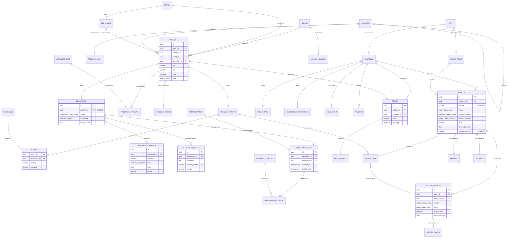

СУБД: **PostgreSQL 16**. Схема получена из
[диаграмм классов предметной области](lab3/README.md#45-диаграммы-классов-и-объектов)
и содержит **40 таблиц** и **13 перечисляемых типов**.

- **SQL-файл:** `database/schema.sql`
- **Изображение ERD:** [`04-erd.png`](lab3/diagrams/img/04-erd.png)
- **Исходник PlantUML:** [`04-erd.puml`](lab3/diagrams/04-erd.puml)

Схема проверена применением к чистому экземпляру PostgreSQL 16: все таблицы, типы,
ограничения и индексы создаются без ошибок.

---

## Диаграмма «сущность-связь»

На диаграмме показаны ключевые таблицы со столбцами; полный перечень из 40 таблиц — в
SQL-файле `database/schema.sql`.

---

## Группы таблиц

| Группа | Таблицы | Назначение |
|--------|---------|------------|
| Справочники | `city`, `brand`, `category`, `attribute_dict`, `category_required_attribute` | Иерархия категорий, бренды, состав обязательных атрибутов |
| Каталог | `seller`, `product`, `product_variant`, `warehouse`, `stock`, `product_attribute`, `product_photo`, `size_chart` | Товары, варианты по размеру и цвету, остатки, атрибуты |
| Описания | `description`, `description_version`, `description_claim`, `prompt_template`, `generation_rule` | Описания, версии, обоснование утверждений, шаблоны промптов, правила |
| Модерация | `administrator`, `moderation_task`, `moderation_decision`, `comment_template`, `seller_violation`, `complaint` | Очередь, решения, нарушения, жалобы |
| Покупатели | `customer`, `size_params`, `customer_preferences`, `view_event`, `favorite`, `recommendation_block` | Профиль, параметры размера, поведение, персонализация |
| Заказы | `orders`, `order_item`, `payment`, `delivery`, `pickup_point` | Заказ, позиции, оплата, доставка |
| Возвраты | `return_request`, `return_photo`, `return_policy` | Заявки, фотографии, правила возврата |
| Отзывы | `review`, `review_photo` | Отзывы с оценкой посадки |

---

## Ключевые решения по схеме

| № | Решение | Обоснование |
|---|---------|-------------|
| 1 | `description.product_id` имеет ограничение уникальности | У товара не более одного описания; версии вынесены в отдельную таблицу |
| 2 | Версии и обоснования удаляются каскадно вместе с описанием | Композиция доменной модели переходит в `ON DELETE CASCADE` |
| 3 | Перечисления домена отображены в `ENUM`-типы, а не `varchar` | Проверка допустимых значений переносится на уровень БД |
| 4 | `stock` имеет составной первичный ключ «вариант + склад» | Один вариант хранится на нескольких складах с разными остатками |
| 5 | `stock.reserved` отделён от `quantity`, добавлено ограничение `reserved <= quantity` | Резерв при оформлении заказа не искажает фактический остаток |
| 6 | `order_item.price_at_order` хранит цену на момент заказа | Цена товара меняется, сумма оформленного заказа — нет |
| 7 | `orders.return_due_date` фиксируется при создании заказа | Изменение правил возврата не ухудшает условия уже оформленных заказов |
| 8 | `orders.idempotency_key` уникален | Повторная отправка запроса не создаёт второй заказ |
| 9 | `return_request` ссылается и на заказ, и на позицию | Поддержка частичного возврата |
| 10 | `generation_rule` не связана внешним ключом с описаниями | Правила применяются алгоритмом при проверке текста |
| 11 | Таблица называется `orders`, а не `order` | `order` — зарезервированное слово SQL |
| 12 | Пароли и секреты в схеме отсутствуют | Аутентификация вынесена в отдельный сервис |

---

## Индексы

Созданы только индексы, необходимые для выполнения требований к производительности:

| Индекс | Требование |
|--------|------------|
| `idx_task_open` (частичный, по незахваченным задачам) | ФТ-9.1 — сортировка очереди модерации |
| `idx_review_product_fit` | ФТ-4.4 — агрегация оценок посадки для ассистента по размеру |
| `idx_view_event_customer` | ФТ-1.1 — формирование персонализированной ленты |
| `idx_orders_customer` | ФТ-6.1 — список «Мои заказы» с признаком возврата |
| `idx_description_status`, `idx_version_description` | ФТ-1.2 — отбор опубликованных описаний |

Партиционирование и дополнительные индексы относятся к физической модели и будут определены
по результатам нагрузочного тестирования.
