> **Статус.** Структуры серверной части, веб- и мобильного приложений — **проектируемые**: выведены из
> [диаграммы пакетов](lab3/README.md#49-диаграмма-пакетов),
> [диаграммы компонентов](lab3/README.md#48-диаграмма-компонентов)
> и [ограниченных контекстов](lab3/README.md#53-проектирование-software-design).
> Код ещё не создан; структура уточняется при создании репозиториев приложений.

---

## 1. Проектируемая структура серверной части

Структура соответствует [диаграмме пакетов](lab3/README.md#49-диаграмма-пакетов)
и принципу чистой архитектуры: зависимости направлены внутрь, доменный слой не зависит ни от
инфраструктуры, ни от интерфейсов.

```mermaid
flowchart TD
    src["src/main/kotlin/by/marketshop/"]

    src --> iface["interfaces/<br/><i>входные точки</i>"]
    src --> app["application/<br/><i>сценарии использования</i>"]
    src --> dom["domain/<br/><i>предметная область</i>"]
    src --> inf["infrastructure/<br/><i>внешние зависимости</i>"]
    src --> cfg["config/<br/><i>сборка приложения</i>"]

    iface --> i1["rest/"]
    iface --> i2["events/"]
    iface --> i3["admin/"]

    app --> a1["catalog/"]
    app --> a2["description/"]
    app --> a3["recommendation/"]
    app --> a4["order/"]
    app --> a5["moderation/"]
    app --> a6["returns/"]

    dom --> d1["catalog/"]
    dom --> d2["description/"]
    dom --> d3["customer/"]
    dom --> d4["order/"]
    dom --> d5["moderation/"]
    dom --> d6["shared/"]

    inf --> f1["persistence/"]
    inf --> f2["llm/"]
    inf --> f3["payment/"]
    inf --> f4["delivery/"]
    inf --> f5["search/"]
    inf --> f6["messaging/"]
    inf --> f7["storage/"]

    classDef core fill:#FDECE3,stroke:#E07A3F,stroke-width:2px
    classDef layer fill:#F2F5FA,stroke:#22304A
    class dom,d1,d2,d3,d4,d5,d6 core
    class iface,app,inf,cfg,i1,i2,i3,a1,a2,a3,a4,a5,a6,f1,f2,f3,f4,f5,f6,f7 layer
```



### Назначение каталогов

| Каталог | Назначение | Правило |
|---------|------------|---------|
| `interfaces/rest` | REST-контроллеры витрины и кабинетов | Не содержит бизнес-логики, только преобразование DTO |
| `interfaces/events` | Подписчики доменных событий из Kafka | Один подписчик — один сценарий приложения |
| `interfaces/admin` | Контроллеры панели администратора | Отдельный префикс маршрутов и проверка роли |
| `application/*` | Сценарии использования, по одному подпакету на домен | Оркестрация, транзакционные границы, порты к инфраструктуре |
| `domain/*` | Сущности, объекты-значения, доменные сервисы | **Не импортирует `infrastructure` и `interfaces`** |
| `domain/shared` | Общие типы: `Money`, идентификаторы, базовые события | Не содержит специфики конкретного домена |
| `infrastructure/persistence` | Репозитории, миграции, отображение на схему БД | Реализует интерфейсы, объявленные в домене |
| `infrastructure/llm` | Клиент внешней языковой модели | Единственное место, знающее о провайдере |
| `infrastructure/payment`, `delivery` | Адаптеры к ЕРИП, эквайрингу и службам доставки | По одному адаптеру на внешнюю систему |
| `config` | Сборка контекста приложения, профили окружений | Единственный слой, знающий обо всех остальных |

**Правило, которое будет проверяться автоматически при сборке:** импорт из
`by.marketshop.infrastructure` или `by.marketshop.interfaces` внутри `by.marketshop.domain`
приводит к падению сборки. Проверка реализуется правилом ArchUnit.

### Сервис генерации описаний (Python)

```
services/generation/
├── app/
│   ├── api/              маршруты FastAPI
│   ├── orchestrator.py   последовательность шагов генерации
│   ├── attributes.py     проверка полноты атрибутов
│   ├── prompt.py         сборка промпта по шаблону категории
│   ├── llm_client.py     вызов внешней модели, таймауты и повторы
│   ├── confidence.py     расчёт уровня уверенности
│   ├── rules.py          детерминированная проверка формулировок
│   ├── summary.py        формирование краткой версии описания
│   └── publisher.py      публикация событий в Kafka
├── tests/
└── pyproject.toml
```

Соответствует [диаграмме компонентов C4 уровня 3](lab3/README.md#73-уровень-3--компоненты-сервиса-генерации-описаний).

---

## 2. Проектируемая структура веб-приложения

```
src/
├── app/                маршрутизация, провайдеры, настройка запросов
├── pages/              страницы: главная, каталог, товар, корзина,
│                       оформление, мои заказы, кабинет продавца, админ-панель
├── widgets/            составные блоки: лента рекомендаций, карточка товара,
│                       ассистент по размеру, очередь модерации
├── features/           сценарии: добавить в корзину, подобрать размер,
│                       оформить возврат, одобрить карточку
├── entities/           модели предметной области и их представления
└── shared/             UI-кит, API-клиент, типы, хелперы
```

Структура соответствует разделению на функциональные группы из информационной
архитектуры: каждая функциональная группа — отдельная
страница или виджет.

---

## 3. Проектируемая структура мобильного приложения

```
app/
├── ui/
│   ├── feed/           лента рекомендаций (главный экран)
│   ├── catalog/        каталог и фильтры (bottom sheet)
│   ├── product/        карточка товара и ассистент по размеру
│   ├── cart/           корзина и оформление заказа
│   ├── orders/         мои заказы, статус доставки, возвраты
│   └── profile/        профиль и параметры размера
├── data/
│   ├── remote/         клиент REST API
│   ├── local/          офлайн-кэш корзины и просмотренных товаров
│   └── repository/     объединение источников данных
└── domain/             модели и сценарии использования
```

Нижняя навигация из пяти пунктов (Главная, Поиск, Избранное, Корзина, Профиль) соответствует
структуре каталога `ui/`.
