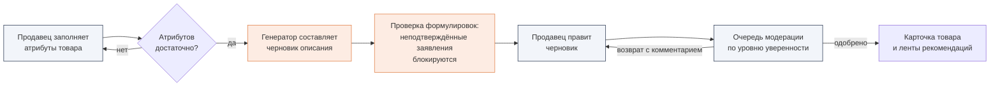
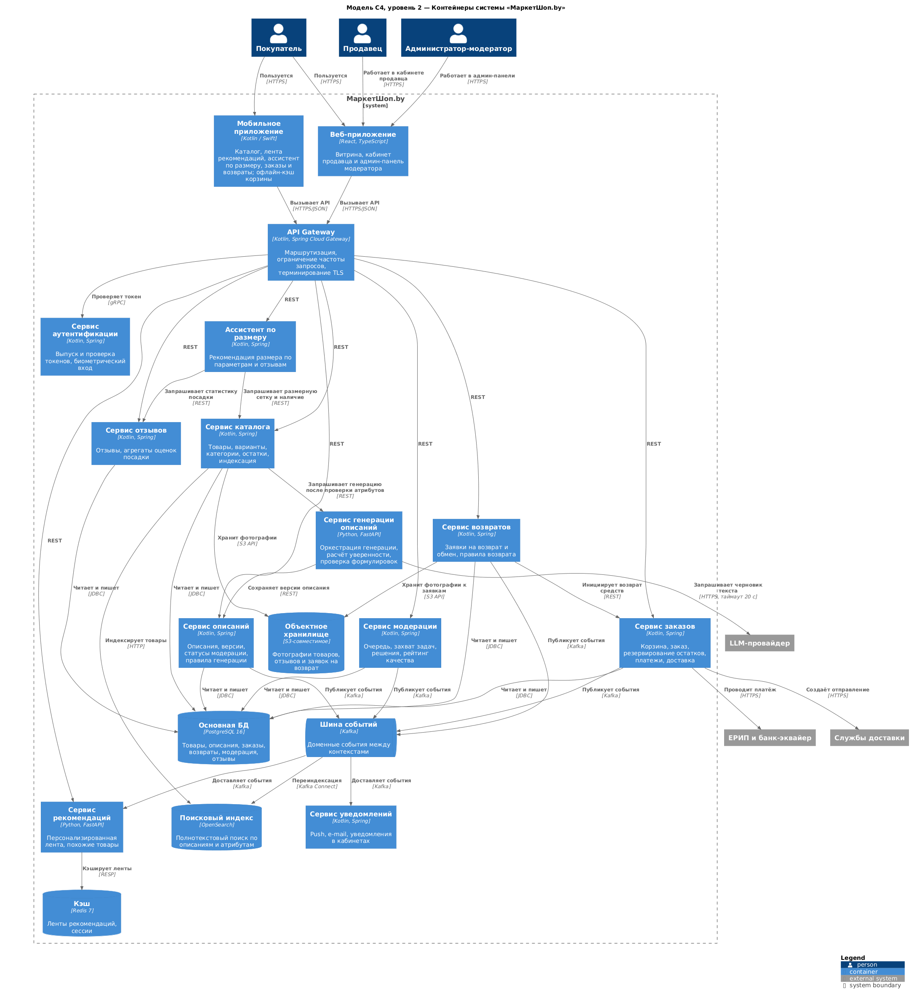

**МаркетШоп.by** — веб- и мобильное приложение маркетплейса одежды и обуви для Республики
Беларусь. Его ключевая особенность — модуль, который **автоматически составляет описание
товара** из структурированных атрибутов (материал, крой, размерная сетка бренда, сезон, уход,
страна производства), проверяет каждое утверждение и **не пропускает неподтверждённые
заявления о качестве**. Одно и то же описание используется в карточке товара и в
персональных рекомендациях «Специально для вас» и «Похожие товары».

Главный экран приложения на пяти устройствах — из <a href="design.html">интерактивного прототипа</a>

---

## Проблема

Покупатели в Беларуси при выборе одежды онлайн видят однотипные описания, скопированные у
поставщика. Из них нельзя понять посадку, состав ткани и соответствие размерной сетке
конкретного бренда. Отсюда возвраты и недоверие к площадке. Небольшим белорусским
производителям нечем ответить: у них нет ресурсов на контент-команду.

Проблему подтвердил опрос 46 респондентов:

  
<h4>60,9%</h4>
сталкивались с несоответствием описания товара реальности

  
<h4>39,1%</h4>
называют сложности с возвратом и обменом главным барьером покупки

  
<h4>4,33 из 5</h4>
средняя важность достоверного описания

  
<h4>82,6%</h4>
покупают со смартфона, поэтому мобильная платформа приоритетна

  
<h4>73,9%</h4>
заинтересованы в персональных рекомендациях

  
<h4>58,7%</h4>
покупают вечером, поэтому тёмная тема обязательна

---

## Решение

Продавец заполняет атрибуты и получает готовый черновик вместо пустого поля. Модератор
проверяет не все тексты подряд, а сначала те, в которых генератор менее уверен. Покупатель
видит описание, где каждое утверждение подкреплено атрибутом, и рекомендацию размера с
пояснением о посадке.

### Ключевые возможности

| Для кого | Возможность | История |
|----------|-------------|---------|
| Покупатель | Персонализированная лента рекомендаций | [US-01](user-stories.html) |
| Покупатель | Достоверное описание в карточке, выше кнопки «В корзину» | [US-02](user-stories.html) |
| Покупатель | Рекомендация размера с пояснением о посадке | [US-03](user-stories.html) |
| Покупатель | Возврат или обмен в два-три шага | [US-11](user-stories.html) |
| Продавец | Автоматический черновик описания и подсказка о недостающих атрибутах | [US-05, US-06](user-stories.html) |
| Администратор | Очередь модерации по уверенности генератора | [US-08](user-stories.html) |
| Администратор | Блокировка неподтверждённых заявлений о качестве | [US-09](user-stories.html) |
| Покупатель | Фильтр и отметка «Сделано в Беларуси» | [US-13](requirements.html#пользовательские-истории) |

Полный перечень — на страницах [Функциональные требования](requirements.html) и
[Пользовательские истории](user-stories.html).

---

## Пользователи

| Роль | Персонаж | Цель | Платформа |
|------|----------|------|-----------|
| Покупатель | Анастасия, 27 лет, маркетолог | Быстро найти подходящую вещь и не ошибиться с покупкой | Мобильная, веб |
| Покупатель-новичок | Ольга Петровна, 48 лет, бухгалтер | Не ошибиться с размером при заказе онлайн | Мобильная, веб |
| Продавец | Виктор, 34 года, совладелец ИП | Опубликовать коллекцию без копирайтера | Веб |
| Администратор-модератор | Марина, 31 год | Проверять поток карточек и отклонять недостоверные описания | Веб |
| Анти-персонаж | «Бот-перекупщик» | Замаскировать некачественный товар привлекательным описанием | — |

Система генерации описаний выступает как отдельный автоматизированный актор. Покупатель
работает на обеих платформах, кабинеты продавца и модератора есть только в веб-версии:
это долгие сессии с большим объёмом текста. Отличия платформ сведены в таблицу
[«Платформенные особенности»](user-stories.html#платформенные-особенности).

---

## Архитектура

| Слой | Решение |
|------|---------|
| Клиенты | Веб-приложение (TypeScript, React) с кабинетами продавца и модератора; мобильные приложения (Kotlin — Android, Swift — iOS) |
| Прикладные сервисы | Kotlin: каталог, заказы, возвраты, модерация, рекомендации |
| Генерация описаний | Отдельный сервис на Python; во внешний LLM-провайдер передаются только атрибуты товара, без персональных данных |
| Данные | PostgreSQL 16 — транзакции, Redis — кэш лент, OpenSearch — поиск, S3 — изображения |
| Интеграция | Kafka — шина доменных событий; адаптеры ЕРИП, банка-эквайера и служб доставки |

Подробнее: [схема базы данных](database.html), [API](api.html), [структура файлов](files.html).

---

## Статус

| Этап | Состояние |
|------|-----------|
| Исследование пользователей и предметной области | Завершено |
| Информационная архитектура и сценарии взаимодействия | Завершены |
| Требования, модель предметной области, архитектура, техническое задание | Завершены |
| Схема базы данных и контракт API | Спроектированы |
| Визуальный язык, адаптивные макеты, интерактивный прототип | Готовы |
| Юзабилити-тестирование прототипа | В работе |
| Реализация серверной части, веб- и мобильного приложения | В работе |

---

## Команда

| Участник | Роль |
|----------|------|
| Степук Анастасия | Тимлид, аналитик, дизайнер |
| Харченко Анастасия | Аналитик, архитектор |
| Шепко Варвара | Аналитик, проектировщик взаимодействия |

Распределение задач — на странице [Презентация проекта](presentation.html#3-распределение-задач-в-команде).
