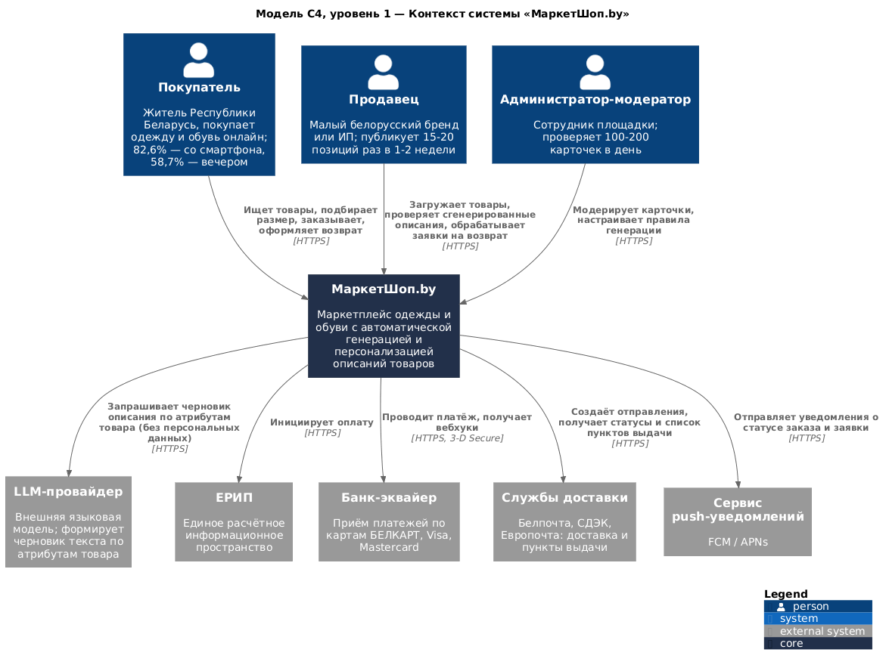

# МаркетШоп.by

**Маркетплейс одежды и обуви для Республики Беларусь с автоматической генерацией и
персонализацией описаний товаров**

Учебный проект по курсу «Проектирование человеко-машинных интерфейсов» 
Белорусский государственный университет · ФПМИ 
Группа 10/12· 2026

---

## О продукте

Жители Республики Беларусь при выборе одежды и обуви онлайн сталкиваются с однотипными,
часто скопированными у поставщика описаниями товаров, которые не отражают реальных
характеристик вещи. По результатам опроса 46 респондентов:

| Показатель | Значение |
|------------|----------|
| Сложности с возвратом и обменом как барьер покупки | **39,1%** |
| Невозможность примерить | 28,3% |
| Сталкивались с несоответствием описания реальности | **60,9%** |
| Важность достоверного описания (шкала 1–5) | **4,33** |
| Заинтересованы в персональных рекомендациях | **73,9%** |
| Покупают со смартфона | **82,6%** |

Проектируемая система формирует описание товара автоматически — из структурированных
атрибутов, с проверкой достоверности каждого утверждения и блокировкой неподтверждённых
заявлений о качестве. Описание используется и в карточке товара, и в персонализированных
рекомендательных блоках.

---

## Документация проекта

### Лабораторная работа №1 — Исследование пользователей и предметной области

Анализ конкурентов, опрос пользователей, профили пользователей, задач и среды, синтез
шести персонажей, контекстные сценарии, объектная модель, стратегия дизайна, бизнес-процессы
As-Is.

[Открыть отчёт (DOCX)](ЛабРабота1_ПЧМИ.docx)

### Лабораторная работа №2 — Информационная архитектура и взаимодействие

Сверка решений с данными опроса, системы организации контента, именования, навигации и
поиска, карта сайта, навигационные модели, карта влияния, карты пути клиента, интерактивные
раскадровки, дизайн-макеты.

[Открыть отчёт (PDF)](ЛабРабота2_ПЧМИ.pdf)

### Лабораторная работа №3 — Требования к программной системе

Пользовательские истории с критериями приёмки, диаграммы UML на PlantUML и Mermaid,
применение ИИ-агентов, Event Storming, Event Modeling, архитектура по модели C4 и
техническое задание по шаблону SRS.

[Открыть отчёт (PDF)](ЛабРабота3_ПЧМИ.pdf)

| Задание | Документ |
|---------|----------|
| 1 | [Пользовательские истории](lab3/README.md#задание-1-разработка-требований-в-виде-пользовательских-историй-user-story) |
| 2 | [Спецификация на PlantUML](lab3/README.md#задание-2-разработка-спецификации-системы-с-использованием-plantuml) |
| 3 | [Спецификация на Mermaid](lab3/README.md#задание-3-разработка-спецификации-системы-с-использованием-mermaid) |
| 4 | [PlantUML, Mermaid и ИИ-агенты](lab3/README.md#задание-4-разработка-спецификации-системы-с-использованием-plantuml-mermaid-и-ии-агентов) |
| 5 | [Event Storming](lab3/README.md#задание-5-проектирование-системы-на-основе-метода-event-storming) |
| 6 | [Event Modeling](lab3/README.md#задание-6-проектирование-системы-с-применением-метода-event-modeling) |
| 7 | [Модель C4](lab3/README.md#задание-7-описание-архитектуры-системы-с-использованием-подхода-c4-model) |
| 8 | [Техническое задание (SRS)](lab3/README.md#задание-8-техническое-задание-на-разработку-приложения) |

---

## Архитектура системы

Подробное описание — в разделе [Модель C4](lab3/README.md#задание-7-описание-архитектуры-системы-с-использованием-подхода-c4-model).

---

## Команда

| Участник | Роль |
|----------|------|
| Харченко Анастасия | Аналитик, архитектор |
| Шепко Варвара | Аналитик, проектировщик взаимодействия |
| Степук Анастасия | Тимлид, аналитик, дизайнер |

---

## Ссылки

- [Репозиторий проекта на GitHub](https://github.com/fpmi-hci-2026/hci-10-project-group-1)
