# Лабораторная работа №3. Разработка требований к программной системе

**Курс:** Проектирование человеко-машинных интерфейсов
**Тема проекта:** сервис автоматической генерации описаний товаров в рекомендательной системе
маркетплейса одежды и обуви (Республика Беларусь)
**Выполнили:** Харченко Анастасия, Шепко Варвара, Степук Анастасия
**Минск, 2026**

---

## Цели работы

1. Разработать функциональные и нефункциональные требования к проектируемой системе.
2. Спроектировать архитектуру системы с использованием модели C4.
3. Разработать требования и архитектуру на основе диаграмм UML средствами PlantUML и Mermaid.
4. Применить методы Event Storming и Event Modeling для проектирования предметной области.
5. Освоить применение ИИ-агентов для разработки спецификации и научиться верифицировать
   полученные от них артефакты.

---

## Структура отчёта

| Задание | Раздел | Содержание |
|---------|--------|------------|
| 1 | [Пользовательские истории](#задание-1-разработка-требований-в-виде-пользовательских-историй-user-story) | 20 User Story с критериями приёмки, приоритетами и зависимостями; платформенные особенности; Gherkin-спецификации |
| 2 | [Спецификация в PlantUML](#задание-2-разработка-спецификации-системы-с-использованием-plantuml) | Диаграммы вариантов использования, деятельности и классов — разработаны без ИИ-агентов |
| 3 | [Спецификация в Mermaid](#задание-3-разработка-спецификации-системы-с-использованием-mermaid) | Те же модели средствами Mermaid + диаграмма последовательности; сравнение языков |
| 4 | [PlantUML, Mermaid и ИИ-агенты](#задание-4-разработка-спецификации-системы-с-использованием-plantuml-mermaid-и-ии-агентов) | Библиотека из 11 промптов, детальные сценарии вариантов использования, расширение набора User Story, полный набор диаграмм на обоих языках |
| 5 | [Event Storming](#задание-5-проектирование-системы-на-основе-метода-event-storming) | Big Picture, Process Modeling, Software Design: агрегаты и ограниченные контексты |
| 6 | [Event Modeling](#задание-6-проектирование-системы-с-применением-метода-event-modeling) | Четыре шаблона, модели двух процессов, 25 слайсов |
| 7 | [Модель C4](#задание-7-описание-архитектуры-системы-с-использованием-подхода-c4-model) | Контекст, контейнеры, компоненты, код; трассируемость архитектурных решений |
| 8 | [Техническое задание (SRS)](#задание-8-техническое-задание-на-разработку-приложения) | Спецификация требований по шаблону Вигерса и Битти |

Исходники диаграмм — [`diagrams/`](diagrams/), отрисованные изображения — [`diagrams/img/`](diagrams/img/).

---

## Задание 1. Разработка требований в виде пользовательских историй (User Story)

> Пользовательские истории этого раздела составлены **самостоятельно, без использования
> ИИ-агентов** — согласно требованию методических указаний. Расширение и уточнение набора
> с помощью ИИ-агентов выполнено отдельно в [задании 4](#44-расширение-набора-user-story).

---

### 1.1. Краткое описание приложения и ролей пользователей

**МаркетШоп.by** — веб- и мобильное приложение маркетплейса одежды и обуви для Республики
Беларусь, ключевой особенностью которого является модуль автоматической генерации текстовых
описаний товаров и их персонализации под конкретного покупателя. Описание формируется из
структурированных атрибутов товара (материал, крой, размерная сетка бренда, сезон, уход,
страна производства), проверяется продавцом и проходит модерацию, после чего используется
и в карточке товара, и в рекомендательных блоках («Специально для вас», «Похожие товары»).

В системе выделены четыре роли. **Покупатель** ищет товар через каталог, поиск и
персонализированную ленту, подбирает размер, оформляет заказ и при необходимости возврат.
**Продавец** (малый белорусский бренд или ИП) загружает товар с атрибутами, получает от
системы черновик описания, правит его и отправляет на модерацию. **Администратор-модератор**
проверяет карточки и сгенерированные тексты, приоритизируя их по уровню уверенности
генератора, и управляет правилами генерации. **Система генерации** выступает как
автоматизированный актор: формирует черновики описаний, проверяет полноту атрибутов и
блокирует публикацию неподтверждённых заявлений о качестве.

Соответствие ролей персонажам из ЛР№1: Покупатель — Анастасия (ключевой) и Ольга Петровна
(дополнительный); Продавец — Виктор (ключевой); Администратор — Марина (вспомогательный);
против роли Продавца работает анти-персонаж «Бот-перекупщик».

---

### 1.2. Ключевые сценарии использования

Для разработки требований отобрано **пять ключевых сценариев**, покрывающих разные роли и
обе платформы. Выбор сценариев обоснован результатами опроса (46 респондентов, ЛР№1–ЛР№2).

| № | Сценарий | Роль (персонаж) | Платформа | Обоснование выбора по данным опроса |
|---|----------|-----------------|-----------|--------------------------------------|
| С1 | Персонализированный подбор товара | Покупатель (Анастасия) | Мобильная (приоритет), веб | 73,9% заинтересованы в персональных рекомендациях; 82,6% покупают со смартфона |
| С2 | Подбор размера перед покупкой | Покупатель-новичок (Ольга Петровна) | Мобильная, веб | «Невозможность примерить» — барьер №2 (28,3%) |
| С3 | Публикация коллекции с автогенерацией описаний | Продавец (Виктор) | Веб | Средняя важность достоверного описания 4,33/5; 60,9% сталкивались с несоответствием |
| С4 | Модерация автосгенерированных описаний | Администратор (Марина) | Веб | 60,9% сталкивались с несоответствием описания реальности |
| С5 | Оформление возврата или обмена | Покупатель (Анастасия, Ольга Петровна) | Мобильная | «Сложности с возвратом/обменом» — барьер №1 (39,1%) |

---

### 1.3. Список User Stories с приоритетами и зависимостями

Приоритет определяется по правилу: **High** — закрывает барьер или потребность, подтверждённую
более чем 25% респондентов, либо блокирует работу других историй; **Medium** — заметно
повышает удобство, но сценарий выполним и без неё; **Low** — оптимизация внутренней работы,
не влияющая на поведение покупателя.

| ID | Сценарий | User Story | Роль | Приоритет | Зависит от |
|----|----------|------------|------|-----------|------------|
| US-01 | С1 | Персонализированная лента рекомендаций | Покупатель | High | US-05 |
| US-02 | С1 | Достоверное описание в карточке товара | Покупатель | High | US-05 |
| US-03 | С2 | Рекомендация размера с пояснением о посадке | Покупатель | High | US-02 |
| US-04 | С2 | Ввод параметров размера без ухода в профиль | Покупатель | Medium | US-03 |
| US-05 | С3 | Автоматический черновик описания товара | Продавец | High | — |
| US-06 | С3 | Подсказка о недостающих атрибутах до генерации | Продавец | High | — |
| US-07 | С3 | Редактор описания с подсказками из отзывов | Продавец | Medium | US-05 |
| US-08 | С4 | Очередь модерации, отсортированная по уверенности | Администратор | High | US-05 |
| US-09 | С4 | Блокировка неподтверждённых заявлений о качестве | Администратор | High | US-06 |
| US-10 | С4 | Шаблонные комментарии при возврате карточки | Администратор | Low | US-08 |
| US-11 | С5 | Оформление возврата в два-три шага | Покупатель | High | — |
| US-12 | С5 | Условия возврата видны до оформления заказа | Покупатель | Medium | US-11 |

#### Зависимости между историями (обоснование)

1. **US-05 должна быть реализована до US-01 и US-08**, потому что и лента рекомендаций, и
   очередь модерации работают с объектом «Описание товара»: пока генератор не создаёт
   черновики, ленте нечего персонализировать, а модератору — нечего проверять.
2. **US-06 должна быть реализована до US-09**, потому что обе истории опираются на один
   функциональный объект «Проверка атрибутов»: сначала он должен уметь определять полноту
   атрибутов (US-06), и только затем — распознавать и блокировать запрещённые формулировки (US-09).
3. **US-11 должна быть реализована до US-12**, потому что блок «условия и срок возврата» в
   карточке и на экране оформления заказа читает те же правила возврата, которые задаются
   при создании процесса заявки.

---

### 1.4. Пользовательские истории и критерии приёмки

---

#### US-01. Персонализированная лента рекомендаций

> **Как** покупатель, который заходит в приложение вечером без конкретной цели,
> **я хочу** видеть на главной подборку товаров, подобранную под мой размер, стиль и сезон,
> **чтобы** не перебирать каталог вручную и быстрее находить подходящие вещи.

**Приоритет: High.** Персонализированные рекомендации — единственная функция, которую
положительно оценили 34 из 46 респондентов (73,9%); лента является содержанием главного
экрана, то есть первым, что видит 82,6% мобильной аудитории.

**Критерии приёмки:**

| № | Критерий |
|---|----------|
| AC-01.1 | При открытии главного экрана авторизованным покупателем лента содержит не менее 12 карточек, каждая из которых подходит хотя бы под один сохранённый параметр профиля (размер, любимая категория, сезон). |
| AC-01.2 | У каждой карточки ленты выводится краткое описание товара (summary) длиной не более 90 символов, сформированное из того же черновика, что и полное описание карточки. |
| AC-01.3 | Для неавторизованного покупателя лента формируется по обезличенной истории просмотров текущего устройства и не содержит обращения по имени. |
| AC-01.4 | Лента обновляется жестом pull-to-refresh; время до отрисовки первых карточек не превышает 2 с при 4G-соединении. |
| AC-01.5 | Товары со статусом описания, отличным от «Опубликовано», в ленте не показываются. |
| AC-01.6 | Добавление карточки в избранное из ленты не приводит к перезагрузке ленты и не меняет позиции остальных карточек. |
| AC-01.7 | Если персонализирующих данных недостаточно (новый пользователь, нет истории), лента заполняется популярными товарами региона покупателя, а над ней выводится блок «Расскажите о своих размерах» со ссылкой на профиль. |

---

#### US-02. Достоверное описание в карточке товара

> **Как** покупатель, выбирающий вещь по фотографии,
> **я хочу** видеть в карточке описание с явным указанием состава ткани, посадки и правил ухода,
> **чтобы** принять решение о покупке, не задавая вопрос продавцу и не рискуя возвратом.

**Приоритет: High.** Средняя оценка важности подробного и достоверного описания — 4,33 из 5
(оценку «5» поставили 22 из 46 респондентов, оценок «1» нет); 60,9% сталкивались с
несоответствием описания реальности.

**Критерии приёмки:**

| № | Критерий |
|---|----------|
| AC-02.1 | Блок описания размещён выше кнопки «В корзину» и виден без горизонтальной прокрутки на экране шириной 375 px. |
| AC-02.2 | Описание содержит обязательные подблоки: «Состав», «Посадка», «Уход», «Размерная сетка бренда»; отсутствующий подблок не отображается пустым, а заменяется строкой «Продавец не указал». |
| AC-02.3 | Все фактические утверждения описания восстановимы из атрибутов товара: при открытии технической панели проверки каждое утверждение сопоставляется с атрибутом-источником. |
| AC-02.4 | В описании отсутствуют формулировки из списка запрещённых («лучший», «100% не сядет», «не вызывает аллергии» и т. п.). |
| AC-02.5 | Если в описании нет подблока «Уход», в карточке появляется кнопка «Вопрос продавцу», открывающая чат с преднастроенной темой. |
| AC-02.6 | Термины генерации (NLP, LLM, «ИИ-описание») в интерфейсе покупателя не отображаются ни в одном месте карточки. |
| AC-02.7 | Полное описание карточки и краткое summary рекомендательного блока формируются из одной версии черновика: при изменении описания обе версии обновляются одновременно. |

---

#### US-03. Рекомендация размера с пояснением о посадке

> **Как** покупатель, который боится ошибиться с размером при заказе онлайн,
> **я хочу** получить рекомендацию конкретного размера с пояснением, маломерит модель или большемерит,
> **чтобы** заказать нужный размер с первого раза и не оформлять возврат.

**Приоритет: High.** «Невозможность примерить» — второй по частоте барьер (28,3%), а
сложность возврата — первый (39,1%); ассистент по размеру закрывает причину, а не следствие.

**Критерии приёмки:**

| № | Критерий |
|---|----------|
| AC-03.1 | Блок «Ассистент по размеру» встроен в карточку товара и не требует перехода на отдельный экран. |
| AC-03.2 | При наличии в профиле параметров покупателя рекомендация отображается сразу, без дополнительных действий. |
| AC-03.3 | Рекомендация содержит номер размера и пояснение в терминах «маломерит / большемерит» с указанием величины отклонения (например, «маломерит на полразмера»). |
| AC-03.4 | Пояснение о посадке формируется только при наличии не менее 5 отзывов с оценкой посадки либо явно заданной размерной сетки бренда; иначе выводится «Данных о посадке пока недостаточно». |
| AC-03.5 | Рекомендованный размер автоматически подставляется в селектор размера, но остаётся доступным для ручного изменения покупателем. |
| AC-03.6 | Текст рекомендации не содержит профессиональных синонимов «ростовка», «размерная сетка» — используется единый термин «размер». |
| AC-03.7 | Если рекомендованного размера нет в наличии, выводится ближайший доступный с явной пометкой «Рекомендованного размера 39 нет в наличии». |

---

#### US-04. Ввод параметров размера без ухода в профиль

> **Как** покупатель, впервые пользующийся ассистентом по размеру,
> **я хочу** ввести свои параметры прямо в карточке товара короткой формой,
> **чтобы** не прерывать выбор товара переходом в настройки профиля.

**Приоритет: Medium.** История повышает конверсию ассистента, но сценарий US-03 выполним и
без неё — через заполнение профиля. Выявлена проверочным сценарием персонажа
«Ольга Петровна» (ЛР№2, раздел 5.1).

**Критерии приёмки:**

| № | Критерий |
|---|----------|
| AC-04.1 | Если параметры размера в профиле не заданы, блок «Ассистент по размеру» показывает форму из не более чем трёх полей. |
| AC-04.2 | Форма открывается поверх карточки (bottom sheet на мобильном, модальное окно в вебе) и не выгружает карточку из памяти — после закрытия позиция прокрутки сохраняется. |
| AC-04.3 | Введённые параметры сохраняются в профиль покупателя и используются при следующем открытии любой карточки. |
| AC-04.4 | Для неавторизованного покупателя параметры сохраняются локально на устройстве и переносятся в профиль при регистрации. |
| AC-04.5 | Рекомендация пересчитывается и отображается не более чем через 1 с после отправки формы, без перезагрузки карточки. |
| AC-04.6 | Поля формы снабжены подсказками с единицами измерения; ввод нечислового значения блокируется с сообщением об ошибке рядом с полем. |

---

#### US-05. Автоматический черновик описания товара

> **Как** продавец малого бренда, у которого нет бюджета на копирайтера,
> **я хочу**, чтобы система сформировала черновик описания по заполненным мной атрибутам,
> **чтобы** опубликовать коллекцию из 15–20 позиций за один заход.

**Приоритет: High.** Это ключевая функция продукта и предпосылка для US-01, US-02 и US-08;
без неё теряется конкурентное преимущество, выявленное в анализе конкурентов (ЛР№1).

**Критерии приёмки:**

| № | Критерий |
|---|----------|
| AC-05.1 | После сохранения атрибутов товара черновик описания формируется автоматически, без отдельного нажатия «Сгенерировать». |
| AC-05.2 | Черновик формируется для партии из 20 позиций не дольше 60 с; по каждой позиции отображается индивидуальный статус. |
| AC-05.3 | Каждый черновик сопровождается уровнем уверенности генератора («высокая» / «средняя» / «низкая»), видимым продавцу. |
| AC-05.4 | Черновик содержит только утверждения, выводимые из заполненных атрибутов; атрибут, не заполненный продавцом, не упоминается в тексте. |
| AC-05.5 | Из одного черновика формируются две версии: полная для карточки товара и краткое summary для рекомендательного блока и результатов поиска. |
| AC-05.6 | Повторная генерация по тем же атрибутам даёт текст, не противоречащий предыдущему по фактам (состав, посадка, сезон). |
| AC-05.7 | Все версии черновика сохраняются в истории: продавец может сравнить текущий текст с предыдущим и откатиться. |

---

#### US-06. Подсказка о недостающих атрибутах до генерации

> **Как** продавец, загружающий новую позицию,
> **я хочу** видеть перечень незаполненных обязательных атрибутов до того, как будет создан черновик,
> **чтобы** не публиковать описание, в котором пропущены существенные для покупателя сведения.

**Приоритет: High.** Выявлена сценарием-исключением персонажа «Виктор» (ЛР№1, раздел 10.2):
при неполных атрибутах система не должна генерировать правдоподобный, но недостоверный текст.

**Критерии приёмки:**

| № | Критерий |
|---|----------|
| AC-06.1 | При отсутствии хотя бы одного обязательного атрибута генерация черновика не запускается. |
| AC-06.2 | Вместо черновика выводится список недостающих полей с указанием названия каждого поля, а не общего сообщения об ошибке. |
| AC-06.3 | Каждый пункт списка является ссылкой, устанавливающей фокус на соответствующем поле формы загрузки. |
| AC-06.4 | Обязательными считаются: категория, материал, размерная сетка, сезон, страна производства; состав списка задаётся администратором и применяется без пересборки приложения. |
| AC-06.5 | После заполнения недостающих полей генерация запускается автоматически, без повторного открытия формы. |
| AC-06.6 | При загрузке партии позиции с неполными атрибутами помечаются в списке отдельным статусом и не блокируют генерацию для остальных позиций партии. |

---

#### US-07. Редактор описания с подсказками из отзывов

> **Как** продавец, проверяющий черновик,
> **я хочу** видеть рядом с текстом подсказки из отзывов прошлых покупателей о посадке,
> **чтобы** уточнить описание и снизить вероятность возврата.

**Приоритет: Medium.** Повышает качество текста, но публикация возможна и без подсказок;
по данным опроса вклад описания в отказ от покупки (13,0%) ниже, чем вклад возврата (39,1%).

**Критерии приёмки:**

| № | Критерий |
|---|----------|
| AC-07.1 | Редактор открывается на том же экране, что и список товаров, без перехода на отдельную страницу. |
| AC-07.2 | Справа от текста выводятся агрегированные оценки посадки из отзывов по этому товару и по предыдущим моделям того же бренда. |
| AC-07.3 | Подсказка показывается только при наличии не менее 5 отзывов с оценкой посадки. |
| AC-07.4 | Правка продавца сохраняется как новая версия описания; исходный черновик генератора остаётся доступным. |
| AC-07.5 | При сохранении правки система повторно проверяет текст на запрещённые формулировки и подсвечивает их до отправки на модерацию. |
| AC-07.6 | Доля изменённых продавцом символов фиксируется в метрике «описание принято без существенных правок» (целевое значение — не менее 70% карточек). |

---

#### US-08. Очередь модерации, отсортированная по уверенности

> **Как** модератор, обрабатывающий 100–200 карточек в день,
> **я хочу** видеть очередь, отсортированную по уровню уверенности генератора,
> **чтобы** в первую очередь проверять тексты с наибольшим риском недостоверности.

**Приоритет: High.** Качество контента — критичная для доверия к площадке функция; целевое
среднее время модерации одной карточки по стратегии дизайна (ЛР№1) — не более 2 минут.

**Критерии приёмки:**

| № | Критерий |
|---|----------|
| AC-08.1 | По умолчанию очередь отсортирована по возрастанию уровня уверенности: карточки с низкой уверенностью — первыми. |
| AC-08.2 | Карточки с низкой уверенностью визуально выделены и отличимы без опоры только на цвет (есть текстовая метка). |
| AC-08.3 | На экране проверки текст описания, фотографии и заявленные атрибуты видны одновременно, без переключения вкладок. |
| AC-08.4 | Решение «Одобрить» или «Вернуть продавцу» доступно с клавиатуры горячими клавишами. |
| AC-08.5 | Пакетное одобрение доступно только для карточек с высокой уверенностью генератора. |
| AC-08.6 | После решения модератора следующая карточка очереди открывается автоматически. |
| AC-08.7 | Карточка, взятая в работу одним модератором, недоступна для решения другому до освобождения или истечения таймаута. |

---

#### US-09. Блокировка неподтверждённых заявлений о качестве

> **Как** модератор, отвечающий за достоверность контента площадки,
> **я хочу**, чтобы система блокировала публикацию описаний с неподтверждёнными заявлениями о качестве,
> **чтобы** недобросовестный продавец не маскировал некачественный товар привлекательным текстом.

**Приоритет: High.** Требование сформулировано на основе анти-персонажа «Бот-перекупщик»
(ЛР№1, раздел 9.6) и прямо следует из ограничения стратегии дизайна: генератор не должен
формулировать непроверяемые заявления о качестве.

**Критерии приёмки:**

| № | Критерий |
|---|----------|
| AC-09.1 | При обнаружении формулировки из списка запрещённых карточка получает статус «Заблокировано до правки» и не может быть опубликована ни продавцом, ни модератором. |
| AC-09.2 | Заблокированная карточка выводится в очереди модерации отдельным блоком над остальными, с указанием найденной формулировки. |
| AC-09.3 | Найденная формулировка подсвечивается непосредственно в тексте описания. |
| AC-09.4 | Список запрещённых формулировок редактируется администратором в разделе «Правила генерации» и применяется к новым проверкам сразу после сохранения. |
| AC-09.5 | Снятие блокировки возможно только после изменения текста; повторная проверка запускается автоматически при сохранении. |
| AC-09.6 | Для продавца, у которого за 30 дней заблокировано более трёх карточек, создаётся запись о повторном нарушении в разделе «Жалобы». |

---

#### US-10. Шаблонные комментарии при возврате карточки

> **Как** модератор, возвращающий карточку продавцу,
> **я хочу** выбрать готовый шаблон комментария и при необходимости дополнить его,
> **чтобы** не набирать вручную одно и то же пояснение по типовым отказам.

**Приоритет: Low.** Экономит время модератора, но не меняет поведение покупателя и продавца
и не влияет на измеримые критерии успешности проекта.

**Критерии приёмки:**

| № | Критерий |
|---|----------|
| AC-10.1 | При выборе действия «Вернуть продавцу» предлагается список из не менее 5 шаблонов комментариев. |
| AC-10.2 | Выбранный шаблон подставляется в редактируемое поле и может быть дополнен произвольным текстом. |
| AC-10.3 | Возврат карточки без комментария невозможен: кнопка подтверждения неактивна при пустом поле. |
| AC-10.4 | Комментарий отображается продавцу в кабинете рядом с возвращённой карточкой и сохраняется в истории карточки. |
| AC-10.5 | Набор шаблонов редактируется администратором без участия разработчиков. |

---

#### US-11. Оформление возврата в два-три шага

> **Как** покупатель, получивший товар, который не подошёл,
> **я хочу** оформить возврат или обмен из раздела «Мои заказы» за два-три шага,
> **чтобы** не обращаться в поддержку и не разбираться в правилах самостоятельно.

**Приоритет: High.** Закрывает барьер №1 по данным опроса: сложности с возвратом и обменом
назвали 18 из 46 респондентов (39,1%) — чаще любой другой причины отказа от онлайн-покупки.

**Критерии приёмки:**

| № | Критерий |
|---|----------|
| AC-11.1 | Переход к оформлению возврата доступен из «Мои заказы» и со страницы статуса доставки — не более чем в один тап от списка заказов. |
| AC-11.2 | Полный путь от списка заказов до подтверждённой заявки содержит не более трёх экранов. |
| AC-11.3 | Причина возврата выбирается из списка; вариант «товар не соответствует описанию» фиксируется отдельным кодом для отчётности. |
| AC-11.4 | Прикрепление фотографий необязательно для всех причин, кроме «брак» и «товар не соответствует описанию». |
| AC-11.5 | После подтверждения заявки покупателю показывается адрес пункта приёма и срок, в течение которого нужно сдать товар. |
| AC-11.6 | Статус заявки отслеживается в том же разделе, а его изменение сопровождается push-уведомлением. |
| AC-11.7 | Оформление заявки не требует обращения в поддержку: целевой показатель — не менее 80% заявок, созданных без обращения. |

---

#### US-12. Условия возврата видны до оформления заказа

> **Как** покупатель, который опасается, что вернуть товар будет сложно,
> **я хочу** видеть условия и срок возврата ещё в карточке товара и на экране оформления заказа,
> **чтобы** решиться на покупку, зная заранее, что я смогу вернуть вещь.

**Приоритет: Medium.** Снимает тревогу, зафиксированную в CJM Анастасии и Ольги Петровны
(ЛР№2), но не блокирует покупку; реализуется после базового процесса заявки (US-11).

**Критерии приёмки:**

| № | Критерий |
|---|----------|
| AC-12.1 | В карточке товара присутствует свёрнутый блок «Возврат и обмен» со сроком в днях, видимый без перехода на другую страницу. |
| AC-12.2 | На экране оформления заказа срок возврата выводится рядом с кнопкой подтверждения. |
| AC-12.3 | Текст условий берётся из единого источника правил: изменение правил администратором отражается во всех местах показа. |
| AC-12.4 | Для товаров, не подлежащих возврату по законодательству, вместо срока выводится явное предупреждение. |
| AC-12.5 | Полные правила открываются из блока по ссылке и доступны также из футера веб-версии. |

---

### 1.5. Платформенные особенности

Сводная таблица отличий мобильного и веб-интерфейса по ключевым пунктам. Приоритет мобильной
платформы обоснован данными опроса: 38 из 46 респондентов (82,6%) покупают со смартфона.

| Пункт | Мобильное приложение | Веб-приложение | Истории |
|-------|----------------------|----------------|---------|
| **Экран, сетка** | 375×670 px, сетка 12 колонок (Android) / 8 pt (iOS); карточки в 2 колонки | Монтажная область 1440 px, 12-колоночная сетка Bootstrap; карточки в 4–5 колонок; планшет — 980 px | US-01, US-02 |
| **Навигация** | Нижняя панель из 5 иконок в зоне большого пальца: Главная · Поиск · Избранное · Корзина · Профиль | Шапка из 7 пунктов: Главная · Каталог · Рекомендации · Поиск · Избранное · Корзина · Профиль; хлебные крошки | US-01, US-11 |
| **Фильтры** | Нижняя всплывающая панель (bottom sheet) поверх результатов | Закреплённая боковая панель, видимая одновременно с результатами | US-01 |
| **Жесты** | Свайп карточек в ленте, pull-to-refresh, свайп для удаления из корзины и избранного | Жесты не применяются; те же действия — кнопками и drag-and-drop | US-01 |
| **Ввод параметров размера** | Bottom sheet из трёх полей, клавиатура числового типа | Модальное окно, переход между полями по Tab | US-04 |
| **Камера и датчики** | Поиск по фото и сканирование штрихкода, биометрический вход и подтверждение оплаты | Загрузка файла изображения вместо съёмки; вход по паролю или OAuth | US-01, US-02 |
| **Офлайн-режим** | Кэш корзины, избранного и последних просмотренных карточек; заявка на возврат сохраняется как черновик и отправляется при восстановлении сети | Полноценный офлайн-режим не поддерживается; при потере соединения форма заказа сохраняется в localStorage | US-11 |
| **Уведомления** | Push: снижение цены, новая подборка, статус доставки и статус заявки на возврат | E-mail и браузерные уведомления при явном разрешении | US-01, US-11 |
| **Тёмная тема** | Обязательна: 58,7% респондентов покупают вечером (19:00–23:00) | Поддерживается через `prefers-color-scheme` | US-01, US-02 |
| **Доступность (WCAG 2.1 AA)** | Тач-зоны не менее 44×44 pt; поддержка VoiceOver/TalkBack для блока описания и ассистента по размеру | Полная навигация с клавиатуры, горячие клавиши в кабинете модератора, видимый фокус, контраст не ниже 4,5:1 | US-02, US-08 |
| **Работа без JavaScript** | Неприменимо | Каталог, карточка товара и статичные правила возврата отображаются без JS; интерактивные фильтры и ассистент требуют JS | US-02, US-12 |
| **Кабинеты продавца и модератора** | Недоступны: монопольные сессии 30–60 минут с большим объёмом текста предполагают клавиатуру и большой экран | Основная и единственная платформа для US-05 — US-10 | US-05 … US-10 |
| **Масштабирование и браузеры** | Неприменимо | Chrome, Safari, Firefox, Edge — две последние версии; корректная вёрстка при масштабе 200% | US-02, US-08 |

---

### 1.6. Спецификация ключевых историй на языке Gherkin

Ниже приведены приёмочные сценарии для историй с приоритетом High в нотации Gherkin
(Given-When-Then), пригодной для автоматизации средствами Cucumber. Сценарии демонстрируют
применение методик BDD и GWT, рассмотренных в разделе «Ключевые понятия» методических указаний.

```gherkin
Функция: Персонализированная лента рекомендаций
  Как покупатель
  Чтобы быстрее находить подходящие вещи
  Я хочу видеть подборку, подобранную под мои размеры и стиль

  Предыстория:
    Допустим в каталоге есть опубликованные товары категории "Платья"
    И покупатель "Анастасия" авторизован в мобильном приложении

  Сценарий: Лента учитывает сохранённые параметры профиля
    Допустим в профиле покупателя указан размер "S"
    И в истории покупок есть три товара из вискозы
    Когда покупатель открывает главный экран
    Тогда лента содержит не менее 12 карточек
    И каждая карточка доступна в размере "S"
    И под названием каждой карточки выводится краткое описание не длиннее 90 символов

  Сценарий: Товары на модерации не попадают в ленту
    Допустим товар "Платье Мадрид" имеет статус описания "На модерации"
    Когда покупатель открывает главный экран
    Тогда товар "Платье Мадрид" отсутствует в ленте

  Сценарий: Новый покупатель без истории
    Допустим покупатель зарегистрировался минуту назад
    И в профиле не указаны размеры
    Когда покупатель открывает главный экран
    Тогда лента заполнена популярными товарами региона покупателя
    И над лентой отображается блок "Расскажите о своих размерах"
```

```gherkin
Функция: Подбор размера
  Как покупатель-новичок
  Чтобы не ошибиться с размером и не оформлять возврат
  Я хочу получить рекомендацию размера с пояснением о посадке

  Сценарий: Рекомендация при заполненном профиле
    Допустим в профиле покупателя указана длина стопы "25 см"
    И у модели "Сапоги зимние" собрано 42 отзыва с оценкой посадки
    Когда покупатель открывает карточку товара "Сапоги зимние"
    Тогда в блоке "Ассистент по размеру" отображается рекомендованный размер "39"
    И отображается пояснение "эта модель маломерит на полразмера"
    И размер "39" подставлен в селектор размера

  Сценарий: Параметры не заданы, покупатель вводит их в карточке
    Допустим в профиле покупателя не указаны параметры размера
    Когда покупатель открывает блок "Ассистент по размеру"
    Тогда отображается форма не более чем из трёх полей
    Когда покупатель вводит длину стопы "25 см" и подтверждает
    Тогда рекомендация отображается не позднее чем через 1 секунду
    И введённые параметры сохранены в профиль покупателя

  Сценарий: Данных о посадке недостаточно
    Допустим у модели "Ботинки кожаные" собрано 2 отзыва с оценкой посадки
    И размерная сетка бренда не заполнена
    Когда покупатель открывает блок "Ассистент по размеру"
    Тогда отображается сообщение "Данных о посадке пока недостаточно"
    Но рекомендованный размер не отображается
```

```gherkin
Функция: Автоматическая генерация описания товара
  Как продавец малого бренда
  Чтобы опубликовать коллекцию без копирайтера
  Я хочу получать черновик описания по заполненным атрибутам

  Сценарий: Черновик формируется по полному набору атрибутов
    Допустим продавец "Виктор" загрузил товар "Куртка зимняя мужская"
    И заполнены атрибуты "материал", "размерная сетка", "сезон", "страна производства", "категория"
    Когда продавец сохраняет карточку
    Тогда черновик описания формируется автоматически
    И черновику присвоен уровень уверенности генератора
    И в тексте черновика отсутствуют утверждения о незаполненных атрибутах

  Сценарий: Неполные атрибуты блокируют генерацию
    Допустим продавец "Виктор" загрузил товар без атрибута "состав ткани"
    Когда продавец сохраняет карточку
    Тогда черновик описания не формируется
    И отображается список недостающих полей
    И список содержит пункт "Состав ткани"
    Когда продавец заполняет поле "Состав ткани"
    Тогда генерация черновика запускается автоматически

  Сценарий: Запрещённая формулировка блокирует публикацию
    Допустим в черновике описания присутствует фраза "100% не сядет"
    Когда продавец отправляет карточку на модерацию
    Тогда карточка получает статус "Заблокировано до правки"
    И фраза "100% не сядет" подсвечена в тексте описания
    Но кнопка "Опубликовать" недоступна модератору
```

```gherkin
Функция: Оформление возврата или обмена
  Как покупатель
  Чтобы вернуть не подошедший товар без обращения в поддержку
  Я хочу оформить заявку за два-три шага

  Сценарий: Возврат по причине несоответствия описанию
    Допустим покупатель получил заказ "№ 10482"
    И срок возврата не истёк
    Когда покупатель открывает раздел "Мои заказы"
    И выбирает действие "Оформить возврат или обмен" для заказа "№ 10482"
    И указывает причину "Товар не соответствует описанию"
    И прикрепляет фотографию товара
    Тогда заявка на возврат создана
    И покупателю показан адрес пункта приёма
    И покупателю показан срок сдачи товара
    И путь от списка заказов до подтверждённой заявки занял не более трёх экранов

  Сценарий: Фото обязательно только для отдельных причин
    Допустим покупатель оформляет возврат заказа "№ 10482"
    Когда покупатель указывает причину "Не подошёл размер"
    Тогда прикрепление фотографии необязательно
    Когда покупатель меняет причину на "Брак"
    Тогда прикрепление фотографии обязательно
    И кнопка подтверждения неактивна до прикрепления фотографии
```

---

### 1.7. Распределение ролей и согласование (командная часть)

#### Распределение задач в команде

| Участник | Зона ответственности в задании 1 | Зона ответственности в ЛР№3 в целом |
|----------|----------------------------------|--------------------------------------|
| **Харченко Анастасия** | Сценарии С1 и С2, истории US-01 — US-04; раздел платформенных особенностей (мобильная платформа) | Задания 2 и 7: диаграммы PlantUML, модель C4, сборка отчёта |
| **Шепко Варвара** | Сценарии С3 и С4, истории US-05 — US-10; Gherkin-спецификации | Задания 3 и 5: диаграммы Mermaid, Event Storming |
| **Степук Анастасия** | Сценарий С5, истории US-11, US-12; приоритизация и матрица зависимостей | Задания 4, 6 и 8: промпты для ИИ-агентов, Event Modeling, ТЗ по шаблону SRS |

#### Процедура согласования

1. **Внутреннее ревью.** Каждая история рецензируется вторым участником команды по чек-листу
   INVEST: Independent, Negotiable, Valuable, Estimable, Small, Testable. История, не
   прошедшая по критерию Testable (критерии приёмки непроверяемы), возвращается автору.
2. **Проверка связи с исследованием.** Для каждой истории с приоритетом High указывается
   конкретный показатель опроса или элемент CJM из ЛР№1–ЛР№2, который она закрывает.
   История High без такой ссылки понижается до Medium.
3. **Фиксация разногласий.** Спорные решения оформляются как «противоречия» и переносятся в
   раздел «Конфликты и противоречия» стратегии дизайна. На момент сдачи ЛР№3 зафиксировано
   одно противоречие: продавцы заинтересованы в максимально «продающем» тексте, покупатели и
   администрация — в достоверности; решение — US-09 ограничивает тон генерации жёстче, чем
   того хотели бы продавцы.
4. **Критерий готовности истории (Definition of Ready).** История считается готовой к
   реализации, если: сформулирована по шаблону «Как… я хочу… чтобы…»; содержит 4–7 проверяемых
   критериев приёмки; имеет приоритет с обоснованием; для неё указаны платформенные отличия;
   разрешены все зависимости от историй более высокого порядка.

---

## Задание 2. Разработка спецификации системы с использованием PlantUML

Все диаграммы хранятся как исходный код `.puml` в каталоге
[`diagrams/`](diagrams/), отрисованные изображения — в [`diagrams/img/`](diagrams/img/).
Такое разделение позволяет вести диаграммы под контролем версий и видеть их изменения в diff.

---

### 2.1. Диаграмма вариантов использования (Use Case Diagram)

**Файл:** [`diagrams/02-usecase.puml`](diagrams/02-usecase.puml)

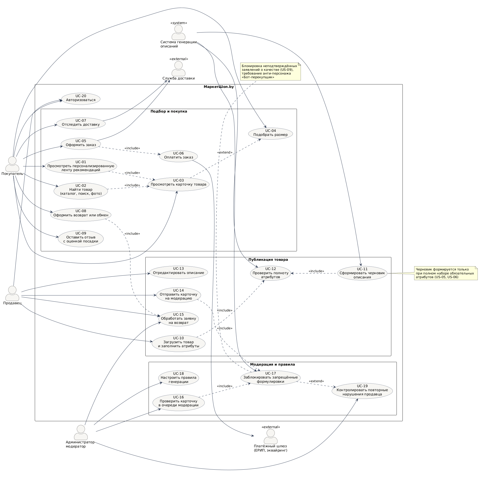

#### Описание

Диаграмма охватывает весь функционал системы в разрезе четырёх ролей, выделенных в задании 1,
и трёх внешних участников. Варианты использования сгруппированы в три пакета, соответствующие
функциональным группам из ЛР№2: **«Подбор и покупка»** (путь покупателя), **«Публикация
товара»** (путь продавца) и **«Модерация и правила»** (путь администратора). Отдельно вынесен
общий для всех ролей вариант UC-20 «Авторизоваться».

Принципиальное решение диаграммы — **выделение системы генерации описаний в самостоятельного
актора**. Генератор не вызывается пользователем напрямую: он инициирует UC-11 «Сформировать
черновик описания», UC-12 «Проверить полноту атрибутов» и UC-17 «Заблокировать запрещённые
формулировки» как автоматизированный процесс. Это отражает ключевую особенность продукта —
описание создаётся системой, а не человеком, — и заранее фиксирует границу ответственности
при распределении задач между командами разработки.

#### Чем полезна команде разработки

| Кому | Что даёт диаграмма |
|------|--------------------|
| **Аналитику** | Полный перечень вариантов использования с явными границами системы; служит оглавлением для детальных сценариев (см. [задание 4](#42-детальные-сценарии-вариантов-использования)) |
| **Разработчику** | Карта точек интеграции с внешними системами: платёжный шлюз (ЕРИП и эквайринг) и службы доставки вынесены за границу системы — это зоны, где нужны адаптеры и обработка отказов |
| **Тестировщику** | Основа матрицы покрытия: каждому UC должен соответствовать хотя бы один приёмочный сценарий; связи `<<include>>` указывают обязательные для проверки комбинации |
| **Заказчику (Игорь Николаевич)** | Наглядное подтверждение, что автогенерация описаний — не вспомогательная функция, а отдельный участник процесса, влияющий на публикацию каждой карточки |

#### Отношения между вариантами использования

| Отношение | Смысл в предметной области |
|-----------|----------------------------|
| `UC-05 ..> UC-06 <<include>>` | Оформление заказа всегда включает оплату — отложенная оплата в MVP не поддерживается |
| `UC-01 ..> UC-03 <<include>>`, `UC-02 ..> UC-03 <<include>>` | И лента рекомендаций, и поиск ведут в карточку товара — это общий узел путей покупателя (ЛР№2, совокупная диаграмма взаимодействия) |
| `UC-03 ..> UC-04 <<extend>>` | Подбор размера — необязательное расширение просмотра карточки: покупатель может купить, не пользуясь ассистентом |
| `UC-10 ..> UC-12 <<include>>` | Загрузка товара всегда сопровождается проверкой полноты атрибутов (US-06) |
| `UC-14 ..> UC-17 <<include>>`, `UC-16 ..> UC-17 <<include>>` | Проверка на запрещённые формулировки выполняется и при отправке на модерацию, и внутри очереди модерации — двойной барьер против анти-персонажа |
| `UC-17 ..> UC-19 <<extend>>` | Контроль повторных нарушений запускается только при накоплении блокировок у одного продавца |
| `UC-08 ..> UC-15 <<include>>` | Оформление возврата покупателем всегда порождает заявку, обрабатываемую продавцом и администратором |

---

### 2.2. Диаграмма деятельности (Activity Diagram)

**Файл:** [`diagrams/02-activity.puml`](diagrams/02-activity.puml)

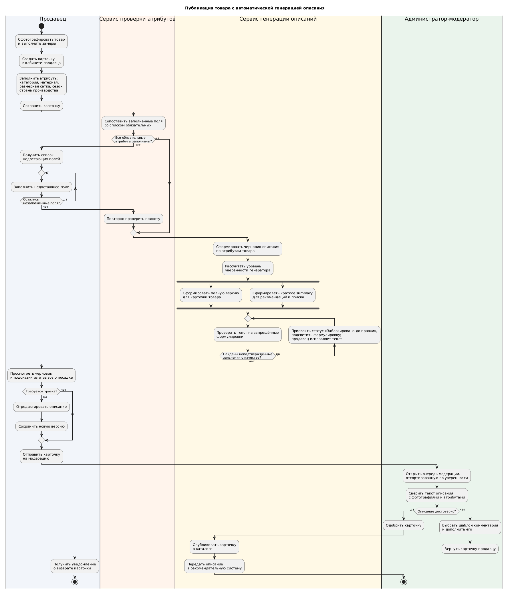

#### Описание

Диаграмма описывает сквозной процесс **публикации товара с автоматической генерацией
описания** — ключевой бизнес-процесс продукта, соответствующий сценарию С3 из задания 1 и
процессу «Публикация товара продавцом» из ЛР№1, переработанному из состояния As-Is в To-Be.

Процесс разнесён по **четырём дорожкам (swimlanes)**: «Продавец», «Сервис проверки атрибутов»,
«Сервис генерации описаний» и «Администратор-модератор». Разделение сервисов на две отдельные
дорожки намеренное: проверка атрибутов и генерация текста — разные ответственности, которые в
архитектуре (см. [задание 7](#задание-7-описание-архитектуры-системы-с-использованием-подхода-c4-model)) реализованы разными компонентами и могут
разрабатываться независимо.

Ключевые управляющие конструкции диаграммы:

- **Цикл дозаполнения атрибутов** (`repeat … repeat while`) в дорожке продавца: при неполных
  атрибутах генерация не запускается, продавец дозаполняет поля по списку недостающих, после
  чего полнота проверяется повторно. Это прямая реализация US-06 и сценария-исключения
  персонажа «Виктор».
- **Параллельное ветвление** (`fork … end fork`): из одного черновика одновременно формируются
  полная версия для карточки товара и краткое summary для рекомендательных блоков и
  результатов поиска. Параллельность на диаграмме фиксирует требование AC-05.5 — обе версии
  порождаются одним актом генерации и не могут разойтись по фактам.
- **Цикл проверки текста** (`repeat … backward`): карточка с неподтверждённым заявлением о
  качестве получает статус «Заблокировано до правки», формулировка подсвечивается, продавец
  правит текст, и проверка выполняется заново. Выйти из цикла, не исправив текст, невозможно —
  это реализация US-09 и барьер против анти-персонажа «Бот-перекупщик».
- **Два разных завершения процесса**: публикация карточки в каталоге с передачей описания в
  рекомендательную систему либо возврат карточки продавцу с комментарием. Второе завершение
  замыкает обратную связь в цикле публикации, показанную на совокупной диаграмме
  взаимодействия в ЛР№2.

#### Чем полезна команде разработки

| Кому | Что даёт диаграмма |
|------|--------------------|
| **Разработчику backend** | Явный порядок вызовов: проверка атрибутов → генерация → проверка текста → модерация. Параллельная ветка указывает, где уместна асинхронная обработка партии из 20 позиций (AC-05.2) |
| **Разработчику frontend** | Точки, в которых интерфейс обязан показать состояние: список недостающих полей, индивидуальный статус позиции в партии, подсветка запрещённой формулировки, статус модерации |
| **Тестировщику** | Набор обязательных тестовых путей: happy path, цикл дозаполнения, цикл блокировки текста, возврат карточки продавцу. Каждый цикл требует проверки выхода и защиты от зацикливания |
| **Аналитику** | Процесс To-Be, который можно сопоставить с As-Is из ЛР№1 и показать заказчику, где именно исчезает узкое место «написание описания вручную» |

---

### 2.3. Диаграмма классов (Class Diagram)

**Файл:** [`diagrams/02-class.puml`](diagrams/02-class.puml)

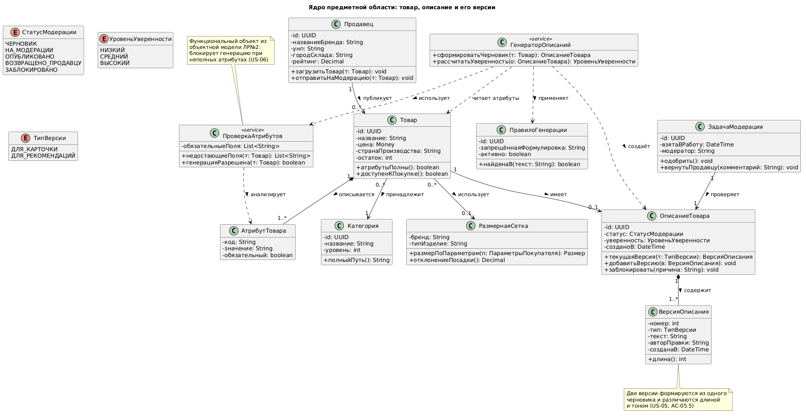

#### Описание

Диаграмма описывает **ядро предметной области** — товар, его описание и версии описания.
Это центральная часть модели: именно здесь реализуется ключевая особенность продукта. Полный
набор доменных моделей (заказы, покупатели, модерация, возвраты) вынесен в
[задание 4](#45-диаграммы-классов-и-объектов).

Классы напрямую происходят из объектной модели ЛР№1–ЛР№2: `Товар`, `ОписаниеТовара`,
`ВерсияОписания`, `ПроверкаАтрибутов` и `ПравилоГенерации` — те же объекты-данные и
функциональные объекты, что были выделены при анализе ментальной модели пользователя.

Проектные решения, зафиксированные диаграммой:

1. **`ОписаниеТовара` отделено от `ВерсияОписания` (композиция `1 *-- 1..*`).** Описание — это
   сущность с жизненным циклом и статусом модерации, а версия — неизменяемый снимок текста.
   Такое разделение обеспечивает требование AC-05.7 (история версий и откат) и AC-07.4
   (правка продавца сохраняется как новая версия, исходный черновик генератора остаётся
   доступным). Версии не существуют вне описания — отсюда композиция, а не агрегация.
2. **Тип версии вынесен в перечисление `ТипВерсии`.** Полная версия для карточки и краткое
   summary для рекомендаций — не разные классы, а два экземпляра одного класса с разным типом.
   Это гарантирует, что обе порождаются из одного черновика (AC-05.5) и обновляются вместе.
3. **`ГенераторОписаний` и `ПроверкаАтрибутов` помечены стереотипом `<<service>>`** и связаны с
   доменными классами отношением зависимости, а не ассоциации: сервисы не хранят состояние
   товара, а только читают атрибуты и создают описание. Это заранее задаёт границу между
   доменным слоем и слоем приложения.
4. **`УровеньУверенности` — перечисление, а не число.** Модератор работает с качественной
   шкалой («низкая / средняя / высокая»), поэтому в домене хранится именно категория;
   численная оценка остаётся деталью реализации модели и в интерфейс не попадает.
5. **`РазмернаяСетка` связана с товаром как `0..1`.** Не у каждого товара есть размерная сетка
   бренда — именно поэтому ассистент по размеру в AC-03.4 обязан уметь сообщать, что данных о
   посадке недостаточно.

#### Чем полезна команде разработки

| Кому | Что даёт диаграмма |
|------|--------------------|
| **Разработчику** | Готовый каркас доменных сущностей и их кратностей; перечисления задают допустимые значения статусов, что снимает вопрос «какие ещё бывают состояния» |
| **Проектировщику БД** | Основа для ERD: композиция «описание — версии» переходит в связь «один ко многим» с каскадным удалением, перечисления — в справочники или `CHECK`-ограничения |
| **Тестировщику** | Границы допустимых значений и обязательность связей: `Товар 1 → 0..1 ОписаниеТовара` означает, что товар без описания — валидное состояние, которое надо тестировать отдельно |
| **Аналитику** | Терминологическая основа: названия классов совпадают со словарём интерфейса из ЛР№2, что исключает расхождение языка аналитики и языка интерфейса |

---

## Задание 3. Разработка спецификации системы с использованием Mermaid
### Подготовка окружения

### 3.1. Диаграмма вариантов использования (Use Case Diagram)

В Mermaid **нет отдельного типа диаграммы вариантов использования**. Общепринятый приём —
эмулировать её средствами `flowchart`: актор изображается прямоугольником, вариант
использования — овалом (`(( ))` / `( )`), граница системы — через `subgraph`. Ниже приведена
та же модель, что и в [разделе 2.1](#21-диаграмма-вариантов-использования-use-case-diagram),
выраженная средствами Mermaid.

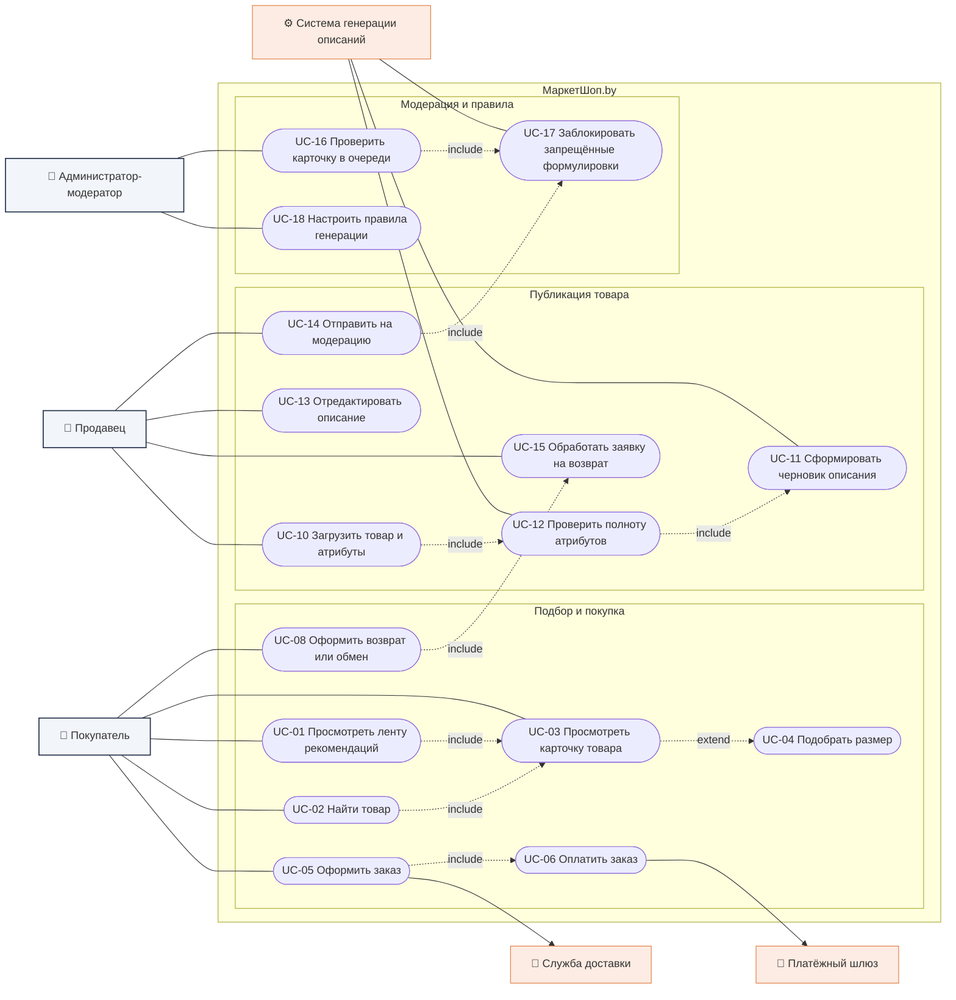

#### Описание

Содержательно модель совпадает с диаграммой задания 2, но средства выражения различаются
принципиально: `<<include>>` и `<<extend>>` в Mermaid передаются **подписью на пунктирной
стрелке**, а не стандартным стереотипом UML, а граница системы — вложенными `subgraph`.
Это означает, что диаграмма в Mermaid **не является формальной UML-диаграммой вариантов
использования** и годится для коммуникации и вики, но не для строгой спецификации.

Практический вывод для команды: формальные UML-модели ведём на PlantUML, а Mermaid применяем
там, где важнее мгновенная отрисовка в вики и низкий порог входа для правок.

---

### 3.2. Диаграмма последовательности (Sequence Diagram)

Диаграмма описывает сценарий **US-05 «Автоматический черновик описания товара»** — ключевой
сценарий продукта, развёрнутый по времени и по участникам.

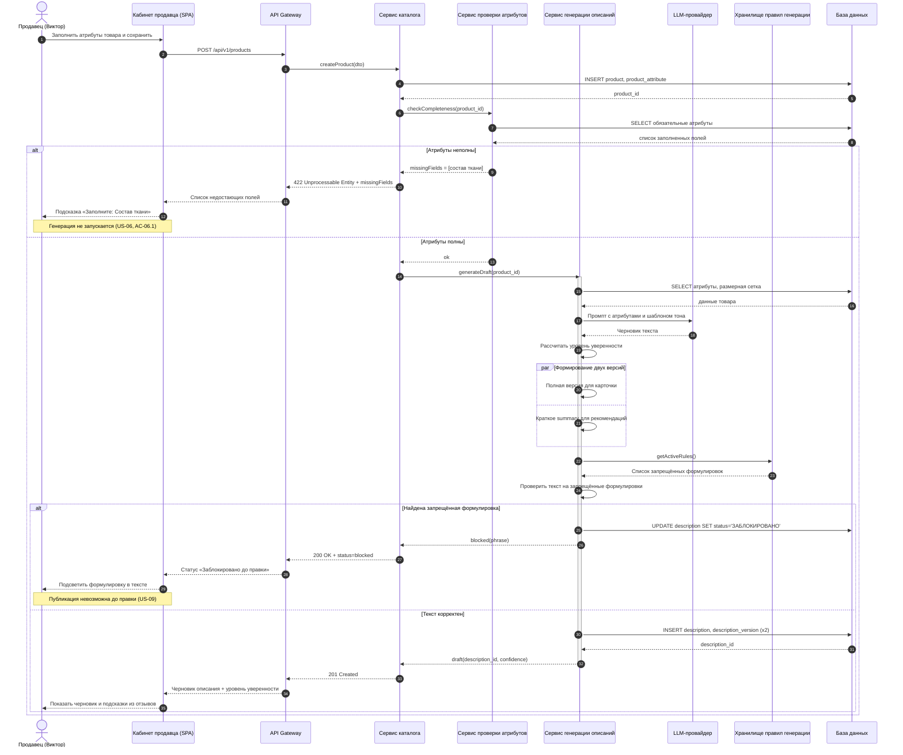

#### Описание

Диаграмма раскрывает **внутреннее устройство шага, который на диаграмме деятельности
(раздел 2.2) выглядел одним действием** «Сформировать черновик описания». Именно поэтому
диаграммы деятельности и последовательности дополняют друг друга: первая отвечает на вопрос
«в каком порядке и кем», вторая — «через какие компоненты и с какими сообщениями».

Ключевые решения, зафиксированные диаграммой:

- **LLM-провайдер — внешний участник.** Он вызывается только сервисом генерации и только после
  успешной проверки полноты атрибутов. Это ограничивает стоимость: обращения к платному
  провайдеру не происходит для заведомо неполных карточек.
- **Проверка правил выполняется после генерации, а не внутри промпта.** Правила хранятся
  отдельно (`RULE`) и применяются к готовому тексту детерминированным алгоритмом. Нельзя
  полагаться на то, что языковая модель сама не употребит запрещённую формулировку, — проверка
  должна быть воспроизводимой и управляться администратором (AC-09.4).
- **Блок `par`** показывает, что две версии описания формируются в рамках одной транзакции
  генерации, — это требование AC-05.5, выраженное на уровне обмена сообщениями.
- **Три различных исхода** (`422` при неполных атрибутах, `200` со статусом блокировки, `201`
  при успехе) задают контракт API ещё до начала реализации.

---

### 3.3. Диаграмма классов (Class Diagram)

Та же модель ядра предметной области, что и в [разделе 2.3](#23-диаграмма-классов-class-diagram),
выраженная средствами Mermaid.

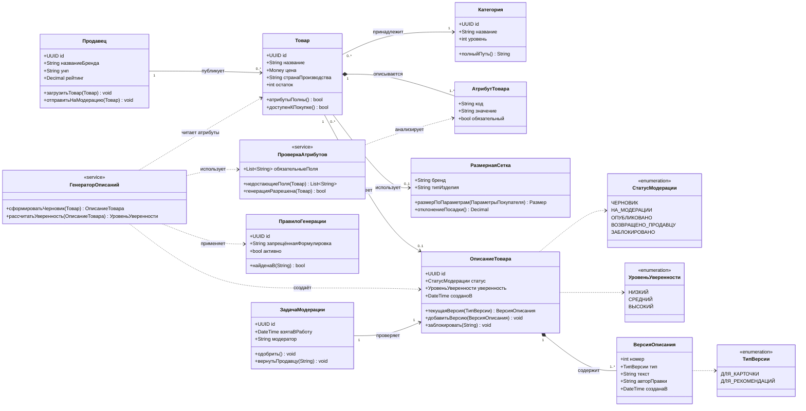

#### Описание

Модель полностью соответствует диаграмме задания 2. Отличия вызваны исключительно
возможностями языка:

- **Перечисления** в Mermaid описываются стереотипом `<<enumeration>>` внутри обычного класса,
  тогда как PlantUML имеет отдельное ключевое слово `enum`. Чтобы связь класса с перечислением
  осталась видимой, её пришлось показать явной зависимостью (`ОписаниеТовара ..> СтатусМодерации`),
  — в PlantUML она выводится из типа атрибута автоматически.
- **Обобщённые типы** записываются через тильды: `List~String~` вместо `List<String>`, так как
  угловые скобки в Mermaid зарезервированы.
- **Примечания (`note`)** в диаграммах классов Mermaid поддерживаются ограниченно, поэтому
  пояснения вынесены в текст раздела, а не на полотно диаграммы.

---

### 3.4. Сравнение PlantUML и Mermaid для задач проекта

Сопоставление выполнено по итогам построения одной и той же модели на обоих языках.

| Критерий | PlantUML | Mermaid | Вывод для проекта |
|----------|----------|---------|-------------------|
| Отрисовка на GitHub | Нужен внешний сервер или заранее отрисованные изображения в репозитории | Нативная, прямо в Markdown | Вики и README ведём на Mermaid |
| Диаграмма вариантов использования | Полноценная поддержка, стандартная нотация UML | Отсутствует, эмулируется через `flowchart` | Формальные UML-модели — на PlantUML |
| Диаграмма деятельности с дорожками | Полноценные swimlanes, `fork`, `repeat` | Дорожек нет; обходной путь — `subgraph` во `flowchart` | Процессы — на PlantUML |
| Диаграмма последовательности | Богатый синтаксис, `activate`, `group`, `box` | Поддержка `alt`, `par`, `loop`, `autonumber` — достаточна | Обе пригодны |
| Диаграмма классов | Перечисления, стереотипы, примечания на полотне | Есть всё основное, примечания ограничены | Обе пригодны |
| Диаграммы компонентов, пакетов, развёртывания | Полноценная поддержка | Отсутствуют как типы, эмулируются `flowchart` | Архитектурные диаграммы — на PlantUML |
| ERD | Через классы либо через библиотеку | Отдельный тип `erDiagram` с кратностями | Схему БД удобнее вести на Mermaid |
| C4 | Библиотека `C4-PlantUML` в составе stdlib | Экспериментальный `C4Context` | Архитектура C4 — на PlantUML |
| Порог входа для правок | Нужны расширение среды и сервер отрисовки | Достаточно правки Markdown в веб-интерфейсе GitHub | Mermaid доступнее для правок всей командой |
| Контроль версий | Отдельные файлы `.puml` — чистый diff | Внутри Markdown — diff смешивается с текстом | PlantUML удобнее для ревью диаграмм |

**Принятое командой решение.** В проекте используются оба языка по зонам ответственности:

- **PlantUML** — формальная спецификация: варианты использования, деятельность, компоненты,
  пакеты, развёртывание, Event Storming, Event Modeling, C4. Исходники — в
  [`diagrams/`](diagrams/), изображения — в [`diagrams/img/`](diagrams/img/).
- **Mermaid** — всё, что должно открываться одним кликом и часто правиться: страницы вики,
  README, схема базы данных, диаграммы последовательности и классов в сопроводительной
  документации.

Согласно требованию методических указаний, ключевые диаграммы продублированы на обоих языках —
см. [задание 4](#задание-4-разработка-спецификации-системы-с-использованием-plantuml-mermaid-и-ии-агентов).

---

## Задание 4. Разработка спецификации системы с использованием PlantUML, Mermaid и ИИ-агентов

### Содержание раздела

| № | Подраздел |
|---|-----------|
| 4.1 | [Библиотека промптов](#41-библиотека-промптов) |
| 4.2 | [Детальные сценарии вариантов использования](#42-детальные-сценарии-вариантов-использования) |
| 4.3 | [Применение навыков ИИ-агентов и верификация результата](#43-применение-навыков-ии-агентов-и-верификация-результата) |
| 4.4 | [Расширение набора User Story](#44-расширение-набора-user-story) |
| 4.5 | [Диаграммы классов и объектов](#45-диаграммы-классов-и-объектов) |
| 4.6 | [Диаграммы деятельности](#46-диаграммы-деятельности) |
| 4.7 | [Диаграммы последовательности](#47-диаграммы-последовательности) |
| 4.8 | [Диаграмма компонентов](#48-диаграмма-компонентов) |
| 4.9 | [Диаграмма пакетов](#49-диаграмма-пакетов) |
| 4.10 | [Диаграмма развёртывания](#410-диаграмма-развёртывания) |
| 4.11 | [Схема базы данных: ERD и ORD](#411-схема-базы-данных-erd-и-ord) |

---

### 4.1. Библиотека промптов

Промпты построены по единой структуре, принятой командой: **Роль → Контекст → Задача →
Ограничения → Формат вывода → Критерии качества**. Контекст во всех промптах один и тот же,
поэтому он вынесен в отдельный блок и подставляется в каждый промпт.

#### 4.1.0. Общий контекстный блок (подставляется во все промпты)

```text
КОНТЕКСТ ПРОЕКТА (используй только эти факты, не додумывай):
Продукт: «МаркетШоп.by» — веб- и мобильное приложение маркетплейса одежды и обуви
для Республики Беларусь. Ключевая особенность — автоматическая генерация текстовых
описаний товаров из структурированных атрибутов и их персонализация в
рекомендательных блоках.

Роли: Покупатель, Продавец (малый белорусский бренд или ИП), Администратор-модератор,
Система генерации описаний (автоматизированный актор).

Персонажи: Анастасия, 27 лет, маркетолог, покупает со смартфона вечером (ключевой);
Ольга Петровна, 48 лет, боится ошибиться с размером (дополнительный);
Виктор, 34 года, владелец ИП, публикует 15–20 позиций раз в 1–2 недели (ключевой);
Марина, 31 год, модератор, обрабатывает 100–200 карточек в день (вспомогательный);
«Бот-перекупщик» — анти-персонаж, массово грузит товары с ложными атрибутами.

Данные опроса (46 респондентов), на которые нужно опираться:
— барьеры: сложности с возвратом/обменом 39,1%; невозможность примерить 28,3%;
  высокая цена 28,3%; долгая доставка 26,1%; недоверие к продавцу 19,6%;
  недостоверное описание 13,0%;
— важность достоверного описания: средняя оценка 4,33 из 5;
— сталкивались с несоответствием описания реальности: 60,9%;
— интерес к персонализированным рекомендациям: 73,9%;
— основное устройство: смартфон 82,6%, компьютер 15,2%, планшет 2,2%;
— время покупок: вечер 19:00–23:00 — 58,7%;
— оплата: карта онлайн 69,6%, при получении 30,4%, ЕРИП 0%;
— доставка: пункт самовывоза 78,3%, курьер 17,4%, Белпочта 4,3%.

Ограничения продукта: генератор не формулирует непроверяемые заявления о качестве
(«лучший», «100% не сядет»); термины NLP/LLM не показываются покупателю;
персональные данные хранятся на территории Республики Беларусь.
```

---

#### 4.1.1. Промпт на написание пользовательских историй

```text
РОЛЬ: Ты — системный аналитик с опытом работы по методологии User Story Mapping
и BDD. Ты пишешь требования, а не технические задачи.

ЗАДАЧА: Составь набор пользовательских историй для сценария «{НАЗВАНИЕ СЦЕНАРИЯ}»
роли «{РОЛЬ}» на платформе «{мобильная | веб}».

ОГРАНИЧЕНИЯ:
1. Каждая история — по шаблону: «Как [роль], я хочу [действие/цель],
   чтобы [бизнес-ценность/результат]». Бизнес-ценность — польза для пользователя
   или бизнеса, а не повторение действия другими словами.
2. Пиши ИСТОРИИ, а не функции и не технические задачи. Запрещены формулировки
   вида «реализовать endpoint», «добавить таблицу», «настроить кэш».
3. Проверь каждую историю по INVEST. Если история не проходит по «Small» —
   раздели её на несколько.
4. К каждой истории — от 4 до 7 критериев приёмки. Каждый критерий должен быть
   проверяемым (можно однозначно сказать «выполнен / не выполнен»),
   не дублировать другие и не описывать реализацию.
5. Для каждой истории укажи приоритет High / Medium / Low и обоснуй его
   ССЫЛКОЙ НА КОНКРЕТНЫЙ ПОКАЗАТЕЛЬ ОПРОСА из контекста. Если подходящего
   показателя нет — ставь приоритет не выше Medium и прямо напиши,
   что данных опроса для обоснования High нет.
6. Отдельным пунктом укажи платформенные особенности: для мобильного интерфейса —
   ограничения экрана, жесты, офлайн-режим, камера/геолокация, push-уведомления;
   для веб-интерфейса — работа в разных браузерах, масштабирование, горячие
   клавиши, доступность по WCAG 2.1 AA, работа без JavaScript.
7. Укажи зависимости от других историй в формате «US-A должна быть реализована
   до US-B, потому что …».

ФОРМАТ ВЫВОДА: Markdown. Для каждой истории: заголовок с ID, блок цитаты с
формулировкой, абзац с обоснованием приоритета, таблица критериев приёмки
(столбцы: ID, критерий).

КРИТЕРИИ КАЧЕСТВА (самопроверка перед ответом):
— ни один критерий приёмки не содержит слов «удобно», «быстро», «корректно»
  без численного порога;
— каждая история приносит ценность самостоятельно;
— нет двух историй, отличающихся только платформой, — платформенные отличия
  вынесены в критерии приёмки.
```

#### 4.1.2. Промпт на диаграмму вариантов использования

```text
РОЛЬ: Ты — системный аналитик, владеющий нотацией UML 2.5 и языком PlantUML.

ЗАДАЧА: Построй диаграмму вариантов использования для контура «{КОНТУР}»
на языке PlantUML.

ОГРАНИЧЕНИЯ:
1. Границу системы обозначь элементом rectangle с названием продукта;
   внешние системы размещай ЗА границей.
2. Варианты использования формулируй глаголом в неопределённой форме
   («Оформить заказ»), а не существительным.
3. Присвой каждому варианту использования идентификатор вида UC-xx и выводи
   его первой строкой внутри овала.
4. Используй отношения <<include>> только для обязательной части поведения
   и <<extend>> только для необязательной. Для каждого отношения добавь
   примечание note, объясняющее, ПОЧЕМУ выбрано именно оно.
5. Обобщение акторов применяй, если одна роль — частный случай другой.
6. Автоматизированные процессы (генерация, рекомендации) показывай
   отдельными акторами со стереотипом <<system>>.
7. Не добавляй варианты использования, которых нет в контексте проекта.
   Если считаешь какой-то необходимым — вынеси его в отдельный список
   «ПРЕДЛОЖЕНИЯ» после кода и не включай в диаграмму.

ФОРМАТ ВЫВОДА: один блок кода PlantUML (@startuml … @enduml), затем таблица
«Отношение | Смысл в предметной области», затем список ПРЕДЛОЖЕНИЯ.

КРИТЕРИИ КАЧЕСТВА: диаграмма компилируется без ошибок; ни один вариант
использования не остался без актора; нет вариантов использования,
описывающих шаги интерфейса («нажать кнопку»).
```

#### 4.1.3. Промпт на диаграмму деятельности

```text

РОЛЬ: Ты — бизнес-аналитик, моделирующий процессы в нотации UML Activity.

ЗАДАЧА: Построй диаграмму деятельности для процесса «{ПРОЦЕСС}» на языке PlantUML.

ОГРАНИЧЕНИЯ:
1. Обязательно используй дорожки (swimlanes) — по одной на каждого участника
   процесса. Автоматические сервисы выделяй в отдельные дорожки, а не смешивай
   с дорожкой человека.
2. Покажи ветвления (if/else) для всех решений, влияющих на исход процесса.
3. Если в процессе есть повторяющиеся действия — используй repeat/while,
   а не копирование блоков.
4. Если действия выполняются параллельно — используй fork/end fork.
5. У процесса должно быть явно показано КАЖДОЕ возможное завершение
   (успешное и неуспешные), каждое — отдельным stop.
6. Запрещены «висячие» ветки: из любого узла должен быть путь к stop.
7. Моделируй процесс To-Be (как должно быть в проектируемой системе),
   а не As-Is.

ФОРМАТ ВЫВОДА: блок кода PlantUML, затем таблица «Кому | Что даёт диаграмма»
для ролей: аналитик, разработчик backend, разработчик frontend, тестировщик.

КРИТЕРИИ КАЧЕСТВА: количество stop равно количеству возможных исходов;
каждая дорожка содержит хотя бы одно действие; циклы имеют условие выхода.
```

#### 4.1.4. Промпт на диаграмму классов

```text
РОЛЬ: Ты — проектировщик предметной области, работающий в стиле
Domain-Driven Design.

ЗАДАЧА: Построй диаграмму классов для домена «{ДОМЕН}» на языке PlantUML.

ОГРАНИЧЕНИЯ:
1. Названия классов, атрибутов и методов — на русском языке и ТОЧНО
   совпадающие со словарём интерфейса проекта (ЛР№2): «размер», а не
   «ростовка»; «описание товара», а не «контент».
2. Для каждого атрибута укажи тип. Перечисляемые значения выноси
   в отдельные enum, а не храни строками.
3. Различай композицию (*--) и агрегацию (o--): композиция — если часть
   не существует без целого. Обоснуй выбор в примечании note.
4. Укажи кратности на ОБОИХ концах каждой связи.
5. Сервисы без состояния помечай стереотипом <<service>> и связывай
   с доменными классами зависимостью (..>), а не ассоциацией.
6. Не добавляй технические поля (created_at, updated_at, version),
   если они не несут смысла в предметной области.
7. На каждой диаграмме — не более 10 классов. Если домен больше —
   предложи разбиение на несколько диаграмм и перечисли их.

ФОРМАТ ВЫВОДА: блок кода PlantUML, затем нумерованный список
«Проектные решения, зафиксированные диаграммой» (не менее 4 пунктов,
каждый со ссылкой на критерий приёмки вида AC-xx.y).

КРИТЕРИИ КАЧЕСТВА: нет связей без кратностей; нет классов без атрибутов
и методов одновременно; каждое перечисление используется хотя бы одним классом.
```

#### 4.1.5. Промпт на диаграмму объектов

```text
РОЛЬ: Ты — аналитик, иллюстрирующий модель конкретным примером.

ЗАДАЧА: Построй диаграмму объектов (снимок состояния) на языке PlantUML
для ситуации «{СИТУАЦИЯ}», соответствующую диаграмме классов «{ДИАГРАММА}».

ОГРАНИЧЕНИЯ:
1. Используй имена и данные ПЕРСОНАЖЕЙ проекта (Анастасия, Виктор,
   Ольга Петровна, Марина), а не абстрактные «user1», «product1».
2. Каждый объект именуй в формате «имяЭкземпляра : Класс».
3. Указывай КОНКРЕТНЫЕ значения атрибутов, включая null там, где
   атрибут не заполнен, — снимок должен показывать и граничные случаи.
4. Значения должны быть правдоподобны для Республики Беларусь: цены в BYN,
   города — Минск, Гродно, Могилёв; УНП — 9 цифр.
5. Снимок должен иллюстрировать КОНКРЕТНОЕ требование: добавь note
   со ссылкой на критерий приёмки, который этот снимок показывает.
6. Не показывай методы — только значения атрибутов.

ФОРМАТ ВЫВОДА: блок кода PlantUML и абзац «Что иллюстрирует снимок».

КРИТЕРИИ КАЧЕСТВА: все классы объектов присутствуют на соответствующей
диаграмме классов; связи между объектами не противоречат кратностям.
```

#### 4.1.6. Промпт на диаграмму последовательности

```text
РОЛЬ: Ты — системный архитектор, проектирующий взаимодействие компонентов.

ЗАДАЧА: Построй диаграмму последовательности для сценария «{СЦЕНАРИЙ}»
на языке PlantUML.

ОГРАНИЧЕНИЯ:
1. Участники — конкретные компоненты системы (API Gateway, сервис каталога,
   сервис генерации описаний, LLM-провайдер, БД), а не абстрактные «система».
2. Включи autonumber.
3. Покажи ВСЕ альтернативные исходы блоками alt/else, включая ошибки:
   нехватка остатка, истёкший срок возврата, отказ платежа, конфликт захвата
   задачи. Для каждой ошибки укажи HTTP-код ответа.
4. Параллельные действия показывай блоком par.
5. Для долгих операций используй activate/deactivate.
6. Укажи реальные маршруты REST API в сообщениях (метод + путь).
7. Добавь note с нефункциональным требованием, относящимся к сценарию
   (время отклика, таймаут, частота).
8. Внешние платные сервисы (LLM-провайдер) вызывай только после того, как
   пройдены все дешёвые проверки, — покажи это порядком сообщений.

ФОРМАТ ВЫВОДА: блок кода PlantUML, затем список «Ключевые решения,
зафиксированные диаграммой» (не менее 3 пунктов).

КРИТЕРИИ КАЧЕСТВА: каждый alt имеет ветку else; нет сообщений от участника
к самому себе без пояснения; все активации закрыты.
```

#### 4.1.7. Промпт на диаграмму компонентов

```text
РОЛЬ: Ты — архитектор программного обеспечения.

ЗАДАЧА: Построй диаграмму компонентов системы на языке PlantUML.

ОГРАНИЧЕНИЯ:
1. Сгруппируй компоненты пакетами: клиентские приложения, контур API,
   прикладные сервисы, инфраструктура данных, внешние системы.
2. Инфраструктурные элементы обозначай правильными типами: database, queue,
   folder — а не прямоугольниками component.
3. Для каждой связи укажи протокол или тип взаимодействия (REST, событие,
   JDBC), если он отличается от очевидного.
4. Асинхронное взаимодействие через шину событий показывай явно: компонент →
   шина → подписчик, а не компонент → компонент.
5. Выдели компоненты, обращающиеся к внешним платным сервисам, —
   их должно быть минимальное число. Обоснуй это в note.
6. Не вводи компоненты «на вырост»: только то, что требуется
   пользовательскими историями US-01 … US-12 и их расширениями.

ФОРМАТ ВЫВОДА: блок кода PlantUML и таблица «Компонент | Ответственность |
Какие User Story реализует».

КРИТЕРИИ КАЧЕСТВА: нет компонентов без входящих и исходящих связей;
каждый прикладной сервис имеет хранилище либо явно помечен как stateless.
```

#### 4.1.8. Промпт на диаграмму пакетов

```text
РОЛЬ: Ты — ведущий разработчик, отвечающий за структуру кодовой базы.

ЗАДАЧА: Построй диаграмму пакетов серверной части на языке PlantUML.

ОГРАНИЧЕНИЯ:
1. Используй слоистую структуру: interfaces, application, domain,
   infrastructure, config.
2. Покажи направление зависимостей. Доменный слой не должен зависеть
   ни от инфраструктуры, ни от интерфейсов.
3. Внутри слоёв выдели подпакеты по доменам (catalog, description, order,
   moderation, customer), а не по техническим типам (dto, utils, helpers).
4. Добавь note, объясняющее принцип инверсии зависимостей на конкретном
   примере из проекта (работа с LLM-провайдером).
5. Имена пакетов — латиницей, в нижнем регистре, по корневому пространству
   имён by.marketshop.

ФОРМАТ ВЫВОДА: блок кода PlantUML и абзац «Правило, которое проверяется
на code review».

КРИТЕРИИ КАЧЕСТВА: нет циклических зависимостей между пакетами;
каждый подпакет application имеет соответствующий подпакет domain.
```

#### 4.1.9. Промпт на диаграмму развёртывания

```text
РОЛЬ: Ты — DevOps-инженер и архитектор инфраструктуры.

ЗАДАЧА: Построй диаграмму развёртывания на языке PlantUML.

ОГРАНИЧЕНИЯ:
1. Узлы (node) — физические или виртуальные среды исполнения; артефакты
   (artifact) — то, что на них разворачивается. Не путай эти элементы.
2. Покажи устройства пользователей (смартфон, рабочая станция), CDN,
   кластер приложений, узел данных, объектное хранилище и внешние сервисы.
3. Для каждого канала связи укажи протокол и, где важно, требование
   безопасности (TLS) или таймаут.
4. Учти ограничение: персональные данные покупателей должны храниться
   на территории Республики Беларусь — отрази это в примечании и
   в размещении узлов.
5. Покажи офлайн-кэш мобильного приложения как отдельный артефакт
   на узле смартфона.
6. Не изобретай конкретных вендоров облака — используй обобщённые
   обозначения.

ФОРМАТ ВЫВОДА: блок кода PlantUML и таблица «Узел | Что разворачивается |
Требования к отказоустойчивости».

КРИТЕРИИ КАЧЕСТВА: каждый артефакт размещён ровно на одном узле;
все внешние сервисы вынесены в отдельный cloud.
```

#### 4.1.10. Промпт на схему базы данных (ERD)

```text
РОЛЬ: Ты — проектировщик баз данных, работающий с PostgreSQL.

ЗАДАЧА: Построй схему базы данных в нотации «сущность-связь» (ERD)
на языке PlantUML по диаграммам классов проекта.

ОГРАНИЧЕНИЯ:
1. Имена таблиц и колонок — латиницей, в snake_case, существительные
   в единственном числе (кроме зарезервированных слов: orders).
2. Для каждой колонки укажи тип PostgreSQL и пометки <<PK>>, <<FK>>, <<UQ>>.
   Обязательные колонки помечай звёздочкой.
3. Перечисления доменной модели отображай в ENUM-типы, а не в varchar.
4. Связи показывай в нотации «воронья лапка» с правильными кратностями:
   ||--|{ (один ко многим, обязательно), ||--o{ (один ко многим, необязательно),
   |o--o{ и т. д.
5. Композиция из доменной модели переходит в FK с ON DELETE CASCADE —
   отметь это в примечании.
6. Таблицы «многие ко многим» и таблицы с составным первичным ключом
   оформляй явно, показывая обе колонки ключа.
7. Не добавляй индексы и партиционирование — это уровень физической модели.

ФОРМАТ ВЫВОДА: блок кода PlantUML, затем таблица «Таблица | Назначение |
Из какого класса получена».

КРИТЕРИИ КАЧЕСТВА: каждая сущность достижима по связям от product
или от customer; нет внешних ключей на несуществующие таблицы;
схема соответствует третьей нормальной форме, а отступления обоснованы.
```

#### 4.1.11. Промпт на формирование технической спецификации (ТЗ по SRS)

```text
РОЛЬ: Ты — системный аналитик, составляющий техническое задание по шаблону
SRS Карла Вигерса и Джой Битти.

ЗАДАЧА: Составь раздел «{НОМЕР И НАЗВАНИЕ РАЗДЕЛА SRS}» технического задания
на разработку приложения.

ВХОДНЫЕ ДАННЫЕ: пользовательские истории US-01 … US-20 с критериями приёмки,
диаграммы вариантов использования, деятельности, классов, последовательности,
компонентов, развёртывания и схема базы данных (прилагаются ниже).

ОГРАНИЧЕНИЯ:
1. Строго следуй структуре SRS: 1 Введение (назначение, соглашения, границы
   проекта, ссылки); 2 Общее описание (взгляд на продукт, классы пользователей,
   операционная среда, ограничения дизайна и реализации, предположения и
   зависимости); 3 Функции системы; 4 Требования к данным; 5 Требования
   к внешним интерфейсам; 6 Атрибуты качества; 7 Интернационализация
   и локализация; 8 Остальные требования; приложения А (словарь) и Б (модели).
2. Каждое функциональное требование нумеруй в формате ФТ-x.y и делай
   ПРОВЕРЯЕМЫМ. Запрещены формулировки «система должна быть удобной»,
   «работать быстро», «поддерживать современные браузеры».
3. Для каждого функционального требования укажи источник: идентификатор
   User Story или варианта использования.
4. Нефункциональные требования формулируй с численными порогами и способом
   измерения (например: «время отклика страницы каталога — не более 2 с
   для 95-го процентиля при 200 одновременных пользователях, измеряется
   нагрузочным тестом»).
5. В разделе границ проекта явно перечисли, что НЕ входит в MVP.
6. Не выдумывай требования законодательства — если норма нужна,
   пометь её как «требует уточнения у юриста» и внеси в раздел
   «Предположения и зависимости».
7. Разделы 4.1 и 4.2 строй по схеме базы данных и словарю терминов проекта,
   не придумывая новых сущностей.

ФОРМАТ ВЫВОДА: Markdown со сквозной нумерацией разделов; функциональные
требования — таблицами (ID, требование, источник, приоритет).

КРИТЕРИИ КАЧЕСТВА: ни одно требование не содержит слова «и/или»;
каждое требование относится ровно к одной функции; все User Story
с приоритетом High покрыты хотя бы одним функциональным требованием.
```

---

### 4.2. Детальные сценарии вариантов использования

Детальные сценарии составлены для диаграммы вариантов использования **контура покупателя**
(раздел [4.2.0](#420-диаграмма-вариантов-использования-контур-покупателя)) по алгоритму
описания функциональных требований в формате Use Case: идентификатор, акторы, предусловия,
триггер, основной поток, альтернативные потоки, исключения, постусловия и нефункциональные
требования. Описаны **пять** вариантов использования.

#### 4.2.0. Диаграмма вариантов использования (контур покупателя)

**Файл:** [`diagrams/04-usecase-buyer.puml`](diagrams/04-usecase-buyer.puml)

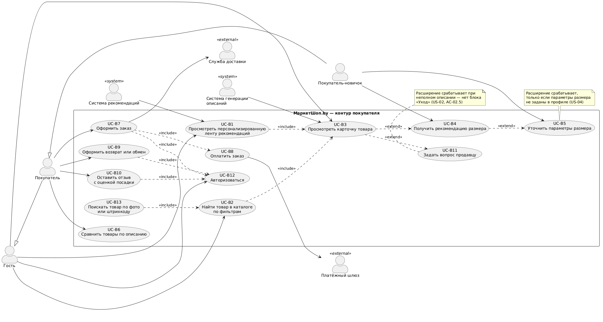

Диаграмма детализирует путь покупателя из общей диаграммы задания 2. Введено **обобщение
акторов**: `Гость` → `Покупатель` → `Покупатель-новичок`. Гость может просматривать ленту,
каталог и карточку товара, но действия, требующие идентификации (заказ, возврат, отзыв),
доступны только авторизованному покупателю — это выражено отношением `<<include>>` с UC-B12.
Роль «Покупатель-новичок» выделена как частный случай покупателя, поскольку именно для неё
критичны UC-B4 и UC-B5 (персонаж «Ольга Петровна»).

**То же на языке Mermaid:**

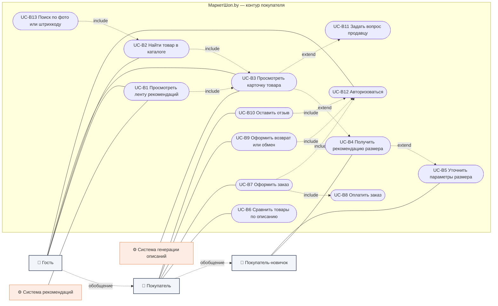

---

#### Сценарий UC-B1. Просмотреть персонализированную ленту рекомендаций

| Поле | Значение |
|------|----------|
| **Идентификатор** | UC-B1 |
| **Название** | Просмотреть персонализированную ленту рекомендаций |
| **Основной актор** | Покупатель (Анастасия) |
| **Вторичные акторы** | Система рекомендаций, Система генерации описаний |
| **Заинтересованные лица** | Покупатель — хочет быстро найти подходящее; заказчик — хочет роста конверсии и среднего чека |
| **Связанная User Story** | US-01 |
| **Предусловия** | Приложение установлено и запущено; в каталоге есть товары со статусом описания «Опубликовано» |
| **Триггер** | Покупатель открывает главный экран приложения |
| **Частота** | Несколько раз в день; пик — 19:00–23:00 (58,7% респондентов) |

**Основной поток (успешный сценарий):**

1. Покупатель открывает главный экран.
2. Система определяет, авторизован ли покупатель, и считывает идентификатор устройства.
3. Система запрашивает профиль предпочтений покупателя: размеры, любимые категории, историю просмотров.
4. Система формирует блок «Специально для вас» из опубликованных товаров, подходящих под параметры профиля.
5. Система формирует блок «Похожие товары» на основе последнего просмотренного товара.
6. Для каждой карточки система подставляет краткую версию описания (не более 90 символов).
7. Система возвращает ленту клиенту, клиент отрисовывает первые карточки.
8. Покупатель просматривает ленту, прокручивая её вниз.

**Постусловия:** лента отображена; событие просмотра ленты записано в историю; кэш ленты сохранён на 15 минут.

**Альтернативные потоки:**

| ID | Условие | Поток |
|----|---------|-------|
| A1 | Лента найдена в кэше и не устарела | Шаги 3–6 пропускаются; система отдаёт кэшированную ленту. Переход к шагу 7 |
| A2 | Покупатель не авторизован | На шаге 3 система использует обезличенную историю просмотров текущего устройства; обращение по имени не выводится. Переход к шагу 4 |
| A3 | Персонализирующих данных недостаточно (новый покупатель) | На шаге 4 система заполняет ленту популярными товарами региона и добавляет над лентой блок «Расскажите о своих размерах» со ссылкой на профиль |
| A4 | Покупатель добавляет карточку в избранное | Система сохраняет товар в избранное и обновляет только состояние иконки; лента не перестраивается, позиции карточек сохраняются |
| A5 | Покупатель выполняет жест pull-to-refresh | Система сбрасывает кэш ленты и выполняет шаги 3–7 заново |

**Исключения:**

| ID | Условие | Обработка |
|----|---------|-----------|
| E1 | Сервис рекомендаций недоступен | Система отдаёт ленту из кэша с пометкой времени обновления; при отсутствии кэша показывает каталог популярных товаров без персонализации |
| E2 | Нет сетевого соединения | Приложение показывает последние просмотренные товары из локального кэша и баннер «Нет соединения» |
| E3 | Все подходящие товары сняты с публикации | Лента заполняется популярными товарами региона; блок «Специально для вас» не отображается пустым |

**Нефункциональные требования:** время до отрисовки первых карточек — не более 2 с при
4G-соединении; лента содержит не менее 12 карточек; тёмная тема обязательна.

---

#### Сценарий UC-B3. Просмотреть карточку товара

| Поле | Значение |
|------|----------|
| **Идентификатор** | UC-B3 |
| **Название** | Просмотреть карточку товара |
| **Основной актор** | Покупатель, Гость |
| **Вторичные акторы** | Система генерации описаний, Сервис отзывов |
| **Связанная User Story** | US-02 |
| **Предусловия** | Товар существует, его описание имеет статус «Опубликовано» |
| **Триггер** | Покупатель выбирает карточку в ленте, результатах поиска или каталоге |
| **Частота** | Десятки раз за сессию; сессия — 15–20 минут |

**Основной поток:**

1. Покупатель открывает карточку товара.
2. Система загружает фотографии товара, цену, наличие размеров.
3. Система загружает полную версию описания с подблоками «Состав», «Посадка», «Уход», «Размерная сетка бренда».
4. Система размещает блок описания выше кнопки «В корзину».
5. Система загружает агрегированные отзывы с оценкой посадки.
6. Система отображает блок «Похожие товары» и «С этим товаром покупают».
7. Покупатель читает описание и принимает решение.

**Постусловия:** событие просмотра записано в историю; профиль предпочтений обновлён.

**Альтернативные потоки:**

| ID | Условие | Поток |
|----|---------|-------|
| A1 | Один из подблоков описания отсутствует | На шаге 3 вместо подблока выводится строка «Продавец не указал»; пустой блок не отображается |
| A2 | Отсутствует подблок «Уход» | Система дополнительно показывает кнопку «Вопрос продавцу» с преднастроенной темой обращения (переход к UC-B11) |
| A3 | У покупателя заданы параметры размера | Система автоматически разворачивает блок «Ассистент по размеру» (переход к UC-B4) |
| A4 | Товара нет в наличии ни в одном размере | Система отключает кнопку «В корзину» и предлагает подписку на поступление |

**Исключения:**

| ID | Условие | Обработка |
|----|---------|-----------|
| E1 | Описание товара находится в статусе «Заблокировано» | Карточка покупателю недоступна, возвращается страница «Товар временно недоступен» |
| E2 | Изображения недоступны в CDN | Отображается заглушка; текстовая часть карточки остаётся функциональной |
| E3 | Сервис отзывов недоступен | Блок отзывов скрывается, остальная часть карточки работает; ассистент по размеру сообщает о нехватке данных |

**Нефункциональные требования:** карточка читается без горизонтальной прокрутки на экране
375 px; термины NLP/LLM не отображаются; контраст текста не ниже 4,5:1.

---

#### Сценарий UC-B4. Получить рекомендацию размера

| Поле | Значение |
|------|----------|
| **Идентификатор** | UC-B4 |
| **Название** | Получить рекомендацию размера |
| **Основной актор** | Покупатель-новичок (Ольга Петровна) |
| **Вторичные акторы** | Сервис отзывов, Сервис каталога |
| **Связанные User Story** | US-03, US-04 |
| **Предусловия** | Открыта карточка товара; товар относится к категории, для которой важен размер |
| **Триггер** | Покупатель открывает блок «Ассистент по размеру» либо блок разворачивается автоматически |
| **Частота** | При каждой первой покупке модели нового бренда |

**Основной поток:**

1. Система считывает параметры размера из профиля покупателя.
2. Система загружает размерную сетку бренда для данного типа изделия.
3. Система агрегирует оценки посадки из отзывов на товар.
4. Система рассчитывает рекомендованный размер и величину отклонения посадки.
5. Система формирует пояснение в терминах «маломерит / большемерит».
6. Система проверяет наличие рекомендованного размера на складе.
7. Система отображает рекомендацию и подставляет размер в селектор.
8. Покупатель принимает рекомендованный размер либо изменяет его вручную.

**Постусловия:** в селекторе размера установлено значение; факт показа рекомендации
зафиксирован для последующего сопоставления с возвратами.

**Альтернативные потоки:**

| ID | Условие | Поток |
|----|---------|-------|
| A1 | Параметры размера не заданы в профиле | Система показывает форму не более чем из трёх полей поверх карточки; после отправки сохраняет параметры в профиль и возвращается к шагу 2 (переход к UC-B5) |
| A2 | Рекомендованного размера нет в наличии | На шаге 7 система предлагает ближайший доступный размер с явной пометкой «Рекомендованного размера 39 нет в наличии» |
| A3 | Покупатель не авторизован | Параметры сохраняются локально на устройстве и переносятся в профиль при регистрации |
| A4 | Покупатель вручную выбирает другой размер | Система сохраняет выбор, но не изменяет рекомендацию; расхождение фиксируется для анализа качества ассистента |

**Исключения:**

| ID | Условие | Обработка |
|----|---------|-----------|
| E1 | Отзывов с оценкой посадки менее 5 и размерная сетка не задана | Система выводит сообщение «Данных о посадке пока недостаточно»; рекомендованный размер не отображается |
| E2 | Введено нечисловое значение параметра | Поле подсвечивается, рядом выводится сообщение об ошибке; отправка формы блокируется |
| E3 | Сервис отзывов недоступен | Расчёт выполняется только по размерной сетке бренда; пояснение о посадке не формируется |

**Нефункциональные требования:** рекомендация отображается не позднее чем через 1 с после
отправки формы; карточка не перезагружается, позиция прокрутки сохраняется.

---

#### Сценарий UC-B7. Оформить заказ

| Поле | Значение |
|------|----------|
| **Идентификатор** | UC-B7 |
| **Название** | Оформить заказ |
| **Основной актор** | Покупатель |
| **Вторичные акторы** | Платёжный шлюз, Служба доставки, Сервис правил возврата |
| **Связанные User Story** | US-12 (условия возврата видны до оформления) |
| **Предусловия** | Покупатель авторизован; в корзине есть хотя бы одна позиция в наличии |
| **Триггер** | Покупатель нажимает «Перейти к оформлению» |
| **Частота** | 1–3 раза в месяц (46% респондентов) |

**Основной поток:**

1. Система рассчитывает итоговую сумму заказа.
2. Система определяет срок возврата по правилам категорий товаров в корзине.
3. Система загружает список пунктов самовывоза для города покупателя.
4. Система отображает пункт самовывоза как способ доставки по умолчанию (78,3% респондентов).
5. Система отображает способы оплаты в порядке: карта онлайн, при получении, ЕРИП.
6. Покупатель выбирает пункт выдачи и способ оплаты.
7. Покупатель подтверждает заказ.
8. Система резервирует остатки по всем позициям.
9. Система создаёт заказ со статусом «Создан».
10. Система инициирует платёж (при оплате онлайн).
11. Система передаёт заказ в службу доставки и получает трек-номер.
12. Система фиксирует дату окончания срока возврата.
13. Система отображает покупателю номер заказа, трек-номер и срок возврата.

**Постусловия:** заказ создан; остатки зарезервированы; срок возврата зафиксирован в заказе
и не изменяется при последующем изменении правил.

**Альтернативные потоки:**

| ID | Условие | Поток |
|----|---------|-------|
| A1 | Выбрана оплата при получении | Шаг 10 пропускается; заказ помечается признаком «Оплата при получении» |
| A2 | Выбрана доставка курьером или Белпочтой | На шаге 3 вместо пунктов выдачи запрашивается адрес доставки |
| A3 | В корзине есть товар, не подлежащий возврату | На шаге 2 вместо срока выводится явное предупреждение |
| A4 | Покупатель применяет бонусные баллы | Итоговая сумма пересчитывается перед шагом 7 |

**Исключения:**

| ID | Условие | Обработка |
|----|---------|-----------|
| E1 | Остатка не хватает на шаге 8 | Заказ не создаётся; система сообщает, какой позиции не хватает, и предлагает похожие товары |
| E2 | Платёж отклонён на шаге 10 | Резерв остатков снимается; покупателю предлагается выбрать другой способ оплаты; заказ остаётся в статусе «Создан» не более 15 минут |
| E3 | Служба доставки недоступна на шаге 11 | Заказ создаётся, трек-номер присваивается асинхронно; покупатель получает уведомление при его появлении |
| E4 | Потеряно соединение после подтверждения | Приложение сохраняет форму заказа локально; при восстановлении связи предлагает повторить отправку с тем же ключом идемпотентности |

**Нефункциональные требования:** повторная отправка запроса с тем же ключом идемпотентности
не создаёт второй заказ; персональные данные передаются только по TLS 1.3.

---

#### Сценарий UC-B9. Оформить возврат или обмен

| Поле | Значение |
|------|----------|
| **Идентификатор** | UC-B9 |
| **Название** | Оформить возврат или обмен |
| **Основной актор** | Покупатель |
| **Вторичные акторы** | Продавец, Администратор-модератор, Хранилище файлов |
| **Связанная User Story** | US-11 |
| **Предусловия** | Заказ выдан покупателю; срок возврата не истёк |
| **Триггер** | Покупатель выбирает «Оформить возврат или обмен» в разделе «Мои заказы» или на странице статуса доставки |
| **Частота** | Редко, но это барьер №1 для 39,1% респондентов |

**Основной поток:**

1. Покупатель открывает раздел «Мои заказы».
2. Система отображает заказы с признаком доступности возврата.
3. Покупатель выбирает заказ и действие «Оформить возврат или обмен».
4. Система проверяет срок возврата по правилам товара.
5. Система отображает список причин возврата.
6. Покупатель выбирает причину.
7. Система определяет, требуется ли фотография для выбранной причины.
8. Покупатель прикрепляет фотографии (если требуется).
9. Система создаёт заявку и присваивает коду причины значение для отчётности.
10. Система определяет пункт приёма и срок сдачи товара.
11. Система уведомляет продавца о новой заявке.
12. Система отображает покупателю адрес пункта приёма и срок сдачи.

**Постусловия:** заявка создана в статусе «Создана»; продавец уведомлён; код причины учтён
в метрике качества описаний.

**Альтернативные потоки:**

| ID | Условие | Поток |
|----|---------|-------|
| A1 | Причина не требует фотографии («Не подошёл размер», «Передумал») | Шаг 8 пропускается |
| A2 | Покупатель оформляет обмен, а не возврат | На шаге 9 заявка помечается признаком обмена; на шаге доработки вместо возврата средств создаётся заказ на замену |
| A3 | Продавец отклоняет заявку | Заявка передаётся администратору; администратор принимает решение, которое является окончательным |
| A4 | Возвращается только часть позиций заказа | Заявка создаётся на выбранные позиции; срок возврата для остальных сохраняется |

**Исключения:**

| ID | Условие | Обработка |
|----|---------|-----------|
| E1 | Срок возврата истёк | Система отказывает в оформлении, показывает причину и ссылку на полные правила возврата |
| E2 | Товар входит в перечень не подлежащих возврату | Действие «Оформить возврат» недоступно; выводится ссылка на правила |
| E3 | Не удалось загрузить фотографии | Заявка сохраняется как черновик; загрузка повторяется при восстановлении соединения |
| E4 | Покупатель не сдал товар в срок | Заявка автоматически переводится в статус «Отклонена» с уведомлением покупателя за сутки до истечения срока |

**Нефункциональные требования:** путь от списка заказов до подтверждённой заявки — не более
трёх экранов; не менее 80% заявок оформляются без обращения в поддержку.

---
### 4.3. Применение навыков ИИ-агентов и верификация результата

#### 4.3.1. Рабочий процесс

Промпты из раздела 4.1 применялись по одинаковой трёхшаговой схеме, принятой командой:

1. **Генерация.** Промпт с подставленным контекстным блоком передаётся агенту; агент
   возвращает черновик артефакта (истории, код диаграммы, раздел ТЗ).
2. **Автоматическая проверка.** Код диаграммы компилируется (`plantuml` / парсер Mermaid).
   Черновик, который не компилируется, возвращается агенту с текстом ошибки — без правок
   вручную, чтобы оценить, насколько промпт устойчив.
3. **Содержательная верификация командой.** Артефакт сверяется с данными ЛР№1–ЛР№2:
   показатели опроса, объектная модель, словарь интерфейса, персонажи. Всё, что агент
   «додумал», отклоняется либо помечается как предложение к обсуждению.

Шаг 3 — ключевой. Он прямо следует из ограничения самого проекта: если мы требуем от
генератора описаний не делать неподтверждённых утверждений о товаре, то и к генератору
требований применяем то же правило — **каждое утверждение должно быть возводимо к источнику**.

#### 4.3.2. Что было сгенерировано и что принято

| Артефакт | Промпт | Итерации | Результат верификации |
|----------|--------|----------|------------------------|
| Расширение набора User Story (US-13 … US-20) | 4.1.1 | 2 | Принято 8 историй из 11 предложенных; 3 отклонены (см. 4.3.3) |
| Диаграмма вариантов использования контура покупателя | 4.1.2 | 2 | Принята после правки: агент не выделил обобщение акторов, добавлено вручную |
| Диаграммы деятельности (2 шт.) | 4.1.3 | 3 | Приняты; потребовалась правка — агент сводил все исходы к одному `stop` |
| Диаграммы классов (5 шт.) | 4.1.4 | 2 | Приняты; удалены технические поля `created_at`, добавленные вопреки ограничению 6 |
| Диаграммы объектов (2 шт.) | 4.1.5 | 1 | Приняты без правок — промпт с требованием использовать персонажей сработал с первого раза |
| Диаграммы последовательности (5 шт.) | 4.1.6 | 2 | Приняты; добавлены недостающие ветки `else` для ошибок |
| Диаграмма компонентов | 4.1.7 | 2 | Принята после переноса асинхронных связей на шину событий |
| Диаграмма пакетов | 4.1.8 | 1 | Принята без правок |
| Диаграмма развёртывания | 4.1.9 | 2 | Принята после добавления требования о размещении данных в Республике Беларусь |
| Схема базы данных (ERD) | 4.1.10 | 3 | Принята; исправлены кратности и добавлены составные первичные ключи |
| Разделы ТЗ по шаблону SRS | 4.1.11 | 3 | Приняты частично — см. [задание 8](#задание-8-техническое-задание-на-разработку-приложения) |

#### 4.3.3. Что было отклонено и почему

Отклонение результатов ИИ-агента — такая же часть работы, как и их получение. Ниже
зафиксированы конкретные случаи.

| № | Что предложил агент | Почему отклонено |
|---|---------------------|------------------|
| 1 | История «Как покупатель, я хочу оплачивать заказ через ЕРИП, чтобы пользоваться привычным способом оплаты» с приоритетом **High** | Приоритет не подтверждён данными: ЕРИП не выбрал **ни один** из 46 респондентов. Функция сохранена как обязательная для рынка Беларуси, но приоритет понижен до Low, а в интерфейсе ЕРИП выводится третьим способом оплаты |
| 2 | История «Как покупатель, я хочу видеть виртуальную примерку по фотографии, чтобы понять, как вещь сядет» | Выходит за границы MVP: требует отдельной CV-модели и 3D-мерок, не заложенных в бюджет и график (4 месяца). Перенесено в раздел «Что не входит в MVP» технического задания |
| 3 | История «Как покупатель, я хочу общаться с ИИ-консультантом в чате» | Противоречит ограничению проекта: термины и присутствие ИИ не показываются покупателю. Кроме того, не подтверждена ни одной потребностью из опроса |
| 4 | В диаграмме классов — поля `created_at`, `updated_at`, `version` во всех классах | Нарушает ограничение 6 промпта 4.1.4: технические поля не несут смысла в предметной области и относятся к уровню хранения. Оставлены только там, где дата значима для домена (дата создания заявки, дата решения модератора) |
| 5 | В ERD — таблица `user` с полем `password_hash` | Аутентификация вынесена в отдельный сервис и не является частью доменной схемы; хранение паролей в основной БД маркетплейса — лишний риск |
| 6 | В диаграмме развёртывания — конкретные названия облачных провайдеров | Нарушает ограничение 6 промпта 4.1.9. Кроме того, противоречит требованию о размещении персональных данных на территории Республики Беларусь |
| 7 | В ТЗ — требование «система должна поддерживать современные браузеры» | Непроверяемая формулировка. Заменена на перечень браузеров с указанием глубины поддержки версий |
| 8 | В ТЗ — ссылки на несуществующие пункты законодательства о защите персональных данных | Прямая галлюцинация: указанные номера статей не подтвердились. Требование переформулировано и помечено как «требует уточнения у юриста» в разделе «Предположения и зависимости» |

#### 4.3.4. Выводы о применении ИИ-агентов

1. **Качество результата определяется качеством контекста, а не формулировкой задачи.**
   Промпты без общего контекстного блока давали обобщённые требования «для маркетплейса
   вообще»; тот же промпт с блоком данных опроса возвращал требования, привязанные к
   конкретным барьерам аудитории.
2. **Ограничение «не додумывай, выноси предложения в отдельный список» критично.**
   Оно превращает галлюцинацию из скрытой ошибки в явное предложение, которое команда
   рассматривает осознанно. Три отклонённые истории (строки 1–3 таблицы) были получены
   именно как предложения и не попали бы в спецификацию незамеченными.
3. **Агент систематически завышает приоритеты.** Во всех итерациях предложенные приоритеты
   смещены в сторону High. Требование обосновывать приоритет ссылкой на конкретный показатель
   опроса — единственное, что надёжно это исправляло.
4. **Агент плохо работает с полнотой исходов.** Диаграммы деятельности и последовательности
   приходилось возвращать на доработку из-за отсутствующих ветвей ошибок. Явный перечень
   обязательных ошибок в промпте (ограничение 3 промпта 4.1.6) снял проблему.
5. **Экономия времени существенна на объёме, а не на единичном артефакте.** Для одной
   диаграммы время на составление промпта сопоставимо со временем ручного построения.
   Выигрыш появился при построении серий однотипных артефактов — пяти диаграмм классов и
   пяти диаграмм последовательности — где один отлаженный промпт переиспользовался.

---

### 4.4. Расширение набора User Story

На основе промпта 4.1.1 набор историй из задания 1 дополнен восемью новыми. Нумерация
продолжает сквозную нумерацию задания 1.

| ID | User Story | Роль | Приоритет | Источник |
|----|------------|------|-----------|----------|
| US-13 | Фильтр «Сделано в Беларуси» | Покупатель | Medium | Задача бизнеса: привлечь малые белорусские бренды (ЛР№1) |
| US-14 | Поиск товара по фотографии и штрихкоду | Покупатель | Medium | Форм-фактор мобильного устройства (ЛР№1, раздел 2.3) |
| US-15 | Понятная причина, когда возврат недоступен | Покупатель | High | Исключения E1, E2 сценария UC-B9 |
| US-16 | Массовая загрузка партии с индивидуальными статусами | Продавец | Medium | Персонаж «Виктор»: 15–20 позиций за заход |
| US-17 | Аналитика влияния описаний на конверсию и возвраты | Продавец | Medium | Измеримые критерии успешности (ЛР№1) |
| US-18 | Настройка обязательных атрибутов без выпуска версии | Администратор | High | AC-06.4; устраняет зависимость бизнеса от релизного цикла |
| US-19 | Рейтинг качества карточек продавца | Администратор | Medium | Анти-персонаж «Бот-перекупщик»; US-09 |
| US-20 | Подписка на поступление нужного размера | Покупатель | Low | Альтернативный поток A4 сценария UC-B3 |

---

#### US-13. Фильтр «Сделано в Беларуси»

> **Как** покупатель, которому важно поддержать локальных производителей,
> **я хочу** отфильтровать каталог по признаку «сделано в Беларуси»,
> **чтобы** находить товары белорусских брендов, не перебирая карточки вручную.

**Приоритет: Medium.** Прямой потребности в опросе не зафиксировано, поэтому приоритет выше
Medium не присваивается. История поддерживает задачу бизнеса — привлечение малых белорусских
брендов на площадку.

| № | Критерий приёмки |
|---|------------------|
| AC-13.1 | Фильтр «Сделано в Беларуси» доступен в панели фильтров каталога и в фильтрах результатов поиска. |
| AC-13.2 | Значение признака берётся из атрибута бренда, а не из страны производства отдельного товара. |
| AC-13.3 | Товары, прошедшие фильтр, помечаются значком в карточке каталога и в карточке товара. |
| AC-13.4 | Состояние фильтра сохраняется в URL веб-версии и восстанавливается при переходе назад. |
| AC-13.5 | При отсутствии результатов выводится предложение снять фильтр, а не пустой экран. |

---

#### US-14. Поиск товара по фотографии и штрихкоду

> **Как** покупатель, увидевший понравившуюся вещь вне приложения,
> **я хочу** найти похожие товары по фотографии или отсканировать штрихкод,
> **чтобы** не описывать вещь словами в поисковой строке.

**Приоритет: Medium.** Функция подтверждена требованиями к форм-фактору мобильного устройства
из ЛР№1, но не входит в число барьеров, названных респондентами.

| № | Критерий приёмки |
|---|------------------|
| AC-14.1 | Вход в режим поиска по фото и сканирования доступен из строки поиска одним нажатием. |
| AC-14.2 | Приложение запрашивает доступ к камере при первом использовании и корректно работает при отказе, предлагая загрузку изображения из галереи. |
| AC-14.3 | Сканирование штрихкода открывает карточку конкретного товара, если он есть в каталоге. |
| AC-14.4 | Поиск по фото возвращает не менее 10 похожих товаров, отсортированных по визуальному сходству. |
| AC-14.5 | В веб-версии вместо съёмки предлагается загрузка файла изображения. |
| AC-14.6 | Если совпадений не найдено, выводится результат поиска по распознанной категории товара, а не пустой экран. |

---

#### US-15. Понятная причина, когда возврат недоступен

> **Как** покупатель, пытающийся вернуть товар,
> **я хочу** увидеть конкретную причину, по которой возврат недоступен, и ссылку на правила,
> **чтобы** понимать ситуацию и не тратить время на обращение в поддержку.

**Приоритет: High.** История закрывает исключения сценария UC-B9 и работает на тот же
барьер №1 (39,1%), что и US-11: отказ без объяснения усиливает восприятие возврата как
сложного процесса.

| № | Критерий приёмки |
|---|------------------|
| AC-15.1 | При истёкшем сроке возврата выводится конкретная дата окончания срока, а не общее сообщение об отказе. |
| AC-15.2 | Для товаров, не подлежащих возврату, причина указывается до оформления заказа, а не после получения. |
| AC-15.3 | В каждом сообщении об отказе присутствует ссылка на полные правила возврата. |
| AC-15.4 | Если возврат недоступен только для части позиций заказа, система позволяет оформить заявку на остальные. |
| AC-15.5 | Сообщение об отказе не содержит технических кодов ошибок и терминов внутренних статусов. |

---

#### US-16. Массовая загрузка партии с индивидуальными статусами

> **Как** продавец, публикующий коллекцию из 15–20 позиций,
> **я хочу** загрузить всю партию сразу и видеть статус по каждой позиции отдельно,
> **чтобы** одна проблемная позиция не блокировала публикацию остальных.

**Приоритет: Medium.** Подтверждена рабочим процессом персонажа «Виктор» (ЛР№1, раздел 9.2),
но базовый сценарий публикации выполним и по одной позиции.

| № | Критерий приёмки |
|---|------------------|
| AC-16.1 | Поддерживается загрузка партии через файл (CSV или XLSX) и через множественный выбор фотографий. |
| AC-16.2 | По каждой позиции отображается индивидуальный статус: черновик сформирован, недостаёт атрибутов, заблокировано. |
| AC-16.3 | Позиции с неполными атрибутами не блокируют генерацию для остальных позиций партии. |
| AC-16.4 | Генерация черновиков для партии из 20 позиций завершается не дольше 60 с. |
| AC-16.5 | Прерывание загрузки не приводит к потере уже обработанных позиций: они сохраняются как черновики. |
| AC-16.6 | Доступна выгрузка отчёта по партии со списком позиций, требующих доработки. |

---

#### US-17. Аналитика влияния описаний на конверсию и возвраты

> **Как** продавец, оценивающий пользу автогенерации,
> **я хочу** видеть, как описания влияют на конверсию карточек и долю возвратов,
> **чтобы** понимать, какие карточки стоит доработать.

**Приоритет: Medium.** Поддерживает измеримые критерии успешности проекта, но не требуется
для выполнения основных сценариев MVP.

| № | Критерий приёмки |
|---|------------------|
| AC-17.1 | В кабинете продавца доступен отчёт с конверсией карточки в заказ за выбранный период. |
| AC-17.2 | Для каждой карточки выводится доля возвратов с причиной «товар не соответствует описанию». |
| AC-17.3 | Отчёт показывает долю карточек, принятых без существенных правок продавца. |
| AC-17.4 | Карточки с долей возвратов выше среднего по категории выделяются отдельно. |
| AC-17.5 | Данные обновляются не реже одного раза в сутки; дата последнего обновления отображается. |

---

#### US-18. Настройка обязательных атрибутов без выпуска версии

> **Как** администратор, отвечающий за качество карточек,
> **я хочу** менять состав обязательных атрибутов для категории через интерфейс,
> **чтобы** не ждать релиза приложения при изменении требований к контенту.

**Приоритет: High.** Непосредственно реализует AC-06.4 и снимает зависимость бизнес-процесса
от релизного цикла разработки; без неё US-06 работает по жёстко зашитому списку.

| № | Критерий приёмки |
|---|------------------|
| AC-18.1 | Состав обязательных атрибутов задаётся для каждой категории отдельно. |
| AC-18.2 | Изменение применяется к новым проверкам сразу после сохранения, без пересборки приложения. |
| AC-18.3 | Уже опубликованные карточки не снимаются с публикации при ужесточении требований; они помечаются как требующие доработки. |
| AC-18.4 | При попытке удалить атрибут, используемый в правилах генерации, выводится предупреждение со списком затронутых правил. |
| AC-18.5 | Все изменения состава атрибутов фиксируются в журнале с указанием автора и времени. |

---

#### US-19. Рейтинг качества карточек продавца

> **Как** администратор, контролирующий добросовестность продавцов,
> **я хочу** видеть рейтинг качества карточек по каждому продавцу,
> **чтобы** выявлять систематические нарушения, а не только единичные случаи.

**Приоритет: Medium.** Усиливает защиту от анти-персонажа «Бот-перекупщик», но базовая
блокировка нарушений обеспечивается US-09 и работает без рейтинга.

| № | Критерий приёмки |
|---|------------------|
| AC-19.1 | Рейтинг рассчитывается по доле возвращённых карточек и доле блокировок за последние 30 дней. |
| AC-19.2 | Продавцы с рейтингом ниже порогового значения выводятся в отдельный список «Требуют внимания». |
| AC-19.3 | Карточки продавца из этого списка получают повышенный приоритет в очереди модерации. |
| AC-19.4 | Пороговое значение настраивается администратором. |
| AC-19.5 | Продавец видит свой показатель качества карточек, но не видит показателей других продавцов. |

---

#### US-20. Подписка на поступление нужного размера

> **Как** покупатель, не нашедший свой размер,
> **я хочу** подписаться на уведомление о поступлении,
> **чтобы** вернуться к покупке, когда размер появится.

**Приоритет: Low.** Оптимизация, не затрагивающая ни один из подтверждённых барьеров;
реализуется после основных сценариев.

| № | Критерий приёмки |
|---|------------------|
| AC-20.1 | Кнопка подписки отображается только для отсутствующих размеров конкретного товара. |
| AC-20.2 | Уведомление приходит однократно при появлении остатка больше нуля. |
| AC-20.3 | Подписка автоматически снимается после отправки уведомления или через 90 дней. |
| AC-20.4 | Покупатель может отписаться из текста уведомления в один шаг. |

---

#### Обновлённая матрица зависимостей

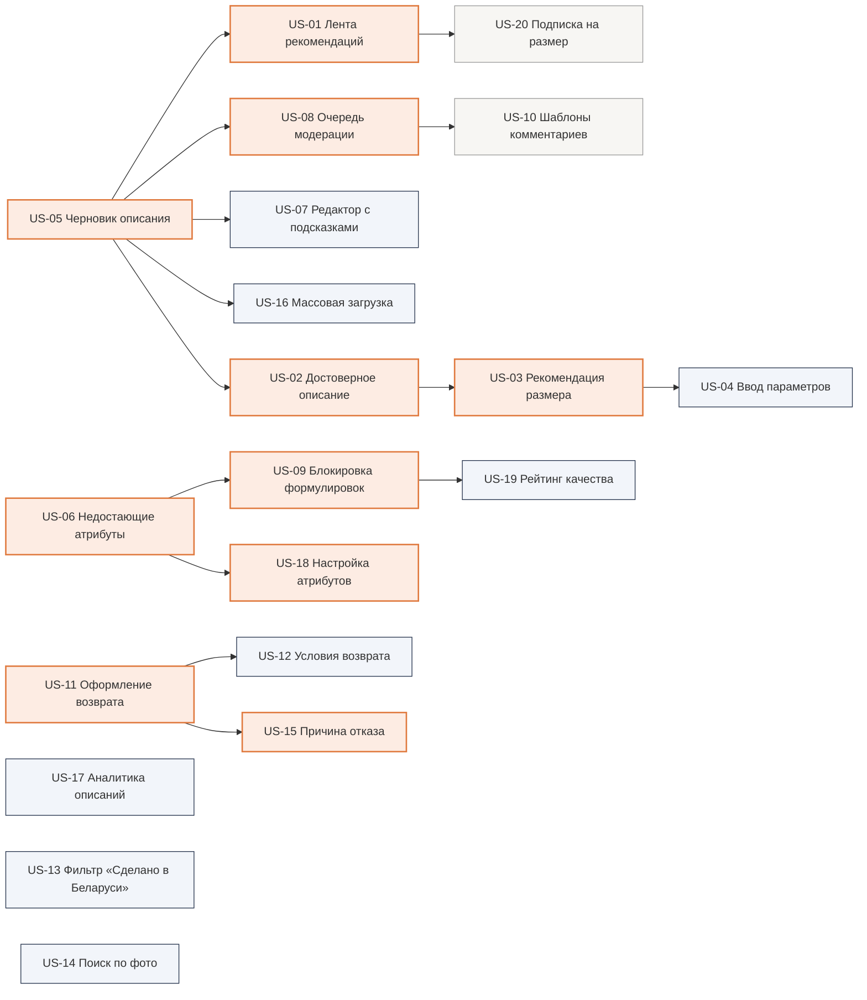

Истории с приоритетом **High** выделены оранжевым, **Medium** — синим, **Low** — серым.
Критический путь реализации: `US-06 → US-05 → US-02 → US-03` и параллельно `US-11 → US-15`.

---
### 4.5. Диаграммы классов и объектов

Построено **пять диаграмм классов** и **две диаграммы объектов**. Доменная модель разделена
по ограниченным контекстам, выявленным в [задании 5](#задание-5-проектирование-системы-на-основе-метода-event-storming): каталог, описания,
заказы, покупатель и модерация. Ограничение «не более 10 классов на диаграмме» из промпта
4.1.4 выдержано на всех диаграммах.

#### 4.5.1. Диаграмма классов 1. Каталог товаров

**Файл:** [`diagrams/04-class-catalog.puml`](diagrams/04-class-catalog.puml)

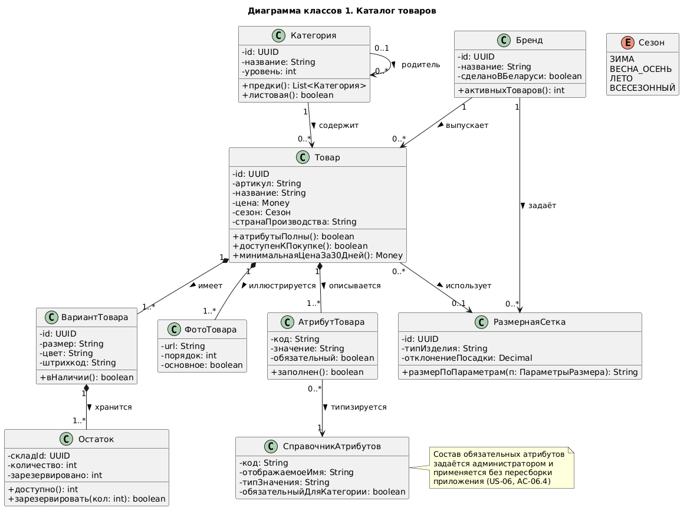

**Проектные решения:**

1. **`Товар` и `ВариантТовара` разделены.** Размер и цвет — характеристики варианта, а не
   товара: цена и описание общие для всех вариантов, а остаток и штрихкод — свои у каждого.
   Без этого разделения невозможно корректно реализовать AC-03.7 (проверка наличия
   рекомендованного размера) и резервирование остатков при оформлении заказа.
2. **`Остаток` связан с вариантом композицией и имеет составной ключ** «вариант + склад».
   Поле `зарезервировано` отделено от `количество`, чтобы резерв при оформлении заказа не
   искажал фактический остаток на складе.
3. **`СправочникАтрибутов` вынесен отдельно от `АтрибутТовара`.** Справочник задаёт, какие
   атрибуты существуют и какие из них обязательны для категории; атрибут товара хранит
   значение. Это реализация AC-06.4 и US-18: состав обязательных полей меняется
   администратором без изменения кода.
4. **`РазмернаяСетка` принадлежит бренду, а не товару** (`Бренд 1 → 0..* РазмернаяСетка`).
   Посадка — свойство бренда и типа изделия, поэтому один товар ссылается на сетку, а не
   содержит её. Кратность `0..1` со стороны товара фиксирует, что сетка может отсутствовать —
   отсюда исключение E1 сценария UC-B4.

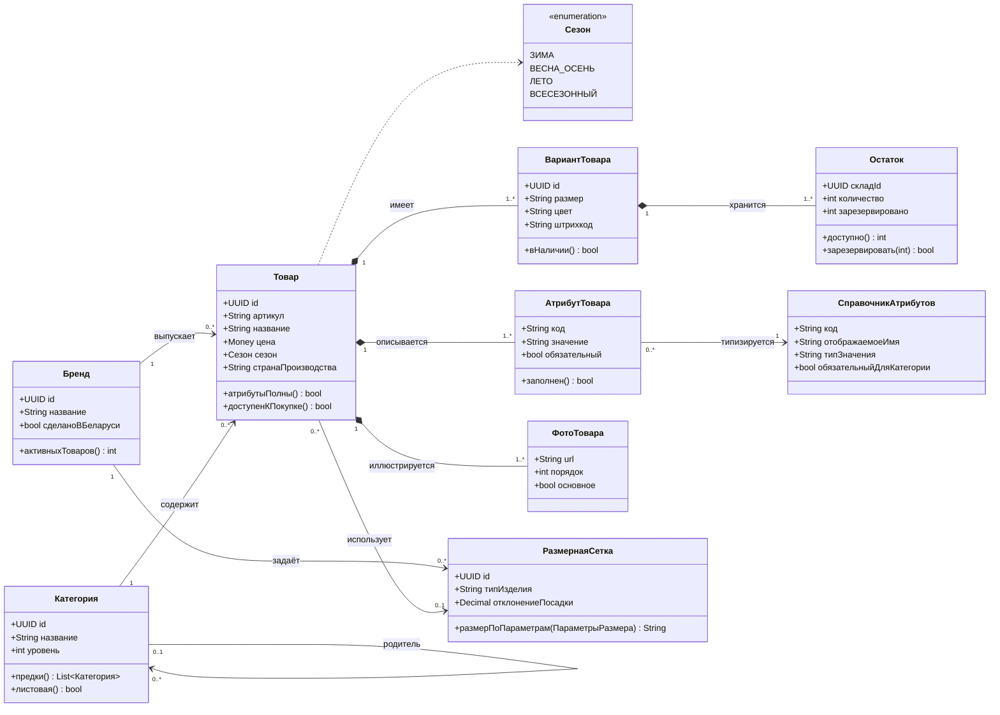

---

#### 4.5.2. Диаграмма классов 2. Генерация и модерация описаний

**Файл:** [`diagrams/04-class-description.puml`](diagrams/04-class-description.puml)

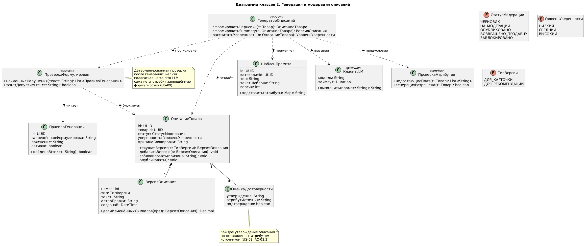

**Проектные решения:**

1. **Генерация разделена на четыре сервиса:** `ГенераторОписаний` (оркестратор),
   `КлиентLLM` (шлюз к внешнему провайдеру), `ПроверкаАтрибутов` (предусловие) и
   `ПроверкаФормулировок` (постусловие). Это позволяет заменить LLM-провайдера, не затрагивая
   ни домен, ни правила проверки.
2. **`ПроверкаФормулировок` — детерминированный сервис, а не часть промпта.** Нельзя
   полагаться на то, что языковая модель сама не употребит запрещённую формулировку: правило
   должно быть воспроизводимым и редактируемым администратором (AC-09.4).
3. **`ОценкаДостоверности` связывает каждое утверждение описания с атрибутом-источником.**
   Это прямая реализация AC-02.3: модератор видит, из какого атрибута выведено каждое
   утверждение, и может проверить достоверность текста формально, а не на глаз.
4. **`ШаблонПромпта` версионируется и привязан к категории.** Тон описания платья и зимних
   сапог различается; версия шаблона позволяет сопоставить качество описаний с конкретной
   версией промпта при анализе метрик (US-17).

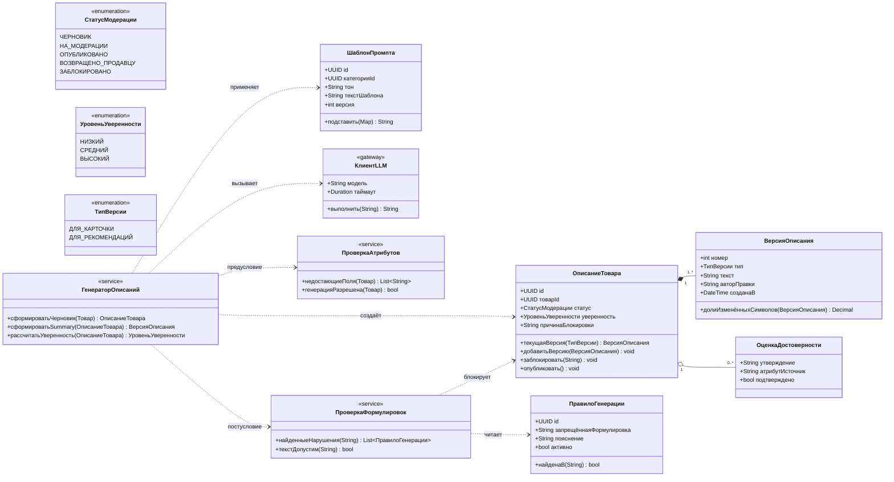

---

#### 4.5.3. Диаграмма классов 3. Заказы, оплата, доставка и возвраты

**Файл:** [`diagrams/04-class-order.puml`](diagrams/04-class-order.puml)

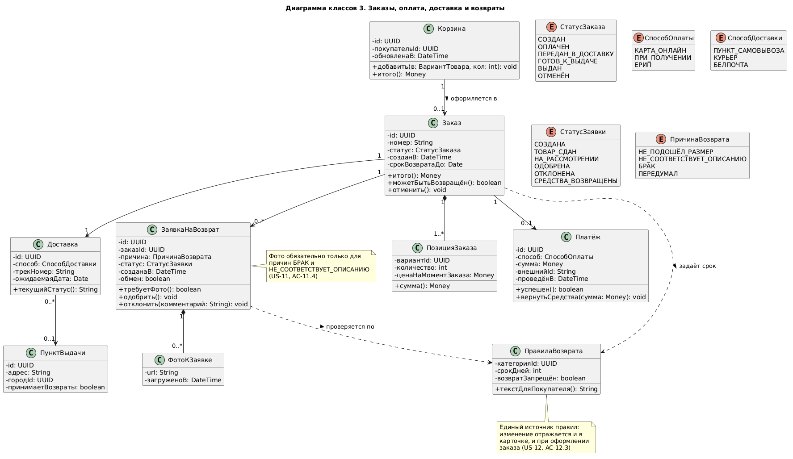

**Проектные решения:**

1. **`ПозицияЗаказа` хранит `ценаНаМоментЗаказа`.** Цена товара меняется, а сумма
   оформленного заказа — нет. Без этого поля невозможно корректно рассчитать возврат средств.
2. **`срокВозвратаДо` хранится в заказе, а не вычисляется каждый раз из правил.** Изменение
   правил возврата администратором не должно ухудшать условия уже оформленных заказов —
   это зафиксировано в постусловиях сценария UC-B7.
3. **`ЗаявкаНаВозврат` связана и с заказом, и с позицией заказа.** Покупатель может вернуть
   часть позиций, оставив остальные (альтернативный поток A4 сценария UC-B9).
4. **Признак `обмен` — булево поле заявки, а не отдельный класс.** Процесс обработки
   возврата и обмена совпадает до момента разрешения; различие проявляется только на
   последнем шаге (возврат средств либо создание заказа на замену).
5. **`ПравилаВозврата` — единый источник для карточки, оформления заказа и заявки**
   (AC-12.3). Класс связан с категорией, а не с товаром: правила задаются на уровне категории.

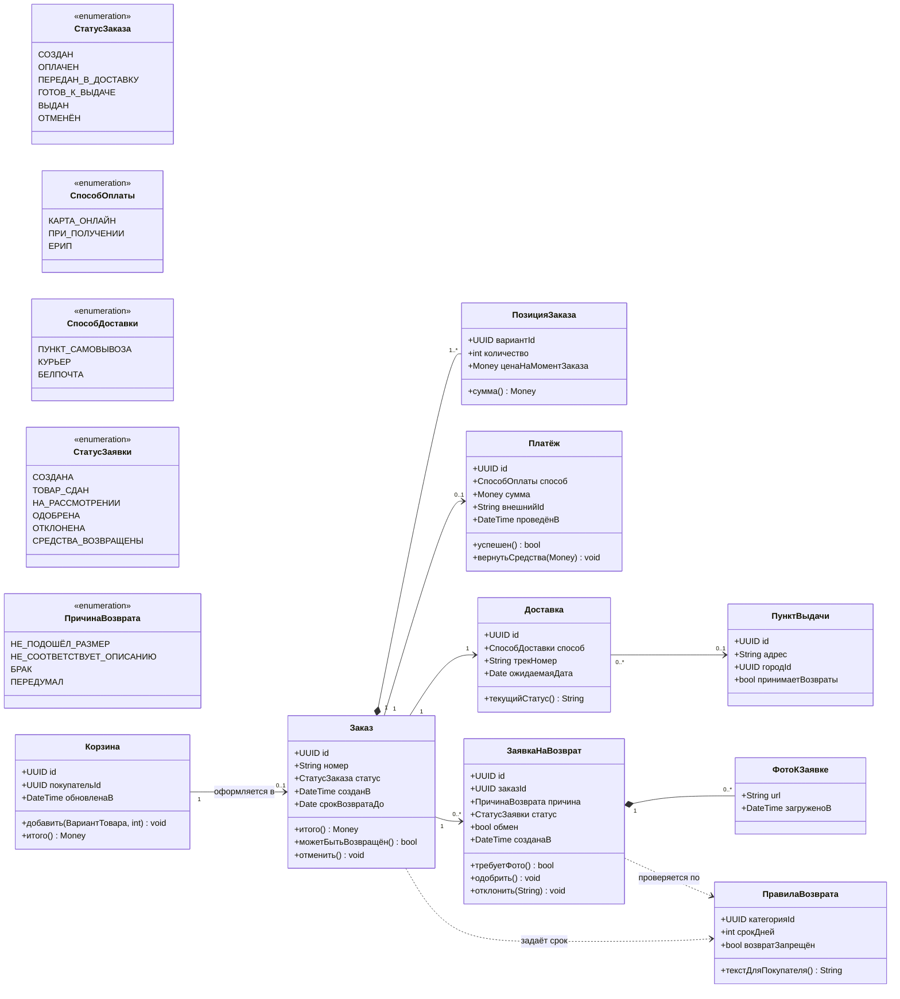

---

#### 4.5.4. Диаграмма классов 4. Покупатель, персонализация и отзывы

**Файл:** [`diagrams/04-class-customer.puml`](diagrams/04-class-customer.puml)

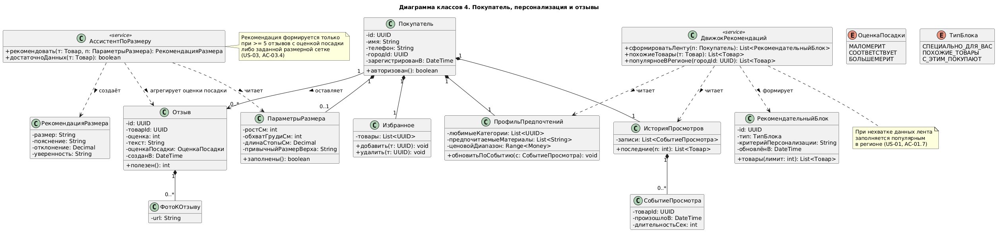

**Проектные решения:**

1. **`ПараметрыРазмера` — отдельный класс с кратностью `0..1`.** Параметры могут
   отсутствовать: именно этот случай порождает альтернативный поток A1 сценария UC-B4 и
   историю US-04.
2. **`ПрофильПредпочтений` обновляется событиями просмотра, а не редактируется вручную.**
   Метод `обновитьПоСобытию` фиксирует, что предпочтения выводятся из поведения — это
   отличает их от явно заданных параметров размера.
3. **`АссистентПоРазмеру` агрегирует отзывы, а не хранит статистику.** Оценка посадки — это
   производная величина; её хранение привело бы к рассогласованию при удалении отзыва.
4. **`РекомендацияРазмера` — объект-значение без идентификатора.** Рекомендация не
   сохраняется в базе: она вычисляется при каждом открытии карточки, поскольку зависит и от
   текущих отзывов, и от наличия на складе.
5. **`ОценкаПосадки` — перечисление из трёх значений**, совпадающее со словарём интерфейса
   («маломерит / соответствует / большемерит»). Это обеспечивает единство языка между
   отзывом покупателя, подсказкой ассистента и подсказкой продавцу в редакторе описания.

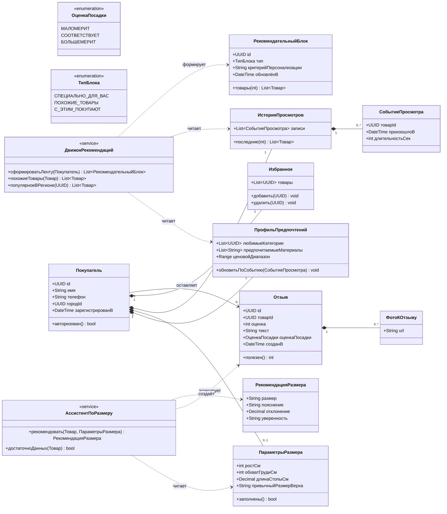

---

#### 4.5.5. Диаграмма классов 5. Модерация, правила и контроль качества

**Файл:** [`diagrams/04-class-moderation.puml`](diagrams/04-class-moderation.puml)

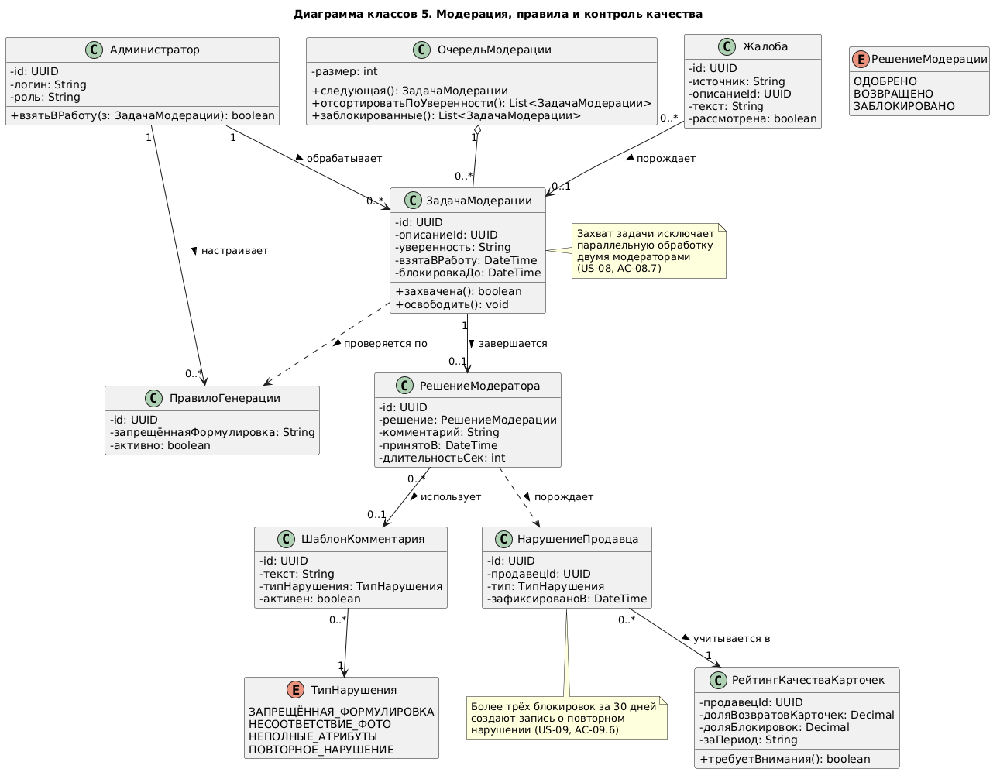

**Проектные решения:**

1. **`ЗадачаМодерации` содержит поля захвата (`взятаВРаботу`, `блокировкаДо`).** Это
   реализация AC-08.7: задача, взятая одним модератором, недоступна другому до освобождения
   или истечения таймаута. Таймаут обязателен — без него задача «зависнет» при сбое клиента.
2. **`РешениеМодератора` отделено от задачи и хранит `длительностьСек`.** Это позволяет
   измерять среднее время модерации — один из критериев успешности проекта (не более 2 минут).
3. **`НарушениеПродавца` создаётся решением модератора, а не блокировкой напрямую.**
   Нарушение — это бизнес-факт, зафиксированный человеком или правилом; `РейтингКачества`
   агрегирует нарушения за период (US-19).
4. **`ШаблонКомментария` типизирован видом нарушения.** Модератору предлагаются релевантные
   шаблоны, а не весь список, что соответствует AC-10.1 и сокращает время решения.

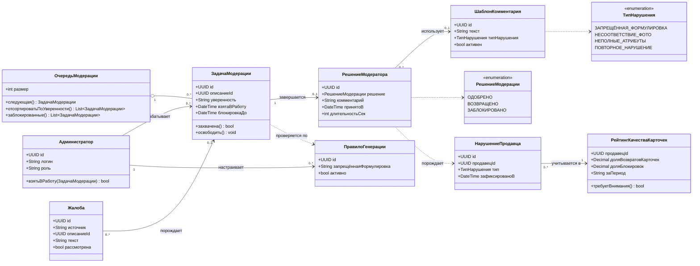

---

#### 4.5.6. Диаграмма объектов 1. Карточка на модерации

**Файл:** [`diagrams/04-object-moderation-snapshot.puml`](diagrams/04-object-moderation-snapshot.puml)

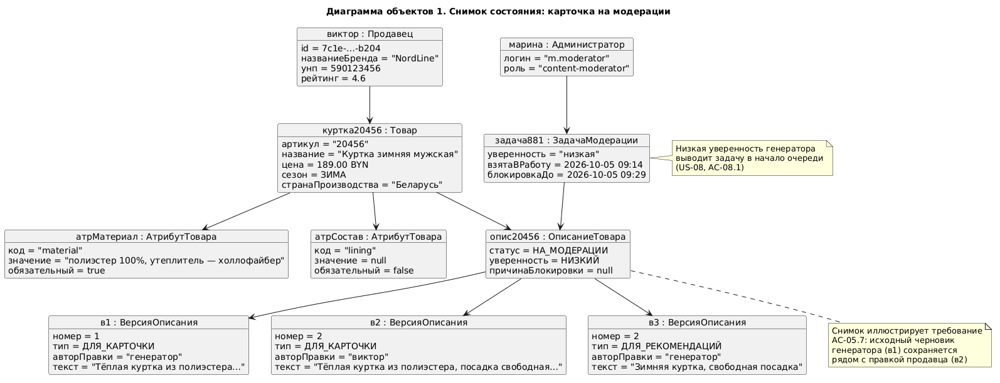

**Что иллюстрирует снимок.** Состояние системы в момент, когда модератор Марина взяла в
работу карточку «Куртка зимняя мужская» продавца Виктора. Снимок показывает три важных
момента, которые на диаграмме классов видны только как кратности:

- у одного описания сосуществуют **три версии**: исходный черновик генератора (`в1`), правка
  продавца (`в2`) и краткая версия для рекомендаций (`в3`). Это AC-05.7 и AC-07.4 в действии —
  исходный текст генератора не затирается правкой;
- атрибут `атрСостав` имеет значение `null` при `обязательный = false` — граничный случай,
  который не блокирует генерацию, в отличие от незаполненного обязательного атрибута;
- `уверенность = НИЗКИЙ` объясняет, почему задача оказалась в начале очереди (AC-08.1), а
  поле `блокировкаДо` фиксирует таймаут захвата задачи (AC-08.7).

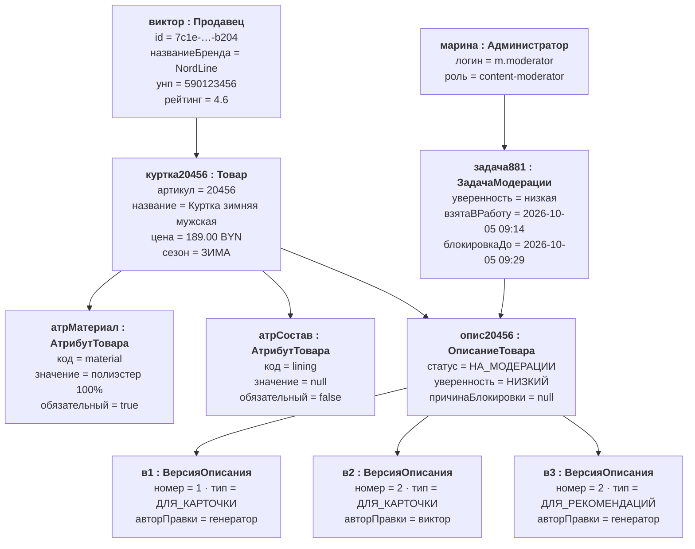

---

#### 4.5.7. Диаграмма объектов 2. Персонализированная лента Анастасии

**Файл:** [`diagrams/04-object-recommendation.puml`](diagrams/04-object-recommendation.puml)

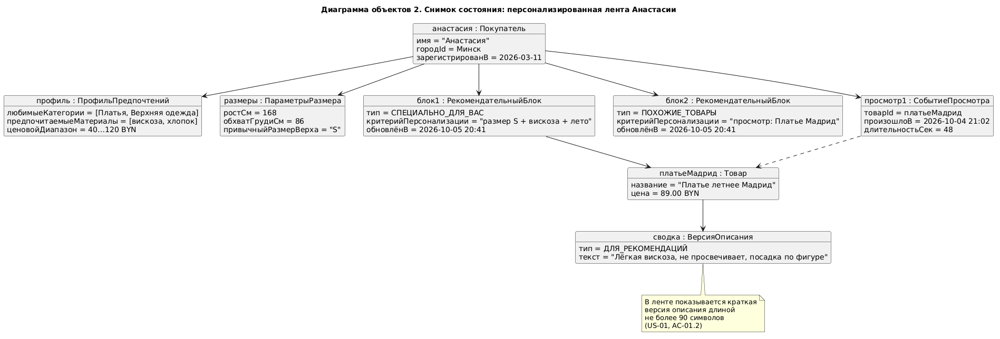

**Что иллюстрирует снимок.** Состояние, в котором находится система, когда ключевой персонаж
Анастасия открывает главный экран вечером. Снимок показывает, какие именно данные участвуют
в формировании ленты: профиль предпочтений (вискоза, платья), параметры размера (S),
последнее событие просмотра (платье «Мадрид», 48 секунд) и два сформированных блока.
Критерий персонализации записан в блоке явно — это нужно для отладки рекомендаций и для
ответа на вопрос «почему мне показали именно это». Краткая версия описания
(«Лёгкая вискоза, не просвечивает, посадка по фигуре» — 51 символ) укладывается в
ограничение 90 символов из AC-01.2.

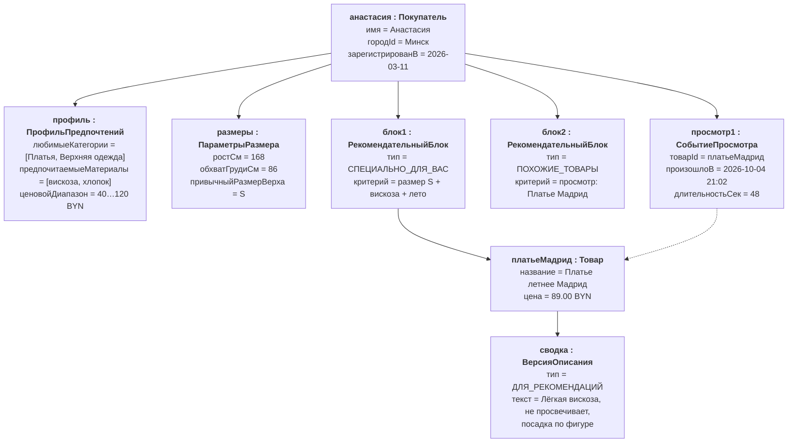

---
### 4.6. Диаграммы деятельности

Всего в спецификации три диаграммы деятельности: «Публикация товара с автогенерацией
описания» построена в [задании 2](#22-диаграмма-деятельности-activity-diagram),
ещё две приведены ниже.

#### 4.6.1. Подбор размера и оформление заказа

**Файл:** [`diagrams/04-activity-size-purchase.puml`](diagrams/04-activity-size-purchase.puml)

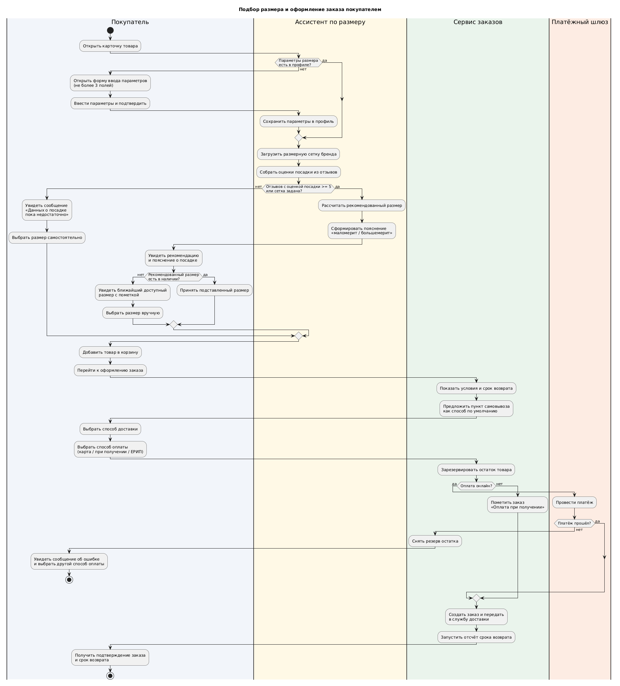

Процесс объединяет сценарии UC-B4 и UC-B7 и показан в четырёх дорожках: «Покупатель»,
«Ассистент по размеру», «Сервис заказов», «Платёжный шлюз». Диаграмма фиксирует три решения:

- **Ввод параметров встроен в процесс, а не вынесен в отдельный маршрут.** Ветка «параметры
  не заданы» возвращается в основной поток, а не завершает процесс — покупатель не теряет
  контекст карточки (US-04).
- **Нехватка данных о посадке не прерывает покупку.** Процесс продолжается с ручным выбором
  размера, то есть ассистент — вспомогательный, а не обязательный шаг.
- **Показаны три различных завершения:** успешное оформление заказа, отказ платежа с
  возвратом к выбору способа оплаты, и выход через ручной выбор размера. Отказ платежа
  обязательно сопровождается снятием резерва остатка — иначе товар «зависнет» недоступным.

```mermaid
flowchart TD
    start([Начало]) --> open["Открыть карточку товара"]
    open --> hasParams{"Параметры размера<br/>есть в профиле?"}
    hasParams -- нет --> form["Открыть форму ввода<br/>не более 3 полей"]
    form --> enter["Ввести параметры<br/>и подтвердить"]
    enter --> save["Сохранить параметры<br/>в профиль"]
    save --> chart
    hasParams -- да --> chart["Загрузить размерную сетку бренда"]
    chart --> fit["Собрать оценки посадки из отзывов"]
    fit --> enough{"Отзывов >= 5<br/>или сетка задана?"}

    enough -- нет --> noData["Сообщение «Данных о посадке<br/>пока недостаточно»"]
    noData --> manual["Выбрать размер самостоятельно"]
    manual --> cart

    enough -- да --> calc["Рассчитать рекомендованный размер"]
    calc --> explain["Сформировать пояснение<br/>маломерит / большемерит"]
    explain --> inStock{"Рекомендованный размер<br/>есть в наличии?"}
    inStock -- нет --> nearest["Показать ближайший доступный<br/>размер с пометкой"]
    nearest --> manual2["Выбрать размер вручную"]
    manual2 --> cart
    inStock -- да --> accept["Принять подставленный размер"]
    accept --> cart["Добавить товар в корзину"]

    cart --> checkout["Перейти к оформлению заказа"]
    checkout --> terms["Показать условия и срок возврата"]
    terms --> pickup["Предложить пункт самовывоза<br/>как способ по умолчанию"]
    pickup --> chooseDelivery["Выбрать способ доставки"]
    chooseDelivery --> choosePay["Выбрать способ оплаты"]
    choosePay --> reserve["Зарезервировать остаток товара"]
    reserve --> online{"Оплата онлайн?"}

    online -- да --> pay["Провести платёж"]
    pay --> paid{"Платёж прошёл?"}
    paid -- нет --> unreserve["Снять резерв остатка"]
    unreserve --> payErr["Показать ошибку и предложить<br/>другой способ оплаты"]
    payErr --> stop2([Завершение: заказ не создан])
    paid -- да --> createOrder
    online -- нет --> onDelivery["Пометить заказ<br/>«Оплата при получении»"]
    onDelivery --> createOrder["Создать заказ и передать<br/>в службу доставки"]

    createOrder --> startReturn["Запустить отсчёт срока возврата"]
    startReturn --> confirm["Подтверждение заказа<br/>и срок возврата"]
    confirm --> stop1([Завершение: заказ оформлен])

    classDef buyer fill:#F2F5FA,stroke:#22304A
    classDef asst fill:#FFF9E6,stroke:#C98A2E
    classDef order fill:#EAF4EC,stroke:#4C8C5A
    classDef pay fill:#FDECE3,stroke:#E07A3F
    class open,form,enter,manual,manual2,accept,cart,checkout,chooseDelivery,choosePay,confirm,noData,nearest buyer
    class chart,fit,calc,explain,save asst
    class terms,pickup,reserve,createOrder,startReturn,onDelivery,unreserve order
    class pay,payErr pay
```

---

#### 4.6.2. Оформление возврата или обмена

**Файл:** [`diagrams/04-activity-return.puml`](diagrams/04-activity-return.puml)

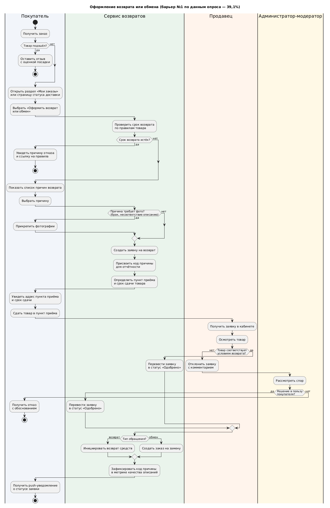

Процесс закрывает барьер №1 по данным опроса (39,1%) и разнесён по пяти дорожкам:
«Покупатель», «Сервис возвратов», «Продавец», «Администратор-модератор». Решения, которые
фиксирует диаграмма:

- **Проверка срока возврата выполняется до показа формы, а не после заполнения.** Покупатель
  не должен заполнять заявку, чтобы узнать, что возврат уже невозможен (US-15).
- **Обязательность фотографий зависит от причины.** Ветвление реализует AC-11.4 и экономит
  шаги в самом частом случае — «не подошёл размер».
- **Спор между покупателем и продавцом разрешает администратор.** Без этой ветки процесс
  заходил бы в тупик при отказе продавца, что воспроизвело бы исходный барьер.
- **Код причины фиксируется в метрике качества описаний.** Это замыкает обратную связь:
  возвраты с причиной «не соответствует описанию» влияют на рейтинг продавца (US-19) и на
  оценку эффекта автогенерации (US-17).

```mermaid
flowchart TD
    start([Начало]) --> receive["Получить заказ"]
    receive --> ok{"Товар подошёл?"}
    ok -- да --> review["Оставить отзыв<br/>с оценкой посадки"]
    review --> stopOk([Завершение: возврат не требуется])

    ok -- нет --> openOrders["Открыть «Мои заказы»<br/>или статус доставки"]
    openOrders --> choose["Выбрать «Оформить возврат<br/>или обмен»"]
    choose --> checkTerm["Проверить срок возврата<br/>по правилам товара"]
    checkTerm --> expired{"Срок возврата истёк?"}
    expired -- да --> reason0["Показать причину отказа<br/>и ссылку на правила"]
    reason0 --> stopExp([Завершение: возврат недоступен])

    expired -- нет --> reasons["Показать список причин"]
    reasons --> pickReason["Выбрать причину"]
    pickReason --> needPhoto{"Причина требует фото?<br/>брак, несоответствие описанию"}
    needPhoto -- да --> photo["Прикрепить фотографии"]
    photo --> createReq
    needPhoto -- нет --> createReq["Создать заявку на возврат"]

    createReq --> code["Присвоить код причины<br/>для отчётности"]
    code --> point["Определить пункт приёма<br/>и срок сдачи"]
    point --> showPoint["Показать адрес пункта<br/>и срок сдачи"]
    showPoint --> handOver["Сдать товар в пункт приёма"]
    handOver --> sellerGet["Продавец получает заявку"]
    sellerGet --> inspect["Осмотреть товар"]
    inspect --> conform{"Товар соответствует<br/>условиям возврата?"}

    conform -- нет --> reject["Отклонить заявку<br/>с комментарием"]
    reject --> dispute["Администратор рассматривает спор"]
    dispute --> forBuyer{"Решение в пользу<br/>покупателя?"}
    forBuyer -- нет --> refuse["Покупатель получает отказ<br/>с обоснованием"]
    refuse --> stopRef([Завершение: заявка отклонена])
    forBuyer -- да --> approve
    conform -- да --> approve["Перевести заявку<br/>в статус «Одобрена»"]

    approve --> kind{"Тип обращения?"}
    kind -- возврат --> refund["Инициировать возврат средств"]
    kind -- обмен --> replace["Создать заказ на замену"]
    refund --> metric
    replace --> metric["Зафиксировать код причины<br/>в метрике качества описаний"]
    metric --> push["Push-уведомление о статусе"]
    push --> stopDone([Завершение: заявка исполнена])

    classDef buyer fill:#F2F5FA,stroke:#22304A
    classDef svc fill:#EAF4EC,stroke:#4C8C5A
    classDef seller fill:#FFF4EC,stroke:#C98A2E
    classDef admin fill:#FFF9E6,stroke:#9A7B2E
    class receive,openOrders,choose,pickReason,photo,showPoint,handOver,review,refuse,reason0 buyer
    class checkTerm,reasons,createReq,code,point,approve,refund,replace,metric,push svc
    class sellerGet,inspect,reject seller
    class dispute admin
```

---

### 4.7. Диаграммы последовательности

Построено **пять** диаграмм последовательности; шестая — «Генерация черновика описания» —
приведена в [задании 3](#32-диаграмма-последовательности-sequence-diagram).

#### 4.7.1. Формирование персонализированной ленты

**Файл:** [`diagrams/04-seq-recommendations.puml`](diagrams/04-seq-recommendations.puml)

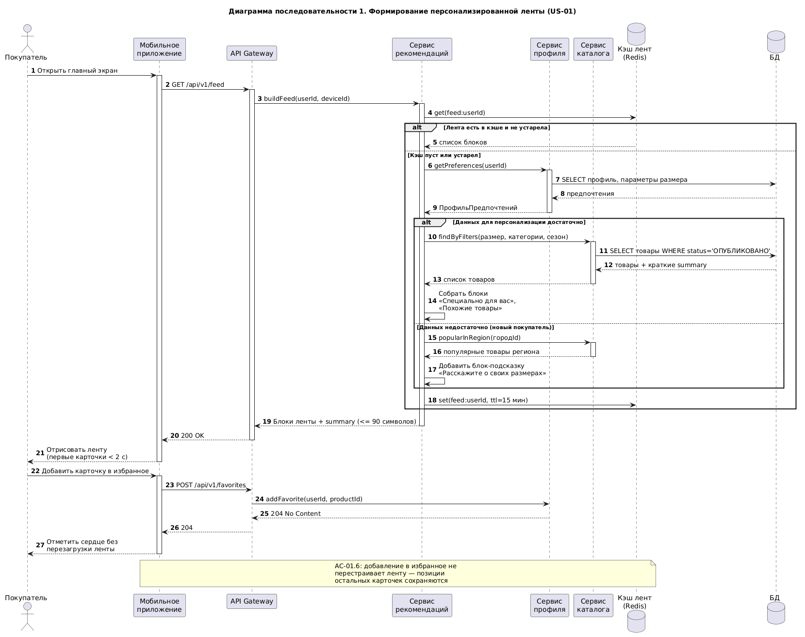

**Ключевые решения:** кэш ленты проверяется первым — это снимает нагрузку с сервиса каталога
при повторных открытиях главного экрана в течение одной сессии; ветка «данных недостаточно»
обрабатывается на сервере, а не в клиенте, чтобы и мобильное, и веб-приложение вели себя
одинаково; добавление в избранное идёт отдельным запросом и не инвалидирует кэш ленты
(AC-01.6).

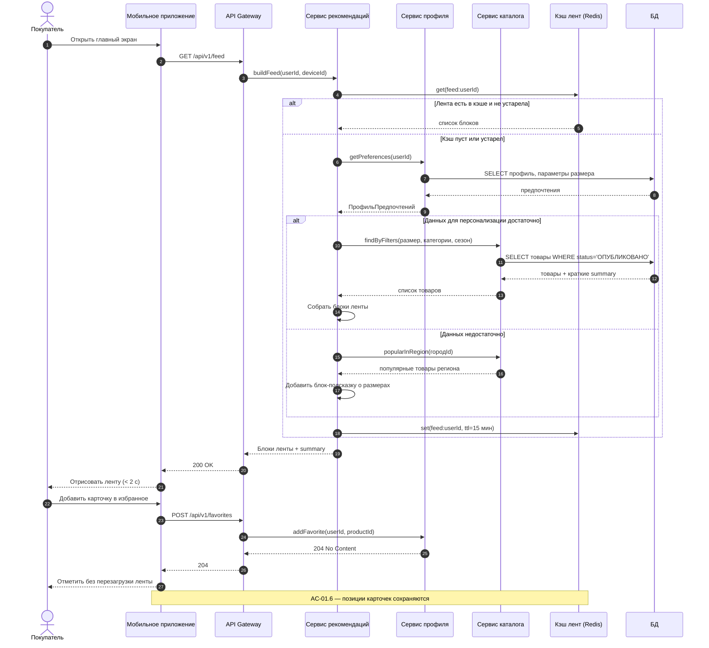

---

#### 4.7.2. Ассистент по размеру

**Файл:** [`diagrams/04-seq-size-assistant.puml`](diagrams/04-seq-size-assistant.puml)

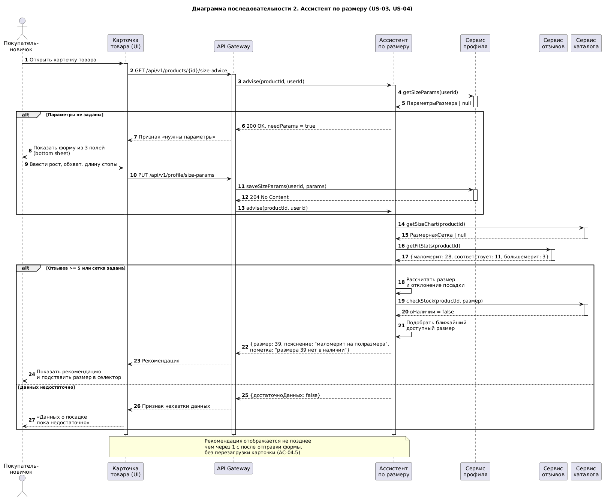

**Ключевые решения:** проверка наличия размера выполняется **после** расчёта рекомендации —
иначе система не смогла бы сообщить, какого именно размера не хватает (AC-03.7); ввод
параметров возвращается в тот же вызов `advise`, а не открывает новый маршрут, что сохраняет
контекст карточки; расчёт выполняется на сервере, поскольку зависит от агрегата отзывов,
который нельзя целиком передавать клиенту.

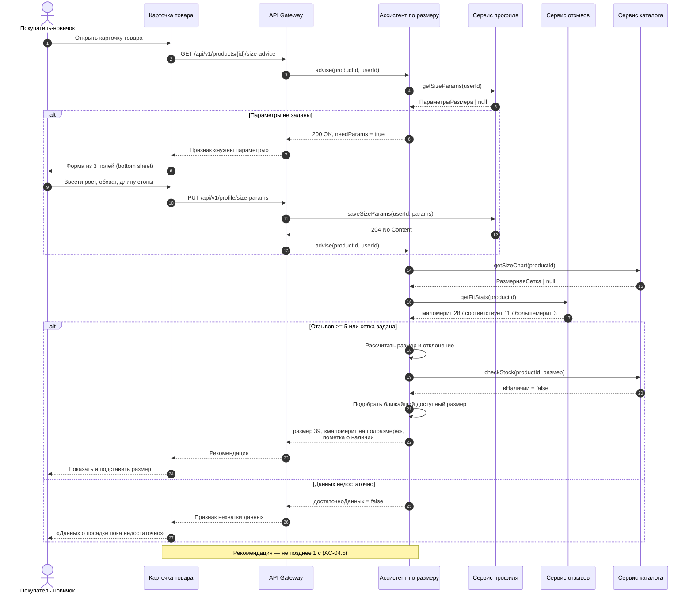

---

#### 4.7.3. Модерация карточки

**Файл:** [`diagrams/04-seq-moderation.puml`](diagrams/04-seq-moderation.puml)

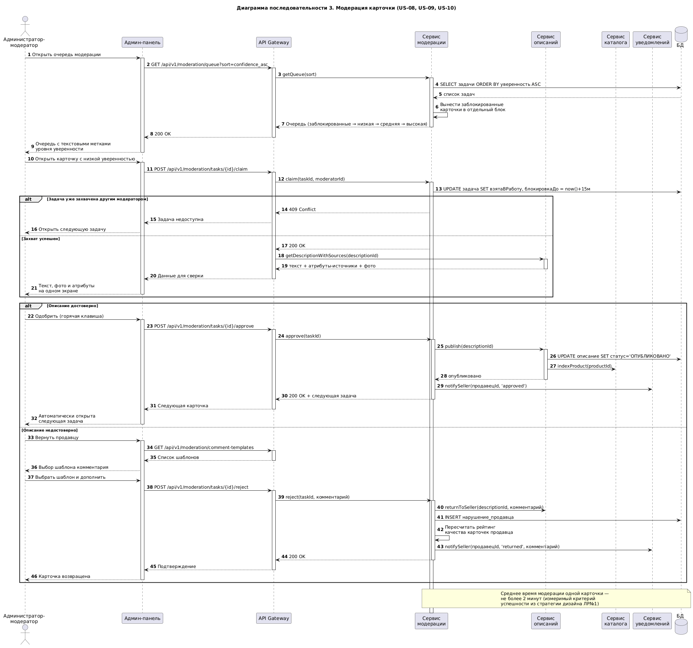

**Ключевые решения:** захват задачи реализован отдельным вызовом `claim` с кодом `409` при
конфликте — это единственный способ гарантировать AC-08.7 при нескольких модераторах;
публикация описания порождает переиндексацию в каталоге, то есть карточка появляется в
поиске не мгновенно, а по событию; возврат карточки продавцу сразу пересчитывает рейтинг
качества, что связывает US-10 и US-19.

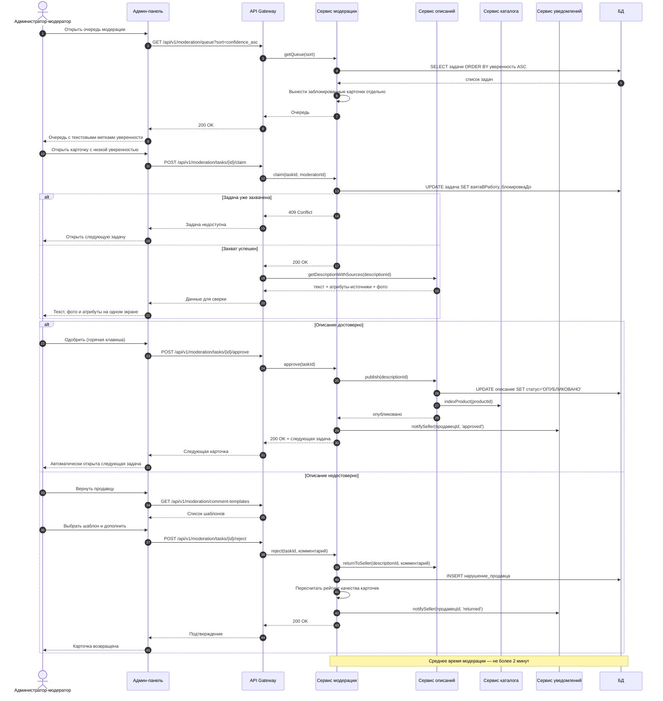

---

#### 4.7.4. Оформление и оплата заказа

**Файл:** [`diagrams/04-seq-checkout.puml`](diagrams/04-seq-checkout.puml)

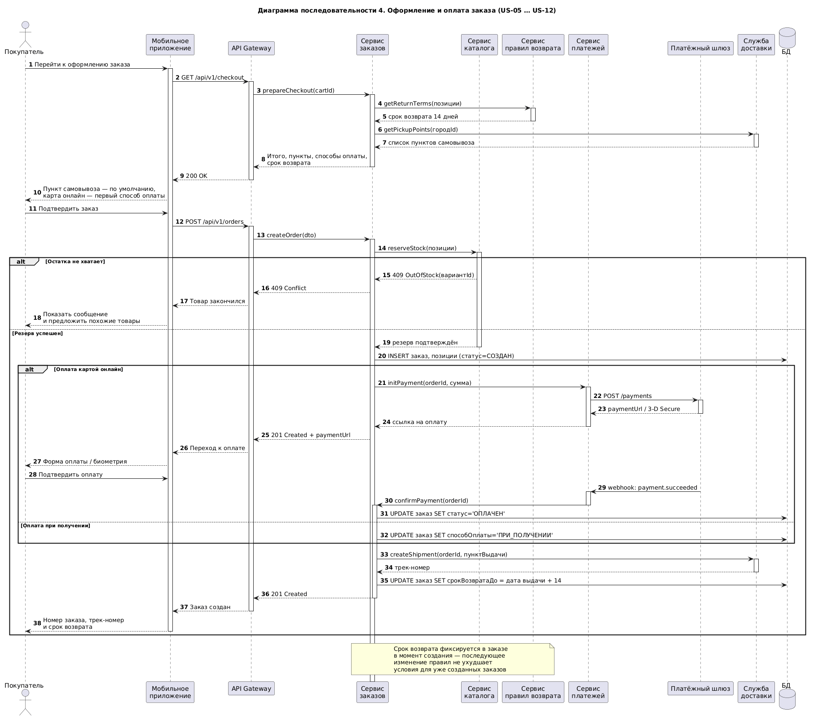

**Ключевые решения:** резерв остатка выполняется **до** создания заказа — иначе два
покупателя могли бы оформить последний экземпляр; подтверждение платежа приходит вебхуком от
шлюза, а не синхронным ответом, поскольку 3-D Secure выполняется вне приложения; срок
возврата фиксируется в заказе в момент создания и далее не пересчитывается.

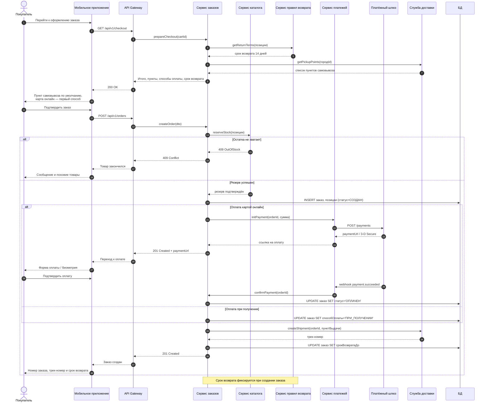

---

#### 4.7.5. Оформление возврата или обмена

**Файл:** [`diagrams/04-seq-return.puml`](diagrams/04-seq-return.puml)

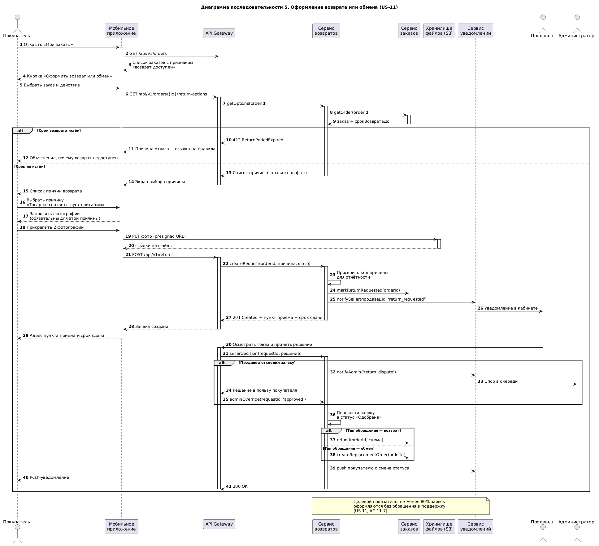

**Ключевые решения:** фотографии загружаются напрямую в объектное хранилище по presigned URL,
минуя прикладные сервисы, — это снимает ограничение на размер запроса и ускоряет оформление
на мобильном интернете; проверка срока возврата выполняется до показа формы (US-15); спор
эскалируется администратору автоматически, а не по обращению покупателя в поддержку.

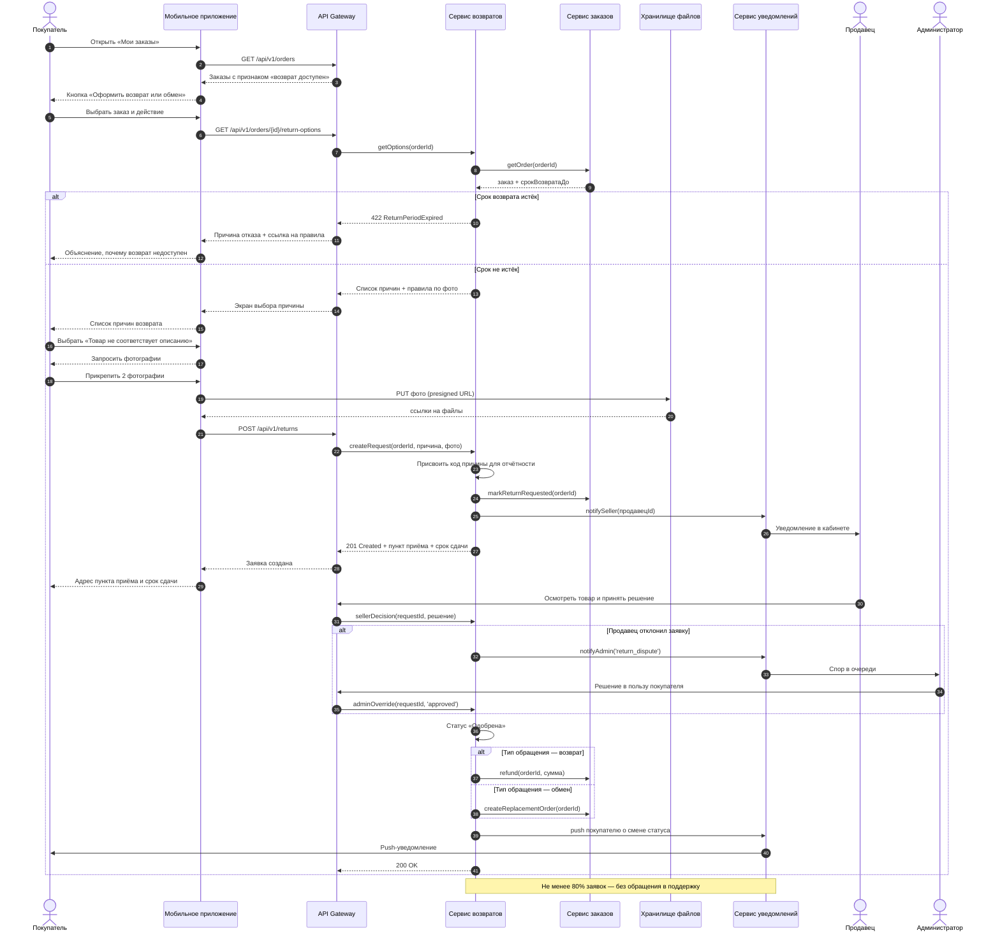

---
### 4.8. Диаграмма компонентов

**Файл:** [`diagrams/04-component.puml`](diagrams/04-component.puml)

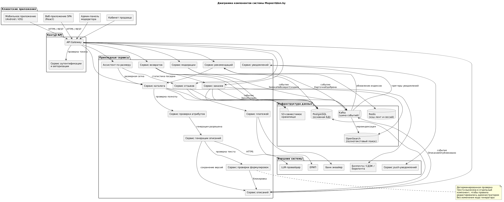

#### Ответственность компонентов

| Компонент | Ответственность | Реализует User Story |
|-----------|-----------------|----------------------|
| API Gateway | Маршрутизация, ограничение частоты запросов, проверка токена | Все |
| Сервис аутентификации | Выпуск и проверка токенов, биометрический вход | US-07, US-11 |
| Сервис каталога | Товары, варианты, категории, остатки, индексация поиска | US-01, US-13, US-14 |
| Сервис описаний | Хранение описаний и версий, статусы модерации | US-02, US-05, US-07 |
| Сервис проверки атрибутов | Определение полноты атрибутов, список недостающих полей | US-06, US-16, US-18 |
| Сервис генерации описаний | Оркестрация генерации, расчёт уверенности | US-05, US-16 |
| Сервис проверки формулировок | Детерминированная проверка текста по правилам | US-09 |
| Сервис рекомендаций | Формирование ленты и блоков «Похожие товары» | US-01 |
| Ассистент по размеру | Расчёт рекомендации размера и пояснения о посадке | US-03, US-04 |
| Сервис заказов | Корзина, заказ, резервирование остатков, срок возврата | US-12 |
| Сервис платежей | Интеграция с ЕРИП и эквайрингом, обработка вебхуков | US-12 |
| Сервис возвратов | Заявки на возврат и обмен, правила возврата | US-11, US-12, US-15 |
| Сервис модерации | Очередь, захват задач, решения, рейтинг качества | US-08, US-10, US-19 |
| Сервис отзывов | Отзывы, агрегаты оценок посадки | US-03, US-07 |
| Сервис уведомлений | Push, e-mail, уведомления в кабинетах | US-01, US-11 |

#### Архитектурные решения

1. **Проверка формулировок вынесена в отдельный компонент**, а не встроена в сервис
   генерации. Правила редактируются администратором (US-18), и изменение списка запрещённых
   фраз не должно требовать выпуска новой версии генератора.
2. **К внешнему LLM-провайдеру обращается ровно один компонент.** Это упрощает контроль
   затрат, установку таймаутов и замену модели: остальные сервисы ничего не знают о
   провайдере.
3. **Асинхронные взаимодействия идут через шину событий, а не прямыми вызовами.**
   Публикация описания, создание заказа и заявки на возврат порождают события, на которые
   подписаны рекомендации, уведомления и поисковый индекс. Это исключает ситуацию, когда
   недоступность сервиса рекомендаций блокирует публикацию карточки.
4. **Поисковый индекс отделён от основной БД.** Полнотекстовый поиск по описаниям на тысячах
   товаров — отдельная нагрузка, которую нельзя класть на транзакционную базу.

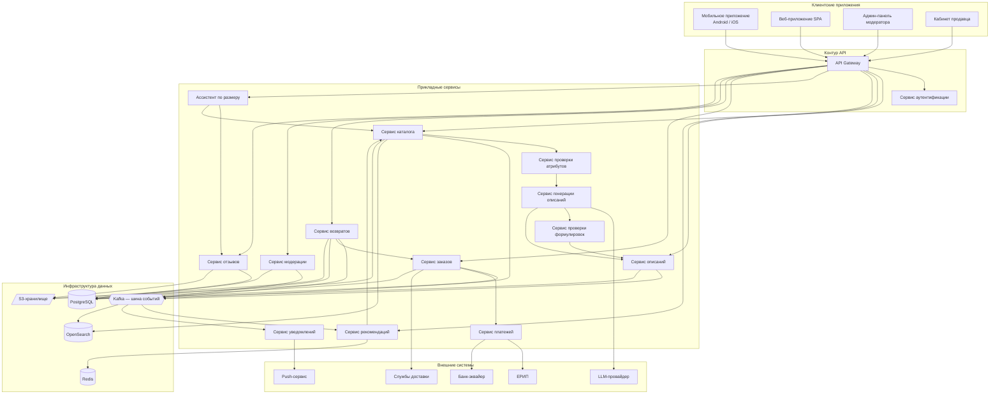

---

### 4.9. Диаграмма пакетов

**Файл:** [`diagrams/04-package.puml`](diagrams/04-package.puml)

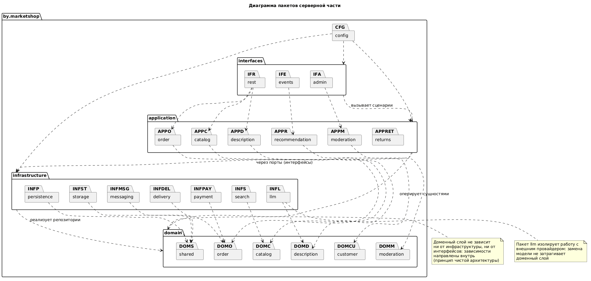

#### Правило, которое проверяется на code review

**Доменный слой (`by.marketshop.domain`) не импортирует ничего из `infrastructure` и
`interfaces`.** Проверка автоматизирована правилом ArchUnit в сборке: нарушение падает тестом,
а не замечанием ревьюера.

Практический смысл правила виден на примере работы с LLM-провайдером. Доменный класс
`ОписаниеТовара` не знает ни о каком провайдере: сервис генерации объявляет **порт**
(интерфейс `КлиентLLM`) в слое `application`, а конкретная реализация живёт в
`infrastructure.llm`. Замена модели или переход на другого поставщика затрагивает один пакет
и не требует изменений ни в домене, ни в правилах модерации.

Подпакеты внутри слоёв выделены **по доменам** (`catalog`, `description`, `order`,
`moderation`, `customer`), а не по техническим типам (`dto`, `utils`, `helpers`). Это
соответствует ограниченным контекстам из [задания 5](#задание-5-проектирование-системы-на-основе-метода-event-storming) и позволяет при
необходимости вынести контекст в отдельный сервис без перетасовки файлов.

```mermaid
flowchart TB
    subgraph root["by.marketshop"]
        subgraph IF["interfaces"]
            IFR["rest"]
            IFE["events"]
            IFA["admin"]
        end
        subgraph APP["application"]
            APPC["catalog"]
            APPD["description"]
            APPR["recommendation"]
            APPO["order"]
            APPM["moderation"]
            APPRET["returns"]
        end
        subgraph DOM["domain"]
            DOMC["catalog"]
            DOMD["description"]
            DOMCU["customer"]
            DOMO["order"]
            DOMM["moderation"]
            DOMS["shared"]
        end
        subgraph INF["infrastructure"]
            INFP["persistence"]
            INFL["llm"]
            INFPAY["payment"]
            INFDEL["delivery"]
            INFS["search"]
            INFMSG["messaging"]
            INFST["storage"]
        end
        CFG["config"]
    end

    IF -.->|вызывает сценарии| APP
    APP -.->|оперирует сущностями| DOM
    APP -.->|через порты| INF
    INF -.->|реализует репозитории| DOM
    CFG -.-> IF
    CFG -.-> APP
    CFG -.-> INF

    IFR -.-> APPC
    IFR -.-> APPD
    IFR -.-> APPO
    IFA -.-> APPM
    IFE -.-> APPR
    APPD -.-> DOMD
    APPC -.-> DOMC
    APPO -.-> DOMO
    APPM -.-> DOMM
    APPR -.-> DOMCU
    INFL -.-> DOMD
    INFP -.-> DOMS

    classDef dom fill:#FDECE3,stroke:#E07A3F,stroke-width:2px
    class DOM,DOMC,DOMD,DOMCU,DOMO,DOMM,DOMS dom
```

---

### 4.10. Диаграмма развёртывания

**Файл:** [`diagrams/04-deployment.puml`](diagrams/04-deployment.puml)

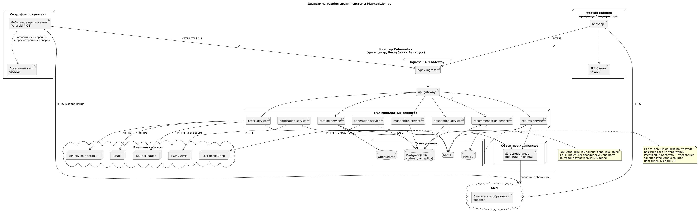

#### Узлы и требования к отказоустойчивости

| Узел | Что разворачивается | Требования |
|------|---------------------|------------|
| Смартфон покупателя | Мобильное приложение, локальный кэш SQLite | Работа в офлайн-режиме для корзины, избранного и просмотренных товаров; черновик заявки на возврат отправляется при восстановлении связи |
| Рабочая станция | Браузер, SPA-бандл | Поддержка двух последних версий Chrome, Safari, Firefox, Edge; корректная вёрстка при масштабе 200% |
| CDN | Статика и изображения товаров | Кэширование изображений, выдача ближайшим узлом; отказ CDN не делает каталог недоступным — отображаются заглушки |
| Ingress / API Gateway | nginx-ingress, api-gateway | Не менее двух реплик, терминирование TLS 1.3, ограничение частоты запросов |
| Пул прикладных сервисов | Восемь сервисов в контейнерах | Горизонтальное масштабирование; сервис генерации масштабируется отдельно, так как ограничен квотой LLM-провайдера |
| Узел данных | PostgreSQL (primary + replica), Redis, OpenSearch, Kafka | Синхронная репликация БД, ежедневное резервное копирование, восстановление не дольше 4 часов |
| Объектное хранилище | S3-совместимое хранилище | Версионирование файлов; фотографии отзывов и заявок на возврат не удаляются до истечения срока рассмотрения |

#### Ключевое ограничение

**Персональные данные покупателей размещаются на территории Республики Беларусь.**
Это ограничение определило размещение узла данных и запрет на использование внешних
управляемых баз данных. Вызовы к внешнему LLM-провайдеру выполняются **без передачи
персональных данных**: на вход подаются только атрибуты товара.

```mermaid
flowchart TB
    subgraph phone["Смартфон покупателя"]
        MobApp["Мобильное приложение"]
        LocalCache[("Локальный кэш SQLite")]
    end
    subgraph desktop["Рабочая станция продавца / модератора"]
        Browser["Браузер"]
        SPA["SPA-бандл"]
    end
    subgraph cdn["CDN"]
        Static["Статика и изображения"]
    end

    subgraph k8s["Кластер Kubernetes — Республика Беларусь"]
        subgraph ingress["Ingress / API Gateway"]
            Nginx["nginx-ingress"]
            GW["api-gateway"]
        end
        subgraph pods["Пул прикладных сервисов"]
            SvcCat["catalog-service"]
            SvcDesc["description-service"]
            SvcGen["generation-service"]
            SvcRec["recommendation-service"]
            SvcOrd["order-service"]
            SvcMod["moderation-service"]
            SvcRet["returns-service"]
            SvcNotif["notification-service"]
        end
        subgraph dataNode["Узел данных"]
            PG[("PostgreSQL 16<br/>primary + replica")]
            Redis[("Redis 7")]
            OS[("OpenSearch")]
            Kafka{{"Kafka"}}
        end
        S3[/"S3-совместимое хранилище"/]
    end

    subgraph extc["Внешние сервисы"]
        LLM["LLM-провайдер"]
        ERIP["ЕРИП"]
        Bank["Банк-эквайер"]
        Delivery["API служб доставки"]
        PushSvc["FCM / APNs"]
    end

    MobApp -->|HTTPS TLS 1.3| Nginx
    MobApp -->|HTTPS| Static
    MobApp -.->|офлайн-кэш| LocalCache
    Browser -->|HTTPS| Nginx
    Browser -->|HTTPS| Static
    Browser -.-> SPA

    Nginx --> GW
    GW --> SvcCat
    GW --> SvcDesc
    GW --> SvcRec
    GW --> SvcOrd
    GW --> SvcMod
    GW --> SvcRet

    SvcCat -->|JDBC| PG
    SvcDesc --> PG
    SvcOrd --> PG
    SvcMod --> PG
    SvcRet --> PG
    SvcRec --> Redis
    SvcCat --> OS
    SvcDesc --> Kafka
    SvcOrd --> Kafka
    SvcRet --> Kafka
    Kafka --> SvcRec
    Kafka --> SvcNotif

    SvcGen -->|HTTPS, таймаут 20 с| LLM
    SvcOrd -->|HTTPS| ERIP
    SvcOrd -->|HTTPS, 3-D Secure| Bank
    SvcOrd -->|HTTPS| Delivery
    SvcNotif -->|HTTPS| PushSvc
    SvcCat --> S3
    SvcRet --> S3
    S3 --> Static
```

---

### 4.11. Схема базы данных: ERD и ORD

#### 4.11.1. Схема «сущность-связь» (ERD)

**Файл:** [`diagrams/04-erd.puml`](diagrams/04-erd.puml)

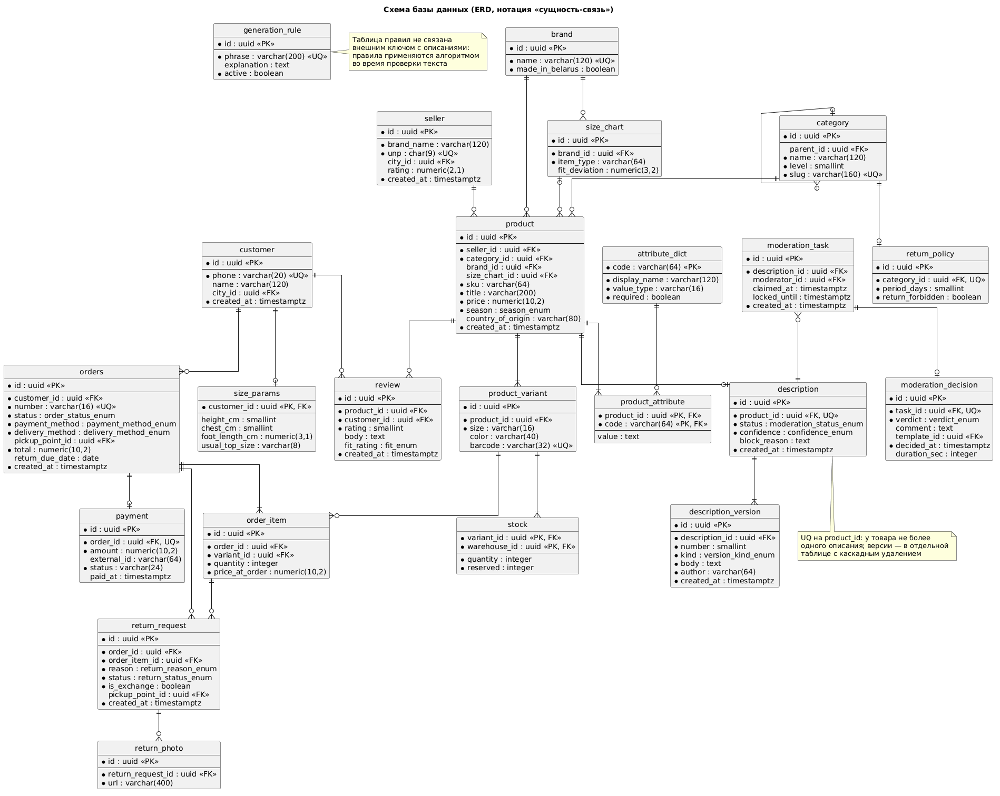

| Таблица | Назначение | Из какого класса получена |
|---------|------------|---------------------------|
| `seller` | Продавцы: бренды и ИП | `Продавец` |
| `brand`, `category` | Справочники бренда и иерархии категорий | `Бренд`, `Категория` |
| `product`, `product_variant`, `stock` | Товар, его варианты по размеру и цвету, остатки по складам | `Товар`, `ВариантТовара`, `Остаток` |
| `attribute_dict`, `product_attribute` | Справочник атрибутов и значения атрибутов товара | `СправочникАтрибутов`, `АтрибутТовара` |
| `size_chart` | Размерные сетки брендов | `РазмернаяСетка` |
| `description`, `description_version` | Описание товара и его версии | `ОписаниеТовара`, `ВерсияОписания` |
| `generation_rule` | Запрещённые формулировки | `ПравилоГенерации` |
| `moderation_task`, `moderation_decision` | Очередь модерации и решения | `ЗадачаМодерации`, `РешениеМодератора` |
| `customer`, `size_params` | Покупатель и его параметры размера | `Покупатель`, `ПараметрыРазмера` |
| `orders`, `order_item`, `payment` | Заказ, позиции и платёж | `Заказ`, `ПозицияЗаказа`, `Платёж` |
| `return_request`, `return_photo`, `return_policy` | Заявки на возврат, фотографии и правила | `ЗаявкаНаВозврат`, `ФотоКЗаявке`, `ПравилаВозврата` |
| `review` | Отзывы с оценкой посадки | `Отзыв` |

**Решения по схеме:**

1. **`description.product_id` имеет ограничение уникальности** — у товара не более одного
   описания; версии вынесены в отдельную таблицу с каскадным удалением (композиция
   доменной модели).
2. **Перечисления домена отображены в `ENUM`-типы PostgreSQL**, а не в `varchar`. Это
   переносит проверку допустимых значений на уровень базы данных.
3. **`stock` имеет составной первичный ключ** «вариант + склад»: один вариант хранится на
   нескольких складах, и остаток у каждого свой.
4. **`generation_rule` не связана внешним ключом с описаниями.** Правила применяются
   алгоритмом в момент проверки текста; связь «правило — нарушенное описание» хранится в
   `description.block_reason` и в журнале нарушений, а не в виде ссылочной целостности.
5. **`return_request` ссылается и на `orders`, и на `order_item`** — для поддержки
   частичного возврата (альтернативный поток A4 сценария UC-B9).
6. **Таблица названа `orders`, а не `order`**, поскольку `order` — зарезервированное слово SQL.

```mermaid
erDiagram
    SELLER ||--o{ PRODUCT : "публикует"
    BRAND ||--o{ PRODUCT : "выпускает"
    BRAND ||--o{ SIZE_CHART : "задаёт"
    CATEGORY ||--o{ PRODUCT : "содержит"
    CATEGORY ||--o| RETURN_POLICY : "имеет правила"
    CATEGORY |o--o{ CATEGORY : "родитель"
    SIZE_CHART |o--o{ PRODUCT : "используется"
    PRODUCT ||--|{ PRODUCT_VARIANT : "имеет"
    PRODUCT_VARIANT ||--|{ STOCK : "хранится"
    PRODUCT ||--|{ PRODUCT_ATTRIBUTE : "описывается"
    ATTRIBUTE_DICT ||--o{ PRODUCT_ATTRIBUTE : "типизирует"
    PRODUCT ||--o| DESCRIPTION : "имеет"
    DESCRIPTION ||--|{ DESCRIPTION_VERSION : "содержит"
    DESCRIPTION ||--o{ MODERATION_TASK : "проверяется"
    MODERATION_TASK ||--o| MODERATION_DECISION : "завершается"
    CUSTOMER ||--o| SIZE_PARAMS : "имеет"
    CUSTOMER ||--o{ ORDERS : "оформляет"
    CUSTOMER ||--o{ REVIEW : "оставляет"
    PRODUCT ||--o{ REVIEW : "получает"
    ORDERS ||--|{ ORDER_ITEM : "состоит из"
    ORDERS ||--o| PAYMENT : "оплачивается"
    ORDERS ||--o{ RETURN_REQUEST : "порождает"
    ORDER_ITEM ||--o{ RETURN_REQUEST : "возвращается"
    PRODUCT_VARIANT ||--o{ ORDER_ITEM : "заказывается"
    RETURN_REQUEST ||--o{ RETURN_PHOTO : "подтверждается"

    SELLER {
        uuid id PK
        varchar brand_name
        char unp UK
        numeric rating
    }
    PRODUCT {
        uuid id PK
        uuid seller_id FK
        uuid category_id FK
        uuid brand_id FK
        uuid size_chart_id FK
        varchar sku
        varchar title
        numeric price
        season_enum season
    }
    PRODUCT_VARIANT {
        uuid id PK
        uuid product_id FK
        varchar size
        varchar color
        varchar barcode UK
    }
    STOCK {
        uuid variant_id PK
        uuid warehouse_id PK
        integer quantity
        integer reserved
    }
    ATTRIBUTE_DICT {
        varchar code PK
        varchar display_name
        boolean required
    }
    PRODUCT_ATTRIBUTE {
        uuid product_id PK
        varchar code PK
        text value
    }
    SIZE_CHART {
        uuid id PK
        uuid brand_id FK
        varchar item_type
        numeric fit_deviation
    }
    DESCRIPTION {
        uuid id PK
        uuid product_id FK
        moderation_status_enum status
        confidence_enum confidence
        text block_reason
    }
    DESCRIPTION_VERSION {
        uuid id PK
        uuid description_id FK
        smallint number
        version_kind_enum kind
        text body
        varchar author
    }
    MODERATION_TASK {
        uuid id PK
        uuid description_id FK
        uuid moderator_id FK
        timestamptz claimed_at
        timestamptz locked_until
    }
    MODERATION_DECISION {
        uuid id PK
        uuid task_id FK
        verdict_enum verdict
        text comment
        integer duration_sec
    }
    CUSTOMER {
        uuid id PK
        varchar phone UK
        varchar name
        uuid city_id FK
    }
    SIZE_PARAMS {
        uuid customer_id PK
        smallint height_cm
        smallint chest_cm
        numeric foot_length_cm
    }
    ORDERS {
        uuid id PK
        uuid customer_id FK
        varchar number UK
        order_status_enum status
        payment_method_enum payment_method
        delivery_method_enum delivery_method
        numeric total
        date return_due_date
    }
    ORDER_ITEM {
        uuid id PK
        uuid order_id FK
        uuid variant_id FK
        integer quantity
        numeric price_at_order
    }
    PAYMENT {
        uuid id PK
        uuid order_id FK
        numeric amount
        varchar external_id
        varchar status
    }
    RETURN_REQUEST {
        uuid id PK
        uuid order_id FK
        uuid order_item_id FK
        return_reason_enum reason
        return_status_enum status
        boolean is_exchange
    }
    RETURN_PHOTO {
        uuid id PK
        uuid return_request_id FK
        varchar url
    }
    RETURN_POLICY {
        uuid id PK
        uuid category_id FK
        smallint period_days
        boolean return_forbidden
    }
    REVIEW {
        uuid id PK
        uuid product_id FK
        uuid customer_id FK
        smallint rating
        fit_enum fit_rating
    }
    CATEGORY {
        uuid id PK
        uuid parent_id FK
        varchar name
        smallint level
    }
    BRAND {
        uuid id PK
        varchar name UK
        boolean made_in_belarus
    }
```

---

#### 4.11.2. Диаграмма объектно-реляционного отображения (ORD)

**Файл:** [`diagrams/04-ord.puml`](diagrams/04-ord.puml)

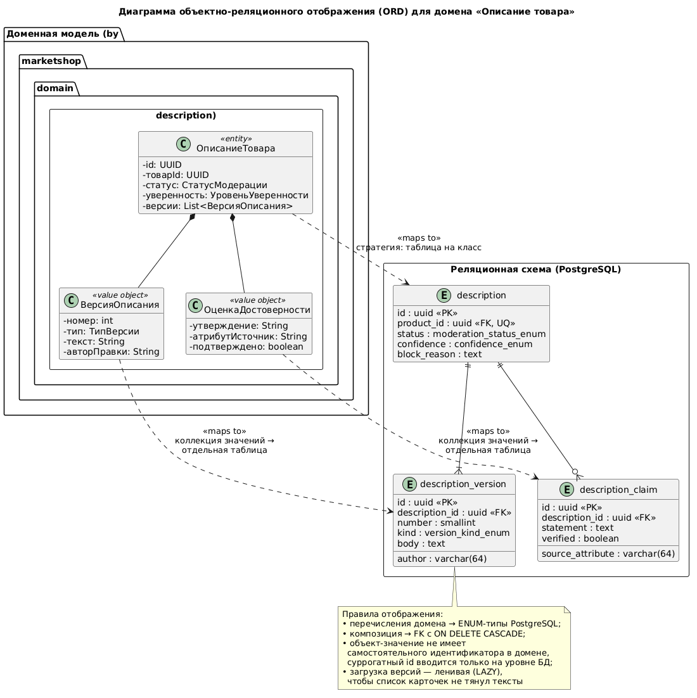

Диаграмма ORD построена для домена «Описание товара» — единственного, где отображение
объектной модели на реляционную неочевидно. В остальных доменах соответствие «класс — таблица»
прямое и не требует отдельной диаграммы.

**Правила отображения, зафиксированные диаграммой:**

| Элемент домена | Отображение в схему | Обоснование |
|----------------|---------------------|-------------|
| `ОписаниеТовара` (сущность) | Таблица `description`, стратегия «таблица на класс» | Имеет собственный жизненный цикл и идентичность |
| `ВерсияОписания` (объект-значение) | Таблица `description_version` с FK и `ON DELETE CASCADE` | Коллекция объектов-значений не может храниться в колонке; суррогатный `id` вводится только на уровне БД |
| `ОценкаДостоверности` (объект-значение) | Таблица `description_claim` | То же; таблица нужна для AC-02.3 — сопоставление утверждений с атрибутами-источниками |
| Перечисления домена | `ENUM`-типы PostgreSQL | Перенос проверки допустимых значений на уровень хранения |
| Композиция `1 *-- 1..*` | FK с `ON DELETE CASCADE` | Часть не существует без целого |
| Загрузка версий | Ленивая (`LAZY`) | Список карточек в каталоге не должен тянуть тексты всех версий |

```mermaid
flowchart LR
    subgraph domain["Доменная модель — by.marketshop.domain.description"]
        D1["<b>ОписаниеТовара</b> «entity»<br/>id : UUID<br/>товарId : UUID<br/>статус : СтатусМодерации<br/>уверенность : УровеньУверенности<br/>версии : List"]
        D2["<b>ВерсияОписания</b> «value object»<br/>номер : int<br/>тип : ТипВерсии<br/>текст : String<br/>авторПравки : String"]
        D3["<b>ОценкаДостоверности</b> «value object»<br/>утверждение : String<br/>атрибутИсточник : String<br/>подтверждено : boolean"]
    end

    subgraph rel["Реляционная схема — PostgreSQL"]
        T1["<b>description</b><br/>id uuid PK<br/>product_id uuid FK UQ<br/>status moderation_status_enum<br/>confidence confidence_enum<br/>block_reason text"]
        T2["<b>description_version</b><br/>id uuid PK<br/>description_id uuid FK<br/>number smallint<br/>kind version_kind_enum<br/>body text<br/>author varchar(64)"]
        T3["<b>description_claim</b><br/>id uuid PK<br/>description_id uuid FK<br/>statement text<br/>source_attribute varchar(64)<br/>verified boolean"]
    end

    D1 -. "maps to<br/>таблица на класс" .-> T1
    D2 -. "maps to<br/>коллекция значений → таблица" .-> T2
    D3 -. "maps to<br/>коллекция значений → таблица" .-> T3

    D1 --- D2
    D1 --- D3
    T1 --> T2
    T1 --> T3

    classDef dom fill:#F2F5FA,stroke:#22304A
    classDef tab fill:#FFF9E6,stroke:#C98A2E
    class D1,D2,D3 dom
    class T1,T2,T3 tab
```

---

## Задание 5. Проектирование системы на основе метода Event Storming

Спецификация построена на языке **PlantUML** — рекомендованным методическими указаниями
способом. Вместо подключения внешней библиотеки `plantuml-libs` нотация Event Storming
воспроизведена средствами самого PlantUML через стереотипы и канонические цвета стикеров.
Решение принято сознательно: публичный сервер отрисовки не загружает внешние `!include`,
а диаграммы в репозитории должны отрисовываться у любого участника команды без настройки
окружения. Семантика нотации при этом полностью сохранена.

#### Цветовая нотация

| Цвет | Элемент | Как формулируется |
|------|---------|-------------------|
| 🟧 Оранжевый | Событие предметной области (domain event) | Глагол в прошедшем времени: «Описание опубликовано» |
| 🟦 Голубой | Команда (command) | Повелительное наклонение: «Опубликовать описание» |
| 🟨 Жёлтый малый | Действующее лицо (actor) | Роль или персонаж: «Продавец (Виктор)» |
| 🟨 Жёлтый крупный | Агрегат (aggregate) | Существительное: «Описание товара» |
| 🟪 Фиолетовый | Политика, автоматизированное правило (policy) | «Когда… — сделать…» |
| 🟩 Зелёный | Представление, read model | Существительное: «Очередь модерации» |
| 🟥 Розовый | Внешняя система | Название системы: «LLM-провайдер» |
| 🟥 Малиновый | Противоречие (hotspot) | Вопрос без ответа |

Спецификация разработана на трёх уровнях, предусмотренных методическими указаниями:
крупномасштабное исследование, моделирование процесса и проектирование.

---

### 5.1. Крупномасштабное исследование (Big Picture)

**Файл:** [`diagrams/05-es-big-picture.puml`](diagrams/05-es-big-picture.puml)

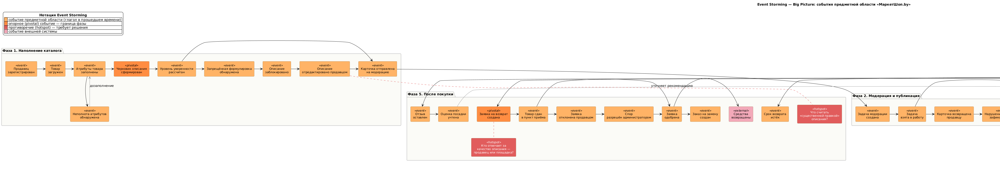

#### Ход сессии

Крупномасштабное исследование проводилось в два этапа, как предписывает метод.

**Этап 1. Хаотическое исследование.** Участники команды независимо друг от друга выписывали
все события предметной области, какие приходили в голову, не согласовывая формулировки.
Всего собрано 58 стикеров. Основной источник расхождений — разные названия одного события:
«описание готово», «текст сгенерирован», «черновик создан» оказались тремя названиями одного
факта.

**Этап 2. Упорядочивание по временной оси.** Дубликаты устранены, формулировки приведены к
прошедшему времени, события выстроены слева направо. Осталось **43 события**, разнесённых по
пяти фазам. Упорядочивание начато с «успешного сценария» — пути, в котором продавец
публикует товар, покупатель его находит, заказывает и оставляет отзыв.

#### Опорные (pivotal) события

Опорные события разделяют процесс на фазы и в дальнейшем становятся границами
ограниченных контекстов.

| Опорное событие | Что меняется после него |
|-----------------|-------------------------|
| **Черновик описания сформирован** | Товар перестаёт быть «сырой» записью продавца и становится объектом, с которым работает модерация |
| **Карточка одобрена** | Ответственность за содержание переходит от продавца к площадке |
| **Описание опубликовано** | Товар становится видимым покупателю и попадает в рекомендации и поиск |
| **Заказ создан** | Возникают финансовые и логистические обязательства |
| **Заказ выдан** | Запускается отсчёт срока возврата — точка входа в контекст возвратов |
| **Заявка на возврат создана** | Процесс разворачивается в обратную сторону и затрагивает все три роли |

#### Выявленные противоречия (hotspots)

| Противоречие | Суть | Как разрешено |
|--------------|------|----------------|
| **Данных о посадке недостаточно** | 28,3% респондентов не покупают из-за невозможности примерить, но у только что выложенной модели ещё нет отзывов о посадке — ассистент бесполезен именно тогда, когда нужнее всего | Введено требование AC-03.4: при нехватке отзывов используется размерная сетка бренда; если нет и её — система честно сообщает о нехватке данных, а не выдаёт недостоверную рекомендацию |
| **Кто отвечает за качество описания — продавец или площадка?** | Текст создаёт система, правит продавец, публикует модератор. Непонятно, к кому предъявлять претензию при возврате «не соответствует описанию» | Разрешено введением объекта «Оценка достоверности» (AC-02.3): каждое утверждение возводится к атрибуту-источнику, заполненному продавцом. Ответственность за факты — на продавце, за форму — на площадке |
| **Что считать «существенной правкой» описания?** | Измеримый критерий успешности «не менее 70% продавцов используют описание без существенных правок» не определён операционально | Разрешено через метрику: доля изменённых символов относительно предыдущей версии (метод `долиИзменённыхСимволов`). Порог существенности зафиксирован в [ТЗ](#задание-8-техническое-задание-на-разработку-приложения) |

---

### 5.2. Моделирование процесса (Process Modeling)

**Файл:** [`diagrams/05-es-process.puml`](diagrams/05-es-process.puml)

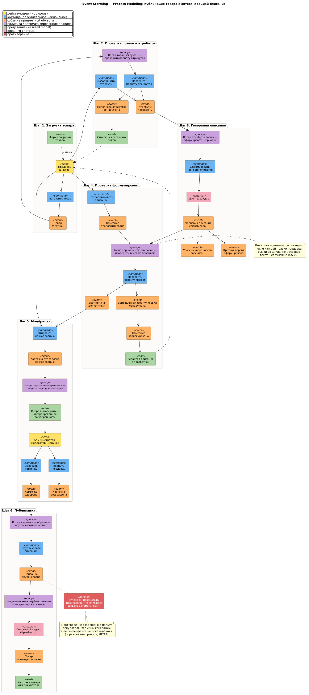

На этом уровне детализирован ключевой процесс продукта — **публикация товара с
автоматической генерацией описания**. К событиям добавлены команды, действующие лица,
политики, представления и внешние системы.

#### Команды и действующие лица

| Команда | Кто выполняет | Порождаемое событие |
|---------|---------------|---------------------|
| Загрузить товар | Продавец (Виктор) | Товар загружен |
| Дозаполнить атрибуты | Продавец | Атрибуты проверены |
| Отредактировать описание | Продавец | Описание отредактировано |
| Отправить на модерацию | Продавец | Карточка отправлена на модерацию |
| Одобрить карточку | Администратор (Марина) | Карточка одобрена |
| Вернуть продавцу | Администратор | Карточка возвращена |
| Проверить полноту атрибутов | — (политика) | Атрибуты проверены / Неполнота обнаружена |
| Сформировать черновик описания | — (политика) | Черновик сформирован |
| Проверить формулировки | — (политика) | Текст допустим / Запрещённая формулировка обнаружена |
| Опубликовать описание | — (политика) | Описание опубликовано |

**Наблюдение.** Из десяти команд процесса только четыре выполняются человеком напрямую;
остальные запускаются политиками. Это количественное подтверждение того, что генерация
описаний — не вспомогательная функция, а основной драйвер процесса.

#### Автоматизированные правила (политики)

| Политика | Формулировка | Обоснование |
|----------|--------------|-------------|
| P1 | Когда товар загружен — проверить полноту атрибутов | US-06: генерация не должна запускаться на неполных данных |
| P2 | Когда атрибуты полны — сформировать черновик описания | US-05: продавец не нажимает «Сгенерировать» вручную (AC-05.1) |
| P3 | Когда черновик сформирован — проверить текст по правилам | US-09: проверка выполняется после каждой правки, цикл не покидается без исправления |
| P4 | Когда карточка отправлена на модерацию — создать задачу модерации | US-08: очередь формируется автоматически |
| P5 | Когда карточка одобрена — опубликовать описание | Разделение решения модератора и технической публикации |
| P6 | Когда описание опубликовано — проиндексировать товар | Карточка появляется в поиске по событию, а не синхронно |

#### Представления (read models)

Каждое представление — это экран или блок интерфейса, спроектированный в ЛР№2:

| Представление | Соответствует макету из ЛР№2 | Для кого |
|---------------|------------------------------|----------|
| Форма загрузки товара | Кабинет продавца — «Загрузка товара» | Продавец |
| Список недостающих полей | Подсказка о недостающих атрибутах | Продавец |
| Редактор описания с подсветкой | Кабинет продавца — «Проверка описания» | Продавец |
| Очередь модерации, отсортированная по уверенности | Кабинет администратора — «Очередь модерации» | Администратор |
| Карточка товара для покупателя | Мобильная карточка товара | Покупатель |

Важное следствие метода: представление может быть построено **только из уже существующих
событий**. Проверка показала, что все пять представлений обеспечены событиями — ни одно поле
интерфейса не требует данных, которые система нигде не фиксирует.

---

### 5.3. Проектирование (Software Design)

**Файл:** [`diagrams/05-es-software-design.puml`](diagrams/05-es-software-design.puml)

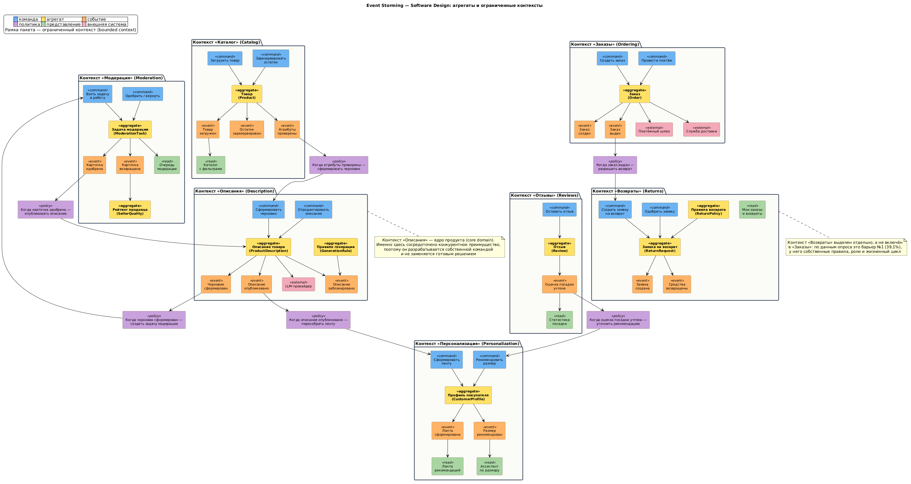

#### Выделенные агрегаты

Агрегат получает команды и порождает события; он же является границей согласованности
(транзакции).

| Агрегат | Контекст | Команды | Почему именно такая граница |
|---------|----------|---------|------------------------------|
| **Товар** (Product) | Каталог | Загрузить товар, Зарезервировать остаток | Атрибуты, варианты и остатки изменяются согласованно: резерв не должен «разъезжаться» с остатком |
| **Описание товара** (ProductDescription) | Описания | Сформировать черновик, Отредактировать описание | Версии и статус модерации изменяются вместе; описание не может быть опубликовано без версии |
| **Правило генерации** (GenerationRule) | Описания | Настроить правила | Отдельный агрегат: правила живут дольше любого описания и редактируются администратором независимо |
| **Задача модерации** (ModerationTask) | Модерация | Взять в работу, Одобрить / вернуть | Захват задачи — инвариант, который нужно обеспечивать транзакционно (AC-08.7) |
| **Рейтинг продавца** (SellerQuality) | Модерация | — (обновляется политикой) | Агрегируется по событиям за период, не изменяется напрямую |
| **Профиль покупателя** (CustomerProfile) | Персонализация | Сформировать ленту, Рекомендовать размер | Предпочтения и параметры размера читаются вместе при каждой персонализации |
| **Заказ** (Order) | Заказы | Создать заказ, Провести платёж | Позиции, платёж и доставка образуют одну транзакционную границу |
| **Заявка на возврат** (ReturnRequest) | Возвраты | Создать заявку, Одобрить заявку | Собственный жизненный цикл, отличный от жизненного цикла заказа |
| **Правила возврата** (ReturnPolicy) | Возвраты | — | Единый источник правил для карточки, оформления заказа и заявки (AC-12.3) |
| **Отзыв** (Review) | Отзывы | Оставить отзыв | Независимая сущность; удаление отзыва не должно затрагивать товар |

#### Ограниченные контексты

Группировка агрегатов в ограниченные контексты выполнена по принципу: **в один контекст
попадают агрегаты, связанные тесным функционалом либо связью через политику**.

| Контекст | Агрегаты | Тип по DDD | Решение о разработке |
|----------|----------|------------|----------------------|
| **Описания** (Description) | Описание товара, Правило генерации | Core domain — ядро | Разрабатывается собственной командой; здесь сосредоточено конкурентное преимущество, выявленное при анализе конкурентов в ЛР№1 |
| **Персонализация** (Personalization) | Профиль покупателя | Core domain | Собственная разработка: лента рекомендаций — содержание главного экрана |
| **Каталог** (Catalog) | Товар | Supporting | Собственная разработка, но без уникальных требований |
| **Модерация** (Moderation) | Задача модерации, Рейтинг продавца | Supporting | Собственная разработка |
| **Возвраты** (Returns) | Заявка на возврат, Правила возврата | Supporting | Выделен в отдельный контекст, хотя формально связан с заказами — обоснование ниже |
| **Заказы** (Ordering) | Заказ | Generic | Типовой функционал; интеграции с платежами и доставкой — через готовые адаптеры |
| **Отзывы** (Reviews) | Отзыв | Generic | Типовой функционал |

**Почему «Возвраты» выделены из «Заказов».** Формально заявка на возврат порождается
заказом, и напрашивается их объединение. Контексты разделены по трём причинам: у возврата
собственный жизненный цикл, не совпадающий с жизненным циклом заказа; в процессе участвуют
три роли (покупатель, продавец, администратор) против одной у заказа; и, главное, по данным
опроса возврат — барьер №1 (39,1%), то есть зона, где продукт создаёт отличие от конкурентов,
а не воспроизводит типовое поведение. Объединение с «Заказами» сделало бы эту зону частью
generic-контекста, который обычно получает наименьшее внимание.

#### Связи между контекстами

| Связь | Тип отношения | Через что |
|-------|---------------|-----------|
| Каталог → Описания | Customer-Supplier | Событие «Атрибуты проверены» → политика P1 |
| Описания → Модерация | Customer-Supplier | Событие «Черновик сформирован» → политика P2 |
| Модерация → Описания | Customer-Supplier | Событие «Карточка одобрена» → политика P3 |
| Описания → Персонализация | Published Language | Событие «Описание опубликовано» → политика P4; передаётся только краткая версия описания |
| Заказы → Возвраты | Customer-Supplier | Событие «Заказ выдан» → политика P5 |
| Отзывы → Персонализация | Published Language | Событие «Оценка посадки учтена» → политика P6 |

Все межконтекстные связи реализованы **асинхронно через события**, а не прямыми вызовами.
Это соответствует диаграмме компонентов из [раздела 4.8](#48-диаграмма-компонентов):
недоступность сервиса рекомендаций не должна блокировать публикацию карточки.

#### Соответствие контекстов пакетам кода

Ограниченные контексты напрямую отображены в подпакеты доменного слоя на
[диаграмме пакетов](#49-диаграмма-пакетов):

| Контекст Event Storming | Пакет кода |
|--------------------------|------------|
| Каталог | `by.marketshop.domain.catalog` |
| Описания | `by.marketshop.domain.description` |
| Модерация | `by.marketshop.domain.moderation` |
| Персонализация | `by.marketshop.domain.customer` |
| Заказы, Возвраты | `by.marketshop.domain.order` |
| Отзывы | `by.marketshop.domain.customer` |

Это и есть практический результат метода: границы, найденные на доске со стикерами,
превратились в границы модулей кода, а не остались упражнением.

---

## Задание 6. Проектирование системы с применением метода Event Modeling

Спецификация построена на языке **PlantUML** — рекомендованным методическими указаниями
способом. Нотация Event Modeling воспроизведена средствами PlantUML через стереотипы и
канонические цвета: диаграммы отрисовываются без подключения внешних библиотек, что
позволяет любому участнику команды открыть их без настройки окружения.

### Отличие Event Modeling от Event Storming

Оба метода используют события предметной области, но решают разные задачи, и в проекте они
применены последовательно, а не как альтернативы.

| | Event Storming (задание 5) | Event Modeling (задание 6) |
|---|---------------------------|----------------------------|
| **Вопрос, на который отвечает** | Что происходит в предметной области и где границы системы? | Как именно информация попадает на экран и обратно в хранилище? |
| **Результат** | Агрегаты и ограниченные контексты | Слайсы — единицы работы для разработчика |
| **Интерфейс** | Не рассматривается | Присутствует явно: триггеры — это макеты из ЛР№2 |
| **Структура доски** | Временная ось событий | Три горизонтальных слоя: интерфейс, команды и представления, поток событий |
| **Что передаётся в разработку** | Границы модулей | Готовый к реализации вертикальный срез |

Event Modeling строится вокруг четырёх типов объектов — **триггеров, команд, событий и
представлений** — и совместим с синтаксисом Given/When/Then, рассмотренным в разделе
«Ключевые понятия» методических указаний: событие-предусловие соответствует *Given*,
команда — *When*, порождаемое событие — *Then*.

---

### 6.1. Четыре шаблона Event Modeling

**Файл:** [`diagrams/06-em-patterns.puml`](diagrams/06-em-patterns.puml)

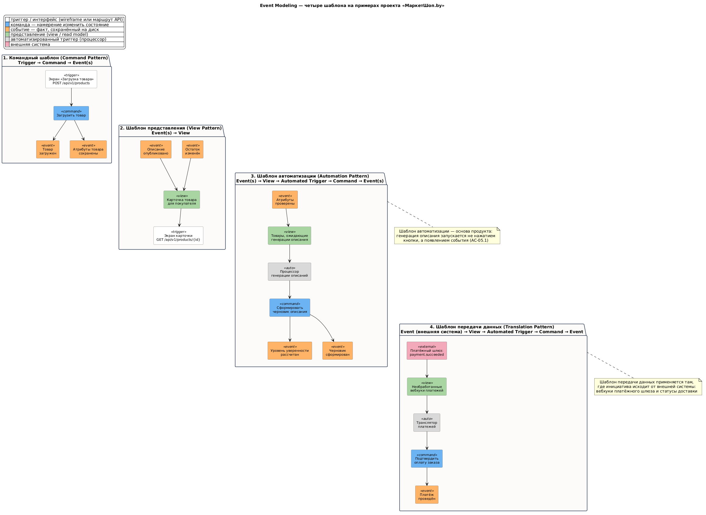

| Шаблон | Схема | Пример в проекте |
|--------|-------|------------------|
| **Командный** (Command Pattern) | Trigger → Command → Event(s) | Экран «Загрузка товара» → команда «Загрузить товар» → события «Товар загружен», «Атрибуты сохранены» |
| **Представления** (View Pattern) | Event(s) → View | События «Описание опубликовано» и «Остаток изменён» → представление «Карточка товара для покупателя» |
| **Автоматизации** (Automation Pattern) | Event(s) → View → Automated Trigger → Command → Event(s) | «Атрибуты проверены» → представление «Товары, ожидающие генерации» → процессор генерации → команда «Сформировать черновик» → «Черновик сформирован» |
| **Передачи данных** (Translation Pattern) | Event внешней системы → View → Automated Trigger → Command → Event | Вебхук платёжного шлюза → представление «Необработанные вебхуки» → транслятор → команда «Подтвердить оплату» → «Платёж проведён» |

**Почему шаблон автоматизации — основной для этого продукта.** В типовом маркетплейсе
преобладает командный шаблон: пользователь нажимает кнопку, система записывает событие.
В «МаркетШоп.by» ключевая ценность создаётся без участия человека — описание формируется
автоматически по появлению события «Атрибуты проверены» (AC-05.1). Из десяти команд процесса
публикации шесть запускаются процессорами, а не людьми. Это означает, что **основной риск
проекта лежит не в интерфейсе, а в надёжности автоматизированных переходов**, и именно их
нужно покрывать тестами в первую очередь.

---

### 6.2. Модель процесса «Публикация товара с автогенерацией описания»

**Файл:** [`diagrams/06-em-publication.puml`](diagrams/06-em-publication.puml)

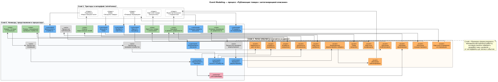

Модель построена в трёх слоях, предусмотренных методом:

- **Слой 1 — триггеры и интерфейс.** Соответствует макетам низкой точности и дизайн-макетам
  из ЛР№2: экран загрузки товара, подсказка о недостающих полях, редактор описания с
  подсветкой, очередь модерации, карточка товара.
- **Слой 2 — команды, представления и процессоры.** Здесь видно, какие действия выполняет
  человек, а какие — автоматика.
- **Слой 3 — поток событий.** То, что остаётся на диске после выключения системы.

#### Слайсы (единицы работы для разработчика)

Каждый слайс — вертикальный срез от интерфейса до записи события; его можно передать
разработчику целиком, не объясняя остальную систему.

| № | Слайс | Шаблон | Что входит | Связь с требованиями |
|---|-------|--------|------------|----------------------|
| S1 | Загрузка товара | Командный | Экран загрузки → «Загрузить товар» → «Товар загружен», «Атрибуты сохранены» | US-05 |
| S2 | Проверка полноты атрибутов | Автоматизации | «Атрибуты сохранены» → представление очереди проверки → процессор → «Атрибуты проверены» / «Неполнота обнаружена» | US-06, AC-06.1 |
| S3 | Подсказка о недостающих полях | Представления | «Неполнота обнаружена» → список недостающих полей → экран подсказки | AC-06.2, AC-06.3 |
| S4 | Дозаполнение атрибутов | Командный | Экран подсказки → «Дозаполнить атрибуты» → «Атрибуты проверены» | AC-06.5 |
| S5 | Генерация черновика | Автоматизации | «Атрибуты проверены» → процессор генерации → вызов LLM → «Черновик сформирован», «Уверенность рассчитана» | US-05, AC-05.1, AC-05.3 |
| S6 | Проверка формулировок | Автоматизации | «Черновик сформирован» → процессор проверки → «Запрещённая формулировка найдена» → «Описание заблокировано» | US-09 |
| S7 | Редактирование описания | Командный | Редактор с подсветкой → «Отредактировать описание» → «Описание отредактировано» | US-07, AC-07.4 |
| S8 | Отправка на модерацию | Командный | Редактор → «Отправить на модерацию» → «Карточка отправлена» | US-05 |
| S9 | Очередь модерации | Представления | «Карточка отправлена» → представление очереди по уверенности → экран модератора | US-08, AC-08.1 |
| S10 | Решение модератора | Командный | Экран очереди → «Одобрить» / «Вернуть продавцу» → «Карточка одобрена» / «Карточка возвращена» | US-08, US-10 |
| S11 | Публикация описания | Автоматизации | «Карточка одобрена» → процессор публикации → «Описание опубликовано» | AC-02.7 |
| S12 | Карточка товара | Представления | «Описание опубликовано» → карточка товара → экран покупателя | US-02 |

**Практический вывод.** Двенадцать слайсов — это двенадцать задач в трекере, каждая из
которых реализуема и тестируема независимо. Критический путь — S1 → S2 → S5 → S6 → S11 → S12;
слайсы S3, S4, S7, S10 расширяют сценарий, но не блокируют сквозной проход.

#### Проверка модели методом Given-When-Then

Каждый слайс допускает прямую запись в синтаксисе Gherkin, что подтверждает совместимость
модели с приёмочными сценариями из [задания 1](#16-спецификация-ключевых-историй-на-языке-gherkin):

```gherkin
# Слайс S5 «Генерация черновика»
Допустим произошло событие "Атрибуты проверены" для товара "Куртка зимняя мужская"
Когда процессор генерации выполняет команду "Сформировать черновик описания"
Тогда записано событие "Черновик сформирован"
И записано событие "Уверенность рассчитана"

# Слайс S6 «Проверка формулировок»
Допустим произошло событие "Черновик сформирован"
И в тексте черновика присутствует формулировка из списка запрещённых
Когда процессор проверки выполняет команду "Проверить формулировки"
Тогда записано событие "Запрещённая формулировка найдена"
И записано событие "Описание заблокировано"
Но событие "Описание опубликовано" не записано
```

---

### 6.3. Модель процессов «Подбор и покупка» и «Возврат или обмен»

**Файл:** [`diagrams/06-em-purchase.puml`](diagrams/06-em-purchase.puml)

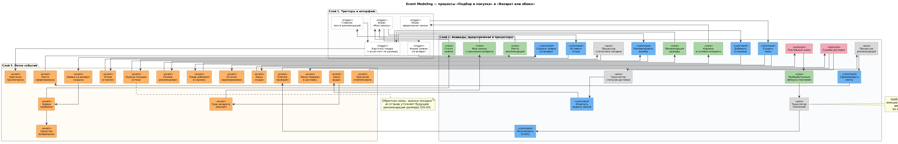

#### Слайсы

| № | Слайс | Шаблон | Связь с требованиями |
|---|-------|--------|----------------------|
| S13 | Формирование ленты рекомендаций | Автоматизации | US-01 |
| S14 | Просмотр карточки товара | Представления | US-02 |
| S15 | Рекомендация размера | Командный | US-03, US-04 |
| S16 | Добавление в корзину | Командный | — |
| S17 | Условия возврата в корзине | Представления | US-12, AC-12.2 |
| S18 | Создание заказа | Командный | UC-B7 |
| S19 | Подтверждение оплаты по вебхуку | Передачи данных | UC-B7, исключение E2 |
| S20 | Отметка выдачи заказа по статусу доставки | Передачи данных | US-11 (запуск срока возврата) |
| S21 | Список «Мои заказы» с признаком возврата | Представления | US-11, AC-11.1 |
| S22 | Создание заявки на возврат | Командный | US-11 |
| S23 | Отслеживание статуса заявки | Представления | AC-11.6 |
| S24 | Отзыв с оценкой посадки | Командный | US-03 |
| S25 | Пересчёт статистики посадки | Автоматизации | AC-03.4 |

#### Два применения шаблона передачи данных

Шаблон передачи данных применён там, где **инициатива исходит от внешней системы**, а не от
пользователя:

1. **Вебхук платёжного шлюза** (S19). Подтверждение оплаты не может быть синхронным ответом:
   3-D Secure выполняется вне приложения, и покупатель может закрыть браузер до возврата на
   сайт. Вебхук сохраняется в представление «Необработанные вебхуки», транслятор превращает
   его во внутреннюю команду. Промежуточное представление обязательно: оно позволяет повторно
   обработать вебхук при сбое, не теряя платёж.
2. **Статус доставки** (S20). Событие «Заказ выдан» порождается не сотрудником площадки, а
   службой доставки. Именно это событие запускает отсчёт срока возврата, поэтому точность
   трансляции напрямую влияет на барьер №1 (39,1%): ошибка в дате выдачи приведёт к
   некорректному отказу в возврате.

#### Замкнутая обратная связь

Модель выявила контур, которого не было видно на диаграммах UML: событие «Оценка посадки
учтена» (S25) возвращается в команду «Рекомендовать размер» (S15). Это означает, что
**качество ассистента по размеру растёт по мере накопления отзывов**, и в начале жизни товара
система обязана честно сообщать о нехватке данных (AC-03.4), а не выдавать рекомендацию с
низкой достоверностью. Контур также объясняет, почему оценка посадки в отзыве — обязательное,
а не опциональное поле формы отзыва.

---

### 6.4. Соответствие слайсов и артефактов проекта

Таблица показывает, что модель событий не является самостоятельным упражнением, а связывает
исследование пользователей, интерфейс и архитектуру.

| Слайс | Триггер — макет из ЛР№2 | Команда — метод сервиса | Событие — таблица/топик |
|-------|--------------------------|--------------------------|--------------------------|
| S1 | Кабинет продавца, «Загрузка товара» | `CatalogService.createProduct` | `product`, топик `catalog.product.created` |
| S5 | — (автоматический) | `GenerationService.generateDraft` | `description`, топик `description.draft.created` |
| S6 | — (автоматический) | `RulesChecker.check` | `description.block_reason`, топик `description.blocked` |
| S9 | Админ-панель, «Очередь модерации» | `ModerationService.getQueue` | представление строится по `moderation_task` |
| S12 | Мобильная карточка товара | `CatalogService.getProduct` | представление строится по `description_version` |
| S13 | Веб-главная, лента рекомендаций | `RecommendationService.buildFeed` | представление в Redis по топику `description.published` |
| S22 | Форма заявки на возврат | `ReturnsService.createRequest` | `return_request`, топик `returns.request.created` |

---

## Задание 7. Описание архитектуры системы с использованием подхода C4 Model

Архитектура описана по модели **C4** (Context, Container, Component, Code), предложенной
Саймоном Брауном. Диаграммы построены на языке **PlantUML** с использованием библиотеки
**C4-PlantUML**, входящей в стандартную библиотеку PlantUML (`!include <C4/...>`), —
рекомендованным методическими указаниями способом. Подключение библиотеки из стандартной
поставки, а не по внешней ссылке, гарантирует отрисовку диаграмм в любом окружении.

### Принцип модели

C4 описывает архитектуру на четырёх уровнях масштаба — от системы целиком до кода, —
и каждый следующий уровень детализирует один элемент предыдущего.

| Уровень | Что показывает | Для кого | Диаграмма |
|---------|----------------|----------|-----------|
| 1. Контекст | Система целиком и её окружение | Заказчик, все заинтересованные лица | [7.1](#71-уровень-1--контекст-системы) |
| 2. Контейнеры | Приложения и хранилища внутри системы | Архитектор, разработчики, DevOps | [7.2](#72-уровень-2--контейнеры) |
| 3. Компоненты | Внутреннее устройство одного контейнера | Разработчики этого контейнера | [7.3](#73-уровень-3--компоненты-сервиса-генерации-описаний) |
| 4. Код | Классы и их связи | Разработчики | [7.4](#74-уровень-4--код) |

---

### 7.1. Уровень 1 — Контекст системы

**Файл:** [`diagrams/07-c4-context.puml`](diagrams/07-c4-context.puml)


Диаграмма отвечает на вопрос «что это за система и с кем она взаимодействует» и предназначена
для разговора с заказчиком — персонажем «Игорь Николаевич» из ЛР№1.

**Решения, зафиксированные на этом уровне:**

1. **Три роли пользователей, а не одна.** Покупатель, продавец и администратор-модератор —
   разные классы пользователей с разными целями. На уровне контекста это уже видно, что
   предотвращает типичную ошибку проектирования «маркетплейс = витрина для покупателя».
2. **LLM-провайдер — внешняя система, а не часть продукта.** Это принципиально для оценки
   рисков: зависимость от внешнего поставщика, тарификация по запросам, возможная
   недоступность. Подпись связи явно фиксирует, что **персональные данные провайдеру не
   передаются** — на вход подаются только атрибуты товара.
3. **Платёжные системы разделены на ЕРИП и банк-эквайер.** По данным опроса ЕРИП не выбрал
   ни один из 46 респондентов, но для рынка Беларуси он остаётся обязательным; разделение
   позволяет реализовать их как независимые адаптеры и приоритизировать эквайринг.
4. **Службы доставки объединены в одну внешнюю систему.** Белпочта, СДЭК и Европочта с точки
   зрения архитектуры решают одну задачу и скрываются за общим адаптером.

---

### 7.2. Уровень 2 — Контейнеры

**Файл:** [`diagrams/07-c4-container.puml`](diagrams/07-c4-container.puml)


Уровень раскрывает систему «МаркетШоп.by» изнутри: приложения, сервисы и хранилища,
а также технологии, на которых они реализованы.

**Решения, зафиксированные на этом уровне:**

1. **Микросервисная структура соответствует ограниченным контекстам Event Storming.**
   Границы сервисов не изобретались заново: сервис описаний, сервис модерации, сервис
   возвратов и сервис рекомендаций — это контексты, найденные в [задании 5](#задание-5-проектирование-системы-на-основе-метода-event-storming).
2. **Сервис генерации описаний реализован на Python, остальные — на Kotlin.** Выбор
   обусловлен экосистемой работы с языковыми моделями. Это осознанный компромисс:
   разнородность стека усложняет эксплуатацию, но изоляция в одном сервисе ограничивает
   издержки одним контейнером.
3. **Четыре хранилища с разными ролями.** PostgreSQL — транзакционные данные; Redis — кэш
   лент рекомендаций; OpenSearch — полнотекстовый поиск; S3 — изображения. Разделение
   вызвано разным профилем нагрузки: поиск по описаниям тысяч товаров нельзя класть на
   транзакционную базу.
4. **Kafka как шина доменных событий.** Все межконтекстные связи — асинхронные. Это прямое
   следствие Event Storming: публикация описания не должна блокироваться недоступностью
   сервиса рекомендаций.
5. **Кабинеты продавца и модератора — часть веб-приложения, а не отдельные контейнеры.**
   Они разделены маршрутами и правами доступа. Выделение в отдельные приложения усложнило бы
   сборку без выигрыша: по данным ЛР№2 обе роли работают только в вебе.

---

### 7.3. Уровень 3 — Компоненты сервиса генерации описаний

**Файл:** [`diagrams/07-c4-component-description.puml`](diagrams/07-c4-component-description.puml)

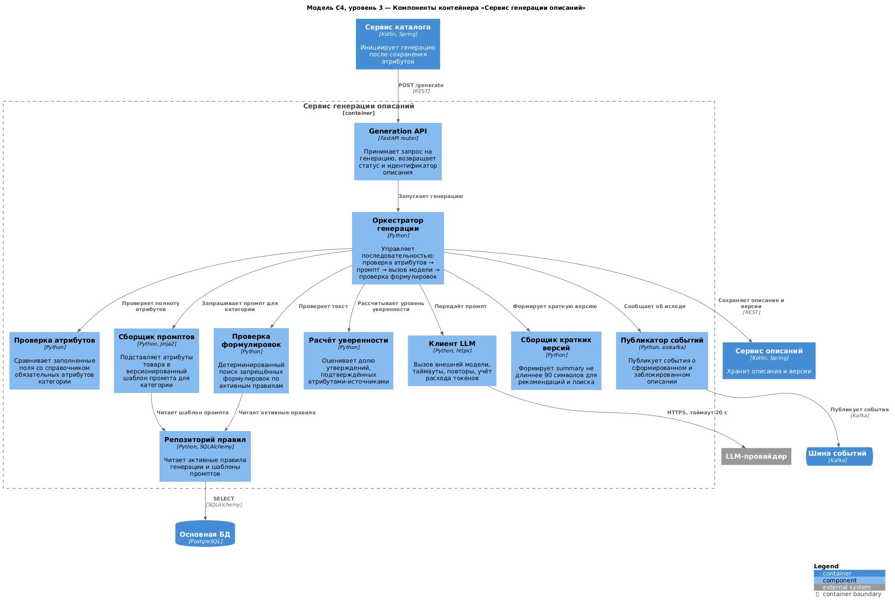

Для детализации выбран **сервис генерации описаний** — ядро продукта (core domain по
классификации из задания 5). Остальные контейнеры реализуют типовую логику и не требуют
отдельной диаграммы компонентов на этапе проектирования.

**Решения, зафиксированные на этом уровне:**

1. **Оркестратор отделён от всех исполнителей.** Последовательность «проверка атрибутов →
   сборка промпта → вызов модели → расчёт уверенности → проверка формулировок» задана в одном
   месте. Изменение порядка шагов — правка одного компонента.
2. **Клиент LLM изолирует внешнюю зависимость.** Таймауты, повторы и учёт расхода токенов
   сосредоточены здесь; остальные компоненты не знают о существовании провайдера.
3. **Сборщик промптов отделён от оркестратора и работает с версионированными шаблонами.**
   Это позволяет сопоставлять качество описаний с версией промпта при анализе метрик (US-17)
   и проводить A/B-сравнение формулировок.
4. **Проверка формулировок — отдельный компонент с собственным репозиторием правил.** Правила
   редактируются администратором (US-18) и применяются детерминированно, а не «просьбой» к
   языковой модели. Это обеспечивает воспроизводимость, необходимую для AC-09.4.
5. **Расчёт уверенности опирается на долю утверждений, подтверждённых атрибутами-источниками.**
   Компонент реализует объект `ОценкаДостоверности` из [диаграммы классов](#452-диаграмма-классов-2-генерация-и-модерация-описаний)
   и напрямую обеспечивает AC-02.3.
6. **Публикатор событий вынесен отдельно.** Сервис не пишет в основную БД напрямую: он
   обращается к сервису описаний по REST и публикует события в Kafka. Это сохраняет
   владение данными за сервисом описаний.

---

### 7.4. Уровень 4 — Код

Четвёртый уровень C4 — диаграммы классов — вынесен в
[задание 4, раздел 4.5](#45-диаграммы-классов-и-объектов),
чтобы не дублировать материал. Соответствие уровней:

| Контейнер (уровень 2) | Диаграмма классов (уровень 4) |
|------------------------|-------------------------------|
| Сервис каталога | [Каталог товаров](#451-диаграмма-классов-1-каталог-товаров) |
| Сервис описаний, сервис генерации | [Генерация и модерация описаний](#452-диаграмма-классов-2-генерация-и-модерация-описаний) |
| Сервис заказов, сервис возвратов | [Заказы, оплата, доставка и возвраты](#453-диаграмма-классов-3-заказы-оплата-доставка-и-возвраты) |
| Сервис рекомендаций, ассистент по размеру, сервис отзывов | [Покупатель, персонализация и отзывы](#454-диаграмма-классов-4-покупатель-персонализация-и-отзывы) |
| Сервис модерации | [Модерация, правила и контроль качества](#455-диаграмма-классов-5-модерация-правила-и-контроль-качества) |

Диаграмма развёртывания, дополняющая модель C4, приведена в
[разделе 4.10](#410-диаграмма-развёртывания).

---

### 7.5. Сквозная трассируемость архитектурных решений

Таблица показывает, что ни одно архитектурное решение не принято «из общих соображений»:
у каждого есть источник в исследовании пользователей или в требованиях.

| Архитектурное решение | Уровень C4 | Источник |
|------------------------|-----------|----------|
| Выделение сервиса генерации описаний | 2 | Конкурентное преимущество, выявленное анализом конкурентов (ЛР№1) |
| Асинхронная шина событий между контекстами | 2 | Ограниченные контексты Event Storming (задание 5) |
| Отдельный компонент проверки формулировок | 3 | Анти-персонаж «Бот-перекупщик» (ЛР№1), US-09 |
| Версионирование шаблонов промптов | 3 | Измеримый критерий «70% описаний без существенных правок» (ЛР№1), US-17 |
| Кэш лент рекомендаций в Redis | 2 | AC-01.4: первые карточки за 2 с при 4G |
| Отдельный поисковый индекс | 2 | Тысячи товаров, порог полнотекстового поиска превышен (ЛР№2, раздел 2.4) |
| Размещение данных в Республике Беларусь | Развёртывание | Законодательство о защите персональных данных; целевая аудитория — жители Беларуси |
| Офлайн-кэш мобильного приложения | Развёртывание | Профиль среды из ЛР№1: использование в транспорте, нестабильный мобильный интернет |
| Приоритет мобильной платформы | 2 | 82,6% респондентов покупают со смартфона |
| Выделение сервиса возвратов | 2 | Барьер №1 по данным опроса — 39,1% |

---

## Задание 8. Техническое задание на разработку приложения

**Спецификация требований к программному обеспечению (SRS)**
Проект: **МаркетШоп.by** — маркетплейс одежды и обуви с автоматической генерацией описаний товаров
Версия документа: 1.0 · Дата: 05.10.2026
Авторы: Харченко Анастасия, Шепко Варвара, Степук Анастасия

Документ составлен по шаблону SRS Карла Вигерса и Джой Битти на основании анализа требований
и диаграмм, разработанных в заданиях 1–7 настоящей лабораторной работы, и результатов
исследования пользователей из ЛР№1 и ЛР№2.

---

### Содержание

1. [Введение](#1-введение)
2. [Общее описание](#2-общее-описание)
3. [Функции системы](#3-функции-системы)
4. [Требования к данным](#4-требования-к-данным)
5. [Требования к внешним интерфейсам](#5-требования-к-внешним-интерфейсам)
6. [Атрибуты качества](#6-атрибуты-качества)
7. [Требования по интернационализации и локализации](#7-требования-по-интернационализации-и-локализации)
8. [Остальные требования](#8-остальные-требования)
- [Приложение А. Словарь терминов](#приложение-а-словарь-терминов)
- [Приложение Б. Модели анализа](#приложение-б-модели-анализа)

---

### 1. Введение

#### 1.1. Назначение

Документ определяет требования к первой версии (MVP) программной системы «МаркетШоп.by» —
веб- и мобильного приложения маркетплейса одежды и обуви для Республики Беларусь с модулем
автоматической генерации и персонализации текстовых описаний товаров.

Документ описывает систему целиком: витрину для покупателя, кабинет продавца, панель
администратора-модератора и серверную часть. Он предназначен для команды разработки,
тестирования, заказчика и приёмочной комиссии.

#### 1.2. Соглашения, принятые в документе

| Обозначение | Значение |
|-------------|----------|
| **ФТ-x.y** | Функциональное требование; x — номер функции системы, y — порядковый номер |
| **НФТ-x.y** | Нефункциональное требование |
| **US-xx** | Пользовательская история из [задания 1](#задание-1-разработка-требований-в-виде-пользовательских-историй-user-story) и [задания 4](#44-расширение-набора-user-story) |
| **AC-xx.y** | Критерий приёмки пользовательской истории |
| **UC-Bx** | Вариант использования из [задания 4](#42-детальные-сценарии-вариантов-использования) |
| **Должна** | Обязательное требование MVP |
| **Следует** | Желательное требование; невыполнение не блокирует приёмку MVP |

Приоритеты требований соответствуют приоритетам пользовательских историй: **High** —
обязательно для MVP; **Medium** — реализуется при наличии ресурса; **Low** — выносится за
пределы MVP.

#### 1.3. Границы проекта

**Входит в MVP:**

- витрина покупателя: лента рекомендаций, каталог с фильтрами, поиск, карточка товара,
  ассистент по размеру, избранное, сравнение, корзина, оформление заказа, отслеживание
  доставки, отзывы;
- возврат и обмен: оформление заявки, отслеживание статуса, обработка продавцом и
  администратором;
- кабинет продавца: загрузка товара с атрибутами, автоматическая генерация описаний,
  редактирование, отправка на модерацию, обработка заявок на возврат;
- панель администратора: очередь модерации, решения, настройка правил генерации и состава
  обязательных атрибутов;
- мобильное приложение (Android, iOS) и веб-приложение.

**Не входит в MVP (явный перечень):**

| Что исключено | Обоснование |
|---------------|-------------|
| Виртуальная примерка по фотографии | Требует отдельной модели компьютерного зрения и 3D-мерок; не укладывается в график 4 месяца (отклонено при верификации ИИ-предложений, [раздел 4.3.3](#433-что-было-отклонено-и-почему)) |
| Чат-консультант на базе языковой модели | Противоречит ограничению: присутствие ИИ не демонстрируется покупателю; потребность не подтверждена опросом |
| Программа лояльности и бонусные баллы | Не закрывает ни один из подтверждённых барьеров; перенесено во вторую версию |
| Собственная служба доставки | Используются внешние службы |
| Мобильные кабинеты продавца и модератора | Монопольные сессии 30–60 минут требуют клавиатуры и большого экрана (ЛР№2, раздел 1.3) |
| Мультивалютность и продажи за пределы Республики Беларусь | Целевой рынок MVP — Республика Беларусь |
| Подписка на поступление размера (US-20) | Приоритет Low |

#### 1.4. Ссылки

1. Отчёт по лабораторной работе №1 «Исследование пользователей и предметной области» — [`docs/ЛабРабота1_ПЧМИ.docx`](../ЛабРабота1_ПЧМИ.docx).
2. Отчёт по лабораторной работе №2 «Проектирование информационной архитектуры и взаимодействия с пользователем» — [`docs/ЛабРабота2_ПЧМИ.pdf`](../ЛабРабота2_ПЧМИ.pdf).
3. Пользовательские истории и критерии приёмки — [задание 1](#задание-1-разработка-требований-в-виде-пользовательских-историй-user-story).
4. Диаграммы UML — [задание 2](#задание-2-разработка-спецификации-системы-с-использованием-plantuml), [задание 3](#задание-3-разработка-спецификации-системы-с-использованием-mermaid), [задание 4](#задание-4-разработка-спецификации-системы-с-использованием-plantuml-mermaid-и-ии-агентов).
5. Модель предметной области Event Storming — [задание 5](#задание-5-проектирование-системы-на-основе-метода-event-storming).
6. Модель событий Event Modeling — [задание 6](#задание-6-проектирование-системы-с-применением-метода-event-modeling).
7. Архитектура по модели C4 — [задание 7](#задание-7-описание-архитектуры-системы-с-использованием-подхода-c4-model).
8. Результаты опроса пользователей (46 респондентов), Google Forms.

---

### 2. Общее описание

#### 2.1. Общий взгляд на продукт

«МаркетШоп.by» — новый продукт, а не замена существующей системы. Его отличие от конкурентов
(Wildberries.by, Ozon.by, Lamoda.by, Kufar, AliExpress) состоит в том, что описание товара
формируется системой из структурированных атрибутов, проверяется на достоверность и
персонализируется под покупателя. По результатам анализа конкурентов (ЛР№1) ни один локальный
игрок такой функциональности не предоставляет.

Продукт решает две связанные задачи, выявленные опросом:

1. **Снижение неопределённости при выборе.** Средняя оценка важности подробного и достоверного
   описания — 4,33 из 5; 60,9% респондентов сталкивались с несоответствием описания реальности.
2. **Снижение числа возвратов и упрощение их оформления.** Сложности с возвратом и обменом —
   барьер №1 (39,1% респондентов). Недостоверное описание является одной из причин возврата,
   поэтому обе задачи решаются согласованно.

Контекст системы и её внешнее окружение приведены на
[диаграмме C4 уровня 1](#71-уровень-1--контекст-системы).

#### 2.2. Классы и характеристики пользователей

| Класс | Доля и значимость | Характеристики | Приоритет |
|-------|-------------------|----------------|-----------|
| **Покупатель — «осознанный»** | Самый многочисленный класс и основной источник дохода | 25–34 года, преимущественно женщины (69,6% респондентов), читают описания и отзывы полностью, покупают 1–3 раза в месяц, заходят вечером со смартфона | Высокий |
| **Покупатель — «быстрый»** | Частые, но небольшие заказы | 18–29 лет, решение принимают по фото и цене, чувствительны к персональным рекомендациям | Высокий |
| **Покупатель — «новичок»** | Группа с наибольшей сложностью удовлетворения потребностей | 35–55 лет, невысокий опыт онлайн-покупок, боятся ошибиться с размером, чувствительны к сложности возврата | Средний |
| **Продавец — малый бренд или ИП** | Определяет наполнение каталога | 28–45 лет, нет бюджета на копирайтера, публикует 15–20 позиций раз в 1–2 недели, работает с компьютера | Высокий |
| **Продавец — крупный поставщик** | Большой ассортимент | Важна скорость массовой генерации карточек | Средний |
| **Администратор-модератор** | Немногочисленный, но критичный для качества класс | 22–35 лет, высокий уровень владения админ-инструментами, обрабатывает 100–200 карточек в день | Средний |
| **Администратор системы** | Единицы | Настраивает правила генерации, состав обязательных атрибутов, шаблоны комментариев | Низкий |

Подробные портреты (персонажи Анастасия, Ольга Петровна, Виктор, Марина, анти-персонаж
«Бот-перекупщик») приведены в ЛР№1.

#### 2.3. Операционная среда

| Параметр | Значение |
|----------|----------|
| Мобильные платформы | Android 10 и выше, iOS 15 и выше; диагонали 5,5″–6,7″, базовое разрешение проектирования 375×670 px |
| Браузеры | Chrome, Safari, Firefox, Edge — две последние мажорные версии на момент выпуска |
| Разрешения веб-версии | Базовое 1440 px, планшет 980 px; корректная вёрстка при масштабе страницы до 200% |
| Серверная среда | Кластер Kubernetes в дата-центре на территории Республики Беларусь |
| Хранилища | PostgreSQL 16, Redis 7, OpenSearch, S3-совместимое объектное хранилище, Apache Kafka |
| Языки реализации | Kotlin (прикладные сервисы), Python (генерация описаний и рекомендации), TypeScript/React (веб), Kotlin/Swift (мобильные приложения) |
| Сетевые условия | Приложение работает при нестабильном мобильном соединении; предусмотрен офлайн-режим для корзины, избранного и просмотренных товаров |

Полное описание среды — на [диаграмме развёртывания](#410-диаграмма-развёртывания).

#### 2.4. Ограничения дизайна и реализации

| № | Ограничение | Источник |
|---|-------------|----------|
| ОГР-1 | Генератор описаний не формулирует непроверяемые заявления о качестве («лучший», «100% не сядет», «не вызывает аллергии»). Каждое утверждение описания должно быть возводимо к заполненному атрибуту товара | Стратегия дизайна ЛР№1; анти-персонаж «Бот-перекупщик» |
| ОГР-2 | Термины, обозначающие технологию генерации (NLP, LLM, «ИИ-описание»), не отображаются в интерфейсе покупателя и продавца | Система именования ЛР№2, раздел 2.2 |
| ОГР-3 | Персональные данные покупателей хранятся на территории Республики Беларусь; внешнему LLM-провайдеру персональные данные не передаются | Законодательство; решение команды |
| ОГР-4 | Приоритет мобильной платформы при проектировании: макеты разрабатываются сначала для 375×670 px | 82,6% респондентов покупают со смартфона |
| ОГР-5 | Единая терминология интерфейса: используется термин «размер», синонимы «ростовка» и «размерная сетка» в интерфейсе покупателя не применяются | Тезаурус ЛР№2, раздел 2.2 |
| ОГР-6 | Доменный слой серверной части не зависит от инфраструктуры и интерфейсов; правило проверяется автоматически при сборке | Диаграмма пакетов, [раздел 4.9](#49-диаграмма-пакетов) |
| ОГР-7 | Межконтекстное взаимодействие сервисов — асинхронное, через шину событий | Event Storming, [задание 5](#задание-5-проектирование-системы-на-основе-метода-event-storming) |

#### 2.5. Предположения и зависимости

| № | Предположение или зависимость | Риск при невыполнении |
|---|-------------------------------|------------------------|
| ПЗ-1 | Доступен внешний LLM-провайдер с квотой, достаточной для генерации описаний для 20 позиций за 60 секунд | Срыв ключевой функции; потребуется собственная модель либо увеличение времени генерации |
| ПЗ-2 | Продавцы готовы заполнять структурированные атрибуты вместо написания текста | Генерация невозможна; потребуется этап обучения продавцов |
| ПЗ-3 | Службы доставки предоставляют API для создания отправлений, получения статусов и списка пунктов выдачи | Ручная обработка отправлений; срок возврата придётся отсчитывать иначе |
| ПЗ-4 | Банк-эквайер поддерживает вебхуки о результате платежа | Потребуется периодический опрос статуса, что ухудшит время отклика |
| ПЗ-5 | Нормы законодательства Республики Беларусь о защите персональных данных и о дистанционной торговле **требуют уточнения у юриста** до начала разработки разделов возврата и хранения данных | Переработка процесса возврата и схемы хранения |
| ПЗ-6 | Перечень товаров, не подлежащих возврату, предоставляется заказчиком и **требует уточнения у юриста** | Неверные отказы покупателям, репутационный и юридический риск |

---

### 3. Функции системы

#### 3.1. Персонализированная лента рекомендаций

**Описание.** Главный экран приложения содержит подборку товаров, сформированную по профилю
покупателя: размерам, предпочитаемым категориям и материалам, истории просмотров и сезону.
Приоритет: **High**. Реализует US-01, UC-B1.

| ID | Требование | Источник | Приоритет |
|----|------------|----------|-----------|
| ФТ-1.1 | Система должна формировать ленту главного экрана, содержащую не менее 12 карточек товаров | AC-01.1 | High |
| ФТ-1.2 | Система должна включать в ленту только товары, описание которых имеет статус «Опубликовано» | AC-01.5 | High |
| ФТ-1.3 | Система должна отображать под каждой карточкой ленты краткую версию описания длиной не более 90 символов | AC-01.2 | High |
| ФТ-1.4 | Система должна формировать ленту для неавторизованного покупателя по обезличенной истории просмотров устройства | AC-01.3 | High |
| ФТ-1.5 | Система должна заполнять ленту популярными товарами региона покупателя и отображать блок «Расскажите о своих размерах», если персонализирующих данных недостаточно | AC-01.7 | High |
| ФТ-1.6 | Система должна обновлять ленту по жесту pull-to-refresh в мобильном приложении | AC-01.4 | High |
| ФТ-1.7 | Система должна сохранять порядок карточек ленты при добавлении товара в избранное | AC-01.6 | Medium |
| ФТ-1.8 | Система должна кэшировать сформированную ленту на срок 15 минут | Раздел 4.7.1 | Medium |

#### 3.2. Каталог, поиск и фильтрация

**Описание.** Поиск товара по каталогу с иерархией категорий, полнотекстовым поиском,
фасетными фильтрами и поиском по изображению. Приоритет: **High**. Реализует UC-B2, UC-B13,
US-13, US-14.

| ID | Требование | Источник | Приоритет |
|----|------------|----------|-----------|
| ФТ-2.1 | Система должна предоставлять каталог с иерархией не менее трёх уровней: раздел → тип изделия → подкатегория | ЛР№2, раздел 2.1 | High |
| ФТ-2.2 | Система должна предоставлять полнотекстовый поиск по названию, бренду, категории и тексту описания товара | ЛР№2, раздел 2.4 | High |
| ФТ-2.3 | Система должна предоставлять фильтры: размер, бренд, цвет, цена, сезон, «сделано в Беларуси», наличие на складе, оценка посадки по отзывам | ЛР№2, раздел 2.4 | High |
| ФТ-2.4 | Система должна выводить автодополнение поисковых подсказок по категориям и брендам | ЛР№2, раздел 2.4 | Medium |
| ФТ-2.5 | Система должна исправлять опечатки в поисковом запросе, включая ввод в неверной раскладке | ЛР№2, раздел 2.4 | Medium |
| ФТ-2.6 | Система должна определять признак «сделано в Беларуси» по атрибуту бренда, а не по стране производства отдельного товара | AC-13.2 | Medium |
| ФТ-2.7 | Система должна сохранять состояние фильтров в адресе страницы веб-версии | AC-13.4 | Medium |
| ФТ-2.8 | Система должна предоставлять поиск похожих товаров по фотографии, возвращая не менее 10 результатов | AC-14.4 | Medium |
| ФТ-2.9 | Система должна открывать карточку товара при сканировании его штрихкода | AC-14.3 | Medium |
| ФТ-2.10 | Система должна выводить под результатами поиска блок «Похожие товары», если точных совпадений нет | ЛР№2, раздел 2.4 | Medium |

#### 3.3. Карточка товара и описание

**Описание.** Экран с полной информацией о товаре: фотографии, цена, наличие размеров,
автоматически сформированное описание, отзывы, рекомендательные блоки. Приоритет: **High**.
Реализует US-02, UC-B3.

| ID | Требование | Источник | Приоритет |
|----|------------|----------|-----------|
| ФТ-3.1 | Система должна размещать блок описания выше кнопки «В корзину» | AC-02.1 | High |
| ФТ-3.2 | Система должна выводить описание в составе подблоков «Состав», «Посадка», «Уход», «Размерная сетка бренда» | AC-02.2 | High |
| ФТ-3.3 | Система должна заменять отсутствующий подблок описания строкой «Продавец не указал» | AC-02.2 | High |
| ФТ-3.4 | Система должна сопоставлять каждое фактическое утверждение описания с атрибутом-источником и предоставлять это сопоставление администратору | AC-02.3 | High |
| ФТ-3.5 | Система не должна включать в описание формулировки из списка запрещённых | AC-02.4, ОГР-1 | High |
| ФТ-3.6 | Система должна отображать кнопку «Вопрос продавцу» в карточке, если в описании отсутствует подблок «Уход» | AC-02.5 | Medium |
| ФТ-3.7 | Система должна формировать полную версию описания и краткое summary из одной версии черновика и обновлять их одновременно | AC-02.7 | High |
| ФТ-3.8 | Система должна отображать свёрнутый блок «Возврат и обмен» со сроком возврата в днях | AC-12.1 | Medium |
| ФТ-3.9 | Система должна выводить предупреждение вместо срока возврата для товаров, не подлежащих возврату | AC-12.4 | Medium |
| ФТ-3.10 | Система должна отключать кнопку «В корзину» и предлагать подписку на поступление, если товар отсутствует во всех размерах | UC-B3, поток A4 | Low |

#### 3.4. Ассистент по размеру

**Описание.** Встроенный в карточку товара инструмент, рекомендующий размер на основании
параметров покупателя, размерной сетки бренда и оценок посадки из отзывов. Приоритет:
**High**. Реализует US-03, US-04, UC-B4.

| ID | Требование | Источник | Приоритет |
|----|------------|----------|-----------|
| ФТ-4.1 | Система должна размещать ассистент по размеру внутри карточки товара без перехода на отдельный экран | AC-03.1 | High |
| ФТ-4.2 | Система должна отображать рекомендацию немедленно, если параметры размера заданы в профиле | AC-03.2 | High |
| ФТ-4.3 | Система должна включать в рекомендацию номер размера и пояснение о посадке с величиной отклонения | AC-03.3 | High |
| ФТ-4.4 | Система должна формировать пояснение о посадке только при наличии не менее пяти отзывов с оценкой посадки либо заданной размерной сетки бренда | AC-03.4 | High |
| ФТ-4.5 | Система должна выводить сообщение «Данных о посадке пока недостаточно» вместо рекомендации при нехватке данных | AC-03.4 | High |
| ФТ-4.6 | Система должна подставлять рекомендованный размер в селектор размера, оставляя возможность ручного изменения | AC-03.5 | High |
| ФТ-4.7 | Система должна предлагать ближайший доступный размер с явной пометкой, если рекомендованный размер отсутствует на складе | AC-03.7 | High |
| ФТ-4.8 | Система должна предоставлять форму ввода параметров размера из не более чем трёх полей непосредственно в карточке товара | AC-04.1 | Medium |
| ФТ-4.9 | Система должна сохранять введённые параметры в профиль покупателя и применять их при открытии других карточек | AC-04.3 | Medium |
| ФТ-4.10 | Система должна сохранять параметры неавторизованного покупателя локально на устройстве и переносить их в профиль при регистрации | AC-04.4 | Medium |
| ФТ-4.11 | Система должна блокировать отправку формы при вводе нечислового значения и выводить сообщение об ошибке рядом с полем | AC-04.6 | Medium |

#### 3.5. Корзина, заказ, оплата и доставка

**Описание.** Оформление заказа с выбором способа доставки и оплаты, резервированием
остатков и фиксацией срока возврата. Приоритет: **High**. Реализует UC-B7, US-12.

| ID | Требование | Источник | Приоритет |
|----|------------|----------|-----------|
| ФТ-5.1 | Система должна предлагать пункт самовывоза как способ доставки по умолчанию | Опрос: 78,3% | High |
| ФТ-5.2 | Система должна выводить способы оплаты в порядке: банковская карта онлайн, оплата при получении, ЕРИП | Опрос: 69,6% / 30,4% / 0% | High |
| ФТ-5.3 | Система должна резервировать остатки по всем позициям заказа до его создания | UC-B7, шаг 8 | High |
| ФТ-5.4 | Система должна отказывать в создании заказа с указанием конкретной позиции, если остатка не хватает | UC-B7, исключение E1 | High |
| ФТ-5.5 | Система должна снимать резерв остатков при отклонении платежа | UC-B7, исключение E2 | High |
| ФТ-5.6 | Система должна фиксировать дату окончания срока возврата в момент создания заказа и не изменять её при последующем изменении правил | UC-B7, постусловия | High |
| ФТ-5.7 | Система должна выводить срок возврата на экране оформления заказа рядом с кнопкой подтверждения | AC-12.2 | Medium |
| ФТ-5.8 | Система не должна создавать второй заказ при повторной отправке запроса с тем же ключом идемпотентности | UC-B7, исключение E4 | High |
| ФТ-5.9 | Система должна отображать покупателю номер заказа, трек-номер и срок возврата после оформления | UC-B7, шаг 13 | High |
| ФТ-5.10 | Система должна присваивать трек-номер асинхронно и уведомлять покупателя, если служба доставки недоступна в момент создания заказа | UC-B7, исключение E3 | Medium |

#### 3.6. Возврат и обмен

**Описание.** Оформление и обработка заявки на возврат или обмен товара. Закрывает барьер №1
по данным опроса. Приоритет: **High**. Реализует US-11, US-12, US-15, UC-B9.

| ID | Требование | Источник | Приоритет |
|----|------------|----------|-----------|
| ФТ-6.1 | Система должна предоставлять переход к оформлению возврата из раздела «Мои заказы» и со страницы статуса доставки не более чем в одно нажатие | AC-11.1 | High |
| ФТ-6.2 | Система должна обеспечивать оформление заявки на возврат не более чем за три экрана | AC-11.2 | High |
| ФТ-6.3 | Система должна предоставлять выбор причины возврата из списка и фиксировать причину «товар не соответствует описанию» отдельным кодом | AC-11.3 | High |
| ФТ-6.4 | Система должна требовать прикрепления фотографий только для причин «брак» и «товар не соответствует описанию» | AC-11.4 | High |
| ФТ-6.5 | Система должна отображать адрес пункта приёма и срок сдачи товара после подтверждения заявки | AC-11.5 | High |
| ФТ-6.6 | Система должна отправлять push-уведомление при изменении статуса заявки | AC-11.6 | High |
| ФТ-6.7 | Система должна отказывать в оформлении возврата с указанием конкретной даты окончания срока, если срок истёк | AC-15.1 | High |
| ФТ-6.8 | Система должна сообщать о невозможности возврата для товаров из перечня не подлежащих возврату до оформления заказа | AC-15.2 | High |
| ФТ-6.9 | Система должна включать ссылку на полные правила возврата в каждое сообщение об отказе | AC-15.3 | High |
| ФТ-6.10 | Система должна позволять оформить заявку на часть позиций заказа | AC-15.4 | Medium |
| ФТ-6.11 | Система должна передавать заявку администратору, если продавец её отклонил | UC-B9, поток A3 | High |
| ФТ-6.12 | Система должна инициировать возврат средств при одобрении заявки на возврат и создавать заказ на замену при одобрении заявки на обмен | UC-B9, поток A2 | High |
| ФТ-6.13 | Система должна переводить заявку в статус «Отклонена» и уведомлять покупателя за сутки до истечения срока сдачи товара | UC-B9, исключение E4 | Medium |
| ФТ-6.14 | Система должна сохранять незавершённую заявку как черновик при потере соединения и отправлять её при восстановлении связи | UC-B9, исключение E3 | Medium |

#### 3.7. Отзывы

**Описание.** Отзывы покупателей с оценкой товара, фотографиями и обязательной оценкой
посадки. Приоритет: **Medium**. Реализует UC-B10.

| ID | Требование | Источник | Приоритет |
|----|------------|----------|-----------|
| ФТ-7.1 | Система должна предоставлять возможность оставить отзыв только покупателю, получившему заказ с этим товаром | UC-B10 | High |
| ФТ-7.2 | Система должна требовать указания оценки посадки в значениях «маломерит», «соответствует», «большемерит» | Задание 6, раздел 6.3 | High |
| ФТ-7.3 | Система должна позволять прикрепить к отзыву до пяти фотографий | ЛР№1 | Medium |
| ФТ-7.4 | Система должна пересчитывать статистику посадки товара после сохранения отзыва | Слайс S25 | High |
| ФТ-7.5 | Система должна предоставлять ссылку на ассистент по размеру из отзывов, упоминающих несоответствие размера | ЛР№2, тезаурус | Low |

#### 3.8. Кабинет продавца: загрузка товара и генерация описаний

**Описание.** Публикация товаров с автоматической генерацией описаний, проверкой полноты
атрибутов, редактированием и отправкой на модерацию. Приоритет: **High**. Реализует US-05,
US-06, US-07, US-16, US-17.

| ID | Требование | Источник | Приоритет |
|----|------------|----------|-----------|
| ФТ-8.1 | Система должна формировать черновик описания автоматически после сохранения атрибутов товара, без отдельного действия продавца | AC-05.1 | High |
| ФТ-8.2 | Система должна присваивать каждому черновику уровень уверенности генератора в значениях «низкая», «средняя», «высокая» и отображать его продавцу | AC-05.3 | High |
| ФТ-8.3 | Система не должна включать в текст черновика утверждения об атрибутах, не заполненных продавцом | AC-05.4 | High |
| ФТ-8.4 | Система должна формировать из одного черновика полную версию для карточки товара и краткое summary для рекомендаций и поиска | AC-05.5 | High |
| ФТ-8.5 | Система должна сохранять все версии описания и предоставлять продавцу возможность сравнить текущую версию с предыдущей и выполнить откат | AC-05.7 | Medium |
| ФТ-8.6 | Система не должна запускать генерацию при отсутствии хотя бы одного обязательного атрибута | AC-06.1 | High |
| ФТ-8.7 | Система должна выводить список недостающих обязательных полей с указанием названия каждого поля | AC-06.2 | High |
| ФТ-8.8 | Система должна устанавливать фокус на соответствующем поле формы при выборе пункта списка недостающих полей | AC-06.3 | Medium |
| ФТ-8.9 | Система должна запускать генерацию автоматически после заполнения недостающих полей | AC-06.5 | High |
| ФТ-8.10 | Система должна обрабатывать позиции партии независимо: позиция с неполными атрибутами не должна блокировать генерацию для остальных | AC-06.6, AC-16.3 | High |
| ФТ-8.11 | Система должна поддерживать загрузку партии товаров через файл формата CSV или XLSX | AC-16.1 | Medium |
| ФТ-8.12 | Система должна отображать индивидуальный статус обработки по каждой позиции партии | AC-16.2 | Medium |
| ФТ-8.13 | Система должна сохранять уже обработанные позиции партии при прерывании загрузки | AC-16.5 | Medium |
| ФТ-8.14 | Система должна выводить рядом с редактором описания агрегированные оценки посадки из отзывов при наличии не менее пяти таких отзывов | AC-07.2, AC-07.3 | Medium |
| ФТ-8.15 | Система должна сохранять правку продавца как новую версию описания, оставляя исходный черновик генератора доступным | AC-07.4 | High |
| ФТ-8.16 | Система должна повторно проверять текст на запрещённые формулировки при сохранении правки и подсвечивать найденные формулировки | AC-07.5 | High |
| ФТ-8.17 | Система должна предоставлять продавцу отчёт с конверсией карточки и долей возвратов с причиной «товар не соответствует описанию» | AC-17.1, AC-17.2 | Medium |
| ФТ-8.18 | Система должна рассчитывать долю карточек, принятых продавцом без существенных правок; существенной считается правка, изменившая более 30% символов относительно черновика генератора | AC-17.3, hotspot задания 5 | Medium |

#### 3.9. Кабинет администратора: модерация и правила

**Описание.** Очередь модерации, решения по карточкам, настройка правил генерации и состава
обязательных атрибутов, контроль нарушений. Приоритет: **High**. Реализует US-08, US-09,
US-10, US-18, US-19.

| ID | Требование | Источник | Приоритет |
|----|------------|----------|-----------|
| ФТ-9.1 | Система должна сортировать очередь модерации по возрастанию уровня уверенности генератора по умолчанию | AC-08.1 | High |
| ФТ-9.2 | Система должна выделять карточки с низкой уверенностью текстовой меткой, а не только цветом | AC-08.2 | High |
| ФТ-9.3 | Система должна отображать текст описания, фотографии и заявленные атрибуты на одном экране без переключения вкладок | AC-08.3 | High |
| ФТ-9.4 | Система должна предоставлять выполнение действий «Одобрить» и «Вернуть продавцу» с клавиатуры | AC-08.4 | Medium |
| ФТ-9.5 | Система должна разрешать пакетное одобрение только для карточек с высокой уверенностью генератора | AC-08.5 | Medium |
| ФТ-9.6 | Система должна открывать следующую карточку очереди автоматически после принятия решения | AC-08.6 | Medium |
| ФТ-9.7 | Система должна исключать одновременную обработку одной задачи двумя модераторами и освобождать захваченную задачу по истечении 15 минут | AC-08.7 | High |
| ФТ-9.8 | Система должна присваивать карточке статус «Заблокировано до правки» при обнаружении запрещённой формулировки и запрещать её публикацию | AC-09.1 | High |
| ФТ-9.9 | Система должна выводить заблокированные карточки отдельным блоком над остальной очередью с указанием найденной формулировки | AC-09.2 | High |
| ФТ-9.10 | Система должна подсвечивать найденную запрещённую формулировку непосредственно в тексте описания | AC-09.3 | High |
| ФТ-9.11 | Система должна применять изменения списка запрещённых формулировок к новым проверкам сразу после сохранения | AC-09.4 | High |
| ФТ-9.12 | Система должна снимать блокировку только после изменения текста и автоматически запускать повторную проверку при сохранении | AC-09.5 | High |
| ФТ-9.13 | Система должна создавать запись о повторном нарушении для продавца, у которого за 30 дней заблокировано более трёх карточек | AC-09.6 | Medium |
| ФТ-9.14 | Система должна предлагать не менее пяти шаблонов комментариев при возврате карточки продавцу | AC-10.1 | Low |
| ФТ-9.15 | Система должна запрещать возврат карточки без комментария | AC-10.3 | Low |
| ФТ-9.16 | Система должна предоставлять настройку состава обязательных атрибутов для каждой категории и применять её без пересборки приложения | AC-18.1, AC-18.2 | High |
| ФТ-9.17 | Система не должна снимать с публикации ранее опубликованные карточки при ужесточении требований к атрибутам; такие карточки должны помечаться как требующие доработки | AC-18.3 | High |
| ФТ-9.18 | Система должна выводить предупреждение со списком затронутых правил при попытке удалить атрибут, используемый в правилах генерации | AC-18.4 | Medium |
| ФТ-9.19 | Система должна фиксировать все изменения состава обязательных атрибутов в журнале с указанием автора и времени | AC-18.5 | Medium |
| ФТ-9.20 | Система должна рассчитывать рейтинг качества карточек продавца по доле возвращённых карточек и доле блокировок за последние 30 дней | AC-19.1 | Medium |
| ФТ-9.21 | Система должна повышать приоритет карточек продавцов из списка «Требуют внимания» в очереди модерации | AC-19.3 | Medium |

#### 3.10. Уведомления

**Описание.** Push- и e-mail-уведомления покупателям, продавцам и администраторам.
Приоритет: **Medium**.

| ID | Требование | Источник | Приоритет |
|----|------------|----------|-----------|
| ФТ-10.1 | Система должна уведомлять покупателя об изменении статуса заказа и статуса заявки на возврат | AC-11.6 | High |
| ФТ-10.2 | Система должна уведомлять продавца о решении модератора по карточке с передачей комментария | AC-10.4 | High |
| ФТ-10.3 | Система должна уведомлять покупателя о снижении цены на товар из избранного | ЛР№1 | Low |
| ФТ-10.4 | Система должна уведомлять администратора о поступлении спора по заявке на возврат | UC-B9, поток A3 | High |

---

### 4. Требования к данным

#### 4.1. Логическая модель данных

Логическая модель данных представлена:

- [диаграммами классов предметной области](#45-диаграммы-классов-и-объектов) — пять доменов;
- [схемой «сущность-связь» (ERD)](#4111-схема-сущность-связь-erd) — 24 таблицы;
- [диаграммой объектно-реляционного отображения (ORD)](#4112-диаграмма-объектно-реляционного-отображения-ord) для домена описаний.

| ID | Требование | Приоритет |
|----|------------|-----------|
| ФТ-11.1 | Схема базы данных должна соответствовать третьей нормальной форме; отступления должны быть обоснованы в документации | High |
| ФТ-11.2 | Перечисляемые значения предметной области должны храниться типами `ENUM` базы данных, а не строками | High |
| ФТ-11.3 | Товар должен иметь не более одного описания; версии описания должны храниться отдельной сущностью | High |
| ФТ-11.4 | Удаление описания должно каскадно удалять его версии и оценки достоверности | High |
| ФТ-11.5 | Остаток должен храниться в разрезе «вариант товара — склад» с раздельным учётом общего количества и зарезервированного | High |

#### 4.2. Словарь данных

Полный словарь терминов приведён в [приложении А](#приложение-а-словарь-терминов).
Ключевые сущности и их мощность:

| Сущность | Мощность | Основные атрибуты |
|----------|----------|-------------------|
| Товар | Тысячи, растёт ежедневно | артикул, название, цена, сезон, страна производства |
| Описание товара | По одному на товар | статус модерации, уровень уверенности, причина блокировки |
| Версия описания | Несколько на описание | номер, тип, текст, автор правки |
| Покупатель | Тысячи | телефон, имя, город |
| Заказ | Тысячи, растёт | номер, статус, способ оплаты, способ доставки, срок возврата |
| Заявка на возврат | Сотни, растёт | причина, статус, признак обмена, пункт приёма |
| Отзыв | Тысячи | оценка, текст, оценка посадки |
| Задача модерации | Сотни в день | уровень уверенности, время захвата, таймаут |
| Правило генерации | Десятки | запрещённая формулировка, признак активности |

#### 4.3. Отчёты

| ID | Требование | Получатель | Приоритет |
|----|------------|-----------|-----------|
| ФТ-12.1 | Система должна формировать отчёт по партии загрузки со списком позиций, требующих доработки | Продавец | Medium |
| ФТ-12.2 | Система должна формировать отчёт по конверсии карточек и доле возвратов за выбранный период с обновлением не реже одного раза в сутки | Продавец | Medium |
| ФТ-12.3 | Система должна формировать отчёт по среднему времени модерации одной карточки | Администратор | Medium |
| ФТ-12.4 | Система должна формировать отчёт по доле возвратов с причиной «товар не соответствует описанию» в разрезе продавцов и категорий | Администратор, заказчик | High |
| ФТ-12.5 | Система должна формировать отчёт по доле описаний, принятых продавцами без существенных правок | Заказчик | Medium |

#### 4.4. Получение, целостность, хранение и утилизация данных

| ID | Требование | Приоритет |
|----|------------|-----------|
| ФТ-13.1 | Персональные данные покупателей должны храниться на серверах, размещённых на территории Республики Беларусь | High |
| ФТ-13.2 | Внешнему LLM-провайдеру не должны передаваться персональные данные; передаются только атрибуты товара | High |
| ФТ-13.3 | Резервное копирование основной базы данных должно выполняться не реже одного раза в сутки; время восстановления не должно превышать 4 часов | High |
| ФТ-13.4 | Фотографии к заявкам на возврат должны храниться не менее срока рассмотрения заявки плюс 30 дней | Medium |
| ФТ-13.5 | Система должна предоставлять покупателю возможность удалить учётную запись; персональные данные должны обезличиваться, история заказов — сохраняться в обезличенном виде для бухгалтерского учёта | High |
| ФТ-13.6 | Все изменения правил генерации и состава обязательных атрибутов должны сохраняться в журнале с указанием автора и времени | Medium |

---

### 5. Требования к внешним интерфейсам

#### 5.1. Пользовательские интерфейсы

| ID | Требование | Источник | Приоритет |
|----|------------|----------|-----------|
| ФТ-14.1 | Мобильное приложение должно использовать нижнюю панель навигации из пяти пунктов: Главная, Поиск, Избранное, Корзина, Профиль | ЛР№2, раздел 2.3 | High |
| ФТ-14.2 | Веб-приложение должно использовать шапку с семью пунктами глобальной навигации и хлебные крошки на страницах каталога и товара | ЛР№2, раздел 2.3 | High |
| ФТ-14.3 | Мобильное приложение должно вызывать фильтры каталога нижней всплывающей панелью, веб-приложение — закреплённой боковой панелью | ЛР№2, раздел 2.3 | Medium |
| ФТ-14.4 | Интерфейс должен поддерживать тёмную тему | Опрос: 58,7% покупают вечером | High |
| ФТ-14.5 | Мобильное приложение должно поддерживать жесты: свайп карточек ленты, pull-to-refresh, свайп для удаления из корзины и избранного | ЛР№1, раздел 2.3 | Medium |
| ФТ-14.6 | Веб-приложение должно отображать каталог, карточку товара и правила возврата при отключённом JavaScript | ЛР№2 | Low |
| ФТ-14.7 | Интерфейс не должен содержать терминов NLP, LLM и «ИИ-описание» в разделах покупателя и продавца | ОГР-2 | High |

#### 5.2. Интерфейсы программного обеспечения

| ID | Требование | Приоритет |
|----|------------|-----------|
| ФТ-15.1 | Система должна предоставлять REST API поверх HTTPS с форматом обмена JSON | High |
| ФТ-15.2 | Система должна интегрироваться с внешним LLM-провайдером с таймаутом не более 20 секунд и не более чем двумя повторами | High |
| ФТ-15.3 | Система должна интегрироваться с ЕРИП и банком-эквайером и обрабатывать вебхуки о результате платежа | High |
| ФТ-15.4 | Система должна интегрироваться с API служб доставки для создания отправлений, получения статусов и списка пунктов выдачи | High |
| ФТ-15.5 | Система должна публиковать доменные события в шину Kafka; межсервисное взаимодействие между ограниченными контекстами должно быть асинхронным (ОГР-7) | High |
| ФТ-15.6 | Система должна повторно обрабатывать вебхук платёжного шлюза при сбое, не допуская потери платежа и двойного подтверждения | High |

#### 5.3. Интерфейсы оборудования

| ID | Требование | Приоритет |
|----|------------|-----------|
| ФТ-16.1 | Мобильное приложение должно использовать камеру устройства для поиска по фотографии и сканирования штрихкода | Medium |
| ФТ-16.2 | Мобильное приложение должно корректно работать при отказе в доступе к камере, предлагая загрузку изображения из галереи | Medium |
| ФТ-16.3 | Мобильное приложение должно поддерживать биометрическую аутентификацию для входа и подтверждения оплаты | Medium |

#### 5.4. Коммуникационные интерфейсы

| ID | Требование | Приоритет |
|----|------------|-----------|
| ФТ-17.1 | Весь обмен данными между клиентами и сервером должен выполняться по протоколу TLS версии не ниже 1.3 | High |
| ФТ-17.2 | Система должна отправлять push-уведомления через FCM (Android) и APNs (iOS) | High |
| ФТ-17.3 | Мобильное приложение должно кэшировать корзину, избранное и последние просмотренные товары для работы при отсутствии соединения | High |

---

### 6. Атрибуты качества

#### 6.1. Удобство использования

| ID | Требование | Способ измерения | Приоритет |
|----|------------|------------------|-----------|
| НФТ-1.1 | Путь от списка заказов до подтверждённой заявки на возврат не должен превышать трёх экранов | Подсчёт экранов в приёмочном сценарии | High |
| НФТ-1.2 | Не менее 80% заявок на возврат должны оформляться без обращения в поддержку | Доля заявок без связанного обращения за первый квартал эксплуатации | High |
| НФТ-1.3 | Интерфейс должен соответствовать уровню AA стандарта WCAG 2.1: контраст текста не ниже 4,5:1, тач-зоны не менее 44×44 pt, полная навигация с клавиатуры в веб-версии | Автоматизированный аудит доступности и ручная проверка | High |
| НФТ-1.4 | Время выполнения задачи «найти подходящий товар и оформить заказ» новым покупателем не должно превышать 10 минут | Юзабилити-тестирование на 5 респондентах | Medium |
| НФТ-1.5 | Не менее 70% продавцов должны использовать автоматически сформированное описание без существенных правок | Доля карточек с изменением не более 30% символов | Medium |

#### 6.2. Производительность

| ID | Требование | Способ измерения | Приоритет |
|----|------------|------------------|-----------|
| НФТ-2.1 | Время до отрисовки первых карточек ленты рекомендаций не должно превышать 2 секунды при соединении 4G | Нагрузочный тест, 95-й процентиль | High |
| НФТ-2.2 | Время ответа страницы каталога не должно превышать 2 секунды для 95-го процентиля при 200 одновременных пользователях | Нагрузочный тест | High |
| НФТ-2.3 | Рекомендация размера должна отображаться не позднее чем через 1 секунду после отправки формы параметров | Измерение в приёмочном тесте | Medium |
| НФТ-2.4 | Генерация черновиков описаний для партии из 20 позиций должна завершаться не дольше 60 секунд | Измерение в приёмочном тесте | High |
| НФТ-2.5 | Среднее время модерации одной карточки не должно превышать 2 минуты | Отчёт по полю длительности решения | Medium |
| НФТ-2.6 | Система должна выдерживать не менее 500 одновременных пользователей в вечерний пик 19:00–23:00 | Нагрузочный тест | High |

#### 6.3. Безопасность

| ID | Требование | Приоритет |
|----|------------|-----------|
| НФТ-3.1 | Доступ к кабинету продавца и панели администратора должен предоставляться только после аутентификации с разграничением прав по ролям | High |
| НФТ-3.2 | Пароли и секреты не должны храниться в основной базе данных маркетплейса; аутентификация выносится в отдельный сервис | High |
| НФТ-3.3 | Все операции изменения данных должны фиксироваться в журнале аудита с указанием пользователя, времени и объекта | Medium |
| НФТ-3.4 | Система должна ограничивать частоту запросов к API для предотвращения массового автоматизированного создания карточек | High |
| НФТ-3.5 | Загружаемые изображения должны проверяться на тип и размер; выполнение загруженных файлов должно быть исключено | High |
| НФТ-3.6 | Продавец должен видеть только свои товары, заказы и показатели качества | High |

#### 6.4. Техника безопасности и добросовестность контента

| ID | Требование | Приоритет |
|----|------------|-----------|
| НФТ-4.1 | Система не должна публиковать описание, содержащее неподтверждённые заявления о качестве товара | High |
| НФТ-4.2 | Система не должна формировать утверждения о свойствах товара, не выводимые из заполненных атрибутов | High |
| НФТ-4.3 | Система должна предоставлять покупателю возможность сообщить о недостоверном описании; обращение должно попадать в очередь администратора | Medium |

#### 6.5. Другие атрибуты качества

| ID | Требование | Приоритет |
|----|------------|-----------|
| НФТ-5.1 | Доступность системы — не менее 99,5% в месяц, исключая плановые работы | High |
| НФТ-5.2 | Недоступность сервиса рекомендаций или внешнего LLM-провайдера не должна препятствовать просмотру каталога, оформлению заказа и возврата | High |
| НФТ-5.3 | Замена LLM-провайдера не должна требовать изменений в доменном слое и правилах проверки формулировок | Medium |
| НФТ-5.4 | Покрытие автоматическими тестами слайсов автоматизации (проверка атрибутов, генерация, проверка формулировок, публикация) должно составлять не менее 80% | High |
| НФТ-5.5 | Развёртывание новой версии не должно требовать остановки обслуживания | Medium |

---

### 7. Требования по интернационализации и локализации

| ID | Требование | Приоритет |
|----|------------|-----------|
| ФТ-18.1 | Основной язык интерфейса — русский | High |
| ФТ-18.2 | Все тексты интерфейса должны выноситься в файлы локализации; строки не должны встраиваться в код | High |
| ФТ-18.3 | Денежные значения должны отображаться в белорусских рублях (BYN) с двумя десятичными знаками и разделителем, принятым в русской локали | High |
| ФТ-18.4 | Даты должны отображаться в формате ДД.ММ.ГГГГ, время — в 24-часовом формате, часовой пояс — Europe/Minsk | High |
| ФТ-18.5 | Поиск должен корректно обрабатывать запросы на русском языке с учётом морфологии, а также запросы латиницей для названий брендов | High |
| ФТ-18.6 | Архитектура интерфейса должна допускать добавление белорусского и английского языков без переработки компонентов | Low |
| ФТ-18.7 | Размеры должны отображаться в европейской системе; дюймовые размеры не используются | Medium |

---

### 8. Остальные требования

#### 8.1. Требования к выпуску и сопровождению

| ID | Требование | Приоритет |
|----|------------|-----------|
| ФТ-19.1 | Исходный код должен размещаться в репозиториях проекта на GitHub; документация — в вики и на GitHub Pages | High |
| ФТ-19.2 | Схема базы данных должна изменяться версионированными миграциями | High |
| ФТ-19.3 | Проект должен содержать инструкцию по локальному запуску в файле README | High |
| ФТ-19.4 | Правило независимости доменного слоя должно проверяться автоматически при сборке | Medium |

#### 8.2. График и этапы

Ориентировочный график реализации MVP — **4 месяца**:

| Этап | Длительность | Содержание |
|------|--------------|------------|
| 1. Исследование и проектирование | 1 месяц | ЛР№1–ЛР№3: исследование пользователей, информационная архитектура, требования и спецификация |
| 2. Каталог, карточка товара и генерация описаний | 1,5 месяца | Функции 3.1–3.4, 3.8; слайсы S1–S12 |
| 3. Заказы, возвраты и кабинеты | 1 месяц | Функции 3.5–3.7, 3.9, 3.10; слайсы S13–S25 |
| 4. Тестирование и пилот | 0,5 месяца | Нагрузочное тестирование, аудит доступности, пилот с ограниченным числом продавцов |

Детальный бюджет определяется на этапе бизнес-планирования и в рамках учебного проекта
не рассчитывается.

#### 8.3. Критерии приёмки MVP

MVP считается принятым при одновременном выполнении условий:

1. Реализованы все функциональные требования с приоритетом **High**.
2. Пройдены приёмочные сценарии Gherkin из [задания 1](#16-спецификация-ключевых-историй-на-языке-gherkin) и [задания 6](#проверка-модели-методом-given-when-then).
3. Выполнены нефункциональные требования НФТ-1.1, НФТ-1.3, НФТ-2.1, НФТ-2.4, НФТ-3.1, НФТ-4.1, НФТ-5.4.
4. Проведён пилот с не менее чем пятью продавцами и 100 опубликованными карточками.
5. Отсутствуют открытые дефекты уровня «блокирующий» и «критический».

---

### Приложение А. Словарь терминов

| Термин | Определение |
|--------|-------------|
| **Автоматическое описание** | Текст описания товара, сформированный системой из структурированных атрибутов. В интерфейсе покупателя термин не используется |
| **Агрегат** | Группа связанных объектов предметной области, изменяемых согласованно в одной транзакции |
| **Ассистент по размеру** | Инструмент в карточке товара, рекомендующий размер по параметрам покупателя, размерной сетке бренда и оценкам посадки |
| **Большемерит** | Характеристика посадки: фактический размер модели больше заявленного |
| **Версия описания** | Неизменяемый снимок текста описания с указанием автора правки и времени создания |
| **Ограниченный контекст** | Граница, внутри которой термины предметной области имеют единственное значение |
| **Оценка достоверности** | Сопоставление утверждения описания с атрибутом товара, из которого оно выведено |
| **Маломерит** | Характеристика посадки: фактический размер модели меньше заявленного |
| **Модерация** | Проверка карточки и текста описания администратором перед публикацией |
| **Размер** | Единый термин для обозначения размера товара. Синонимы «ростовка» и «размерная сетка» в интерфейсе покупателя не применяются |
| **Рекомендательный блок** | Персонализированная подборка товаров: «Специально для вас», «Похожие товары», «С этим товаром покупают» |
| **Слайс** | Вертикальный срез функциональности от интерфейса до записи события; минимальная единица работы для разработчика |
| **Существенная правка** | Изменение продавцом более 30% символов черновика, сформированного генератором |
| **Уровень уверенности генератора** | Качественная оценка достоверности сформированного текста: низкая, средняя, высокая |
| **Черновик описания** | Автоматически сформированный текст до проверки продавцом и модератором |
| **ЕРИП** | Единое расчётное и информационное пространство — система платежей Республики Беларусь |

### Приложение Б. Модели анализа

| Модель | Где приведена |
|--------|---------------|
| Пользовательские истории и критерии приёмки | [Задание 1](#задание-1-разработка-требований-в-виде-пользовательских-историй-user-story), [раздел 4.4](#44-расширение-набора-user-story) |
| Приёмочные сценарии на языке Gherkin | [Раздел 1.6](#16-спецификация-ключевых-историй-на-языке-gherkin) |
| Диаграммы вариантов использования | [Раздел 2.1](#21-диаграмма-вариантов-использования-use-case-diagram), [раздел 4.2](#42-детальные-сценарии-вариантов-использования) |
| Детальные сценарии вариантов использования | [Раздел 4.2](#42-детальные-сценарии-вариантов-использования) |
| Диаграммы деятельности | [Раздел 2.2](#22-диаграмма-деятельности-activity-diagram), [раздел 4.6](#46-диаграммы-деятельности) |
| Диаграммы классов и объектов | [Раздел 2.3](#23-диаграмма-классов-class-diagram), [раздел 4.5](#45-диаграммы-классов-и-объектов) |
| Диаграммы последовательности | [Раздел 3.2](#32-диаграмма-последовательности-sequence-diagram), [раздел 4.7](#47-диаграммы-последовательности) |
| Диаграмма компонентов | [Раздел 4.8](#48-диаграмма-компонентов) |
| Диаграмма пакетов | [Раздел 4.9](#49-диаграмма-пакетов) |
| Диаграмма развёртывания | [Раздел 4.10](#410-диаграмма-развёртывания) |
| Схема базы данных (ERD) и ORD | [Раздел 4.11](#411-схема-базы-данных-erd-и-ord) |
| Модель предметной области Event Storming | [Задание 5](#задание-5-проектирование-системы-на-основе-метода-event-storming) |
| Модель событий Event Modeling | [Задание 6](#задание-6-проектирование-системы-с-применением-метода-event-modeling) |
| Архитектура по модели C4 | [Задание 7](#задание-7-описание-архитектуры-системы-с-использованием-подхода-c4-model) |

---

## Выходные документы

Перечень соответствует разделу «Выходные документы» методических указаний.

| № | Документ | Где находится |
|---|----------|---------------|
| 1 | Спецификация на разработку веб- и мобильного приложения по шаблону SRS | [08-srs.md](#задание-8-техническое-задание-на-разработку-приложения) |
| 1.1 | Диаграммы вариантов использования и сценарии вариантов использования (5 сценариев) на PlantUML и Mermaid | [2.1](#21-диаграмма-вариантов-использования-use-case-diagram), [3.1](#31-диаграмма-вариантов-использования-use-case-diagram), [4.2](#42-детальные-сценарии-вариантов-использования) |
| 1.2 | Диаграммы деятельности (3) на PlantUML и Mermaid | [2.2](#22-диаграмма-деятельности-activity-diagram), [4.6](#46-диаграммы-деятельности) |
| 1.3 | Диаграммы классов и объектов (7) на PlantUML и Mermaid | [2.3](#23-диаграмма-классов-class-diagram), [3.3](#33-диаграмма-классов-class-diagram), [4.5](#45-диаграммы-классов-и-объектов) |
| 1.4 | Диаграммы последовательности (6) на PlantUML и Mermaid | [3.2](#32-диаграмма-последовательности-sequence-diagram), [4.7](#47-диаграммы-последовательности) |
| 1.5 | Диаграмма компонентов на PlantUML и Mermaid | [4.8](#48-диаграмма-компонентов) |
| 1.6 | Диаграмма пакетов на PlantUML и Mermaid | [4.9](#49-диаграмма-пакетов) |
| 1.7 | Диаграмма развёртывания на PlantUML и Mermaid | [4.10](#410-диаграмма-развёртывания) |
| 1.8 | Схема базы данных (ERD) и диаграмма объектно-реляционного отображения (ORD) | [4.11](#411-схема-базы-данных-erd-и-ord) |
| 2 | Спецификация системы методом Event Storming на PlantUML | [05-event-storming.md](#задание-5-проектирование-системы-на-основе-метода-event-storming) |
| 3 | Спецификация системы методом Event Modeling на PlantUML | [06-event-modeling.md](#задание-6-проектирование-системы-с-применением-метода-event-modeling) |
| 4 | Архитектура системы по модели C4 на PlantUML | [07-c4-model.md](#задание-7-описание-архитектуры-системы-с-использованием-подхода-c4-model) |
| 5 | Отчёт о выполнении лабораторной работы | настоящий документ |

### Статистика по диаграммам

| Показатель | Значение |
|------------|----------|
| Исходников PlantUML (`.puml`) | 32 |
| Отрисованных изображений (PNG) | 32 |
| Диаграмм на языке Mermaid | 24 |
| Пользовательских историй | 20 |
| Критериев приёмки | 117 |
| Детальных сценариев вариантов использования | 5 |
| Слайсов Event Modeling | 25 |
| Функциональных требований в ТЗ | 157 |
| Нефункциональных требований в ТЗ | 25 |

Все исходники PlantUML проверены компиляцией, все блоки Mermaid — парсером `mermaid.parse()`.

---

## Инструменты

| Инструмент | Назначение |
|------------|------------|
| PlantUML + библиотека C4 из стандартной поставки | Диаграммы UML, Event Storming, Event Modeling, C4 |
| Mermaid | Диаграммы в Markdown, отрисовываемые GitHub нативно |
| VS Code + расширения `jebbs.plantuml`, `bierner.markdown-mermaid` | Предпросмотр диаграмм |
| Google Forms | Опрос пользователей (ЛР№1) |
| draw.io, Figma, Miro | Макеты и карты из ЛР№2 |
| ИИ-агенты | Расширение набора требований и диаграмм (задание 4) |

---

## Общие выводы

1. **Требования, выведенные из данных исследования, устойчивее требований, выведенных из
   здравого смысла.** Правило «приоритет High обосновывается конкретным показателем опроса»
   сработало как фильтр: именно оно отсеяло историю про оплату через ЕРИП, которую и команда,
   и ИИ-агент интуитивно считали важной, хотя этот способ оплаты не выбрал ни один из 46
   респондентов.

2. **Два языка спецификации решают разные задачи и не конкурируют.** PlantUML даёт
   формальную нотацию UML и чистый diff при ревью; Mermaid даёт мгновенную отрисовку в вики
   и низкий порог входа для правок. Попытка вести всё на одном языке приводит либо к потере
   формальности, либо к тому, что документацию перестают править.

3. **ИИ-агент полезен на объёме, а не на единичном артефакте.** Время на составление
   качественного промпта сопоставимо со временем ручного построения одной диаграммы. Выигрыш
   появился на сериях: пять диаграмм классов и пять диаграмм последовательности построены
   одним отлаженным промптом. При этом агент систематически завышает приоритеты и пропускает
   ветви ошибок — обе проблемы снимаются явными ограничениями в промпте.

4. **Верификация результатов ИИ-агента — обязательный этап, а не формальность.** Из
   11 предложенных историй отклонены 3, а в разделах технического задания обнаружена прямая
   галлюцинация — ссылки на несуществующие пункты законодательства. Ограничение «не додумывай,
   выноси предложения в отдельный список» превращает скрытую ошибку в явное предложение,
   которое команда рассматривает осознанно.

5. **Event Storming и Event Modeling дополняют UML, а не дублируют его.** Event Storming дал
   границы ограниченных контекстов, которые прямо отобразились в подпакеты доменного слоя и в
   границы микросервисов. Event Modeling выявил контур обратной связи «отзыв → статистика
   посадки → рекомендация размера», не видимый ни на одной диаграмме UML, и показал, что
   шесть из десяти команд ключевого процесса запускаются автоматикой, — это сместило оценку
   рисков проекта с интерфейса на надёжность автоматизированных переходов.

6. **Сквозная трассируемость оказалась главным результатом работы.** Выстроена цепочка
   «показатель опроса → барьер → пользовательская история → критерий приёмки → вариант
   использования → диаграмма → функциональное требование ТЗ → архитектурное решение». Любое
   решение в спецификации возводится к данным исследования, а не к мнению разработчика.
   Это тот же принцип, который продукт требует от самого себя: каждое утверждение описания
   товара должно быть возводимо к атрибуту-источнику.
