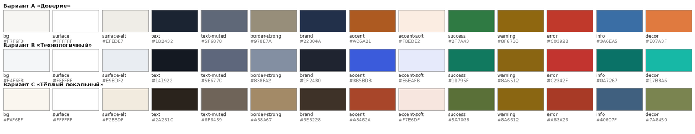
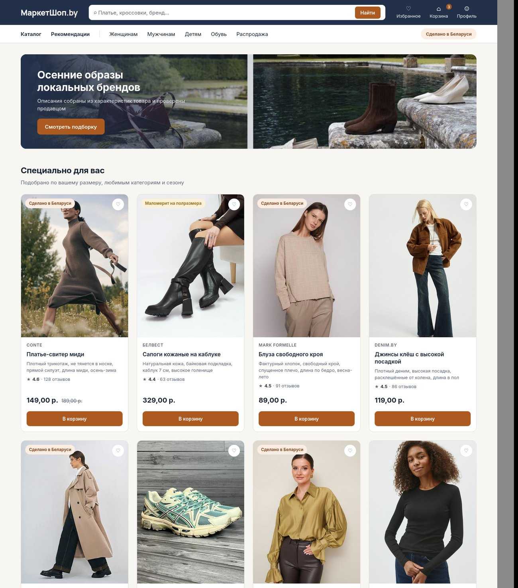
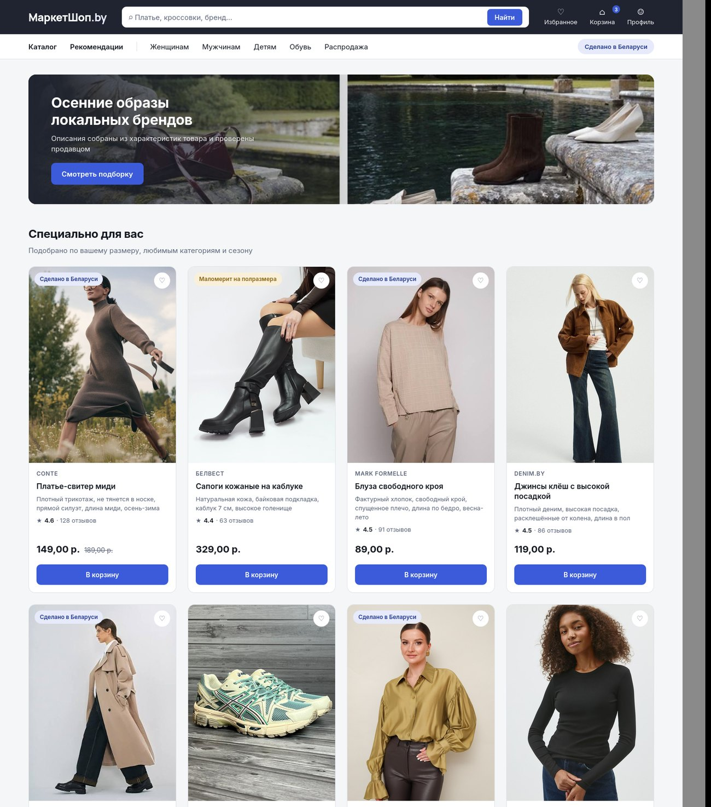
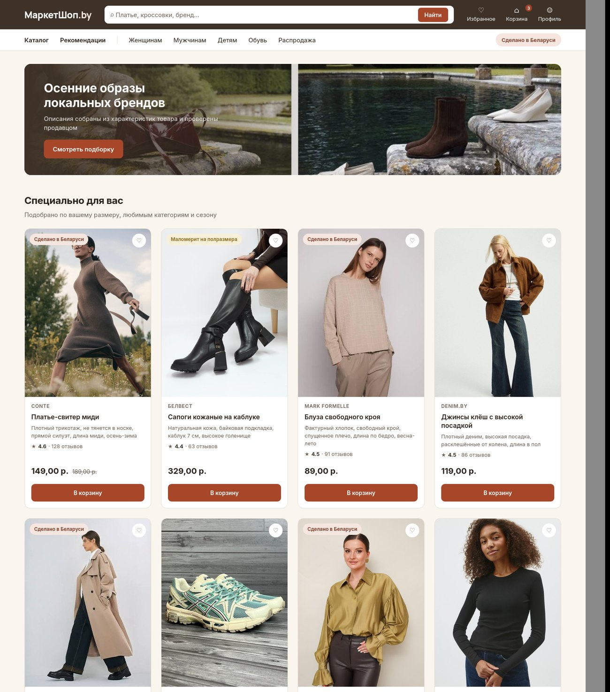
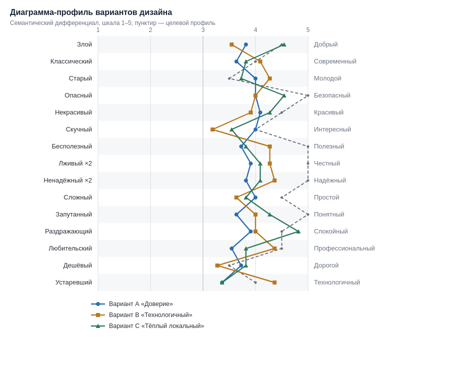
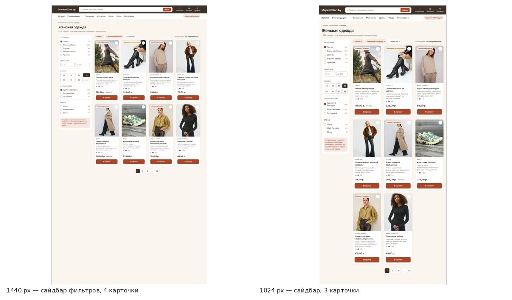
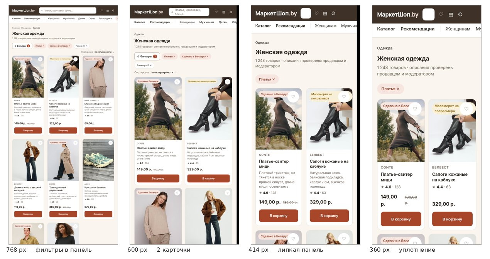
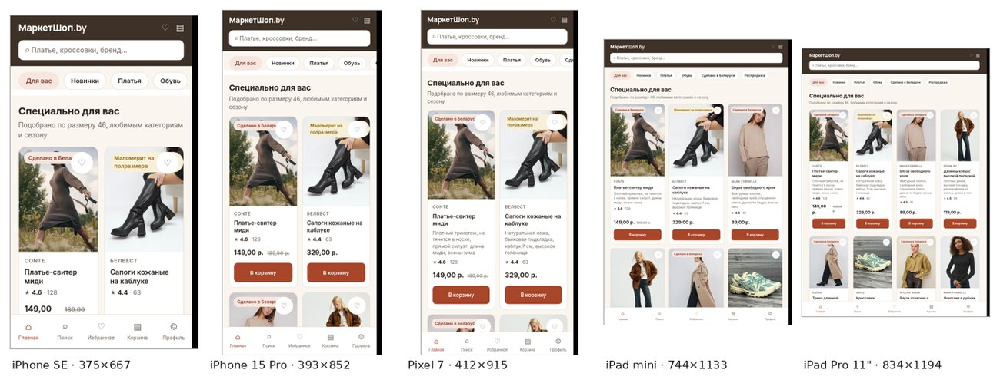
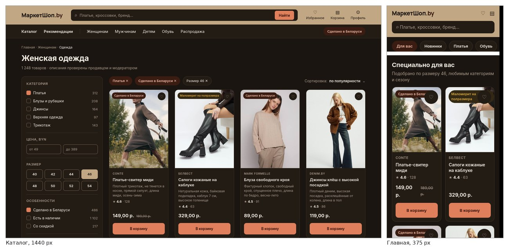
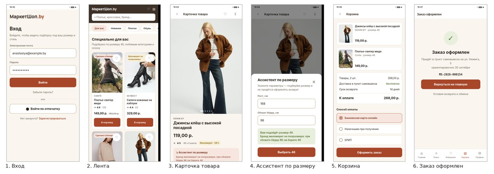

<!--raw-->

Белорусский государственный университет

Факультет прикладной математики и информатики

Кафедра технологий программирования

Отчёт по лабораторной работе № 5

по курсу «Проектирование человеко-машинных интерфейсов»

Проектирование прототипа приложения

Тема проекта: МаркетШоп.by — сервис автоматической генерации описаний товаров в рекомендательной системе маркетплейса одежды и обуви (Республика Беларусь)

Выполнили: студенты 4 курса, группа 10

Харченко Анастасия

Шепко Варвара

Степук Анастасия

Проверила: старший преподаватель кафедры ТП

Давидовская М. И.

Минск, 2026

<!--/raw-->

<!--TOC-->

## Введение

Работа продолжает проект МаркетШоп.by из ЛР № 1 — ЛР № 4. В ЛР № 2 была разработана информационная архитектура и предложена цветовая концепция, в ЛР № 3 — требования и модели предметной области, в ЛР № 4 — физическая модель базы данных, REST API и MCP-сервер. В настоящей работе исследован визуальный язык продукта, разработаны адаптивные макеты и руководства по стилям для веб- и мобильного приложения.

Ключевой результат работы: **цветовая концепция, предложенная в ЛР № 2 «на глаз», проверена эмпирически и по итогам теста заменена.** Это соответствует принятой в проекте практике — в ЛР № 2 по результатам опроса были переработаны пять разделов ЛР № 1.

Все артефакты собираются скриптами из трёх источников — `design/tokens.json`, `research/adjectives.csv` и `research/raw.csv`. Макеты, руководства по стилям, отчёт о контрасте и настоящий отчёт не набирались вручную, поэтому не могут разойтись между собой.

**Таблица 1 — Результаты работы по заданиям**

| Задание | Результат | Файлы |
|---|---|---|
| 1. Исследование визуального языка | 15 пар прилагательных с целевым профилем, 3 цветовых варианта, тест с 11 респондентами, 4 диаграммы-профиля | `research/`, `mockups/visual-language.html` |
| 2. Адаптивные макеты и прототип | 6 разрешений веб-страницы, 5 устройств, отзывчивая разметка с медиазапросами, ТЗ на интерактивный прототип | `mockups/`, `prototype/` |
| 3. Руководства по стилям | 2 руководства, 33 раздела, 21 компонент, проверка контраста по WCAG 2.1 | `style-guide/`, `design/` |

## 1 Исследование визуального языка

### 1.1 Анализ шаблонов и решений

Исследование начато с изучения существующих решений. Рассмотрены товарные страницы и карточки товара на Dribbble и CodePen, обзор элементов интерфейса Usability.gov, материал UXPin о применении шаблонов проектирования и исследование Smashing Magazine о навигационных категориях в электронной коммерции.

Отбор вёлся не по внешней привлекательности, а по пригодности для задач проекта. Каждое решение проверялось на совместимость с информационной архитектурой ЛР № 2 и критериями приёмки ЛР № 3: если шаблон противоречил уже принятому требованию, он отклонялся независимо от того, насколько распространён.

**Таблица 2 — Заимствованные и отклонённые решения**

| Паттерн | Источник | Решение | Обоснование |
|---|---|---|---|
| Закреплённая панель покупки | Dribbble, товарные страницы | принят частично | решение распространено, но AC-02.1 требует размещать описание выше кнопки «В корзину»; при закреплённой панели кнопка видна всегда и требование теряет смысл, поэтому кнопка размещена в потоке документа |
| Фасетные фильтры в боковой панели | Smashing Magazine | принят | соответствует системе поиска ЛР № 2, п. 2.4: фильтрация по размеру, цене, бренду и признаку «Сделано в Беларуси» |
| Мегаменю категорий | Dribbble | отклонён | ЛР № 2 ограничивает число навигационных связей функционального блока тремя; мегаменю нарушает это ограничение |
| Карточка с кратким описанием | CodePen, product cart | принят | прямо реализует AC-01.2: в карточке ленты выводится summary не длиннее 90 символов, сформированный из того же черновика, что и полное описание |
| Бейдж происхождения товара | Usability.gov, UI patterns | принят | закрывает US-13: фильтр и отметка «Сделано в Беларуси» как инструмент поддержки локальных брендов |
| Аккордеон характеристик | UXPin | отклонён | AC-02.2 требует, чтобы все четыре подблока описания — состав, посадка, уход, размерная сетка — были видны без дополнительного действия |
| Подбор размера по меркам | Dribbble, fashion e-commerce | принят | US-03 и US-04: рекомендация размера с пояснением о посадке, ввод параметров без ухода в профиль |
| Индикатор доверия к описанию | собственное решение | принят с ограничением | уровень уверенности генератора показывается продавцу и модератору, но скрыт от покупателя (ОГР-2) |

### 1.2 Методика тестирования визуального дизайна

Рассмотрены три подхода к оценке визуального дизайна.

**Пятисекундный тест.** Макет показывается ровно пять секунд, после чего респондента просят описать, что он запомнил. Метод выявляет, какие элементы захватывают внимание первыми, но не даёт количественной оценки и плохо поддаётся сравнению нескольких вариантов между собой.

**Метод предпочтительного выбора.** Респондент указывает, какой из вариантов нравится больше. Прост в проведении и обработке, однако измеряет эстетическое предпочтение, а не соответствие дизайна задуманным характеристикам продукта. Вариант может нравиться и при этом не вызывать нужных ассоциаций.

**Семантический дифференциал Ч. Осгуда.** Респондент оценивает объект по набору биполярных шкал, заданных парами антонимов. Результат — профиль значений, который можно сопоставить с заранее заданным целевым профилем и сравнить между вариантами численно.

Основным выбран **семантический дифференциал**. Методические указания прямо требуют шкал по парам прилагательных, расчёта средних и построения диаграммы-профиля. Существеннее другое: метод позволяет заранее объявить, каким продукт должен восприниматься, и затем проверить гипотезу, а не подбирать объяснение под полученный результат.

Метод предпочтительного выбора применён дополнительно: последним вопросом анкеты респондент указывает вариант, который выбрал бы сам. Этот ответ не влияет на расчёт и служит проверкой — совпадает ли прямое предпочтение с результатом по шкалам.

### 1.3 Пары прилагательных и целевой профиль

Семь пар из методических указаний сохранены и дополнены до пятнадцати. Каждая пара обоснована данными ЛР № 1 — ЛР № 4; оценивается по шкале 1–5, где 5 соответствует левому полюсу.

**Целевой профиль задан до проведения теста и при обработке не изменялся.** Это принципиально: вариант выбирается по минимуму отклонения от заранее объявленной цели, а не подгонкой объяснения под полученный результат.

Для пяти пар целевое значение намеренно не крайнее. Парам «Честный — Лживый» и «Надёжный — Ненадёжный» присвоен двойной вес: они закрывают барьеры, подтверждённые опросом ЛР № 1 (несоответствие описания реальности — 60,9 %, сложности с возвратом — 39,1 %).

**Таблица 3 — Пары прилагательных, целевые значения и обоснование**

| № | Пара (5 — 1) | Цель | Вес | Обоснование |
|---|---|---|---|---|
| P01 | Добрый — Злой | 4.5 | — | тон интерфейса: польза простым языком, без маркетингового давления |
| P02 | Современный — Классический | 4.0 | — | образ технологичной площадки, но ядро ЦА включает 35–55 лет (32,6%) — крайняя новизна отталкивает |
| P03 | Молодой — Старый | 3.5 | — | ЦА 18–55: 25–34 — 39,1%, 18–24 — 28,3%, 35–44 — 21,7%, 45+ — 10,9% |
| P04 | Безопасный — Опасный | 5.0 | — | оплата картой онлайн 69,6%; недоверие к продавцу — барьер 19,6% |
| P05 | Красивый — Некрасивый | 4.5 | — | нейтральный фон и белые карточки — ради акцента на фотографиях товара |
| P06 | Интересный — Скучный | 4.0 | — | монопольный интерфейс, сессии 15–20 мин: не должен отвлекать от выбора |
| P07 | Полезный — Бесполезный | 5.0 | — | средняя важность достоверного описания 4,33/5, оценок «1» нет |
| P08 | Честный — Лживый | 5.0 | ×2 | 60,9% сталкивались с несоответствием описания реальности; запрет неподтверждённых заявлений о качестве |
| P09 | Надёжный — Ненадёжный | 5.0 | ×2 | сложности с возвратом/обменом — барьер №1 (39,1%) |
| P10 | Простой — Сложный | 4.5 | — | Ольга Петровна, 48: низкий/средний уровень владения приложениями |
| P11 | Понятный — Запутанный | 5.0 | — | термины генерации (NLP, LLM, «ИИ-описание») отсутствуют в покупательском контуре |
| P12 | Спокойный — Раздражающий | 4.5 | — | 58,7% заходят вечером 19:00–23:00; требуется тёмная тема и низкая визуальная агрессия |
| P13 | Профессиональный — Любительский | 4.5 | — | привлечь малые белорусские бренды: их карточки должны выглядеть солидно |
| P14 | Дорогой — Дешёвый | 3.5 | — | «качественная одежда по адекватной цене»: не люкс и не дискаунтер |
| P15 | Технологичный — Устаревший | 4.0 | — | бизнес-задача: образ технологичной площадки |

### 1.4 Цветовые схемы

Подготовлены три цветовых решения. Вариант A воспроизводит концепцию ЛР № 2 и служит контрольным: именно его предстояло проверить. Варианты B и C сгенерированы в paletton.com — триада и аналоговая схема соответственно; оттенки и тона подобраны в colorhexa.com.

| Вариант | Схема | Замысел и проверяемая гипотеза |
|---|---|---|
| A «Доверие» | ЛР № 2, контрольный | тёмно-синий как цвет шапки и тёплый оранжевый как цвет действия. Концепция принята в ЛР № 2 исходя из общих соображений, без проверки на пользователях |
| B «Технологичный» | триада: графит, индиго, бирюзовый | проверяет бизнес-задачу ЛР № 1, п. 13.4 — сформировать образ технологичной площадки. Холодная гамма, характерная для продуктовых и финансовых сервисов |
| C «Тёплый локальный» | аналоговая: терракота и олива на кремовом | отсылка к идентичности малых белорусских брендов — основной аудитории продавцов по ЛР № 1. Тёплая, приглушённая гамма |

Принципиальное условие: **набор имён токенов во всех трёх вариантах идентичен**, различаются только значения. Благодаря этому макеты собираются из одной разметки, и различие сводится ровно к цвету — то, чего и требуют методические указания.

**Таблица 4 — Значения основных токенов, светлая тема**

| Токен | Назначение | A | B | C |
|---|---|---|---|---|
| `bg` | фон страницы | #F7F6F3 | #F4F6F8 | #FAF6EF |
| `surface` | карточка, панель | #FFFFFF | #FFFFFF | #FFFFFF |
| `text` | основной текст | #1B2432 | #141922 | #2A231C |
| `text-muted` | второстепенный текст | #5F6878 | #5E677C | #6F6459 |
| `brand` | шапка и глобальная навигация | #22304A | #1F2430 | #3E3228 |
| `accent` | кнопка ключевого действия | #AD5A21 | #3B5BDB | #A8462A |
| `accent-soft` | акцентная плашка | #FBEDE2 | #E6EAFB | #F7E6DF |
| `success` | успех | #2F7A43 | #11795F | #5A7038 |
| `warning` | предупреждение | #8F6710 | #8A6512 | #8A6612 |
| `error` | ошибка | #C0392B | #C2342F | #A83A26 |
| `decor` | декоративная заливка | #E07A3F | #17B8A6 | #7A8450 |

#### Проверка контраста

Цветовое решение проверялось не только на восприятие, но и на доступность. Все сочетания «текст — фон» и «граница — фон» проверены по WCAG 2.1 автоматической проверкой, вычисляющей коэффициент контраста по формуле относительной яркости и сверяет его с порогом: 4,5 : 1 для основного текста, 3 : 1 для границ и графических элементов.

Результат: **126 пар, из них обязательных 120; не проходит — 0; уровню AAA соответствует 42**.

**Таблица 5 — Дефекты контраста, выявленные в исходной палитре ЛР № 2**

| Сочетание | Контраст | Требуется | Итог | Решение |
|---|---|---|---|---|
| Белый текст на `#E07A3F` | 2,99 : 1 | 4,5 : 1 | не проходит | для заливки кнопок введён затемнённый тон `#AD5A21` (4,93 : 1); исходный оттенок сохранён как декоративный |
| Белый текст на `#C96930` | 3,77 : 1 | 4,5 : 1 | не проходит | то же; оттенок использовался как состояние наведения |
| Граница поля ввода `#C9C4B9` | 1,74 : 1 | 3 : 1 | не проходит | затемнена до уровня, удовлетворяющего WCAG 1.4.11 |
| Второстепенный текст на плашке | 4,23 : 1 | 4,5 : 1 | не проходит | цвет текста затемнён |

Всего скорректировано десять значений в трёх палитрах. Существенно, что дефект обнаружен в концепции, принятой в предыдущей работе: без формальной проверки он перешёл бы в разработку и проявился бы уже на этапе тестирования доступности.

### 1.5 Дизайн-макеты вариантов

Для исследования выбраны два экрана — по одному на каждую платформу.

| Экран | Разрешение | Обоснование выбора |
|---|---|---|
| Главная страница веб-приложения с лентой «Специально для вас» | 1440 px | лента — содержание главного экрана; персонализированные рекомендации положительно оценили 73,9 % респондентов опроса ЛР № 1. Экран содержит шапку, глобальную навигацию, баннер, сетку карточек и подвал, то есть почти все типовые элементы системы |
| Карточка товара мобильного приложения | 375 px | 82,6 % респондентов совершают покупки со смартфона. Карточка — ядро продукта: именно в ней показывается автоматически сформированное описание, ради которого проектируется система |

Оба экрана зафиксированы макетами низкой точности ещё в ЛР № 2, поэтому структура не менялась — проверялся только цвет.

**Содержание макетов.** Веб-главная включает шапку с логотипом, поиском и утилитами, строку глобальной навигации с отметкой «Сделано в Беларуси», баннер и сетку из восьми карточек по четыре в ряд. Каждая карточка содержит фотографию в соотношении 3:4, бренд, название, краткое описание, рейтинг, цену и кнопку действия. Мобильная карточка товара содержит галерею, бренд, название, цену, оценку посадки из отзывов, блок «Ассистент по размеру», описание из четырёх обязательных подблоков, выбор размера с отметкой отсутствующих позиций и кнопку «В корзину».

**Достоверность содержания.** Краткие описания в карточках не превышают 90 символов — это `CHECK`-ограничение базы данных, введённое в ЛР № 4 по критерию AC-01.2. Описание в карточке товара содержит ровно четыре подблока, требуемых AC-02.2. Термины автоматической генерации в макетах отсутствуют, как предписывает ограничение ОГР-2.

**Техническая реализация.** Макеты собраны из одной разметки на CSS-переменных: переключение набора значений даёт три варианта, у которых гарантированно совпадают сетка, типографика, фотографии и тексты. Способ исключает типичную ошибку подобных исследований, когда варианты непреднамеренно различаются не только цветом и эксперимент начинает измерять две переменные одновременно.

Шрифты Inter и Manrope встроены в файл, внешних ссылок нет: вид макета не зависит от наличия сети во время теста. Это существенно, поскольку при отсутствии загрузки шрифта браузер подставил бы системный и оформление изменилось бы посреди исследования.

**Оговорка о данных.** Наименования, цены и характеристики товаров в макетах являются демонстрационными; фотографии использованы в учебных целях. На результаты исследования это не влияет: во всех трёх вариантах содержание макетов идентично, а оценивается исключительно цветовое решение.

Перед началом сбора ответов состав материалов зафиксирован контрольными суммами (`research/FREEZE.md`) — это подтверждает, что все респонденты оценивали одну и ту же версию макетов.

### 1.6 Организация и проведение теста

В тестировании приняли участие **11 респондентов**. Состав выборки соответствует группам пользователей, выделенным в ЛР № 1.

**Таблица 4 — Состав выборки**

| Группа пользователей из ЛР № 1 | Требовалось | Фактически |
|---|---|---|
| «Осознанные покупательницы» 25–34 | 4 | 4 |
| «Новички» 35–55 | 3 | 3 |
| «Быстрые покупатели» 18–29 | 2 | 3 |
| Продавцы | 1 | 2 |

Распределение по основному устройству: смартфон — 8, компьютер — 2, планшет — 1.

Анкета реализована собственным веб-сервером: он показывает макеты, задаёт вопросы и записывает ответы непосредственно в `research/raw.csv`. Отказ от внешнего сервиса форм исключил рассогласование имён столбцов при выгрузке и позволил назначать порядок показа автоматически.

Соблюдены условия корректности измерения: **порядок предъявления вариантов ротировался между респондентами** для подавления эффекта первичности; переход к оценке блокировался на 15 секунд, чтобы респондент действительно рассмотрел макет; возврат к предыдущему макету не допускался; все 15 шкал были обязательными.

**Ограничение.** Респонденты проходили тест самостоятельно со своих устройств, поэтому условия показа — диагональ экрана, яркость, освещение — не были одинаковыми. Взамен исключено влияние ведущего, способного невольно подсказать ожидаемый ответ. Поскольку все три варианта каждый респондент видел на одном и том же устройстве, на сравнение вариантов между собой это не влияет.

### 1.7 Обработка результатов

**Таблица 5 — Средние оценки по парам прилагательных**

| Пара (5 — 1) | Цель | Вес | A | B | C | Ближе к цели |
|---|---|---|---|---|---|---|
| Добрый — Злой | 4.5 | — | 3.82 ± 0.75 | 3.55 ± 1.13 | 4.55 ± 0.69 | C |
| Современный — Классический | 4.0 | — | 3.64 ± 1.03 | 4.09 ± 1.14 | 3.82 ± 0.98 | B |
| Молодой — Старый | 3.5 | — | 4.00 ± 1.00 | 4.27 ± 0.79 | 3.73 ± 0.90 | C |
| Безопасный — Опасный | 5.0 | — | 4.00 ± 0.63 | 4.00 ± 0.77 | 4.55 ± 0.69 | C |
| Красивый — Некрасивый | 4.5 | — | 4.09 ± 0.94 | 3.91 ± 0.83 | 4.27 ± 0.79 | C |
| Интересный — Скучный | 4.0 | — | 4.00 ± 0.63 | 3.18 ± 0.87 | 3.55 ± 1.04 | A |
| Полезный — Бесполезный | 5.0 | — | 3.73 ± 0.79 | 4.27 ± 0.79 | 3.82 ± 0.75 | B |
| Честный — Лживый | 5.0 | ×2 | 3.91 ± 0.94 | 4.27 ± 0.65 | 4.09 ± 0.70 | B |
| Надёжный — Ненадёжный | 5.0 | ×2 | 3.82 ± 0.87 | 4.36 ± 0.67 | 4.09 ± 0.83 | B |
| Простой — Сложный | 4.5 | — | 4.00 ± 0.77 | 3.64 ± 1.03 | 3.82 ± 0.75 | A |
| Понятный — Запутанный | 5.0 | — | 3.64 ± 0.92 | 4.00 ± 1.10 | 4.27 ± 0.47 | C |
| Спокойный — Раздражающий | 4.5 | — | 3.91 ± 0.70 | 4.00 ± 0.63 | 4.82 ± 0.40 | C |
| Профессиональный — Любительский | 4.5 | — | 3.55 ± 0.82 | 4.36 ± 0.81 | 3.82 ± 1.17 | B |
| Дорогой — Дешёвый | 3.5 | — | 3.73 ± 0.90 | 3.27 ± 0.65 | 3.82 ± 0.87 | A |
| Технологичный — Устаревший | 4.0 | — | 3.36 ± 0.92 | 4.36 ± 0.67 | 3.36 ± 0.92 | B |

Формат ячейки — среднее ± стандартное отклонение.

**Таблица 6 — Отклонение от целевого профиля**

| Вариант | Сумма отклонений | Взвешенная сумма | Место |
|---|---|---|---|
| Вариант C «Тёплый локальный» | 7.95 | **9.77** | 1 |
| Вариант B «Технологичный» | 9.41 | **10.77** | 2 |
| Вариант A «Доверие» | 10.77 | **13.05** | 3 |

**Выбран вариант Вариант C «Тёплый локальный»** — наименьшее взвешенное отклонение (9.77). Отрыв от второго места составляет 1.00, то есть варианты C и B по совокупности шкал близки, и вывод опирается также на расхождения по отдельным парам и на контрольный вопрос.

На диаграмме видно, что линия варианта C на большинстве шкал проходит ближе к пунктирной линии цели. Наибольшие расхождения у всех вариантов приходятся на верхнюю часть диаграммы — пары «Полезный», «Честный», «Надёжный»: ни один вариант не достиг целевого значения 5,0. Это закономерно: доверие к площадке формируется содержанием, а не цветом, и цветовое решение может лишь не мешать ему.

#### Содержательный разбор

Вариант C выигрывает по шкалам «Спокойный» (4.82 — лучшая оценка в таблице при наименьшем разбросе 0.40), «Добрый» (4.55) и «Безопасный» (4.55). Это соответствует условиям использования из ЛР № 1: 58,7 % респондентов заходят в приложение вечером, когда визуальная агрессия воспринимается особенно остро.

Вариант C уступает по шкалам «Технологичный» (3.36 при цели 4,0) и «Профессиональный» (3.82 при цели 4,5) — по ним лидирует вариант B. Таким образом, бизнес-задача ЛР № 1 п. 13.4 о технологичном образе площадки решается выбранным вариантом не полностью; компенсировать это следует средствами типографики и компоновки, а не цветом.

Исходный вариант A, предложенный в ЛР № 2, занял последнее место (13.05). Он проиграл прежде всего по шкалам «Понятный» (3.64 при цели 5,0), «Полезный» (3.73) и «Надёжный» (3.82), то есть именно по тем характеристикам, которые закрывают ключевые барьеры онлайн-покупки, выявленные в ЛР № 1.

#### Контрольный вопрос

| Вариант | Выбрали | Доля |
|---|---|---|
| Вариант A «Доверие» | 2 | 18 % |
| Вариант B «Технологичный» | 3 | 27 % |
| Вариант C «Тёплый локальный» | 6 | 55 % |

Прямой выбор подтверждает результат по шкалам: вариант C предпочли 6 респондентов из 11.

#### Различия между группами пользователей

Оценки разобраны по группам, выделенным в ЛР № 1. Это важно, поскольку группы различаются и возрастом, и опытом онлайн-покупок.

| Группа | Человек | A | B | C | Лучший |
|---|---|---|---|---|---|
| «Осознанные покупательницы» 25–34 | 4 | 8.25 | 6.75 | 6.75 | B |
| «Новички» 35 и старше | 4 | 14.50 | 11.75 | 11.75 | B |
| «Быстрые покупатели» 18–24 | 3 | 18.50 | 15.17 | 14.17 | C |

В таблице приведено взвешенное отклонение от целевого профиля внутри каждой группы: чем меньше значение, тем ближе вариант к цели. Группы разошлись в оценках, поэтому итоговый выбор опирается на выборку в целом; расхождение зафиксировано как ограничение исследования. Следует учитывать, что при разбиении на группы численность каждой составляет три-четыре человека, поэтому различия между группами носят характер наблюдения, а не статистически значимого вывода.

#### Проверка эффекта порядка

Поскольку порядок показа ротировался, проверено, не объясняется ли результат позицией предъявления.

| Позиция показа | Средняя оценка |
|---|---|
| 1-й | 3.915 |
| 2-й | 3.994 |
| 3-й | 3.897 |

Разброс между позициями составляет 0.097 балла, то есть позиция на оценку практически не влияла. Дополнительно пересчитаны отклонения только по тем респондентам, которые видели соответствующий вариант не первым: Вариант A «Доверие» — 12.25, Вариант B «Технологичный» — 13.33, Вариант C «Тёплый локальный» — 9.25. Вариант C сохраняет первое место, следовательно результат устойчив.

## 2 Проектирование прототипа пользовательского интерфейса

### 2.1 Модульная сетка

Для адаптации выбрана страница **каталога с фильтрами**: её структура (боковая панель фильтров и сетка карточек) перестраивается на каждом шаге, поэтому адаптация содержательна, а не сводится к изменению ширины.

Применена двенадцатиколоночная сетка — наиболее распространённая в веб-дизайне и рекомендованная методическими указаниями: двенадцать делится на четыре, три и два, что позволяет без остатка разложить контент в любое из этих чисел колонок. На узких разрешениях число колонок сокращается до восьми и четырёх, поскольку двенадцать колонок шириной менее 40 px теряют смысл.

Ширина контейнера рассчитана по формуле из методических указаний: контейнер = колонка × N + гаттер × (N − 1). Для монтажной области 1440 px при полях 60 px контейнер равен 1320 px, что при двенадцати колонках и гаттере 24 px даёт колонку 88 px: 12 × 88 + 11 × 24 = 1056 + 264 = 1320.

Боковая панель фильтров занимает три колонки — 3 × 88 + 2 × 24 = 312 px, сетка товаров девять колонок. Фактическая ширина панели в собранном макете составляет ровно 312 px, что подтверждено измерением в браузере.

**Таблица 7 — Расчёт модульной сетки**

| Диапазон | Артборд | Контейнер | Колонок | Гаттер | Колонка | Поля | Проверка |
|---|---|---|---|---|---|---|---|
| 1440+ | 1440 | 1320 | 12 | 24 | 88 | 60 | 12 × 88 + 11 × 24 = 1320 |
| 992–1199 | 1024 | 984 | 12 | 24 | 60 | 20 | 12 × 60 + 11 × 24 = 984 |
| 768–991 | 768 | 720 | 8 | 24 | 69 | 24 | 8 × 69 + 7 × 24 = 720 |
| 576–767 | 600 | 552 | 8 | 16 | 55 | 24 | 8 × 55 + 7 × 16 = 552 |
| 400–575 | 414 | stretch | 4 | 16 | 83.5 | 16 | резиновая сетка |
| 320–399 | 360 | stretch | 4 | 16 | 70 | 16 | резиновая сетка |

### 2.2 Адаптивные макеты веб-страницы

Макеты разработаны для шести разрешений, требуемых методическими указаниями. Реализованы **единой разметкой с медиазапросами**, а не шестью отдельными изображениями: переходы между состояниями можно наблюдать, изменяя ширину окна браузера.

**Таблица 8 — Изменения компоновки по брейкпоинтам**

| Диапазон | Артборд | Изменения |
|---|---|---|
| 1440+ | 1440 | Сайдбар фильтров 3 колонки слева, сетка 4 карточки в ряд. Поиск развёрнут в шапке, вся глобальная навигация видна. |
| 992–1199 | 1024 | Сайдбар сохраняется, сетка сокращается до 3 карточек. Названия категорий в шапке без изменений. |
| 768–991 | 768 | Сайдбар сворачивается в кнопку «Фильтры» и выдвижную панель. Сетка 3 карточки. Поиск сжимается, утилиты шапки — только иконки. |
| 576–767 | 600 | Сетка 2 карточки. Сортировка переезжает в нижнюю всплывающую панель. Хлебные крошки сокращаются до последнего уровня. |
| 400–575 | 414 | Категории — горизонтальная лента с прокруткой. Внизу закрепляется панель «Фильтры · Сортировка». Поиск — по иконке. |
| 320–399 | 360 | Сетка 2 карточки с уплотнённой типографикой: название в две строки, цена и рейтинг в одну. Отступы 16 px, кнопка «В корзину» на всю ширину. |

**Логика перестроения.** Адаптация построена на последовательном вытеснении второстепенного: сначала сокращается плотность сетки, затем убирается боковая панель, затем сжимаются элементы шапки, и лишь в последнюю очередь упрощается содержимое карточки. Ключевое действие — кнопка «В корзину» — сохраняется на всех разрешениях.

На разрешении 768 px боковая панель фильтров заменяется кнопкой с указанием числа применённых фильтров: панель занимает слишком много места, но скрывать сам факт фильтрации нельзя, иначе пользователь не поймёт, почему видит неполный каталог. Начиная с 575 px управление сортировкой и фильтрами переносится в закреплённую внизу строку — в зону, достижимую большим пальцем. На 360 px из карточки убирается краткое описание: при ширине карточки 158 px оно занимало бы четыре строки и вытесняло цену за пределы экрана.

Каждое состояние проверено в браузере измерением фактических значений: ширина контейнера, число колонок сетки, ширина карточки, видимость боковой панели, наличие горизонтальной прокрутки.

**Таблица 9 — Результаты измерений**

| Ширина окна | Карточек в ряд | Ширина карточки | Сайдбар | Кнопка «Фильтры» | Горизонтальная прокрутка |
|---|---|---|---|---|---|
| 1440 | 4 | 224 px | есть, 312 px | нет | нет |
| 1024 | 3 | 223 px | есть, 228 px | нет | нет |
| 768 | 3 | 219 px | скрыт | есть | нет |
| 600 | 2 | 268 px | скрыт | есть | нет |
| 414 | 2 | 183 px | скрыт | закреплена внизу | нет |
| 360 | 2 | 158 px | скрыт | закреплена внизу | нет |

При проверке выявлены и устранены два нарушения собственного руководства по стилям: кнопка «В корзину» на узких экранах имела высоту 38 px, а нижняя панель навигации — 43 px при требовании ЛР № 1 п. 2.3 не менее 44 pt для iOS и 48 dp для Android.

### 2.3 Макеты экрана мобильного приложения для пяти устройств

В соответствии с методическими указаниями выбрано пять устройств, включая планшеты. Проектируемый экран — **главная после авторизации** с лентой «Специально для вас».

**Таблица 9 — Устройства и компоновка**

| Устройство | Размер | Платформа | Колонок карточек | Особенности |
|---|---|---|---|---|
| iPhone SE (3rd) | 375 × 667 | iOS | 2 | минимальный кейс; проверка AC-02.1 |
| iPhone 15 Pro | 393 × 852 | iOS | 2 | safe area, Dynamic Island |
| Pixel 7 | 412 × 915 | Android | 2 | Material, системная кнопка «Назад» |
| iPad mini | 744 × 1133 | iPadOS | 3 | 2 колонки карточек, side rail |
| iPad Pro 11" | 834 × 1194 | iPadOS | 4 | master-detail |

Планшеты включены в набор, несмотря на то что основным устройством их назвали лишь 2,2 % респондентов опроса ЛР № 1: планшетные компоновки необходимы кабинету продавца и панели модератора, где обрабатывается от 100 до 200 карточек в день. Таким образом планшет проектируется как рабочая, а не покупательская среда.

Сетка карточек изменяется с двух колонок на смартфонах до трёх на iPad mini и четырёх на iPad Pro. Нижняя панель навигации во всех размерах сохраняет пять пунктов — Главная, Поиск, Избранное, Корзина, Профиль, — как зафиксировано в системе навигации ЛР № 2, п. 2.3; вход в каталог осуществляется с главной и из результатов поиска, чтобы не выходить за предел пяти иконок.

Размер интерактивных элементов проверен отдельно. В первой редакции макетов кнопка «В корзину» имела высоту 38 px, а пункт нижней панели — 43 px, что нарушало требование ЛР № 1, п. 2.3 о крупных тач-зонах и рекомендации платформ: не менее 44 pt для iOS и 48 dp для Android. Значения исправлены до 48 px.

Поддержана тёмная тема: 58,7 % респондентов опроса ЛР № 1 пользуются приложением вечером с 19:00 до 23:00.

### 2.4 Интерактивный прототип

Прототип реализован как связанный набор экранов, открывающийся в браузере. Переходы между экранами — действующие, а не имитированные изображениями; «Ассистент по размеру» открывается всплывающей панелью поверх карточки товара, что соответствует классификации временного интерфейса из ЛР № 2, п. 1.3.

**Таблица 10 — Экраны прототипа и сценарий**

| № | Экран | Действие | Переход | Вариант использования |
|---|---|---|---|---|
| 1 | Вход | «Войти» либо вход по отпечатку | → Лента | UC-20, UC-21 |
| 2 | Лента «Специально для вас» | выбор карточки товара | → Карточка | UC-01 |
| 3 | Карточка товара | чтение описания из четырёх подблоков | — | UC-03 |
| 4 | Ассистент по размеру | ввод роста и обхвата, получение рекомендации | всплывающая панель | UC-04 |
| 5 | Карточка товара | «В корзину» | → Корзина | UC-05 |
| 6 | Корзина | выбор способа оплаты, «Оформить заказ» | → Подтверждение | UC-06 |
| 7 | Заказ оформлен | номер заказа, пункт выдачи, условия возврата | → Лента | UC-23 |

Соответствие прототипа требованиям предыдущих работ проверено автоматически по тринадцати пунктам: описание размещено выше кнопки «В корзину» (AC-02.1), присутствуют все четыре подблока описания (AC-02.2), отсутствуют термины автоматической генерации (AC-02.6, ОГР-2), параметры размера вводятся непосредственно в ассистенте без перехода в профиль (US-04), срок возврата виден до оформления заказа (US-12), пункт самовывоза предложен по умолчанию, а способы оплаты упорядочены по данным опроса ЛР № 1 — банковская карта первой, ЕРИП третьим. Размер интерактивных элементов во всех экранах не менее 48 px.

**Проверка соответствия.** Прототип проверен по тринадцати требованиям предыдущих работ автоматической проверкой разметки.

| Требование | Источник | Как реализовано |
|---|---|---|
| Описание выше кнопки «В корзину» | AC-02.1 | блок описания предшествует кнопке в потоке документа |
| Четыре подблока описания | AC-02.2 | состав, посадка, уход, размерная сетка бренда |
| Незаполненный подблок не остаётся пустым | AC-02.2 | выводится строка «Продавец не указал» |
| Нет терминов генерации | AC-02.6, ОГР-2 | в покупательском контуре отсутствуют NLP, LLM, «ИИ-описание» |
| Ассистент по размеру — временный интерфейс | ЛР № 2, п. 1.3 | открывается панелью поверх карточки, не отдельным экраном |
| Ввод параметров без ухода в профиль | US-04 | поля роста и обхвата внутри панели ассистента |
| Условия возврата до оформления заказа | US-12 | срок возврата показан в итоговой сводке корзины |
| Пункт самовывоза по умолчанию | опрос ЛР № 1, 78,3 % | выбран заранее, доставка бесплатна |
| Порядок способов оплаты | опрос ЛР № 1 | карта онлайн первой (69,6 %), ЕРИП третьим (0 выборов из 46) |
| Биометрический вход | ЛР № 1, п. 2.3 | кнопка входа по отпечатку на экране авторизации |
| Формат номера заказа | ЛР № 4 | MS-2026-000154 по шаблону из физической модели |
| Нижняя панель навигации | ЛР № 2, п. 2.3 | Главная, Поиск, Избранное, Корзина, Профиль |
| Размер тач-зон | ЛР № 1, п. 2.3 | не менее 48 px на всех экранах |

**Таблица 11 — Ссылки на прототип и макеты**

| Что | Адрес |
|---|---|
| Интерактивный прототип | https://fpmi-hci-2026.github.io/hci-10-project-group-1/lab5/mockups/prototype-login.html |
| Адаптивные макеты каталога | https://fpmi-hci-2026.github.io/hci-10-project-group-1/lab5/mockups/responsive-catalog.html |
| Экраны на пяти устройствах | https://fpmi-hci-2026.github.io/hci-10-project-group-1/lab5/mockups/devices.html |
| Макеты в Figma | https://www.figma.com/design/DIsarmkx75gQIm7ncRLsAZ/МаркетШоп |

## 3 Руководства по стилям

Разработаны два руководства — для веб- и для мобильного приложения. Оба собираются автоматически из `design/tokens.json`, поэтому значения цветов и размеров в руководстве, в макетах и в переменных Figma совпадают по построению.

**Таблица 12 — Состав руководств**

| Раздел | Содержание |
|---|---|
| Логотип | построение, охранное поле, минимальный размер, запреты |
| Цвет | 31 токенов в светлой и тёмной темах, отчёт о контрасте |
| Статусы описания | 6 бейджей по числу значений перечисления `description.status` |
| Уверенность генератора | 3 дискретных уровня, скрытые от покупателя |
| Типографика | 9 ступеней шкалы, Inter и Manrope |
| Сетка и отступы | 6 брейкпоинтов, шаг 8 pt, шкала радиусов |
| Компоненты | 21 компонент с вариантами и состояниями |
| Обработка ошибок | 9 кодов ответа API, формат RFC 9457 |
| Тон голоса | готовая микрокопия, запрещённые формулировки и термины |
| Видимость по контурам | что показывается покупателю, продавцу, модератору, администратору |
| Фотографии товара | соотношение, фон, обязательные кадры |
| Движение | три длительности, поведение при «уменьшить движение» |
| Доступность | контраст, размеры текста, фокус, тач-зоны |
| Платформенные различия | iOS и Android: гарнитуры, навигация, жесты (только мобильное) |

#### Типографика

Гарнитура основного текста — **Inter**, логотипа — **Manrope ExtraBold**. Inter выбран за крупные строчные знаки: в карточке товара много мелкого текста — состав ткани, правила ухода, размерная сетка, — и на 13–14 px разборчивость критична. Дополнительное основание — персонаж Ольга Петровна из ЛР № 1, 48 лет, предпочитающая крупный шрифт; минимальный размер основного текста установлен в 16 px.

| Ступень | Размер | Интерлиньяж | Начертание | Применение |
|---|---|---|---|---|
| h1 | 40 px | 48 px | 700 | заголовок страницы |
| h2 | 30 px | 38 px | 700 | заголовок раздела |
| h3 | 24 px | 32 px | 600 | заголовок блока |
| h4 | 19 px | 26 px | 600 | подзаголовок |
| body | 16 px | 24 px | 400 | основной текст, минимум для чтения |
| body-sm | 14 px | 20 px | 400 | описание в карточке |
| caption | 13 px | 18 px | 400 | подписи, метаданные |
| label | 13 px | 16 px | 600 | метки полей, прописные |

#### Статусы описания товара

Перечень состояний не придуман, а выведен из физической модели ЛР № 4: поле `description.status` объявлено перечислением ровно из шести значений. Следовательно, бейджей в интерфейсе тоже ровно шесть — седьмого состояния система иметь не может.

| Значение | Подпись в интерфейсе | Цвет | В каком контуре |
|---|---|---|---|
| `incomplete` | Не хватает атрибутов | warning | продавец |
| `draft` | Черновик | text-muted | продавец |
| `pending_moderation` | На модерации | info | продавец, модератор |
| `blocked` | Заблокировано | error | продавец, модератор |
| `returned` | Возвращено на правку | on-accent-soft | продавец |
| `published` | Опубликовано | success | продавец, модератор, администратор |

Аналогично уровень уверенности генератора `description.confidence` — три дискретных значения, а не процентная шкала; в очереди модерации они задают порядок проверки, а покупателю не показываются вовсе.

#### Состояния ошибки

Перечень состояний ошибки получен из таблицы кодов ответа API ЛР № 4. Такой подход гарантирует полноту: интерфейс спроектирован под все состояния, в которых система действительно может оказаться.

| Код | Операций в API | Способ показа |
|---|---|---|
| 401 | 47 | модальное окно входа; после авторизации возврат к прерванному действию |
| 404 | 24 | экран «Не найдено». Чужой ресурс отдаёт 404, а не 403 — интерфейс не должен подтверждать существование объекта |
| 400 | 16 | подсветка поля формы и подпись под ним |
| 409 | 15 | баннер с текстом из поля detail |
| 403 | 14 | баннер в теле страницы: пользователь не может это исправить, модальное окно было бы навязчивым |
| 422 | 12 | подсветка полей из массива missing и общий баннер |
| 429 | 3 | уведомление с обратным отсчётом |
| 413 | 2 | ошибка у поля загрузки: партия не более 20 позиций, файл не более 10 МБ |
| 503 | 1 | отдельное состояние кнопки «Сгенерировать описание» |

Два раздела заслуживают отдельного пояснения, поскольку выведены из моделей ЛР № 4, а не из общих рекомендаций по оформлению.

**Состояния по кодам ответа.** Перечень состояний интерфейса получен из таблицы кодов ответа API: девять кодов, для каждого определён способ показа. Код 401 встречается в 47 операциях из 55, то есть является самым частым состоянием системы и проектируется первым. Ответы передаются в формате `application/problem+json`, поэтому заданы правила отображения: поле `title` выводится заголовком, `detail` — подписью, массив `missing` подсвечивает конкретные поля формы.

**Видимость элементов по контурам.** Ограничение ОГР-2 запрещает показывать покупателю признаки автоматической генерации. В ЛР № 4 оно проведено на уровне схем: в покупательском контуре API полей `confidence` и `claims` нет вовсе. Руководство фиксирует это таблицей соответствия, чтобы ограничение не было нарушено при разработке.

### 3.1 Трассируемость в код

Имена токенов (`brand`, `accent`, `on-accent`, `surface`, `text-muted` и прочие) одинаковы в `design/tokens.json`, в CSS-переменных макетов и в коллекциях переменных Figma. Соответствие дизайна и реализации не требует перевода: разработчик фронтенда использует то же имя, что указано в руководстве.

Выбранная по результатам теста палитра — **Вариант C «Тёплый локальный»**: шапка и глобальная навигация `#3E3228`, кнопка ключевого действия `#A8462A`, фон `#FAF6EF`, декоративный оттенок `#7A8450`.

## 4 Планирование этапа концептуального проектирования

**Таблица 13 — План этапа и фактическое исполнение**

| Шаг | Содержание | Результат | Исполнитель |
|---|---|---|---|
| 1 | Анализ шаблонов и методик тестирования визуального дизайна | таблица решений, выбор метода | Шепко В. |
| 2 | Разработка пар прилагательных и целевого профиля | 15 пар, обоснование по ЛР № 1 — ЛР № 4 | Харченко А. |
| 3 | Подготовка цветовых схем и проверка контраста | 3 палитры, 126 проверенных пар | Харченко А. |
| 4 | Сборка макетов для исследования | 6 макетов из одной разметки, фиксация версии | Степук А. |
| 5 | Проведение теста и обработка результатов | 11 анкет, 4 диаграммы-профиля, выбор варианта | Харченко А. |
| 6 | Адаптивные макеты и макеты устройств | 6 разрешений, 5 устройств | Шепко В. |
| 7 | Руководства по стилям | 2 документа, 33 раздела | Степук А. |
| 8 | Техническое задание на прототип и сборка в Figma | ТЗ, карта переходов, интерактивный прототип | Шепко В., Степук А. |

Последовательность шагов определяется зависимостями по данным: цветовые схемы нельзя подготовить до определения целевого профиля, макеты для исследования — до утверждения схем, а руководства по стилям и прототип — до выбора варианта по результатам теста. Шаги 1 и 2 выполнялись параллельно, равно как шаги 6 и 7 после получения результатов.

Решение строить все артефакты из общего набора токенов принято на шаге 3 и позволило выполнить шаг 7 без переработки: смена палитры по результатам теста свелась к перегенерации документов.

## Выходные документы

| Требование методических указаний | Артефакт |
|---|---|
| 2–3 вида дизайн-макета веб- и мобильного приложения | `mockups/visual-language.html` — 3 варианта × 2 экрана |
| Результаты исследования визуального языка | `research/results.md`, `research/charts/profile-*.svg` |
| Макеты страницы и экрана под разные разрешения | `mockups/catalog.html`, `mockups/responsive-catalog.html`, `mockups/mobile-home.html`, `mockups/devices.html` |
| Концептуальные макеты: интерактивные прототипы | `mockups/prototype-*.html` — пять связанных экранов, ссылка на Figma |
| Руководства по стилям для мобильного и веб-приложения | `style-guide/web.md`, `style-guide/mobile.md` |
| Отчёт с планированием этапа и описанием шагов | настоящий документ |

## Заключение

1. Исследован визуальный язык продукта. Составлен список из 15 пар прилагательных с целевым профилем, обоснованным данными ЛР № 1 — ЛР № 4 и заданным до проведения теста. Подготовлены три цветовых варианта, различающиеся исключительно значениями токенов.
2. Проведён тест с 11 респондентами, состав выборки соответствует группам пользователей из ЛР № 1. Выбран вариант Вариант C «Тёплый локальный» с взвешенным отклонением 9.77 против 10.77 и 13.05 у остальных. Результат подтверждён контрольным вопросом (6 из 11) и проверен на устойчивость к эффекту порядка.
3. Цветовая концепция, предложенная в ЛР № 2, по результатам теста заняла последнее место и заменена. Дополнительно установлено, что её акцентный цвет не удовлетворял требованию WCAG по контрасту. Проектное решение, принятое ранее без проверки, скорректировано эмпирическими данными.
4. Разработаны адаптивные макеты каталога для шести разрешений и макеты главного экрана для пяти устройств, включая планшеты. Макеты реализованы единой отзывчивой разметкой; каждое состояние проверено измерением фактических значений в браузере.
5. Разработаны руководства по стилям для веб- и мобильного приложения. Перечень состояний компонентов выведен из кодов ответа API и перечислений базы данных ЛР № 4, а не составлен произвольно, что обеспечивает полноту покрытия состояний системы.
6. Все артефакты генерируются из общего набора токенов, поэтому макеты, руководства по стилям и настоящий отчёт согласованы между собой по построению.

## Список использованных источников

1. Давидовская, М. И. Проектирование прототипа приложения : методические указания по выполнению лабораторной работы № 5 / М. И. Давидовская. — Минск : БГУ, 2024.
2. Харченко, А. Лабораторная работа № 4. Стили интеграции программных систем и проектирование API / А. Харченко, В. Шепко, А. Степук. — Минск : БГУ, 2026.
3. Харченко, А. Лабораторная работа № 2. Проектирование информационной архитектуры и взаимодействия с пользователем / А. Харченко, В. Шепко, А. Степук. — Минск : БГУ, 2026.
4. Osgood, C. E. The Measurement of Meaning / C. E. Osgood, G. J. Suci, P. H. Tannenbaum. — University of Illinois Press, 1957.
5. Web Content Accessibility Guidelines (WCAG) 2.1 [Электронный ресурс]. — Режим доступа: https://www.w3.org/TR/WCAG21/. — Дата доступа: 28.10.2026.
6. Material Design 3. Accessibility [Электронный ресурс]. — Режим доступа: https://m3.material.io/foundations/accessible-design. — Дата доступа: 28.10.2026.
7. Human Interface Guidelines. Layout [Электронный ресурс]. — Режим доступа: https://developer.apple.com/design/human-interface-guidelines/layout. — Дата доступа: 28.10.2026.
8. Figma. Prototyping [Электронный ресурс]. — Режим доступа: https://help.figma.com/category/87-prototyping. — Дата доступа: 27.10.2026.
9. Paletton — The Color Scheme Designer [Электронный ресурс]. — Режим доступа: http://paletton.com. — Дата доступа: 27.10.2026.
10. Guidelines For Navigation And Categories In E-Commerce [Электронный ресурс]. — Режим доступа: https://www.smashingmagazine.com. — Дата доступа: 27.10.2026.
11. RFC 9457. Problem Details for HTTP APIs [Электронный ресурс]. — Режим доступа: https://www.rfc-editor.org/rfc/rfc9457. — Дата доступа: 20.10.2026.

## Приложение А. Диаграммы-профили

Диаграммы построены автоматически из файла ответов. Пунктирной линией нанесён целевой профиль, заданный до проведения теста.

| Файл | Содержание |
|---|---|
| `research/charts/profile-all.svg` | профили всех трёх вариантов с целевым профилем |
| `research/charts/profile-a.svg` | вариант A «Доверие» отдельно |
| `research/charts/profile-b.svg` | вариант B «Технологичный» отдельно |
| `research/charts/profile-c.svg` | вариант C «Тёплый локальный» отдельно |

