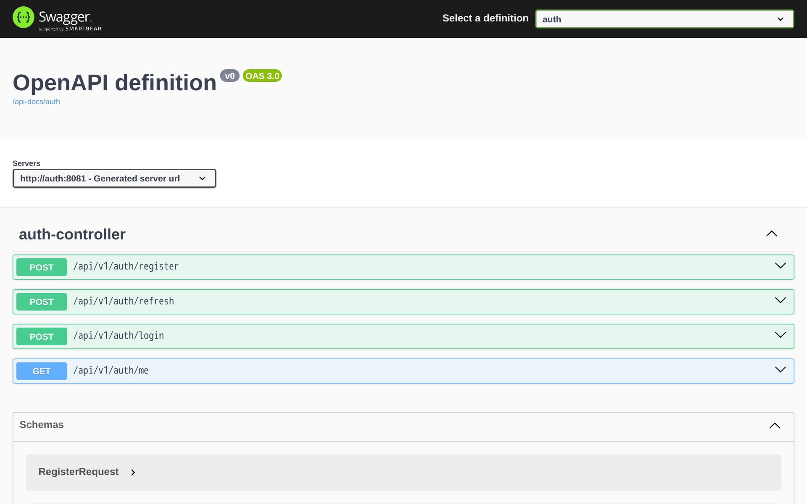
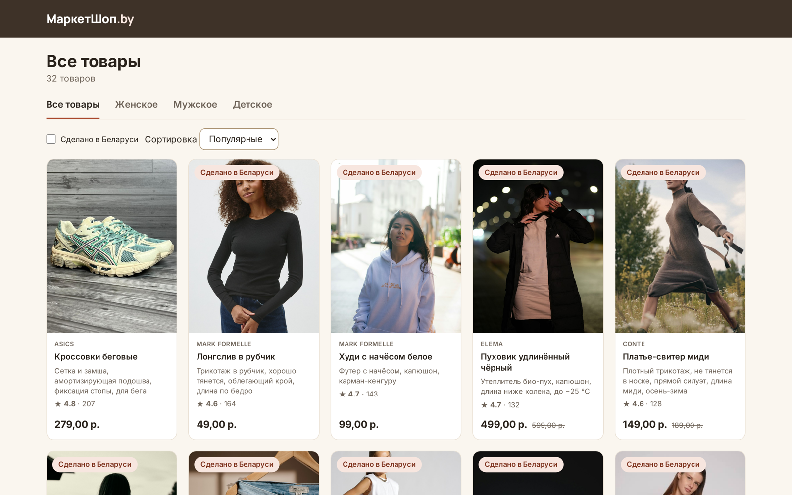

<!--raw-->

Белорусский государственный университет

Факультет прикладной математики и информатики

Кафедра технологий программирования

Отчёт по лабораторной работе № 7

по курсу «Проектирование человеко-машинных интерфейсов»

Разработка API и серверной части приложения

Тема проекта: МаркетШоп.by — сервис автоматической генерации описаний товаров в рекомендательной системе маркетплейса одежды и обуви (Республика Беларусь)

Выполнили: студенты 4 курса, группа 10

Харченко Анастасия

Шепко Варвара

Степук Анастасия

Проверила: старший преподаватель кафедры ТП

Давидовская М. И.

Минск, 2026

<!--/raw-->

<!--TOC-->

## Введение

**Цель работы** — получить навыки проектирования и разработки серверного приложения, реализации бизнес-логики и API.

**Задачи:** распределить задачи реализации между участниками; реализовать серверную часть для основных сущностей
системы и документировать API; настроить проекты веб- и мобильного приложений и создать их первую страницу и первый
экран; настроить в каждом репозитории непрерывную интеграцию с проверкой качества кода и тестами; подготовить
окружение разработки в контейнерах и развёртывание в облаке.

Входные данные — техническое задание и архитектура по модели C4 (ЛР № 3), физическая модель данных и контракт API
(ЛР № 4), руководство по стилям и прототипы (ЛР № 5).

Результат размещён в трёх репозиториях, подключённых к основному как подмодули:

| Репозиторий | Содержание |
|-------------|------------|
| `hci-10-backend-api-group-1` | Сервисы аутентификации, каталога и заказов на Kotlin и Spring Boot, шлюз API, общая библиотека, окружение Docker Compose, сквозной тест |
| `hci-10-frontend-group-1` | Веб-приложение на React и TypeScript: каркас и главная страница с каталогом |
| `hci-10-mobile-group-1` | Приложение Android на Kotlin и Jetpack Compose: каркас и экран «Главная» |

## 1 Распределение задач

Задачи сформированы из слайсов Event Modeling (ЛР № 3). В эту работу вошли контексты, без которых не работает
ни один сценарий покупателя: пользователи, каталог, корзина и заказы. Остальные контексты — генерация описаний,
модерация, размер, отзывы, возвраты, уведомления и рекомендации — строятся на них и реализуются следующими
этапами по тому же образцу.

**Таблица 1 — Распределение задач**

| Участник | Серверная часть | Веб-приложение | Мобильное приложение | Документация |
|----------|-----------------|----------------|----------------------|--------------|
| Харченко Анастасия | Каркас сборки, общая библиотека, аутентификация, каталог и поиск, корзина, заказы и оплата, шлюз API и Swagger, окружение Docker Compose и развёртывание | — | — | README и сайт проекта, обновление подмодулей |
| Шепко Варвара | Сквозной сценарий через шлюз | — | Каркас, клиент API, тема, экран «Главная», тесты, CI | Вики проекта |
| Степук Анастасия | CI и проверка качества, README | Каркас, клиент API, главная страница, стили, тесты, CI и публикация на Vercel | — | Отчёт ЛР № 7 |

Порядок работы: сначала серверная часть, затем параллельно веб- и мобильное приложения на готовом API. Изменения
вливаются через pull request, который рецензирует участник, не являющийся автором.

## 2 Архитектура реализации

Реализация следует модели C4 из ЛР № 3. Каждый ограниченный контекст — отдельный сервис со своей схемой в
PostgreSQL; запросы клиентов проходят через шлюз, а сервисы публикуют доменные события в Kafka в формате
CloudEvents. Событие публикуется только после фиксации транзакции, поэтому подписчики не увидят изменения, которое
было откачено. Сервисы следующих этапов подключатся к тем же событиям без изменения готовых.

**Таблица 2 — Сервисы серверной части**

| Сервис | Стек | Ответственность | Публикует события |
|--------|------|-----------------|-------------------|
| `gateway` | Kotlin, Spring Cloud Gateway | Единая точка входа, маршрутизация, ограничение частоты запросов (Redis), CORS, Swagger UI всех сервисов | — |
| `auth` | Kotlin, Spring Boot | Регистрация, вход, JWT, обновление токена | — |
| `catalog` | Kotlin, Spring Boot | Категории, товары, атрибуты и их полнота, остатки и резерв, фото в S3, полнотекстовый поиск в OpenSearch, загрузка из CSV | `catalog.product.created`, `catalog.attributes.verified` |
| `orders` | Kotlin, Spring Boot | Избранное, корзина, оформление, оплата картой и через ЕРИП, статусы доставки | `order.created`, `order.delivered` |

Инфраструктура: PostgreSQL 16 (у каждого сервиса своя схема, миграции Flyway по физической модели ЛР № 4), Redis 7,
Kafka 3.8 в режиме KRaft, OpenSearch 2, S3-совместимое хранилище фото.

Общая библиотека `libs/common` избавляет сервисы от повторяющегося кода: проверка JWT и ролей, ответы об ошибках в
формате problem+json (RFC 9457) с машиночитаемым кодом, публикация событий после фиксации транзакции, постраничная
выдача и HTTP-клиент для внутренних запросов.

## 3 Серверная часть

### 3.1 Основные сущности и бизнес-логика

**Таблица 3 — Реализованные сценарии**

| Сценарий (ЛР № 3) | Что реализовано |
|-------------------|-----------------|
| Регистрация и вход | Роли покупателя, продавца и администратора; токен доступа на 60 минут и токен обновления на 30 дней |
| Каталог и поиск | Дерево категорий; фильтры по категории, размеру, цене, бренду и метке «Сделано в Беларуси»; сортировка; постраничная выдача; полнотекстовый поиск с подсказками и поиск по штрихкоду |
| Карточка товара | Фото, атрибуты, размеры с наличием, срок возврата |
| Добавление товара (US-05, US-06) | Проверка обязательных атрибутов категории; недостающие атрибуты возвращаются списком; загрузка фото и пакетная загрузка CSV |
| Избранное | Добавление и удаление товаров покупателем |
| Корзина и заказ (С1) | Резерв остатков при оформлении; повторный запрос с тем же ключом идемпотентности не создаёт второй заказ; пункты выдачи и курьерская доставка |
| Оплата | Картой и через ЕРИП, подпись платёжного вебхука HMAC, тестовый режим оплаты |
| Статусы заказа (С5) | Администратор переводит заказ по статусам доставки до выдачи |

При первом запуске каталог заполняется восемью товарами прототипа ЛР № 5 с фотографиями, а система — тремя
демонстрационными пользователями-персонажами ЛР № 1: покупателем Анастасией, продавцом Виктором и
администратором Мариной.

### 3.2 Документация API

Каждый сервис публикует описание OpenAPI, шлюз собирает их в один Swagger UI (рисунок 1). Публичных операций 38:
4 в аутентификации, 16 в каталоге и 18 в заказах. Внутренние операции (резерв остатков, сведения о товаре для других
сервисов) шлюз наружу не пропускает.

Работу API подтверждает сквозной сценарий `scripts/e2e.py`: через шлюз входят покупатель, продавец и администратор;
покупатель получает категории, фильтрует каталог, открывает карточку товара и находит товар поиском; продавец
создаёт товар без обязательных атрибутов, получает их список и дополняет; покупатель кладёт товар в корзину,
оформляет и оплачивает заказ; администратор ведёт заказ до выдачи. Сценарий проходит полностью.

## 4 Веб-приложение

Веб-приложение настроено на React 18 и TypeScript со сборщиком Vite, ESLint и Vitest. Цвета, шрифты, отступы и
компоненты взяты из руководства по стилям ЛР № 5 (вариант C «Тёплый локальный»), тёмная тема включается вместе с
системной. Клиент API подставляет токен доступа, при ответе 401 один раз обновляет его и повторяет запрос, а ошибку
problem+json показывает понятным текстом.

Первая страница — каталог покупателя (рисунок 2): вкладки разделов «Все товары», «Женское», «Мужское» и «Детское»,
под ними подкатегории выбранного раздела, фильтр «Сделано в Беларуси», сортировка и карточки товаров с фото, брендом,
ценой и отметками. Демонстрационный каталог содержит 32 товара: 8 из прототипа ЛР № 5 и 24 для остальных разделов
с фото Unsplash. Все данные приходят из API. В режиме разработки
Vite проксирует запросы `/api` на шлюз, в облаке адрес шлюза задаёт переменная `VITE_API_URL`.

## 5 Мобильное приложение

Приложение Android настроено на Kotlin и Jetpack Compose (Material 3): по опросу ЛР № 1 со смартфона покупают
82,6% респондентов. Цвета — те же токены ЛР № 5, что в вебе, со светлой и тёмной темой.

Первый экран — «Главная» по мобильному прототипу ЛР № 5: подборки «Популярное», «Сделано в Беларуси», «Платья»,
«Джинсы», «Обувь» и сетка карточек товаров из API каталога. Клиент API (OkHttp и kotlinx.serialization) так же, как
в вебе, обновляет токен при ответе 401 и превращает ошибку problem+json в понятное сообщение. Адрес шлюза задаётся
при сборке: по умолчанию `10.0.2.2:8080` — так эмулятор видит компьютер разработчика.

## 6 Непрерывная интеграция и проверка качества

В каждом репозитории GitHub Actions запускается при каждом изменении ветки `main` и каждом pull request. Сначала
выполняются статический анализ и тесты; анализ SonarCloud и сборка начинаются только после их успешного завершения.

**Таблица 4 — Конвейеры CI**

| Репозиторий | Статический анализ | Тесты | Сборка после проверок |
|-------------|--------------------|-------|-----------------------|
| Серверная часть | detekt | 8 тестов JUnit 5, из них интеграционные с PostgreSQL в Testcontainers | Образы сервисов; для Render образы публикуются в GitHub Container Registry скриптом `scripts/push-images.sh` |
| Веб-приложение | ESLint, проверка типов TypeScript | 10 тестов Vitest и Testing Library с отчётом о покрытии | Образ nginx со статикой, публикация в GHCR из `main` |
| Мобильное приложение | detekt, Android Lint | 7 тестов JUnit с MockWebServer | APK в артефактах сборки |

Тесты проверяют поведение, на котором держатся сценарии: в серверной части — регистрацию, вход и обновление токена,
запрет самостоятельной регистрации администратором, постраничную выдачу, порядок размеров по сетке и подпись
платёжного вебхука; в вебе — вывод категорий и товаров,
передачу фильтров в запрос каталога, сообщение об ошибке сервера и обновление токена; в мобильном приложении —
разбор ответов каталога, обновление токена, выход из сессии при отказе обновления и подборки главной.

Для проверки качества выбран SonarCloud: он поддерживает Kotlin и TypeScript в одном инструменте. Анализ
запускается, если в репозитории задан секрет `SONAR_TOKEN`; без секрета шаг пропускается с сообщением, а не падает.
Статический анализ detekt и ESLint выполняется всегда и останавливает сборку при нарушениях.

## 7 Окружение разработки и развёртывание

Окружение разработки поднимается одной командой в Docker: `docker compose up --build` собирает сервисы из
исходников (многоэтапный Dockerfile: сборка Gradle, затем образ сервиса на JRE) и запускает инфраструктуру с
проверками готовности. Порт шлюза задаётся переменной, если 8080 занят. Секрет подписи токенов задаётся в `.env`,
который не попадает в репозиторий.

Приложение развёрнуто на площадках, рекомендованных методическими указаниями:

- **серверная часть** — Render, тариф Free: PostgreSQL, Key Value (Redis) и четыре сервиса из Docker-образов
  linux/amd64 в GitHub Container Registry. Бесплатный тариф даёт 512 МБ на сервис и не предоставляет Kafka, OpenSearch
  и постоянного диска, поэтому в облаке работает облегчённый режим: доменные события отключены (`EVENTS_ENABLED=false`),
  поиск идёт через SQL, фото демонстрационного каталога берутся с GitHub Pages. Адрес шлюза и Swagger UI:
  https://marketshop-gateway.onrender.com/swagger-ui.html. Сквозной сценарий `e2e.py` проходит через облачный шлюз полностью;
- **веб-приложение** — Vercel: сборка Vite, адрес шлюза в переменной `VITE_API_URL`, маршруты приложения обрабатывает
  `vercel.json`. Шлюз разрешает запросы с доменов `*.vercel.app`. Адрес: https://marketshop-five.vercel.app.

Полное окружение с Kafka и OpenSearch разворачивается на виртуальной машине с Docker и 6 ГБ памяти: профиль `public`
добавляет Caddy, который выпускает HTTPS-сертификат Let's Encrypt и проксирует шлюз и фото.

Мобильное приложение распространяется как APK из артефактов CI и подключается к тому же шлюзу.

## 8 Вклад участников и работа с репозиторием

Работа велась в ветках от `main` с сообщениями коммитов по соглашению Conventional Commits (`feat`, `test`, `ci`,
`docs`, `chore`). Каждый коммит — завершённый фрагмент: сервис, экран или настройка.

**Таблица 5 — Коммиты участников по репозиториям**

| Участник | Серверная часть | Веб-приложение | Мобильное приложение | Основной репозиторий | Всего |
|----------|-----------------|----------------|----------------------|----------------------|-------|
| Харченко Анастасия | 7 | — | — | 3 | 10 |
| Шепко Варвара | 1 | — | 7 | — | 8 |
| Степук Анастасия | 7 | 9 | — | 5 | 21 |

Шепко Варвара, кроме того, обновила вики проекта: статус страницы «API проекта» и фактическую структуру файлов.

**Таблица 6 — Коммиты серверной части**

| № | Коммит | Автор |
|---|--------|-------|
| 1 | `chore: каркас Gradle и Docker` | Харченко А. |
| 2 | `feat: общая библиотека сервисов` | Харченко А. |
| 3 | `feat: сервис аутентификации` | Харченко А. |
| 4 | `feat: каталог, поиск и фото товаров` | Харченко А. |
| 5 | `feat: корзина, заказы и оплата` | Харченко А. |
| 6 | `feat: шлюз API и Swagger UI` | Харченко А. |
| 7 | `chore: окружение Docker Compose и развёртывание` | Харченко А. |
| 8 | `test: сквозной сценарий через шлюз` | Шепко В. |
| 9 | `ci: проверка качества, тесты и сборка образов` | Степук А. |
| 10 | `docs: README серверной части` | Степук А. |

**Таблица 7 — Коммиты веб- и мобильного приложений**

| № | Веб-приложение (Степук А.) | Мобильное приложение (Шепко В.) |
|---|----------------------------|---------------------------------|
| 1 | `chore: каркас React, TypeScript и Vite` | `chore: каркас Android-приложения` |
| 2 | `feat: клиент API и сессия` | `feat: клиент API и сессия` |
| 3 | `feat: стили и тёмная тема по токенам ЛР№5` | `feat: тема по токенам ЛР№5` |
| 4 | `feat: главная страница с каталогом` | `feat: экран «Главная»` |
| 5 | `test: тесты Vitest` | `test: тесты клиента API` |
| 6 | `ci: проверка качества, сборка и публикация` | `ci: проверка качества и сборка APK` |
| 7 | `docs: README веб-приложения` | `docs: README мобильного приложения` |

В основном репозитории Степук А. добавила этот отчёт, Харченко А. описала запуск проекта и вклад участников в README,
обновила статус реализации на сайте проекта и указатели подмодулей на итоговые коммиты.

После слияния основной работы Степук А. развернула приложение в облаке и расширила демонстрационный каталог
(таблица 8).

**Таблица 8 — Коммиты развёртывания и доработок (Степук А.)**

| Репозиторий | Коммит |
|-------------|--------|
| Серверная часть | `fix(ci): сборка образов без загрузки Gradle` |
| Серверная часть | `feat: облегчённый режим для Render` |
| Серверная часть | `docs: развёртывание на Render` |
| Серверная часть | `fix(ci): образы для Render публикуются из личного аккаунта` |
| Серверная часть | `feat: демо-каталог из 32 товаров для всех разделов` |
| Веб-приложение | `docs: публикация на Vercel через CLI` |
| Веб-приложение | `feat: разделы и «Все товары» на главной` |
| Основной | `docs: ссылки на развёрнутое приложение` |
| Основной | `chore: обновить подмодули` |
| Основной | `docs: демо-каталог и снимки главной страницы` |
| Основной | `chore: обновить подмодули` |

## Заключение

1. Задачи распределены по ограниченным контекстам Event Storming: серверную часть ведёт один участник, веб- и
   мобильное приложение — по одному участнику, CI и сквозную проверку — участники, не писавшие проверяемый код.
2. Серверная часть реализована по архитектуре C4 из ЛР № 3 для основных сущностей: пользователи, категории, товары и
   атрибуты, остатки, избранное, корзина, заказы и платежи. У каждого сервиса своя схема данных по физической модели
   ЛР № 4, изменения публикуются доменными событиями в Kafka.
3. API документирован в Swagger UI шлюза (38 публичных операций), сквозной сценарий от входа до выдачи заказа
   проходит через шлюз полностью.
4. Веб- и мобильное приложения настроены, их первая страница и первый экран выводят каталог из API и используют
   руководство по стилям ЛР № 5.
5. В трёх репозиториях настроены конвейеры GitHub Actions: статический анализ, 25 автоматических тестов, анализ
   SonarCloud и сборка только после успешных проверок. Окружение разработки разворачивается в Docker одной командой,
   приложение развёрнуто в облаке: серверная часть на Render, веб-приложение на Vercel (https://marketshop-five.vercel.app).

## Список использованных источников

1. Давидовская, М. И. Разработка API и серверной части приложения : методические указания по выполнению лабораторной работы № 7 / М. И. Давидовская. — Минск : БГУ, 2024.
2. Spring Boot Reference Documentation [Электронный ресурс]. — Режим доступа: https://docs.spring.io/spring-boot/. — Дата доступа: 29.10.2026.
3. Spring Cloud Gateway [Электронный ресурс]. — Режим доступа: https://spring.io/projects/spring-cloud-gateway. — Дата доступа: 29.10.2026.
4. CloudEvents Specification 1.0 [Электронный ресурс]. — Режим доступа: https://cloudevents.io/. — Дата доступа: 29.10.2026.
5. RFC 9457. Problem Details for HTTP APIs [Электронный ресурс]. — Режим доступа: https://www.rfc-editor.org/rfc/rfc9457. — Дата доступа: 29.10.2026.
6. Jetpack Compose [Электронный ресурс] / Android Developers. — Режим доступа: https://developer.android.com/compose. — Дата доступа: 29.10.2026.
7. GitHub Actions Documentation [Электронный ресурс]. — Режим доступа: https://docs.github.com/actions. — Дата доступа: 29.10.2026.
8. SonarCloud Documentation [Электронный ресурс]. — Режим доступа: https://docs.sonarsource.com/sonarqube-cloud/. — Дата доступа: 29.10.2026.
9. Testcontainers for Java [Электронный ресурс]. — Режим доступа: https://java.testcontainers.org/. — Дата доступа: 29.10.2026.
