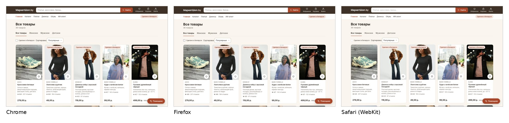
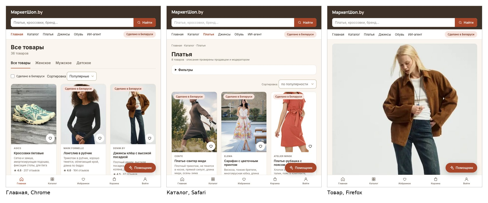
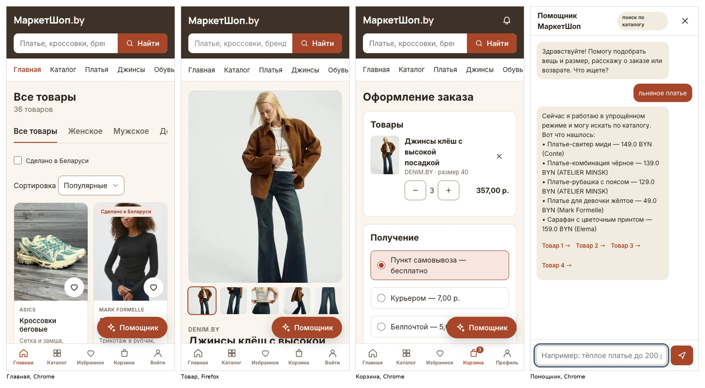
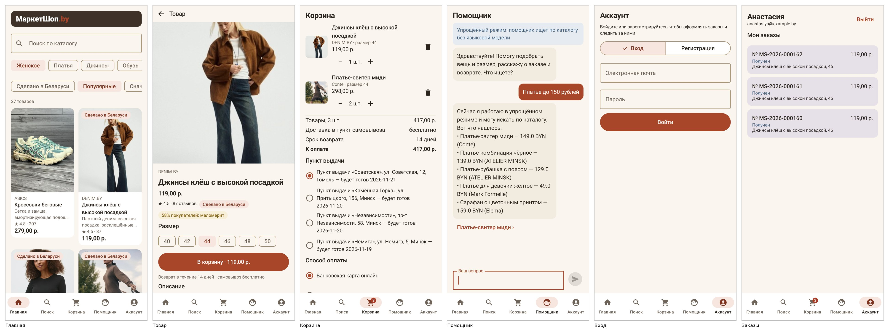

<!--raw-->
<div class="title-page">
<p class="tp-org">Белорусский государственный университет</p>
<p class="tp-org">Факультет прикладной математики и информатики</p>
<p class="tp-org">Кафедра технологий программирования</p>
<div class="sp-l"></div>
<p>Отчёт по лабораторной работе № 8</p>
<p>по курсу «Проектирование человеко-машинных интерфейсов»</p>
<div class="sp-s"></div>
<p class="tp-h">Проектирование и вёрстка мобильного и веб-приложения</p>
<div class="sp-s"></div>
<p class="tp-sub">Тема проекта: МаркетШоп.by — сервис автоматической генерации описаний товаров в рекомендательной системе маркетплейса одежды и обуви (Республика Беларусь)</p>
<div class="sp-m"></div>
<p class="tp-right">Выполнили: студенты 4 курса, группа 10</p>
<p class="tp-right">Харченко Анастасия</p>
<p class="tp-right">Шепко Варвара</p>
<p class="tp-right">Степук Анастасия</p>
<div class="sp-m"></div>
<p>Минск, 2026</p>
</div>
<!--/raw-->

<!--TOC-->

## Введение

**Цель работы** — получить навыки проектирования и разработки серверного приложения и реализации мобильного и
веб-приложения с адаптивной вёрсткой.

**Задачи:**
- завершить серверную часть по техническому заданию;
- реализовать MCP-сервер ассистента на базе данных проекта и проверить его в MCP Inspector;
- сверстать адаптивное веб-приложение и мобильное приложение с основными страницами;
- интегрировать клиентов с API, добавить в интерфейс чат-бот;
- проверить доступность и качество;
- поддерживать CI с проверкой качества и тестами.

Входные данные:
- техническое задание и архитектура C4 (ЛР № 3);
- проект MCP-сервера и контракт API (ЛР № 4);
- руководство по стилям и прототипы (ЛР № 5);
- результаты юзабилити-оценки (ЛР № 6);
- серверная часть, первая страница и первый экран (ЛР № 7).

**Таблица 1 — Ссылки на результаты**

| Что | Где |
|-----|-----|
| Макеты Figma (ЛР № 5) | https://www.figma.com/design/DIsarmkx75gQIm7ncRLsAZ/МаркетШоп |
| Серверная часть и MCP-сервер | https://github.com/fpmi-hci-2026/hci-10-backend-api-group-1 |
| Веб-приложение | https://github.com/fpmi-hci-2026/hci-10-frontend-group-1 |
| Мобильное приложение | https://github.com/fpmi-hci-2026/hci-10-mobile-group-1 |
| Развёрнутая версия | веб — https://marketshop-five.vercel.app, API и Swagger UI — https://marketshop-gateway.onrender.com/swagger-ui.html |

## 1 Распределение задач

Зоны ответственности сохранены с ЛР № 7. Каждый участник ведёт своё приложение. Чат-бот
делает тот, кто ведёт соответствующий клиент.

**Таблица 2 — Распределение задач**

| Участник | Задачи |
|----------|--------|
| Харченко Анастасия | Серверная часть: сервисы описаний, модерации, размеров, возвратов, отзывов и уведомлений; Python-сервисы генерации, ИИ-помощника и рекомендаций; переход на бесплатную языковую модель Groq с запасным режимом; MCP-сервер и его проверка в MCP Inspector |
| Шепко Варвара | Мобильное приложение: экраны, нижняя навигация, офлайн-режим, чат-помощник, тесты |
| Степук Анастасия | Веб-приложение: страницы покупателя, продавца и модератора, адаптивная вёрстка по БЭМ, адаптивная графика, PWA, чат-помощник, доступность, Lighthouse и W3C, проверка в трёх браузерах; развёртывание всех сервисов в облаке; отчёт |

Изменения вливаются через pull request, который рецензирует участник, не являющийся автором.

## 2 Серверная часть

### 2.1 Сервисы и бизнес-логика

В ЛР № 7 были реализованы аутентификация, каталог, заказы и шлюз. Теперь к ним добавлены остальные ограниченные
контексты архитектуры C4.

**Таблица 3 — Сервисы серверной части**

| Сервис | Стек | Что делает |
|--------|------|------------|
| `gateway` | Kotlin, Spring Cloud Gateway | Единая точка входа, Swagger UI всех сервисов, ограничение частоты запросов |
| `auth` | Kotlin, Spring Boot | Регистрация, вход, JWT, обновление токена |
| `catalog` | Kotlin, Spring Boot | Категории, товары, атрибуты и их полнота, остатки, фото, поиск |
| `orders` | Kotlin, Spring Boot | Избранное, корзина, заказы, оплата картой и через ЕРИП, статусы доставки |
| `descriptions` | Kotlin, Spring Boot | Описания с версиями, утверждения и их источники, проверка запрещённых формулировок, отправка на модерацию (US-05, US-07, US-09) |
| `moderation` | Kotlin, Spring Boot | Очередь по уверенности генератора, захват задачи, одобрение, возврат с комментарием, блокировка, правила проверки (US-08) |
| `size` | Kotlin, Spring Boot | Мерки покупателя и подбор размера с учётом посадки модели (US-03, US-04) |
| `returns` | Kotlin, Spring Boot | Возврат и обмен в срок 14 дней, решение продавца (US-11, US-15) |
| `reviews` | Kotlin, Spring Boot | Отзывы с оценкой посадки, статистика «маломерит / в размер / большемерит» |
| `notifications` | Kotlin, Spring Boot | Уведомления о заказах, модерации и возвратах по доменным событиям |
| `generation` | Python, FastAPI | Черновик описания по атрибутам: языковая модель или шаблон, расчёт уверенности |
| `assistant` | Python, FastAPI | ИИ-помощник покупателя: диалог с вызовом инструментов каталога, размеров, заказов |
| `recommendations` | Python, FastAPI | Лента «Для вас» и похожие товары |

Сервисы обмениваются доменными событиями Kafka в формате CloudEvents. Пример цепочки:
1. Продавец заполнил атрибуты, каталог публикует `catalog.attributes.verified`.
2. Сервис генерации составляет черновик.
3. Сервис описаний сохраняет черновик как версию.
4. После отправки описания на модерацию задача появляется в очереди модератора.
5. Решение модератора меняет статус описания и отправляет продавцу уведомление.

**Хранение данных.** У каждого сервиса своя схема PostgreSQL, миграции Flyway построены по физической модели ЛР № 4.

**Сессии и аутентификация.** Используется JWT:
- токен доступа действует 60 минут, токен обновления — 30 дней;
- роли покупателя, продавца и администратора проверяются на каждой операции.

**Валидация.** Ошибки возвращаются в формате problem+json (RFC 9457) с машиночитаемым кодом:
- 400 — неверный формат;
- 422 — нарушение правила. Например, описание с формулировкой «лучший» не уходит на модерацию, а заявка на возврат
  после 14 дней отклоняется.

### 2.2 Языковая модель: бесплатно и с запасным режимом

Генерация описаний и ИИ-помощник обращаются к языковой модели через OpenAI-совместимый интерфейс. Выбран бесплатный
тариф Groq (модель GPT-OSS 120B). Ключ задаётся переменной окружения `LLM_API_KEY` и в репозиторий не попадает.

Без ключа или при отказе провайдера приложение продолжает работать:
- описание собирается по шаблонам из атрибутов;
- помощник отвечает подборкой из поиска по каталогу. В ответе стоит пометка `mode: "search"`, интерфейс показывает её
  меткой «поиск по каталогу».

Так демонстрация не зависит от внешнего сервиса.

### 2.3 Документация API

Шлюз собирает описания OpenAPI всех сервисов в один Swagger UI: **77 публичных операций в 12 сервисах**.

## 3 MCP-сервер

### 3.1 Устройство

MCP-сервер `marketshop-assistant` из ЛР № 4 реализован на официальном Python SDK (`mcp` 2.3) в каталоге `mcp-server/`
серверного репозитория. Прототип ЛР № 4 работал на моках SQLite. Теперь сервер подключён к настоящей базе проекта:

- **чтение** идёт прямо из таблиц сервисов (SQL): товары и атрибуты, описания и утверждения, очередь модерации,
  заказы и возвраты;
- **изменения** идут через тот же REST API, что у веб- и мобильного приложения, от имени ролей демо-пользователей. Поэтому
  ассистент подчиняется тем же правилам, что и интерфейс:
  - права ролей;
  - полнота атрибутов;
  - запрет непроверяемых заявлений;
  - срок возврата.

  Сервер эти правила не дублирует;
- **журнал**: каждое изменяющее действие записывается в таблицу `mcp.audit_log` с результатом `ok` или `rejected`.
  Почта покупателя в ответах скрыта.

**Таблица 4 — Примитивы MCP-сервера**

| Примитив | Количество | Состав |
|----------|------------|--------|
| Tools | 13 | 6 только для чтения (`list_products`, `get_product`, `check_attributes`, `search_catalog`, `get_order_summary`, `check_return_eligibility`), 5 изменяющих, 2 необратимых решения (`moderate_description`, `create_return_request`) |
| Resources | 8 | каталог продавца, карточка товара, очередь модерации, запрещённые формулировки, обязательные атрибуты, условия возврата, сводка заказа, журнал ассистента |
| Prompts | 3 | `prepare_product_card`, `moderation_review`, `return_request_assistant` |

Аннотации MCP `readOnlyHint` и `destructiveHint` подсказывают клиенту характер инструмента. Claude Desktop перед
необратимым действием спрашивает подтверждение.

### 3.2 Проверка в MCP Inspector

Сервер проверен официальным MCP Inspector (CLI 2.15) на настоящей базе. Сценарий `inspector_check.py` из 15 шагов
воспроизводит диалоги продавца, модератора и покупателя из ЛР № 4.

**Продавец:**
1. Создаёт товар без части атрибутов. Сервер сообщает, каких атрибутов не хватает.
2. Пытается передать неизвестный атрибут — получает отказ.
3. Дополняет атрибуты — сервис генерации пишет черновик.
4. Дописывает «Лучшая юбка сезона». Отправка на модерацию заблокирована.
5. Исправляет текст и отправляет описание.

**Модератор:**
1. Видит описание в очереди.
2. Пытается вернуть его продавцу без комментария — получает отказ.
3. Одобряет описание.
4. Добавляет запрещённую формулировку. Повторное добавление отклоняется.

**Покупатель:**
1. Получает сводку заказа со скрытой почтой.
2. Проверяет, можно ли вернуть товар.
3. Оформляет обмен на другой размер. Повторная заявка отклоняется.

Все шаги проходят, лог хранится в `mcp-server/results/inspector.log`. Ещё 17 модульных тестов проверяют:
- состав примитивов и JSON-схемы;
- отказы сервисов и запись в журнал;
- маскирование почты;
- работу через stdio.

Тесты запускаются в CI.

Подключение к Claude Desktop и Cursor описано для разработчиков в `mcp-server/README.md`.

## 4 Веб-приложение

### 4.1 Страницы

Веб-приложение — одностраничное приложение на React 18 и TypeScript (сборщик Vite, маршрутизация React Router).
Набор страниц зависит от роли пользователя.

**Таблица 5 — Страницы веб-приложения**

| Контур | Страницы |
|--------|----------|
| Покупатель | Главная (подборка «Для вас», разделы, фильтр «Сделано в Беларуси», сортировка); каталог с фасетными фильтрами (категория, размер в наличии, цена, особенности) и постраничным выводом; поиск; карточка товара (галерея, описание, выбор размера, ассистент по размеру, отзывы, похожие товары); избранное; корзина с изменением количества и оформлением заказа; заказы, оплата, возврат и обмен; мерки; уведомления; профиль |
| Продавец | Мои товары, добавление товара с проверкой обязательных характеристик и загрузкой фото, редактор автоматического описания с источниками утверждений, возвраты, аналитика |
| Модератор | Очередь модерации, проверка карточки, правила проверки формулировок, качество продавцов, статусы заказов |
| Все | Вход и регистрация, профиль, ИИ-помощник (у покупателя) |

Кабинеты продавца и модератора загружаются отдельными файлами по требованию. Покупатель их не скачивает.

### 4.2 Архитектура клиента и работа с API

```
src/
  api/          клиент API (client.ts), хук загрузки (hooks.ts), сессия (auth.tsx), типы ответов (types.ts)
  components/   каркас (Layout), карточка товара, цена, метки, SVG-иконки, адаптивное фото, ИИ-помощник
  pages/        buyer/, seller/, admin/, Agent.tsx — по одной папке на контур
  styles/       tokens.css → base.css → blocks/*.css (по файлу на блок БЭМ)
public/         шрифты, WebP-фото, иконки, manifest.webmanifest, sw.js
```

- **Клиент API** (`api/client.ts`):
  - подставляет токен доступа;
  - при ответе 401 один раз обновляет токен по refresh-токену и повторяет запрос. Параллельные запросы ждут одно
    общее обновление;
  - при неудачном обновлении завершает сессию;
  - ответ problem+json превращает в ошибку с понятным текстом.
- **Хук `useApi`** даёт каждой странице три состояния: загрузка («Загрузка…» с `role="status"`), ошибка (сообщение с
  `role="alert"`) и данные. Пустые списки показываются отдельной подсказкой.
- **Маршруты по ролям.**
  - Кабинеты открываются только своей роли.
  - Без входа приложение ведёт на страницу входа и после входа возвращает на исходный адрес.
  - Прямой URL чужого кабинета перенаправляет на свою главную.
- **Оформление заказа** отправляет ключ идемпотентности: повторное нажатие не создаёт второй заказ.

### 4.3 Адаптивная вёрстка

- **Mobile-first.**
  - Базовые стили написаны для телефона.
  - Медиазапросы `min-width: 600px` и `900px` добавляют колонки сетки, боковую панель фильтров и полную шапку.
  - Сетки построены на CSS Grid и Flexbox.
  - В `<meta name="viewport">` указано `viewport-fit=cover`, масштабирование не запрещено.
- **БЭМ и custom properties.**
  - Каждый блок — отдельный файл в `styles/blocks`: `header`, `tabbar`, `product-card`, `filters`, `chat` и другие,
    всего 29.
  - Элементы и модификаторы именуются по БЭМ (`product-card__fav--active`). Модификатор собирает функция `mod()`.
  - Цвета, отступы, радиусы и размеры шрифтов задаются только токенами ЛР № 5 в `tokens.css`.
  - Тёмная тема переопределяет токены по `prefers-color-scheme`.
- **Резиновая типографика.** Размеры заголовков и цен заданы `clamp()`, например `clamp(1.5rem, 1.25rem + 1.1vw, 1.875rem)` для h1.
- **Телефон.**
  - Шапка закреплена, внизу фиксированная навигация: Главная, Каталог, Избранное, Корзина со счётчиком, Профиль.
  - Отступы учитывают вырез и полоску жестов (`env(safe-area-inset-*)`).
  - Тач-цели не меньше 44×44 px.
  - Поля ввода шрифтом 16 px, поэтому iOS не увеличивает страницу при фокусе.
  - `touch-action: manipulation` убирает задержку двойного тапа.
  - Фильтры каталога сворачиваются в `<details>`.
  - Таблицы кабинетов превращаются в карточки с подписями из `data-label`.
  - Модальные окна выезжают снизу.
- **Адаптивная графика.**
  - Иконки — inline SVG.
  - Демо-фото каталога подготовлены в WebP шириной 360 и 720 px, браузер выбирает размер по `srcset` и `sizes`.
  - Все фото ниже первого экрана грузятся с `loading="lazy"`.
  - У `` заданы размеры, поэтому вёрстка не прыгает при загрузке.

На рисунках 1–3 веб-приложение показано в Chrome, Firefox и Safari (WebKit) на компьютере, планшете и телефоне.







### 4.4 PWA

- Манифест с иконками 192 и 512 px (включая maskable): приложение ставится на домашний экран и открывается без
  адресной строки.
- Service worker:
  - страницы и сборку отдаёт из кэша, если сети нет;
  - запросы каталога выполняет «сначала сеть, при сбое — сохранённый ответ».

  Корзина, заказы и другие личные данные в кэш не попадают. Проверено: после отключения сети главная открывается и
  показывает 24 карточки из последнего каталога.
- Тёмная тема включается по `prefers-color-scheme`, `theme-color` задан для обеих тем.
- При `prefers-reduced-motion` анимации и плавная прокрутка отключаются.

### 4.5 Доступность и качество

- **Контраст.** Пары цветов проверены в ЛР № 5 (не ниже 4.5:1).
- **Клавиатура.**
  - Всё доступно с клавиатуры, фокус виден (`:focus-visible`, рамка 3 px).
  - Первая ссылка «Перейти к содержимому» пропускает шапку.
  - Окна закрываются по Esc.
- **Подписи.**
  - Поля подписаны внутри `<label>`.
  - Переключатели размеров и разделов сообщают состояние через `aria-pressed`.
  - У фото есть `alt`.
  - Заголовки идут по порядку h1–h3.

**Таблица 6 — Lighthouse (mobile) на собранной версии**

| Страница | Performance | Accessibility | Best Practices |
|----------|-------------|---------------|----------------|
| Главная | 94 | 100 | 100 |
| Каталог «Платья» | 96 | 100 | 100 |
| Карточка товара | 96 | 100 | 100 |

**W3C Validator.** Отрендеренный HTML страниц проверен валидатором W3C (главная, каталог, товар, вход):
**0 ошибок и 0 предупреждений**.

**Проверка в трёх браузерах.** Набор Playwright `e2e/layout.spec.ts` прогоняется в Chromium, Firefox и WebKit (66 проверок):
- четыре страницы на ширине 320, 375, 768, 1440 и 1920 px — без горизонтальной прокрутки;
- все элементы управления на телефоне — не меньше 44×44 px;
- нижняя навигация закреплена на телефоне и скрыта на компьютере.

Набор нашёл дефект. В Safari выпадающий список игнорирует минимальную высоту и получается 25 px. Список перерисован
своим стилем со стрелкой, после этого все проверки проходят.

### 4.6 ИИ в интерфейсе

- **ИИ-помощник покупателя.**
  - Кнопка «Помощник» в углу экрана открывает чат: на телефоне на весь экран, на компьютере панелью.
  - Помощник отвечает о товарах, размерах, заказах и возвратах и даёт ссылки на найденные товары.
  - Без языковой модели в шапке чата появляется метка «поиск по каталогу» (рисунок 3).

Методичка (п. 7.3) требует в интерфейсе «кастомный чат-бот или рекомендации, как подключить ИИ-агента». Мы выбрали
чат-бот: покупателю не нужно знать, что такое MCP. Подключение своего ИИ-агента — задача разработчиков, поэтому
инструкция для Claude Desktop и Cursor лежит в `mcp-server/README.md` серверного репозитория (раздел 3).

## 5 Мобильное приложение

Приложение Android на Kotlin и Jetpack Compose (Material 3) использует те же токены ЛР № 5, что веб, и светлую и
тёмную тему.

**Таблица 7 — Экраны мобильного приложения**

| Экран | Что умеет |
|-------|-----------|
| Главная | Поиск, разделы и категории, фильтр «Сделано в Беларуси», сортировка, сетка карточек |
| Товар | Листание фото, описание, выбор размера, «В корзину» |
| Корзина | Изменение количества («−» и «+»), удаление, пункт выдачи и способ оплаты, оформление заказа с ключом идемпотентности |
| Помощник | Чат с ИИ-помощником: примеры вопросов, ссылки на найденные товары, пометка упрощённого режима |
| Аккаунт | Вход и регистрация с проверкой полей, заказы и оплата в тестовом режиме, выход |

**Мобильное взаимодействие.**
- Нижняя навигация из пяти вкладок, на значке корзины — счётчик.
- Отступы от системных панелей и клавиатуры (edge-to-edge).
- Тач-цели не меньше 48 dp.
- У иконок и фото есть подписи для TalkBack, сообщения о статусе и ошибках озвучиваются.

**Работа с API.** Клиент OkHttp:
- подставляет JWT, при ответе 401 обновляет токен, а при отказе обновления выходит из сессии;
- ошибку problem+json превращает в понятный текст;
- без сети показывает «Нет соединения с сервером» и кнопку «Повторить».

**Офлайн-режим.** Последние страницы каталога (до 8 запросов) сохраняются в файл. Без сети или при сбое сервера
главная показывает сохранённый каталог с плашкой «Нет сети — показан сохранённый каталог».

Снимки экранов (рисунок 4) построены автоматическими тестами Roborazzi на профиле Pixel 7.



## 6 Непрерывная интеграция и тесты

Конвейеры GitHub Actions из ЛР № 7 расширены новыми проверками. Сборка начинается только после успешного
статического анализа и тестов. SonarCloud запускается, если задан секрет `SONAR_TOKEN`.

**Таблица 8 — Проверки по репозиториям**

| Репозиторий | Статический анализ | Тесты |
|-------------|--------------------|-------|
| Серверная часть | detekt; ruff для Python-сервисов и MCP-сервера | 19 тестов Kotlin; 25 тестов pytest в генерации, помощнике и рекомендациях; 17 тестов MCP-сервера; сценарий MCP Inspector (локально на полном окружении) |
| Веб-приложение | ESLint, проверка типов TypeScript | 23 теста Vitest и Testing Library в CI; 66 проверок вёрстки Playwright в трёх браузерах (локально, нужен запущенный бэкенд) |
| Мобильное приложение | detekt, Android Lint | 24 теста: JUnit и MockWebServer (API, офлайн-кэш, формы), 6 снимков экранов Roborazzi |

## 7 Развёртывание и демонстрация

**Локально.** Окружение разработки запускается одной командой `docker compose up --build`: 17 контейнеров —
сервисы, PostgreSQL, Redis, Kafka, OpenSearch, хранилище фото. На нём работают все функции и MCP-сервер.

**В облаке** работают все 13 сервисов на бесплатных тарифах:
- Render — сервисы из Docker-образов;
- Render Key Value — Redis;
- Neon — PostgreSQL;
- Vercel — веб-приложение (https://marketshop-five.vercel.app).

Бесплатные тарифы не дают Kafka, OpenSearch и S3, поэтому для облака сделан отдельный режим. Код сервисов не меняется,
меняется только инфраструктура:

**Таблица 9 — Облачный режим**

| Что | Локально | В облаке |
|-----|----------|----------|
| Доменные события | Kafka | HTTP-запросы подписчикам `POST /internal/events`: вызывается тот же обработчик, что слушает топик Kafka; при ошибке до 6 повторов, пока спящий сервис просыпается |
| Внутренние маршруты | сеть Docker | общий токен `INTERNAL_TOKEN` |
| Фото | S3 | таблица в базе, отдача через шлюз |
| Поиск | OpenSearch | SQL |

Облачный режим сначала проверен локально в конфигурации `deploy/cloud-local.yml`: без Kafka, OpenSearch и S3, как на Render.

Развёртывание выполняет скрипт `deploy/render.py` через API Render:
- создаёт сервисы;
- заводит общую группу переменных со случайными секретами;
- запускает развёртывание.

Бесплатные сервисы засыпают через 15 минут без запросов, спящий сервис не тратит месячный лимит в 750 часов. Перед
показом команда `render.py wake` будит все сервисы сразу.

Демонстрация на защите:
1. Выполнить `python3 deploy/render.py wake` (или локально `docker compose up`).
2. Открыть сайт https://marketshop-five.vercel.app и мобильное приложение.
3. Пройти сценарий покупателя: каталог → товар → корзина → заказ → помощник.
4. Пройти сценарий продавца: добавить товар → проверить описание → отправить на модерацию.
5. Пройти сценарий модератора: очередь → решение.
6. Запустить `python inspector_check.py` в `mcp-server/` или открыть веб-интерфейс MCP Inspector.

## 8 Использование ИИ и инжиниринг промптов

### 8.1 Какие части созданы с помощью ИИ и как проверены

При разработке использовался ИИ-ассистент для программирования. Ему не передавались пароли, токены и ключи API:
- секреты хранятся только в `.env` и секретах CI;
- в промптах вместо них использовались имена переменных.

**Таблица 10 — Части, созданные с помощью ИИ, и способ проверки**

| Часть | Что сгенерировано | Как проверено |
|-------|-------------------|---------------|
| Сервисы описаний, модерации, возвратов, отзывов, уведомлений | Контроллеры, репозитории, миграции по физической модели ЛР № 4 | Ревью на соответствие модели; 14 тестов Kotlin |
| Клиент языковой модели и запасной режим | Клиент OpenAI-совместимого API, разбор JSON, шаблоны | Тесты pytest с подменой провайдера; ручная проверка ответа без ключа |
| MCP-сервер | Инструменты, ресурсы, промпты, журнал | 17 модульных тестов; 15 шагов MCP Inspector на настоящей базе |
| Стили БЭМ и адаптивная вёрстка | Блоки CSS, разметка страниц | Скриншоты в трёх браузерах; Playwright: прокрутка и тач-цели; Lighthouse; W3C |
| PWA | Манифест, service worker | Проверка без сети в Playwright; Lighthouse Best Practices 100 |
| Облачный режим (события по HTTP, фото в базе, скрипт Render) | Транспорт событий, фильтр токена, скрипт развёртывания | Тесты Kotlin и pytest; запуск на локальной копии облака; скрипт проверен на заглушке API Render |
| Тесты | Каркас тестов по описанию сценария | Сверка с требованиями методички и user stories; тест тач-целей нашёл реальный дефект в Safari (таблица 11) |

Каждый участник может объяснить и изменить любой фрагмент своей части. Сгенерированный код проходил те же
ревью pull request и CI, что и написанный вручную.

### 8.2 Промпты, которые работают в продукте

**Генерация описаний.**

Короткий промпт вида «опиши товар по атрибутам» оставляет модели свободу. Модель склонна добавлять оценки и обещания
(«идеально сядет», «не потеряет цвет»). Как раз на такие формулировки жалуются покупатели в исследовании ЛР № 1.
Поэтому промпт уточнялся ограничениями:
1. **Запрет недоказуемого.** Добавлен прямой запрет оценок качества и обещаний с примерами.
2. **Источник у каждого утверждения.** Каждое утверждение обязано ссылаться на код атрибута (`source_attribute`).
   Это позволило автоматически отмечать утверждения без источника.
3. **Строгий формат.** Ответ ограничен строгим JSON с четырьмя блоками и фразой для ленты не длиннее 90 символов.
   Включён режим JSON у провайдера.
4. **Пустой блок вместо выдумки.** Если атрибута для блока нет, блок остаётся пустым. Модель больше не заполняет его
   догадкой.

Финальный промпт:

```
Ты — редактор маркетплейса одежды и обуви МаркетШоп.by. По атрибутам товара пиши описание для карточки.
- по-русски, нейтрально и конкретно, как консультант, который держал вещь в руках;
- четыре блока: composition, fit, care, sizeChart; 1–2 предложения в каждом;
- summary — одна фраза для ленты, не длиннее 90 символов;
- каждое утверждение опирается на переданный атрибут: внеси его в claims с кодом атрибута;
- не добавляй того, чего нет в атрибутах: ни оценок качества, ни обещаний. Нет атрибута — блок null.
Покупатели жалуются, что описания не совпадают с реальностью, поэтому точность важнее красоты.
Ответ — только JSON.
```

**Проверка вывода.**
- Ответ разбирается схемой Pydantic. Неверный формат — шаблонное описание.
- Утверждения без подтверждающего атрибута отмечаются.
- Текст проверяется по списку запрещённых формулировок.
- По этим результатам рассчитывается уверенность генератора, по ней модератор сортирует очередь.

**ИИ-помощник покупателя.**

Промпт ограничивает модель фактами из инструментов: состав, посадку и наличие нельзя придумывать. Положить товар в
корзину помощник может только по прямой просьбе. При сомнении в размере он спрашивает мерки.

Цикл вызова инструментов ограничен 8 шагами, чтобы зацикленный диалог не расходовал лимит бесплатного тарифа.

### 8.3 Итерации при разработке

**Таблица 11 — Ошибки в выводе ИИ и как они найдены**

| Проблема в сгенерированном коде | Как обнаружена | Исправление |
|---------------------------------|----------------|-------------|
| В промпт с примером JSON внутри f-строки попали одинарные фигурные скобки | Тесты генерации упали при импорте модуля | Скобки удвоены, добавлен тест генерации |
| После перезапуска базы сервис генерации держал «мёртвое» соединение и перестал писать черновики | Повторная проверка API после перезапуска PostgreSQL | Проверка соединения при выдаче из пула (`check_connection`) |
| Импорты MCP SDK из старой версии (`mcp.client.StdioServerParameters`) | Тест через stdio упал при импорте | Импорты сверены с документацией SDK 2.3 |
| Обёртка `<picture>` сломала сетку строки корзины: фото растянулось на всю высоту | Скриншот корзины на 375 px | `picture { display: contents }` |
| Выпадающий список в Safari высотой 25 px | Проверка тач-целей Playwright в WebKit | Собственный стиль `select` |

Вывод: ИИ ускоряет рутинную часть — разметку, однотипные контроллеры, тесты по описанию. Но каждую ошибку из
таблицы 11 нашла автоматическая проверка или скриншот, а не чтение кода. Поэтому проверки писались до того, как
работа считалась законченной.

## 9 Вклад участников и работа с репозиторием

Коммиты оформлены по соглашению Conventional Commits. Каждый участник применил свою серию изменений в отдельной
ветке `lab8` и открыл pull request.

**Таблица 12 — Коммиты участников**

| Участник | Репозиторий | Коммиты |
|----------|-------------|---------|
| Харченко Анастасия | Серверная часть | `feat: сервисы описаний, модерации, размеров, возвратов, отзывов, уведомлений и Python-сервисы`; `feat: генерация и ИИ-помощник на бесплатном Groq, запасной режим без ключа`; `fix: генерация восстанавливает соединение с базой после её перезапуска`; `feat: MCP-сервер ассистента на базе проекта и проверка в MCP Inspector`; `docs: README — новые сервисы, ИИ-функции на Groq, MCP-сервер` |
| Шепко Варвара | Мобильное приложение | `feat: нижняя навигация, экраны поиска, товара, корзины и аккаунта`; `feat: офлайн-кэш каталога`; `feat: чат-помощник и инструкция по подключению ИИ-агента`; `test: офлайн-кэш, корзина, заказ, помощник, формы и снимки экранов`; `docs: README мобильного приложения`; `fix: убрать подсказку с демо-учётками на экране входа`; `fix: убрать раздел «Как подключить ИИ-агента» — покупателю остаётся чат-помощник` |
| Степук Анастасия | Серверная часть | `feat: события по HTTP и защищённые внутренние маршруты для облака без Kafka`; `feat: фото товаров в базе для облака без S3`; `chore: развёртывание всех сервисов на Render одной командой`; `docs: развёртывание всех сервисов в облаке` |
| Степук Анастасия | Веб-приложение | `feat: страницы покупателя, кабинеты продавца и модератора, ИИ-помощник`; `feat: адаптивная вёрстка mobile-first по БЭМ, нижняя навигация, WebP и страница «ИИ-агент»`; `feat: PWA — манифест, иконки, офлайн-кэш каталога; ленивая загрузка кабинетов`; `fix: высота выпадающих списков в Safari, robots.txt`; `test: вёрстка в Chrome, Firefox и Safari на 320–1920 px, тач-цели, нижняя навигация, каталог по страницам`; `docs: README — страницы, адаптивная вёрстка, PWA, ИИ-агент, проверка в трёх браузерах`; `fix: компактная форма входа без подсказки с демо-учётками, поля форм без лишней высоты`; `fix: убрать страницу «ИИ-агент» для разработчиков — покупателю остаётся чат-помощник` |
| Степук Анастасия | Основной | `docs: отчёт ЛР№8`; `chore: обновить подмодули` |

## Заключение

1. Серверная часть завершена по техническому заданию:
   - 13 сервисов, своя схема PostgreSQL у каждого;
   - JWT-сессии с ролями, валидация с ответами problem+json;
   - 77 публичных операций в Swagger UI.
2. MCP-сервер из ЛР № 4 реализован на настоящей базе проекта: 13 инструментов, 8 ресурсов и 3 промпта. Он
   проверен в официальном MCP Inspector (15 шагов) и 17 модульными тестами.
3. Веб-приложение реализует страницы покупателя, продавца и модератора с адаптивной вёрсткой:
   - mobile-first, БЭМ и токены, `clamp()`, WebP и `srcset`, нижняя навигация, PWA;
   - Lighthouse (mobile): Performance 94–96, Accessibility и Best Practices 100;
   - W3C — без ошибок;
   - нет горизонтальной прокрутки на 320–1920 px в Chrome, Firefox и Safari.
4. Мобильное приложение получило основные экраны, нижнюю навигацию, офлайн-режим и чат-помощник; 24 теста и снимки экранов.
5. Все 13 сервисов развёрнуты в облаке на бесплатных тарифах: Kafka заменена доставкой событий по HTTP, S3 — хранением фото в базе.
6. В интерфейс встроен ИИ-помощник покупателя, а подключение своего ИИ-агента через MCP описано для разработчиков. Языковая модель
   бесплатная, без неё приложение работает в запасном режиме.
7. Использование ИИ задокументировано: промпты, итерации уточнения, сгенерированные части и способ проверки каждой.

## Список использованных источников

1. Давидовская, М. И. Проектирование и вёрстка мобильного и веб-приложения : методические указания по выполнению лабораторной работы № 8 / М. И. Давидовская. — Минск : БГУ, 2026.
2. Model Context Protocol. Specification [Электронный ресурс]. — Режим доступа: https://modelcontextprotocol.io/specification. — Дата доступа: 18.11.2026.
3. MCP Inspector [Электронный ресурс]. — Режим доступа: https://modelcontextprotocol.io/docs/tools/inspector. — Дата доступа: 18.11.2026.
4. БЭМ. Методология [Электронный ресурс]. — Режим доступа: https://ru.bem.info/methodology/. — Дата доступа: 18.11.2026.
5. Responsive images [Электронный ресурс] / MDN Web Docs. — Режим доступа: https://developer.mozilla.org/en-US/docs/Web/HTML/Guides/Responsive_images. — Дата доступа: 18.11.2026.
6. Progressive web apps [Электронный ресурс] / MDN Web Docs. — Режим доступа: https://developer.mozilla.org/en-US/docs/Web/Progressive_web_apps. — Дата доступа: 18.11.2026.
7. Web Content Accessibility Guidelines (WCAG) 2.2 [Электронный ресурс] / W3C. — Режим доступа: https://www.w3.org/TR/WCAG22/. — Дата доступа: 18.11.2026.
8. Lighthouse [Электронный ресурс] / Chrome for Developers. — Режим доступа: https://developer.chrome.com/docs/lighthouse. — Дата доступа: 18.11.2026.
9. Playwright [Электронный ресурс]. — Режим доступа: https://playwright.dev/. — Дата доступа: 18.11.2026.
10. Groq API Documentation [Электронный ресурс]. — Режим доступа: https://console.groq.com/docs. — Дата доступа: 18.11.2026.
11. Jetpack Compose [Электронный ресурс] / Android Developers. — Режим доступа: https://developer.android.com/compose. — Дата доступа: 18.11.2026.
