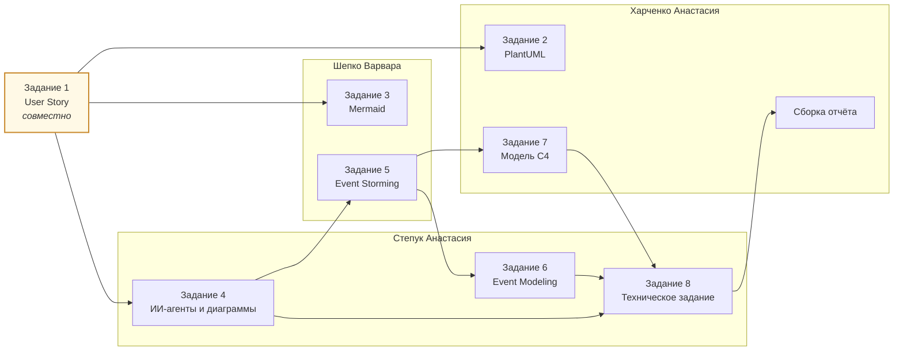

> **Статус.** План презентации, распределение задач и регламент работы — готовы.
> Файл презентации готовится к защите; ссылка добавляется в раздел 1 после его подготовки.

---

## 1. Ссылка на презентацию

> Презентация готовится. После подготовки заменить этот блок ссылкой на файл
> `docs/presentation/marketshop-presentation.pdf` в репозитории либо на Google Slides.

---

## 2. План презентации

Структура соответствует требованиям к презентации проекта из методических указаний к ЛР№1
(раздел 8.1): распределение задач в команде, требования к приложению, схема базы данных,
организация работы с репозиторием и проектом.

| № | Слайд | Содержание | Источник материала |
|---|-------|------------|--------------------|
| 1 | Титул | Название проекта, команда, курс, год | — |
| 2 | Проблема | Барьеры онлайн-покупки одежды по данным опроса 46 респондентов | ЛР№1 |
| 3 | Решение | Автоматическая генерация достоверных описаний из атрибутов | ЛР№1 |
| 4 | Конкуренты | Сравнительная таблица: ни один локальный игрок не использует автогенерацию | ЛР№1 |
| 5 | Пользователи | Четыре роли и пять персонажей, включая анти-персонажа | ЛР№1 |
| 6 | Результаты опроса | Ключевые показатели и их влияние на проектные решения | ЛР№1, ЛР№2 |
| 7 | Информационная архитектура | Карта сайта, системы организации, именования, навигации и поиска | ЛР№2 |
| 8 | Путь пользователя | Карта пути клиента Анастасии и Ольги Петровны | ЛР№2 |
| 9 | Дизайн-макеты | Пять ключевых экранов веб- и мобильного приложения | ЛР№2 |
| 10 | Требования | 20 пользовательских историй, 157 функциональных требований | ЛР№3, задания 1 и 8 |
| 11 | Предметная область | Event Storming: агрегаты и ограниченные контексты | ЛР№3, задание 5 |
| 12 | Модель событий | Event Modeling: 25 слайсов как единиц работы | ЛР№3, задание 6 |
| 13 | Архитектура | Модель C4: контекст и контейнеры | ЛР№3, задание 7 |
| 14 | Схема базы данных | ERD, 40 таблиц, ключевые решения | ЛР№3, задание 4 |
| 15 | Применение ИИ-агентов | Библиотека промптов и результаты верификации | ЛР№3, задание 4 |
| 16 | Организация работы | Репозитории, вики, GitHub Pages, распределение задач | настоящая страница |
| 17 | План реализации | График MVP на 4 месяца и критерии приёмки | ЛР№3, задание 8 |
| 18 | Выводы | Сквозная трассируемость решений от данных исследования | ЛР№3 |

---

## 3. Распределение задач в команде

| Участник | Роль | ЛР№1 | ЛР№2 | ЛР№3 |
|----------|------|------|------|------|
| **Харченко Анастасия** | Аналитик, архитектор | Профили и персонажи покупателей, объектная модель | Информационная архитектура, карта сайта, система навигации | Задания 2 и 7: диаграммы PlantUML, модель C4, сборка отчёта |
| **Шепко Варвара** | Аналитик, проектировщик взаимодействия | Анализ конкурентов, профили продавцов и администраторов | Система именования, карточная сортировка, карты пути клиента | Задания 3 и 5: диаграммы Mermaid, Event Storming |
| **Степук Анастасия** | Аналитик, дизайнер | Опрос пользователей, бизнес-процессы As-Is | Система поиска, дизайн-макеты, интерактивные раскадровки | Задания 4, 6 и 8: промпты для ИИ-агентов, Event Modeling, техническое задание |

### Распределение по заданиям ЛР№3

Задание 1 выполнялось совместно: каждый участник разработал истории для своих сценариев,
после чего набор прошёл перекрёстное ревью по чек-листу INVEST.

---

## 4. Организация работы с репозиторием и проектом

### Репозитории

| Репозиторий | Назначение | Состояние |
|-------------|------------|-----------|
| [`hci-10-project-group-1`](https://github.com/fpmi-hci-2026/hci-10-project-group-1) | Документация, требования, проектирование API и бизнес-логики | Документация ЛР№1–ЛР№3 и ЛР№5 опубликована |
| [`hci-10-backend-api-group-1`](https://github.com/fpmi-hci-2026/hci-10-backend-api-group-1) | Серверная часть: прикладные сервисы и API | Создан, реализация не начата |
| [`hci-10-frontend-group-1`](https://github.com/fpmi-hci-2026/hci-10-frontend-group-1) | Веб-приложение: витрина и кабинеты | Создан, реализация не начата |
| [`hci-10-mobile-group-1`](https://github.com/fpmi-hci-2026/hci-10-mobile-group-1) | Мобильные приложения Android и iOS | Создан, реализация не начата |

### Ветвление и ревью

1. Работа ведётся в ветках от `main` с именем `lab<N>/<краткое-описание>`.
2. Изменения вливаются через pull request с указанием, какой раздел методических указаний
   закрывается.
3. Pull request рецензирует участник, не являющийся автором.
4. Диаграммы правятся в исходниках `.puml`; коммит содержит и исходник, и переотрисованное
   изображение.
5. Блоки Mermaid проверяются парсером, исходники PlantUML — компиляцией до коммита.

### Документация

| Канал | Что публикуется | Как ведётся |
|-------|-----------------|-------------|
| `README.md` | Описание проекта, установка, подмодули, использование, команда | Правится в основном репозитории |
| `/docs` | Отчёты по лабораторным работам | Правится в основном репозитории; источник GitHub Pages |
| Вики | Сводные страницы проекта для команды | Исходники в каталоге `wiki/`, синхронизируются с вики-репозиторием |
| GitHub Pages | Публичный сайт проекта | Собирается из `/docs` ветки `main` |

### Управление задачами

Задачи ведутся в GitHub Projects основного репозитория. Статусы: `To do` → `In progress` →
`Review` → `Done`. Каждая задача ссылается на пункт методических указаний либо на
пользовательскую историю.

На этапе реализации задачи формируются из
[слайсов Event Modeling](lab3/README.md#слайсы-единицы-работы-для-разработчика):
каждый слайс — вертикальный срез от интерфейса до записи события, который можно передать
разработчику целиком.

---

## 5. Что показать на защите

| Вопрос комиссии | Чем ответить |
|-----------------|--------------|
| Откуда взялись требования? | Таблица «показатель опроса → барьер → User Story → критерий приёмки» |
| Почему именно такой приоритет? | Правило обоснования приоритета High показателем опроса; пример с ЕРИП (0 из 46) |
| Как проверяли работу ИИ-агентов? | Таблица из 8 отклонённых предложений, включая галлюцинацию со ссылками на законодательство |
| Почему такие границы сервисов? | Ограниченные контексты Event Storming и их отображение в пакеты кода |
| Как связаны интерфейс и архитектура? | Слайсы Event Modeling: триггер — макет из ЛР№2, событие — таблица БД |
| Чем подтверждена схема БД? | SQL-файл применяется к чистому экземпляру PostgreSQL 16 без ошибок |
