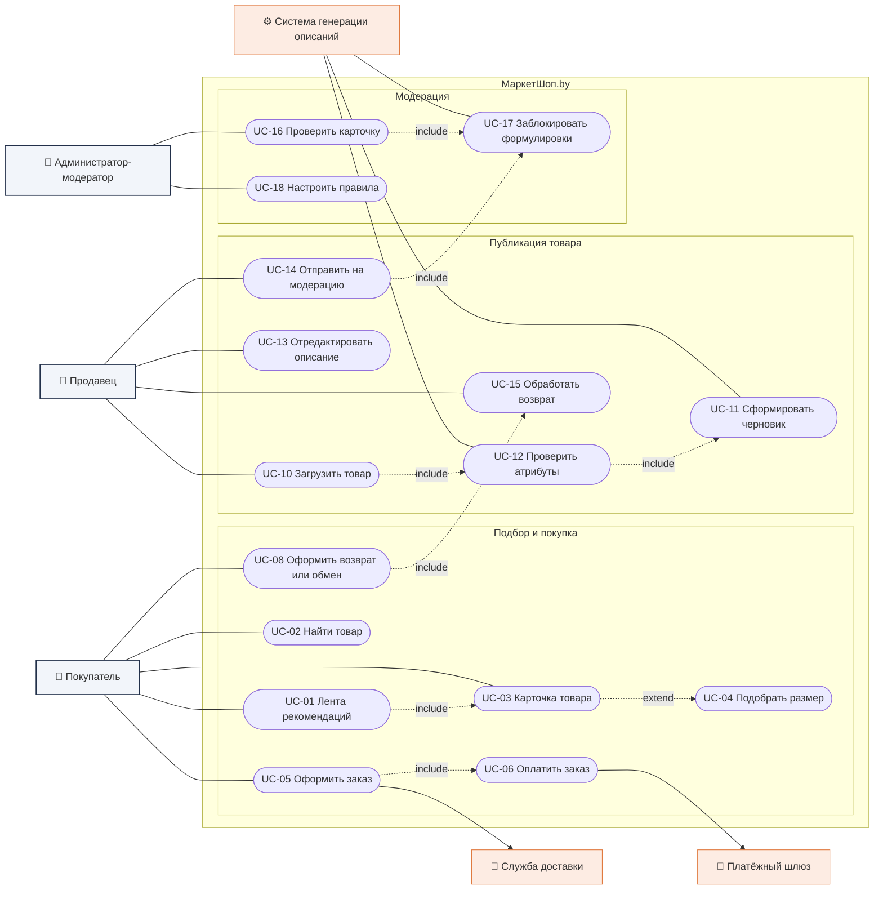
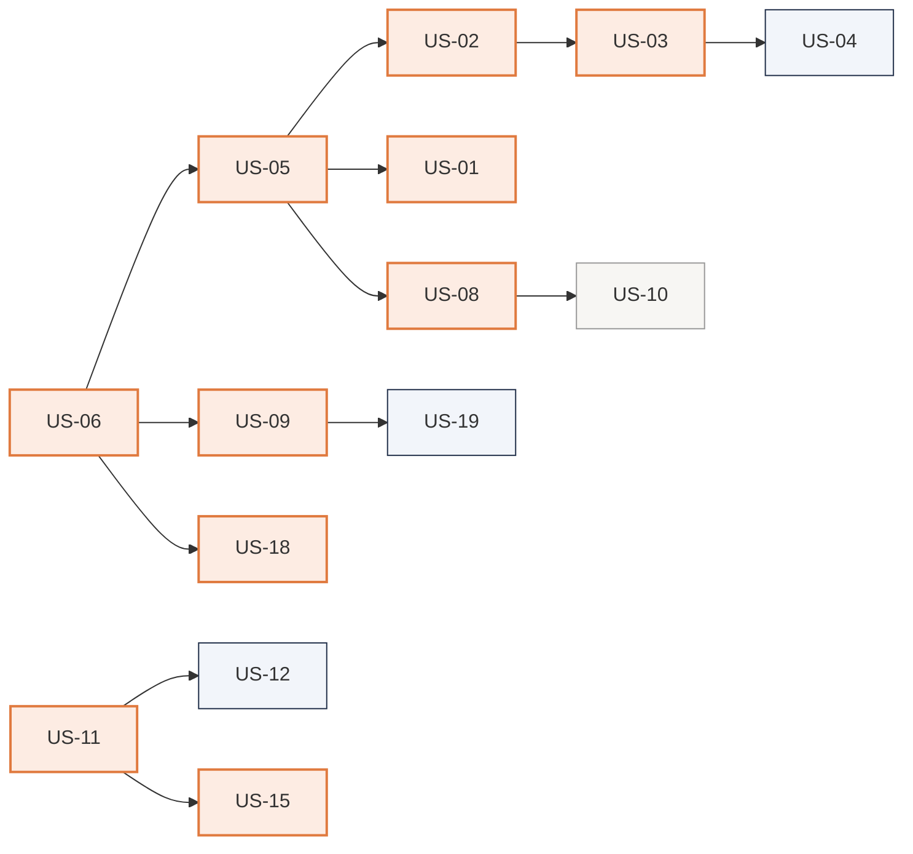

Страница содержит сводку функциональных требований проекта: диаграмму вариантов
использования, текстовые сценарии и перечень пользовательских историй.
Полные версии — в [отчёте по ЛР№3](lab3/README.md).

---

## Диаграмма вариантов использования



Диаграмма в нотации UML (PlantUML):
[исходник](lab3/diagrams/02-usecase.puml) ·
[изображение](lab3/diagrams/img/02-usecase.png)

---

## Пользовательские истории

20 историй с критериями приёмки, приоритетами и зависимостями —
[полный перечень](lab3/README.md#задание-1-разработка-требований-в-виде-пользовательских-историй-user-story).

| ID | История | Роль | Приоритет |
|----|---------|------|-----------|
| US-01 | Персонализированная лента рекомендаций | Покупатель | High |
| US-02 | Достоверное описание в карточке товара | Покупатель | High |
| US-03 | Рекомендация размера с пояснением о посадке | Покупатель | High |
| US-04 | Ввод параметров размера без ухода в профиль | Покупатель | Medium |
| US-05 | Автоматический черновик описания товара | Продавец | High |
| US-06 | Подсказка о недостающих атрибутах до генерации | Продавец | High |
| US-07 | Редактор описания с подсказками из отзывов | Продавец | Medium |
| US-08 | Очередь модерации, отсортированная по уверенности | Администратор | High |
| US-09 | Блокировка неподтверждённых заявлений о качестве | Администратор | High |
| US-10 | Шаблонные комментарии при возврате карточки | Администратор | Low |
| US-11 | Оформление возврата в два-три шага | Покупатель | High |
| US-12 | Условия возврата видны до оформления заказа | Покупатель | Medium |
| US-13 | Фильтр «Сделано в Беларуси» | Покупатель | Medium |
| US-14 | Поиск товара по фотографии и штрихкоду | Покупатель | Medium |
| US-15 | Понятная причина, когда возврат недоступен | Покупатель | High |
| US-16 | Массовая загрузка партии с индивидуальными статусами | Продавец | Medium |
| US-17 | Аналитика влияния описаний на конверсию и возвраты | Продавец | Medium |
| US-18 | Настройка обязательных атрибутов без выпуска версии | Администратор | High |
| US-19 | Рейтинг качества карточек продавца | Администратор | Medium |
| US-20 | Подписка на поступление нужного размера | Покупатель | Low |

### Порядок реализации



---

## Текстовые сценарии вариантов использования

Полные описания пяти сценариев (акторы, предусловия, триггер, основной поток,
альтернативные потоки, исключения, постусловия, нефункциональные требования) —
[в отчёте по ЛР№3](lab3/README.md#42-детальные-сценарии-вариантов-использования).

| Сценарий | Основной актор | Закрывает |
|----------|----------------|-----------|
| UC-B1. Просмотреть персонализированную ленту рекомендаций | Покупатель | US-01 |
| UC-B3. Просмотреть карточку товара | Покупатель, Гость | US-02 |
| UC-B4. Получить рекомендацию размера | Покупатель-новичок | US-03, US-04 |
| UC-B7. Оформить заказ | Покупатель | US-12 |
| UC-B9. Оформить возврат или обмен | Покупатель | US-11 |

### Пример: UC-B9 «Оформить возврат или обмен»

**Предусловия.** Заказ выдан покупателю; срок возврата не истёк.
**Триггер.** Покупатель выбирает «Оформить возврат или обмен» в разделе «Мои заказы».

**Основной поток:**

1. Покупатель открывает раздел «Мои заказы».
2. Система отображает заказы с признаком доступности возврата.
3. Покупатель выбирает заказ и действие «Оформить возврат или обмен».
4. Система проверяет срок возврата по правилам товара.
5. Система отображает список причин возврата.
6. Покупатель выбирает причину.
7. Система определяет, требуется ли фотография для выбранной причины.
8. Покупатель прикрепляет фотографии (если требуется).
9. Система создаёт заявку и присваивает код причины для отчётности.
10. Система определяет пункт приёма и срок сдачи товара.
11. Система уведомляет продавца о новой заявке.
12. Система отображает покупателю адрес пункта приёма и срок сдачи.

**Исключения:** истёкший срок возврата, товар из перечня не подлежащих возврату, сбой
загрузки фотографий, несдача товара в срок.

**Нефункциональные требования:** путь от списка заказов до подтверждённой заявки — не более
трёх экранов; не менее 80% заявок оформляются без обращения в поддержку.

---

## Приёмочные сценарии (Gherkin)

Для историй с приоритетом High разработаны приёмочные сценарии на языке Gherkin, пригодные
для автоматизации средствами Cucumber —
[полный перечень](lab3/README.md#16-спецификация-ключевых-историй-на-языке-gherkin).

```gherkin
# language: ru
Функция: Подбор размера

  Сценарий: Рекомендация при заполненном профиле
    Допустим в профиле покупателя указана длина стопы "25 см"
    И у модели "Сапоги зимние" собрано 42 отзыва с оценкой посадки
    Когда покупатель открывает карточку товара "Сапоги зимние"
    Тогда в блоке "Ассистент по размеру" отображается рекомендованный размер "39"
    И отображается пояснение "эта модель маломерит на полразмера"
    И размер "39" подставлен в селектор размера

  Сценарий: Данных о посадке недостаточно
    Допустим у модели "Ботинки кожаные" собрано 2 отзыва с оценкой посадки
    И размерная сетка бренда не заполнена
    Когда покупатель открывает блок "Ассистент по размеру"
    Тогда отображается сообщение "Данных о посадке пока недостаточно"
    Но рекомендованный размер не отображается
```

---

## Полный перечень требований

Техническое задание по шаблону SRS (157 функциональных и 25 нефункциональных требований,
каждое со ссылкой на источник) —
[docs/lab3/README.md#задание-8-техническое-задание-на-разработку-приложения](lab3/README.md#задание-8-техническое-задание-на-разработку-приложения).
