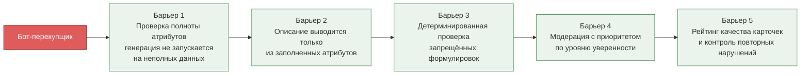

Страница содержит ограничения проекта и нефункциональные требования: к безопасности,
надёжности, производительности, доступности и локализации. Полные формулировки с
идентификаторами — в [техническом задании](lab3/README.md#задание-8-техническое-задание-на-разработку-приложения).

---

## 1. Ограничения проекта

| № | Ограничение | Источник |
|---|-------------|----------|
| ОГР-1 | Генератор описаний не формулирует непроверяемые заявления о качестве («лучший», «100% не сядет»). Каждое утверждение описания должно быть возводимо к заполненному атрибуту товара | Стратегия дизайна; анти-персонаж «Бот-перекупщик» |
| ОГР-2 | Термины, обозначающие технологию генерации (NLP, LLM, «ИИ-описание»), не отображаются в интерфейсе покупателя и продавца | Система именования |
| ОГР-3 | Персональные данные покупателей хранятся на территории Республики Беларусь; внешнему LLM-провайдеру персональные данные не передаются | Законодательство; решение команды |
| ОГР-4 | Приоритет мобильной платформы: макеты разрабатываются сначала для 375×670 px | 82,6% респондентов покупают со смартфона |
| ОГР-5 | Единая терминология: используется термин «размер»; синонимы «ростовка» и «размерная сетка» в интерфейсе покупателя не применяются | Тезаурус |
| ОГР-6 | Доменный слой серверной части не зависит от инфраструктуры и интерфейсов; правило проверяется автоматически при сборке | Диаграмма пакетов |
| ОГР-7 | Межконтекстное взаимодействие сервисов — асинхронное, через шину событий | Event Storming |

---

## 2. Требования к безопасности

| ID | Требование |
|----|------------|
| НФТ-3.1 | Доступ к кабинету продавца и панели администратора предоставляется только после аутентификации с разграничением прав по ролям |
| НФТ-3.2 | Пароли и секреты не хранятся в основной базе данных маркетплейса; аутентификация вынесена в отдельный сервис |
| НФТ-3.3 | Все операции изменения данных фиксируются в журнале аудита с указанием пользователя, времени и объекта |
| НФТ-3.4 | Частота запросов к API ограничивается для предотвращения массового автоматизированного создания карточек |
| НФТ-3.5 | Загружаемые изображения проверяются на тип и размер; выполнение загруженных файлов исключено |
| НФТ-3.6 | Продавец видит только свои товары, заказы и показатели качества |
| ФТ-17.1 | Весь обмен данными между клиентами и сервером выполняется по TLS версии не ниже 1.3 |
| ФТ-13.1 | Персональные данные покупателей хранятся на серверах на территории Республики Беларусь |
| ФТ-13.2 | Внешнему LLM-провайдеру передаются только атрибуты товара |
| ФТ-13.5 | Покупатель может удалить учётную запись; персональные данные обезличиваются, история заказов сохраняется в обезличенном виде |

### Модель угроз: анти-персонаж «Бот-перекупщик»

Недобросовестный продавец, массово загружающий товары с ложными атрибутами, чтобы
замаскировать некачественный товар привлекательным описанием. Против него работают
четыре барьера:

---

## 3. Требования к надёжности

| ID | Требование |
|----|------------|
| НФТ-5.1 | Доступность системы — не менее 99,5% в месяц, исключая плановые работы |
| НФТ-5.2 | Недоступность сервиса рекомендаций или внешнего LLM-провайдера не препятствует просмотру каталога, оформлению заказа и возврата |
| НФТ-5.3 | Замена LLM-провайдера не требует изменений в доменном слое и правилах проверки формулировок |
| НФТ-5.4 | Покрытие автоматическими тестами слайсов автоматизации — не менее 80% |
| НФТ-5.5 | Развёртывание новой версии не требует остановки обслуживания |
| ФТ-13.3 | Резервное копирование основной БД — не реже раза в сутки; восстановление не дольше 4 часов |
| ФТ-15.6 | Вебхук платёжного шлюза обрабатывается повторно при сбое без потери платежа и двойного подтверждения |
| ФТ-5.8 | Повторная отправка запроса с тем же ключом идемпотентности не создаёт второй заказ |

### Деградация при отказах

| Что отказало | Поведение системы |
|--------------|-------------------|
| Сервис рекомендаций | Лента отдаётся из кэша с пометкой времени обновления; при отсутствии кэша — каталог популярных товаров без персонализации |
| LLM-провайдер | Генерация новых описаний приостанавливается; опубликованные карточки, заказы и возвраты работают без ограничений |
| Сервис отзывов | Блок отзывов скрывается; ассистент по размеру работает по размерной сетке бренда либо сообщает о нехватке данных |
| CDN | Отображаются заглушки изображений; текстовая часть карточки функциональна |
| Служба доставки | Заказ создаётся, трек-номер присваивается асинхронно с уведомлением покупателя |
| Нет сети на устройстве | Доступны корзина, избранное и просмотренные товары из локального кэша; заявка на возврат сохраняется черновиком |

---

## 4. Требования к производительности

| ID | Требование | Способ измерения |
|----|------------|------------------|
| НФТ-2.1 | Первые карточки ленты рекомендаций — не дольше 2 с при 4G | Нагрузочный тест, 95-й процентиль |
| НФТ-2.2 | Страница каталога — не дольше 2 с для 95-го процентиля при 200 одновременных пользователях | Нагрузочный тест |
| НФТ-2.3 | Рекомендация размера — не позднее 1 с после отправки формы | Приёмочный тест |
| НФТ-2.4 | Генерация черновиков для партии из 20 позиций — не дольше 60 с | Приёмочный тест |
| НФТ-2.5 | Среднее время модерации одной карточки — не более 2 минут | Отчёт по длительности решений |
| НФТ-2.6 | Не менее 500 одновременных пользователей в вечерний пик 19:00–23:00 | Нагрузочный тест |
| ФТ-15.2 | Таймаут обращения к LLM-провайдеру — не более 20 с, не более двух повторов | Конфигурация и тест |

---

## 5. Требования к удобству использования и доступности

| ID | Требование |
|----|------------|
| НФТ-1.1 | Путь от списка заказов до подтверждённой заявки на возврат — не более трёх экранов |
| НФТ-1.2 | Не менее 80% заявок на возврат оформляются без обращения в поддержку |
| НФТ-1.3 | Соответствие уровню AA стандарта WCAG 2.1: контраст не ниже 4,5:1, тач-зоны не менее 44×44 pt, полная навигация с клавиатуры в веб-версии |
| НФТ-1.4 | Время задачи «найти товар и оформить заказ» новым покупателем — не более 10 минут |
| НФТ-1.5 | Не менее 70% продавцов используют сформированное описание без существенных правок (изменено не более 30% символов) |
| ФТ-14.4 | Поддержка тёмной темы |
| ФТ-14.6 | Каталог, карточка товара и правила возврата отображаются при отключённом JavaScript |

---

## 6. Требования к локализации

| ID | Требование |
|----|------------|
| ФТ-18.1 | Основной язык интерфейса — русский |
| ФТ-18.2 | Все тексты вынесены в файлы локализации; строки не встроены в код |
| ФТ-18.3 | Денежные значения — в белорусских рублях (BYN) с двумя десятичными знаками |
| ФТ-18.4 | Даты — в формате ДД.ММ.ГГГГ, время — 24-часовое, часовой пояс Europe/Minsk |
| ФТ-18.5 | Поиск учитывает морфологию русского языка и запросы латиницей для названий брендов |
| ФТ-18.7 | Размеры отображаются в европейской системе |

---

## 7. Предположения и зависимости

| № | Предположение | Риск при невыполнении |
|---|---------------|------------------------|
| ПЗ-1 | Доступен внешний LLM-провайдер с достаточной квотой | Срыв ключевой функции продукта |
| ПЗ-2 | Продавцы готовы заполнять структурированные атрибуты вместо написания текста | Генерация невозможна; нужен этап обучения продавцов |
| ПЗ-3 | Службы доставки предоставляют API для отправлений, статусов и пунктов выдачи | Ручная обработка; иной способ отсчёта срока возврата |
| ПЗ-4 | Банк-эквайер поддерживает вебхуки о результате платежа | Потребуется периодический опрос статуса |
| ПЗ-5 | Нормы законодательства о защите персональных данных и дистанционной торговле **требуют уточнения у юриста** | Переработка процесса возврата и схемы хранения |
| ПЗ-6 | Перечень товаров, не подлежащих возврату, предоставляется заказчиком и **требует уточнения у юриста** | Неверные отказы покупателям |

---

## 8. Границы MVP

**Не входит в первую версию:** виртуальная примерка по фотографии, чат-консультант на базе
языковой модели, программа лояльности и бонусные баллы, собственная служба доставки,
мобильные кабинеты продавца и модератора, мультивалютность и продажи за пределы Республики
Беларусь, подписка на поступление размера.

Обоснование каждого исключения —
[в техническом задании, раздел 1.3](lab3/README.md#13-границы-проекта).
